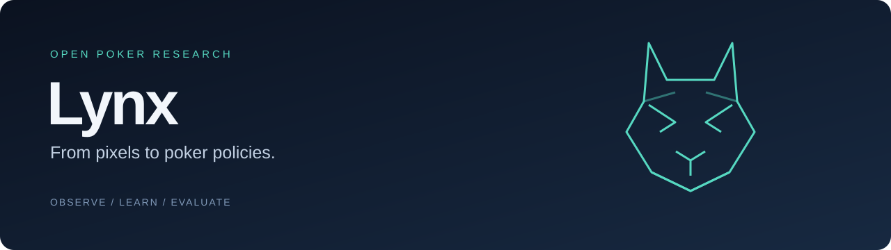
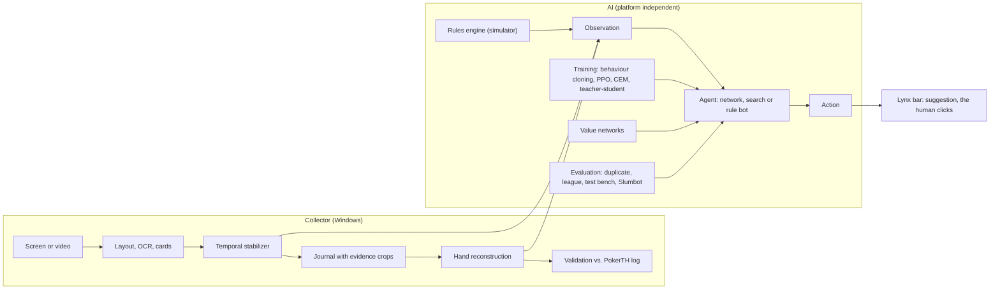

# Lynx

[](https://github.com/jakobfigur/lynx-poker/actions/workflows/ci.yml)
[](collector/pyproject.toml)
[](LICENSE)

[Quick start](#quick-start) · [Architecture](#how-it-works) · [Documentation](docs/README.md) · [Deutsch](README.de.md) · [Contributing](CONTRIBUTING.md)

**A poker AI built from screen pixels up: a collector that reads PokerTH games purely from the screen, and a self-trained No-Limit Hold'em bot that advises live.**

Built in eight days (25 Oct – 1 Nov 2026) on a laptop without a GPU, with about €6 of rented cloud compute. Developed by Jakob Figur with Claude Code. Documentation is in German; this README is in English and German ([deutsche Fassung](README.de.md)).

> **Not for real-money play.** Bots and real-time assistance are prohibited on real-money poker sites and may be illegal. Lynx was developed and tested only against PokerTH (open source, play money) and public research benchmarks. The live advisor only displays suggestions in a normal, visible window; it never clicks or controls the browser, and it does not hide from screen recording or screen sharing.

## Results

These are historical research measurements from the October–November 2026 experiments, documented in the case study. They are not a claim of general poker strength or independent reproduction. CI checks software behavior, not these performance results.

| What | Result |
| --- | --- |
| Collector vs. PokerTH's own hand log | actions 88 % precision / 89 % recall, board cards 55/55, bet amounts 98.7 % (first real recording, after one evening of fixes) |
| Bot generations | five network generations, each adopted only after passing a gate on fresh deals (a gate is never re-run until it passes); ROI on the human-style test set `mensch480` from +43.8 % (rule bot) to +128.2 % (lynx-4, greedy) |
| Heads-up vs. [Slumbot](https://www.slumbot.com/) (200 BB) | lynx-4: +0.2 bb/100 [−29; +30] over 10,000 hands (earlier generations −14 to −35) |
| Heads-up vs. a model of human players | lynx-5t (distilled from search): +77.8 / +73.0 bb/100 at 40 / 100 BB over 4,800 hands; its parent lynx-4: +13.0 / −14.9 |
| River value net | leaf value error 0.121 → 0.0081 pot by changing the training distribution, not the data volume |
| Real PokerTH tournaments | 10 sit-and-gos vs. PokerTH bots with live advice: 3 wins, ROI +32 % (too few to be significant) |

Intervals are 95 % confidence intervals. The full story with every number, date and source is in the [case study](docs/CASE-STUDY.md).

## How it works



- **Collector** (`collector/src/pokercollector/`): window capture with `mss`, table and seat detection with OpenCV, Windows OCR, card recognition from learned templates, a stabilizer that only reports values seen over several frames, an append-only journal with an evidence crop per event, hand reconstruction that reports gaps instead of guessing, and a field-by-field comparison with PokerTH's exported log.
- **AI** (`collector/src/pokercollector/ai/`): an NLHE engine for 2–10 players, rule bots, duplicate evaluation with confidence intervals, sit-and-go tournaments with ICM, a rating league, fixed test sets, PPO self-play with a KL leash to a behaviour-cloned Pluribus prior, heads-up CFR+ re-solving with neural value nets as leaves, a policy model of human players learned from 7.35 million showdown decisions, and the live advisor.
- **One interface:** every bot maps an `Observation` to an `Action`, so the same bot runs in the simulator, on recorded hands and live.

## Quick start

Requirements: [uv](https://docs.astral.sh/uv/) (installs Python 3.12 and all packages). The AI part runs on Windows, Linux and macOS; the collector and live advisor need Windows 10/11 with an installed OCR language.

```bash
uv sync --project collector --frozen --python 3.12            # create the locked environment (once)
uv run --project collector --no-sync pytest -q collector/tests # run the test suite

# Lynx (lynx-4, greedy) against the rule bot "tag", duplicate heads-up, 100 deals
uv run --project collector pokercollector sim match --agents "nn?run=lynx-4@300&greedy=1:lynx,tag" --hands 100

# show the league with all bots and their specifications
uv run --project collector pokercollector league show

# measure a bot on a fixed test set (paired comparisons via "bench compare")
uv run --project collector pokercollector bench run lynx-4-300 --sets hu48

# play a tournament against Lynx in the terminal
uv run --project collector pokercollector play --mode tournament --opponents lynx-4-300,tag,rock
```

On Windows the wrappers `sync.cmd`, `tests.cmd` and `pc.cmd <command>` do the same; on Linux/macOS use `./pc.sh <command>`. Collector, Windows only: `pc.cmd calibrate collector\testdata\pokerth_preflop_hand1.png` analyses the test screenshot and writes an overlay image. All commands: [CLI reference](docs/CLI-REFERENZ.md).

## Repository layout

```text
collector/        Python package "pokercollector": collector modules, CLI, ai/ subpackage, tests, test image
cloud/            scripts for rented servers (training data, teacher data) and Kaggle kernels (value-net training)
scripts/          gen_reference.py and experimente/: the original scripts the training and measurement runs used
data/             small starter pack: league file and trained checkpoints (about 2.5 MB)
docs/             technical documentation, case study, API and CLI reference, data and licences, project notes
```

## Documentation (German)

| Document | Content |
| --- | --- |
| [CASE-STUDY.md](docs/CASE-STUDY.md) | what was built, how and why, stage by stage, with all results and lessons |
| [TECHNISCHE-DOKUMENTATION.md](docs/TECHNISCHE-DOKUMENTATION.md) | architecture, every module, data formats, operations, reproduction |
| [API-REFERENZ.md](docs/API-REFERENZ.md) · [CLI-REFERENZ.md](docs/CLI-REFERENZ.md) | generated from the code |
| [DATEN-UND-LIZENZEN.md](docs/DATEN-UND-LIZENZEN.md) | what data and models are included, what is not, third-party sources |
| [projektnotizen/](docs/projektnotizen/) | the original working notes, plans and night logs |

## Data and models

Included: the league file and ten small checkpoints (lynx-4, lynx-5t, the human model and seven earlier generations), the human-style bots and the fold model. Not included: screen recordings, card templates (harvest your own with `harvest-cards`), value-net training data (8 GB), the value nets themselves (77 MB each) and third-party hand histories, which come from the [PHH dataset](https://github.com/uoftcprg/phh-dataset). Details: [DATEN-UND-LIZENZEN.md](docs/DATEN-UND-LIZENZEN.md).

## Limitations

- Most measurements are against bots and against a model of 2009 online players; there are no results against real humans yet.
- The second external benchmark (GTO Wizard) was requested but not yet available.
- The collector is calibrated to the PokerTH web client; other clients need their own layout profile and card templates.
- Code comments, CLI output and documentation are in German.

## Licence and acknowledgements

MIT, see [LICENSE](LICENSE). Third-party data keeps its own terms.

Contributions are welcome: see [CONTRIBUTING.md](CONTRIBUTING.md). For vulnerabilities, follow the [security policy](SECURITY.md).

Thanks to the PokerTH project; to the [PHH dataset](https://github.com/uoftcprg/phh-dataset) (MIT) for the Pluribus hands (Brown & Sandholm, *Science* 2019) and the HandHQ histories; to Slumbot for its public API. Ideas come from DeepStack, Libratus, Pluribus, ReBeL and DecisionHoldem. Built with [Claude Code](https://claude.com/claude-code).
