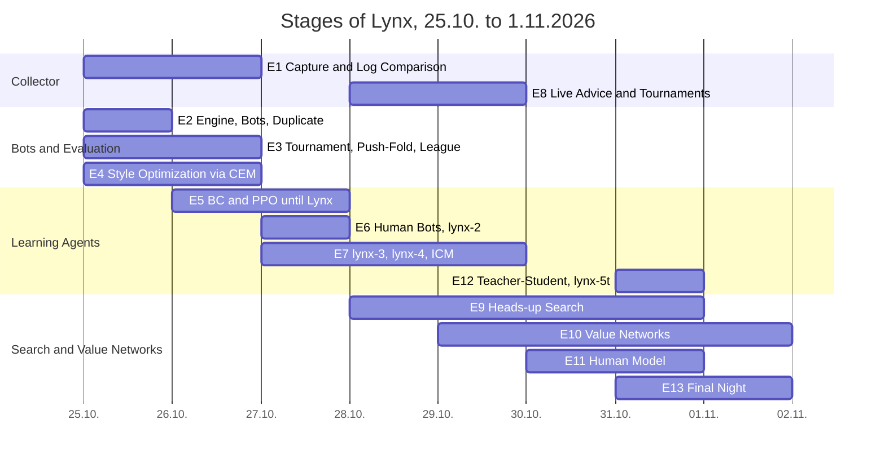

# Case Study: Lynx – from Screen Collector to Poker Bot in Eight Days

Status 3.11.2026 · Jakob Figur

In eight days (25.10.–1.11.2026), a poker system was created on a laptop without a graphics card that reads PokerTH games purely from the screen image and advises with a self-trained bot. The best bot plays heads-up against the external benchmark Slumbot on equal footing; against a human clone, trained on 7.35 million showdown decisions, its teacher-student derivative wins +73 to +78 bb/100. The cloud bill was around 6 euros.

## At a Glance

| Question | Answer |
| --- | --- |
| Goal | To capture PokerTH (Open Source, play money) exclusively visually; from this, build a bot that plays especially well against humans |
| Framework | one developer, laptop with Intel i5 and 16 GB RAM without GPU, USB stick as project carrier, cloud used only by the hour |
| Time and Costs | 25.10.–1.11.2026; about €6 of Hetzner compute time, network training on Kaggle free |
| Collector | actions 88% precision and 89% recall against the PokerTH log, board cards 55 of 55, amounts 98.7% (after one evening of corrections; previously 18% and 5%) |
| Bot Generations | five network generations with passed gates or predetermined confirmation (pros-2, pros-h1 “Lynx”, lynx-2, lynx-3, lynx-4); human test bench `mensch480` from +43.8% ROI (rule bot rock) to +128.2% (lynx-4 greedy) |
| External Benchmark | Slumbot, heads-up 200 BB: lynx-4 +0.2 [−29; +30] bb/100 over 10,000 hands; predecessors were at −14 to −35 |
| Against the Human Clone | lynx-5t greedy +77.8 and +73.0 bb/100 at 40 and 100 BB (4,800 hands per cell); starting network lynx-4 +13.0 and −14.9 |
| Real Tournaments | 10 Sit & Gos against PokerTH bots with live advice: 3 wins, ROI +32% (statistically not significant) |
| Key Lessons | Never repeat a gate until passing; play greedy instead of sampled (+98 bb/100); data distribution beats data quantity; search depends critically on opponent ranges |

## Timeline

**Reading guide.** Each number includes date and source. “Chronicle” is the internal development log; most findings are additionally found in the project log [`research-notes/DEVELOPMENT_LOG.md`](research-notes/DEVELOPMENT_LOG.md) (“Doc x.y”). Files under `data/` were in the private project folder and are, except for a small starter pack, not in the repository (see [`DATA_AND_LICENSES.md`](DATA_AND_LICENSES.md)). What is not documented is marked as **uncertain**. Technical details are in [`TECHNICAL_DOCUMENTATION.md`](TECHNICAL_DOCUMENTATION.md).

---

## 1. Starting Point and Goal

**Initial goal (25.10.2026, `PROJECT_HANDOVER.md`):** A Windows application should capture PokerTH Web Client games **exclusively visually** – recording the screen, reading cards, amounts and actions using OCR, reconstructing hands from this and checking the result **independently against the PokerTH export**. The export is only a reference, never input. No browser remote control, no DOM, network or memory access, no automatic clicks. The handover document was reportedly created on a Mac and refers to an older file “Poker_Collector_Projektuebergabe.md”, which was no longer available – so an earlier preliminary step existed, its date is **uncertain**. The memory file’s chronicle cites the developer’s core concern: “Capture exclusively visually – that is the experiment itself.”

The plan foresaw AI as a late step (Phase G: “Baselines and Simulator first”), with action suggestions including justification and uncertainty but without autoplay.

**Shift of focus (26.10.):** After one day of building the collector and initial simulator stages, the developer redefined the AI goal: “maximally good bot, better than human in every situation,” quality over quantity in data; evening goal “better than Pluribus” (Chronicle 26.10.).

**Goal clarification (29.10., 17:15, Chronicle):** Lynx is to “become really good overall, especially against HUMANS, not against platform bots”. PokerTH bots are a training ground and measure, not a goal. Consequence: reconstruction of PokerTH bots (lever H8) and bot-specific exploitation were dropped; priorities became search as teacher, opponent models derived from human hand histories, external benchmarks (Slumbot, GTO Wizard), and real games against humans.

**Goal board (`GOALS.md`, 28.10.):** five benchmarks with stages – (1) real PokerTH tournaments (50 with ROI > 0, then 200 with ROI > +20%), (2) `mensch480` ≥ +100% → +120%, (3) Slumbot > −15 → > 0 → lower 95% bound > 0 with ≥ 20,000 hands, (4) exploiter ≤ +5%, (5) endgame HU 20 BB (`nash240` ≥ 0, `kurz240` > +20%). Consciously no goal: matching humans, training on Slumbot.

## 2. Framework Conditions

| Item | Verified Status |
|---|---|
| Team | one developer (Jakob); the developer plays himself, grants approvals (Slumbot API, GTO Wizard, Hetzner batches), logs tournament seats (`DEVELOPMENT_LOG.md` 1.1, Chronicle) |
| Computer | Laptop Intel i5-1335U (2 P + 8 E cores, 12 threads), 16 GB RAM, **no GPU**, Windows 11 Pro (`DEVELOPMENT_LOG.md` 2.1) |
| Project Carrier | USB stick Intenso cMobile Line “POKER”, exFAT, drive D:, portable Python 3.12 + uv with offline cache, nothing installed (`GETTING_STARTED.md`, Doc 2.2) |
| Code Volume (2.11. counted) | ~16,800 lines Python in `src` (Collector 6,247, AI 10,548), 44 files in AI package, 42 test files with 3,423 lines; test suite 36 (25.10.) → 93 (25.10. evening) → 171 (28.10.) → 198 (29.10.) → 224 green (30.10.) → 244 green (31.10. evening) → 249 green (3.11.; in published tree 247 passed, 2 skipped) |
| Data | 17 recorded PokerTH sessions (26.10.–29.10., `data/sessions`, 41 MB to 601 MB per session); HandHQ 25NL 2009 (5.0 GB, 5,989 files, 5.72 million hands); Pluribus-PHH 10,000 hands |
| External Services | Slumbot API (approved 27.10.), GTO Wizard benchmark (approved 29.10., requested access, not granted by 31.10.), Hetzner Cloud (token 29.10.), Kaggle (free T4 GPU) |
| Budget | “Maximum at minimal budget” (decision 29.10. 02:00): AX102 dedicated server (~€116/month) discarded; instead laptop at night, Hetzner cpx62 by the hour (€0.2479/h), Kaggle €0. Total spending until 1.11. **≈ €6** (section 4f) |
| Period | 25.10.2026 (project on stick, 18:01 file time) to 1.11.2026 06:25 (last chronicle entry), thus **eight days**, four of them with autonomous night runs |

Operational side conditions shaped the work: The USB stick crashed three times due to USB controller errors (10/27 07:10, 10/28 04:15, 10/28 afternoon), the the operator code memory watchdog terminated background shells due to RAM shortage, and an automatic lock screen triggered Modern Standby after 10 minutes, freezing processes (10/29 17:40). All three issues cost computing hours and were gradually circumvented using `powercfg`, keep-alive scripts, and detached processes (`Start-Process`) (Documentation 2.5, Chronicle 10/28–30).

## 3. Stages

### E1 – Collector: Capture, OCR, Reconstruction, Comparison (10/25–26, refinements until 10/29)

**Goal:** Capture PokerTH purely visually and compare against the log.

**Built (10/25, `GETTING_STARTED.md`):** Layout/table detection with profile `pokerth_web_v1.json` (10 seats, board, pot, action bar, D/SB/BB), Windows OCR with cache, parser for amounts and action words including OCR reader, card recognition with trainable templates, temporal stabilization, immutable journal (JSONL + receipt images + SQLite + SHA-256 manifest), hand reconstruction as state machine with gaps and contradictions, live source (mss, foreground only), PokerTH log import and field-wise comparison (precision/recall). Tested initially on **one** preflop screenshot, 36 tests.

**Result (first real recording 10/26, 6-player table, 12 hands in log, Documentation 3.4):**

| Field | first evaluation | after corrections same evening |
|---|---|---|
| Dealer | 11 % | 92 % |
| SB/BB seat | 0 % / 11 % | 100 % / 100 % |
| Board cards | P 60 %, R 5.5 % | 100 % / 100 % (55/55) |
| Actions | P 18 %, R 5 % | **P 88 %, R 89 %** |
| Action amounts | – | 98.7 % |
| Starting stacks | 0 % | 90 % |

The corrections included seat memory, shape comparison for card ranks, and reconstruction timing. Side note: PokerTH Web plays 1000 chips at 10/20 (50 BB) with a blind raise every 9 hands – this gave rise to the test format `pokerth`.

**Live hardening (10/28–29, Documentation 8.6):** On the first live evening, errors occurred in the pipeline, not the recognition: suggestions 10–20 s delayed (analysis queue always full, ~270 ms/image), phantom suggestions after hand end, hand number OCR lagged 10–20 s (history of previous hand ended up in observation), “$1000” read as “51000”. After fixes: suggestion 0.7–1.8 s after recognition; comparison against the log of game 1: actions 78/80 % → **88/88 %**, dealer/SB/BB 74 % → **100 %**, amounts 94 → 97 %. Game 7 (10/29) was again below at 79/85 % actions – unclear if session or night changes (Documentation 8.6).

**Most severe live bug (10/29 evening, Chronicle):** On the end screen, the winner’s stack “$13408” was read as a bet from seat 5 and remained in state; throughout the following tournament, pot 13438 instead of 30 appeared in every decision (T9s preflop all-in 97 %). Fix `drop_stale_bets` + `fix_dollar_misreads`; replay: 19 of 155 suggestions changed.

**Lesson:** Visual capture after one evening of corrections is good enough for live advising (board 100 %, amounts ~98 %), but the semantics of the image (pot without ongoing bets, static labels, end screens) is the real source of errors. Untested remain diamonds/clubs systematically, side pots, table sizes other than 4/6, occlusion-proof recording (Documentation 3.5).

### E2 – Engine, Bot Pool, Evaluation (10/25)

**Built:** NLHE rule engine for 2–10 players (`engine.py`), eight style bots (random, caller, equity, station, rock, tag, lag, maniac), duplicate evaluation with bb/100 and 95-% CI, VPIP/PFR/AF/WTSD (`evaluate.py`), bridge Collector→Observation (`replay.py`). 93 tests green on evening of 10/25.

**Result (Documentation 7):** Cash game: tag +140 bb/100, station −185. An engine bug (short all-in BB forced SB to call) was found by the league.

**Decision:** An interface Observation→Action for simulator, replay, and live; training only in simulator, real data only for opponent models and validation, never single-hand results as labels (core principle, Chronicle 10/25).

### E3 – Tournament, Push/Fold, League (10/25–26)

**Built:** Tournament mode 50/30/20 (`tournament.py`), Nash push/fold (169×169 equity matrix, heads-up exact), play mode human vs. bots (`pc.cmd play`), league with Weng-Lin/Plackett-Luce rating on Elo scale, benchmark against fixed opponents, push/fold EV loss.

**Result (`data/league/report.md`, status 10/26, 90 league games):** rock 2614 > opt-1 2479 ≈ tag 2484 > opt-2 2187 > lag 1611 > equity 1338 > maniac 930 > station 748 > random −150. Finding: In tournament, rock wins over tag; in cash, tag wins (survival pays off with three paid places); tag switches to push/fold only at 12 BB. The league was not updated after 10/26 (`players.json` lists 18 entries, all network bots with 0 league games – they were only registered through gate). Documentation 8.4 explicitly calls the league report outdated.

### E4 – Style parameter optimization via CEM (10/25–26)

**Built:** CEM over ten style sliders (`optimize.py`), gate test (`train gate`), league as training opponent (weight exp((mu−max)/15), 20 % self-play).

**Results:**
- opt-1 (10/25): Gate vs tag **+8.9 % ROI [1.1; 16.7]** passed on 120 schemata, benchmark SNG +46 % (best), but league rating below tag → non-transitivity/overfitting (Chronicle 10/25, `players.json`).
- League run 1 (10/26): Gate +5.2 [−3.1; 13.4] on 120 schemata, confirmation on 300 schemata **−5.3 [−10.1; −0.5]** → failed.
- opt-2 (10/26): Gate +8.5 [1.0; 16.0], confirmation 300 schemata +1.9 [−2.2; 6.1] → removed from league.

**Decision and lesson:** All gates shared seed 777 – the test set “wore out”. Since then gate seed = 100000 + training seed. Own method rule (10/26, documented in README): **Do not repeat Gate until passing; at most one predetermined larger confirmation.** 16 schemata per generation mean ±15 % ROI noise. Conclusion: style tuning exhausted (rock/tag/opt-1 within a few percent).

### E5 – Learning agent: BC from Pluribus, PPO with leash (10/26–27)

**Built:** 46 features/6 actions (`features.py`), MLP agent (`nn_agent.py`), BC + PPO with KL leash (“piKL”, `rl.py`), PHH import (all 10,000 Pluribus hands replay identically), testbench `bench` (fixed sets, Δ rock paired), numba acceleration ~85×, MCCFR, Deep CFR, exploiter test (`train exploit`), random style bots and exploiter in training (PSRO-like), ranges (`ranges.py`), feature versions feat-2/feat-3 with `widen_net`, action version act-2 (8 actions), self-play seats, table weights.

**Series of results (Chronicle 10/26–27, `data/bench/report.md`):**

| Run | Key figure | Finding |
|---|---|---|
| nn-1 (PPO no leash) | Pool ROI +84 %, Gate vs rock −8.5 %, Pluribus match 63 → 13 % | learns league exploitation, no poker |
| pros-1 (BC Pluribus + leash, 96 tournaments/it) | mix96 Δrock −20 → +8 at it 200, plateau ~+11 | Leash works, batches too small |
| **pros-2** (512 tournaments/it, 300 it, ~30 min) | **Gate vs rock +19.8 % [8.8; 30.7]**, mix96 Δrock +22.8, exploiter +3.8 % | **large batches were the key** |
| cfr-1 (table MCCFR) | exploiter +69 % | too coarse |
| dcfr-1 (Deep CFR) | it 30 −16 %, @60 −58 Δrock | abandoned 10/27 |
| pros-r1@300 (feat-2, ranges) | mix96 +23.0, fest48 +25.0, Pluribus 82 % | best bot on `praezise` 10/27 |
| pros-r2/r3 (multi-format, night run 10/26–27) | Gate pros-r3@200 +13.3 [3.0; 23.6]; format testbench all in noise (CI ±15–20) | “Gate winner ≠ best bot” |
| pros-o1 (opponent model feat-3) | paired −3.9/−4.4 vs pros-r1@300 | too early, aborted |
| **pros-h1@600** (feat-3 + act-2, 40 % self-play seats, many HU/3-player tables, leash starts at 4+ players) | precise vs pros-r1@300: hu480 +8.3*, 10max +8.3, mix960 +2.9; Gate 120 schemata +3.0 failed, **one-time confirmation 600 schemata +6.0 [1.4; 10.6]** | new best 10/27 15:20; name **Lynx** (10/27 18:00) |

Slumbot Leak Analysis (October 27, 10,955 hands pros-r1): Button folds 40% immediately (strong range: 10–20%), BB folds 51% against open → approx. −31 bb/100. After act-2 and HU-heavy training (pros-h1): Button fold 40 → 13%, BB fold 47 → 35%.

**Lesson:** Success came from the combination of self-play seats + exploiter + many HU/3-player tables + leash from 4 players + act-2, not from a single ingredient. The large testbench `praezise` (mix960 + pokerth480 + hu480 + 10max240, ±3 instead of ±12) was necessary to even detect differences.

### E6 – Human Bots from HandHQ (October 27)

**Built:** HandHQ evaluation (`humans.py`): PS+PTY 25NL July 2009, 5.72 million hands, 121,391 players, six types (Nit 27%, Average 25/17/9%, Passive 14%, TAG 9%). Finding: the previous style bots were calling stations (fold to bet 6–17% vs human 50–70%) → new parameter `respect`. Human bots adapted by CEM to the types (`humanbots.py`, v1/v2, style `sticky`), testbench set **mensch480** (PokerTH format, opponents by type proportion). Data traps documented: PS winnings missing in uncontested pots, PTY winnings contain recirculation, “????” on all-in.

**Result (Chronicle Oct 27, 20:45):** **lynx-2@500** = Lynx still with 40% human bots: paired vs Lynx mensch480 **+17.7***, mix960 +8.1*, hu480 +8.5*, pokerth +3.2, 10max +8.5; exploiter +1%. Both preset confirmations passed: 600 fresh human tables **+12.1 [7.0; 17.3]**, league gate 600 fresh tournaments **+7.4 [2.6; 12.3]** (`data/rl/lynx-2-bestaetigung.txt`).

**Lesson:** “Human bots as training opponents = biggest jump so far.” Opponent distribution beats training duration.

### E7 – lynx-3 and lynx-4: Night runs, ICM, plateaus, gate discipline (Oct 27–29)

**lynx-3 (Night Oct 27/28, `OVERNIGHT_LOG.md`):** Sections up to 1500 iterations, gate every 600 schemas. Only @300 passed (+4.5 [0.3; 8.6] vs lynx-2); @600 −3.7, @900 +0.1, @1200 −2.5, @1500 +2.8 vs lynx-3-300 – all failed: **Plateau after first section.** Later states were higher on mensch480 (@1100 +108.5% vs @300 +96.8%) but were not adopted following method rule. Confirmations for lynx-3@300: human tables **+9.2 [4.8; 13.6]**, league gate seed 2810 **+6.7 [2.3; 11.0]** → Live standard Oct 28, 10:07. The stick failed at 04:15; training finished at 03:58.

**lynx-4 (Night Oct 28/29, autonomous):** ICM reward built (`icm.py`, Malmuth-Harville, mix (1−icm)·Chips + icm·ΔICM), run with `--icm 1.0`, exploiter every 50 iterations, table weights 2:3/3:3/4:2/5:2/6:4. **Gate @300 passed: +10.0 [5.4; 14.6]** vs lynx-3-300 (600 schemas). Paired vs lynx-3@300 (Doc 8.6): mensch480 **+18.3 [13.1; 23.5]**, mix960 +8.7, pokerth480 +12.3, 10max240 +13.5, hu480 −3.1 [−8.2; +2.0]. Gates @600/900/1200 vs lynx-4-300: +3.1, +3.4, +4.3 [−0.0; +8.6] – failed, same plateau pattern. Live standard from Oct 29, 10:50.

**Gate discipline proven (Oct 29, 12:53):** lynx-4@100 looked better on fixed testbench schemas than @300 (mix960 +18.3 instead of +8.7 vs lynx-3). Fresh gate @100 vs @300 (600 schemas, seed 2910): **+1.6 [−3.0; +6.1]** – no difference. Lesson: “Testbench leads at single checkpoints on fixed schemas often noise; always recheck freshly paired.”

Absolute testbench values lynx-4@300 (Oct 29, same schemas as lynx-3@300): mensch480 115.1 / mix960 59.3 / pokerth480 47.5 / hu480 46.5 / 10max240 87.0 / Pluribus-top1 0.814.

### E8 – Live operation: Bar, real tournaments, live bugs (Oct 28–29)

**Built (Oct 28):** Lynx bar (`overlay.py`): Tk window over taskbar, topmost, NOACTIVATE, `WDA_EXCLUDEFROMCAPTURE` (verified via mss comparison: 0% vs 94% visible), sound per action; automatic tournament detection `TournamentWatch` with entry in `data/ziele/pokerth.jsonl`.

**Changed for release (Nov 3):** The bar no longer hides from screen recordings so it remains visible in recordings and screen shares. Instead, the collector crops its area from its own images and fills it with background color. Practical test: In normal screen recording 93% of bar area shows action color, in collector’s masked image 0%.

**Result (`data/ziele/pokerth.jsonl`, Oct 28–29, all 6-max tables against PokerTH bots, difficulty “normal”, Jakob clicks, Lynx advises greedily):**

| Game | Date | Bot | Place | Hands | Detection |
|---|---|---|---|---|---|
| 1 | Oct 28 23:36 | lynx-3-300 | **1** | 35 | manual (auto missed final hand all-in) |
| 2 | Oct 29 00:09 | lynx-3-300 | 3 | 20 | re-simulated, no log |
| 3 | Oct 29 00:21 | lynx-3-300 | 6 | 10 | auto 5, corrected to 6 |
| 4 | Oct 29 01:02 | lynx-3-300 | 6 | ~7 | KK on A-Q-4-4; Jakob’s seat |
| 5 | Oct 29 00:56 | lynx-3-300 | **1** | 25 | auto 2 (end screen before pot credit), corrected |
| 6 | Oct 29 01:38 | lynx-3-300 | **1** | 31 | HU vs “Falcon Fay” |
| 7 | Oct 29 10:34 | lynx-4-300 | 2 | 29 | auto correct |
| 8 | Oct 29 10:47 | lynx-4-300 | 4 | 24 | auto correct |
| 9 | Oct 29 16:47 | lynx-4-300 | 5 | 18 | auto correct |
| 10 | Oct 29 17:02 | lynx-4-300 | 3 | 27 | auto correct |

Leaderboard Oct 29 17:15: **10 tournaments, ROI +32%** (payout 50/30/20: 3 wins, 1 second, 2 third). Separately: lynx-3-300 games 1–6 → 3 wins, ROI +70%; lynx-4-300 games 7–10 → places 2, 4, 5, 3, ROI −25% (own calculation from places). Two more tournaments on evening Oct 29 (session 20261029-202109) lost both – with pot-13438 bug in tournament 2 – and were not logged for lack of space. Statistically 10 tournaments are worthless (doc: 95% interval with 6 tournaments about −60 to +200%). Four of six games first night ran with live errors (doc 8.6, plan 1.2).

**Lesson (Plan 1.2):** “The live chain was the actual opponent, not the bots.” After fixes, re-simulation detected all six places correctly, from game 7 auto entry was made.

### E9 – Heads-up search (Oct 28–30)

**Built (Oct 28):** `husearch.py` – Blueprint net up to flop, from turn heads-up CFR+ (numba, nogil) over all 1326 combos of both players, turn tree with all 44 rivers, exploitability via best response (turn 120 iterations ~1.5% pot, river 300 iterations <1%). Plus HU Preflop solver `hupreflop.py` (CFR+ over 169 classes, 800 iterations). Oct 29: Flop in search tree (hus-2 tree, drawn turn/river cards), kernel layerwise parallel (2.5–3.3× faster).

**Results series (all numbers: `DEVELOPMENT_LOG.md` 6.8, `data/bench/diag-nacht.txt`, `hus1bp.txt`, `hus1v.txt`, `hus2v.txt`):**

| Date | Variant | Measure | Result |
|---|---|---|---|
| Oct 28 | hus-2 (resolving from current node, heuristic range) | Slumbot | **−440 bb/100**, aborted after 458 hands (massively lost all-ins) |
| Oct 28 | hus-3 (solving from street start + preflop solver) | Slumbot cleaned, 8,167 hands | −23.7 [−52; +5]; apparent plus was card luck +29 |
| Oct 29 22:15 | hus-1 (turn+river, play-out) | hu480 paired vs net +46.5 | search +17.1 → **−29.4 [−36.8; −21.9]** |
| Oct 29 Night A | only preflop solver, postflop net | hu480 | +21.2 → **−25.2** → **Leak resides preflop** (200-BB cash equilibrium in 50-BB tournament) |
| Oct 29 Night B | turn+river without preflop solver (hus1np) | hu480 | +37.9 → −8.5 [−14.7; −2.3] |
| Oct 30 Night C | hus-1 vs net, HU 200 BB cash, 2,000 hands | bb/100 | −0.6 [−62; +61] – tied, measurement too coarse (SD ~200 per 50-hand problem) |
| Oct 30 D | + blueprint ranges preflop (`bpranges.py`, ranges=pre) | hu480 | +41.2 → −5.2 [−11.6; +1.1] |
| Oct 30 E | + blueprint ranges preflop+flop | hu480 | +44.0 → **−2.5 [−8.7; +3.7]** (on par); vs heuristic search +6.0 [1.8; 10.3] significant |
| Oct 30 | hus-4 = E configuration | Slumbot cleaned, 3,000 hands | **−39.0 [−95; +17]**; river contribution −99 bb/100 (net −65) – “Opponent plays like our net” does not apply to Slumbot |
| Oct 30 | equilibrium ranges `eq` from hupreflop + preflop solver + net hands (hus-5) | Slumbot cleaned, 3,000 hands | **+0.0 [−50; +50]** |
| Oct 31 05:55 | hus-5 continuation | Slumbot cleaned, 10,000 hands | **−8.0 [−35; +19]** (net +0.2) |
| Oct 30 F | flop search k 6/6, 40 iterations, net hands | hu480 | +37.3; vs turn search V **−5.8 [−11.4; −0.3]** → flop remains blueprint |

Series Search vs Network on hu480: **−29.4 → −8.5 → −5.2 → −2.5**. Series Search vs Slumbot: hus-1 −12.6 (raw) / hus-3 −23.7 / hus-4 −39.0 / hus-5 +0.0 @3k, −8.0 @10k.

**Decisions:** hus-Standard `streets=turn,river` + `ranges=pre,flop` (Oct 30); Spec `auto=1` selects tournament or cash configuration per hand (Oct 31, 00:30). The search was **never live standard**, because it never significantly outperformed the network when paired.

**Lesson:** The search stands or falls with the opponent's range. Against pool bots, the exploitatively trained network wins; an equilibrium player can at best draw level; against Slumbot, only equilibrium ranges bring the search to network level. Interim results under ~5,000 Slumbot hands are worthless (intervals ±60 to ±130).

### E10 – Value networks: River, River-Leaf, Turn (Oct 29–Nov 1)

**Plan (`VALUE_NETWORK_MILESTONE.md`, Oct 29):** DeepStack order – river network first, then as a node in the turn tree, then turn data with river network, then flop. Data on Hetzner (hourly), training on Kaggle T4 (free), acceptance criteria: hold-out MAE < 0.015 pot, oracle deviation < 0.05 pot, turn live < 0.5 s.

**Built:** `valuedata.py` (situations, synthetic ranges, exact CFR+ solution, .npz shards, modes `river`, `river-leaf`, `turn-leaf`), `valuenet.py` (standalone numpy+torch, 2712 → 1024×3 or 2048×3 → 2652, Huber + zero-sum penalty), LEAF nodes in `husearch` with reevaluation every 10 iterations, `cloud/hetzner.py` (API without hcloud, create/push/pull/delete), Kaggle kernels.

**Result series (chronicle Oct 30–Nov 1; errors in pot units):**

| Step | Data | Network | Hold-out MAE | Oracle-500 EV error | **River-Leaf Oracle EV error** |
|---|---|---|---|---|---|
| t1 (Oct 30 13:16) | 500k broad (Tranche 1) | 1024×3, 30 epochs, 390 s | 0.0264 | 0.0053 | **0.121** (unusable on leaves) |
| t1-curve | 200k | 1024×3 | 0.0380 | – | – (error ~ n^−0.4) |
| t1-big | 500k | 2048×3, 60 epochs | 0.0189 | 0.0038 | 0.132 (capacity doesn’t help) |
| t2-big (Oct 30 18:05) | 500k broad + 252k Leaf (Tranche 2) | 2048×3 | 0.0199 | 0.0035 | **0.035** |
| **t3-big = vnet-river-1** (Oct 31 00:12) | 500k broad + 504k Leaf (Tranche 3) | 2048×3, 47 min | 0.0192 | 0.0035 | **0.0081** (95% 0.022, max 0.042) → **target < 0.02 achieved** |
| vnet-2 (Oct 31 18:45) | + 3 Turn-Leaf shards (66k, double) | 2048×3, 62 min | 0.0209 | River-Leaf 0.0338 | **Turn-Leaf 0.0544** (vnet-river-1 on turn: 0.090) |
| vnet-2b (Nov 1 06:25) | 300k River + 19 River-Leaf + 9 Turn-Leaf (977k lines; 1.37 million caused OOM) | 2048×3, 2812 s | 0.0260 (different mix) | River-Leaf 0.0336 | **Turn-Leaf 0.0510** → plateau ~0.05 |

**Decisive insight (Oct 30 13:40):** Training ranges of tranche 1 were all broad (≥ 9 bits entropy); real search leaves have thin ranges, board-correlated, SPR median 0.44 instead of 1.4 → out-of-distribution. Consequently, `river-leaf` mode was built (solve turn tree, extract ranges at river roots under average strategy). Two leaf tranches reduced leaf error by factor 15 (0.121 → 0.0081); more capacity on broad data didn’t help.

**Playtest V (Oct 30 18:52):** Search with network leaves vs search with exact river subtrees: **−0.8 [−3.9; +2.3]** (hu480, paired), turn decision 1.1 instead of 4.8 s (4.4× faster). The river network thus costs no measurable strength.

**Turn level (Oct 31–Nov 1):** `turn-leaf` tranche on teacher-1: 2.6 s per flop seed, 84–87 min per shard, 10 shards = 220,688 lines (~14.5 h instead of estimated 4–5 h). Flop search `leaf=4` with turn network halved deviation to reference (strategy distance 0.471 → 0.233 on all turns, 0.369 at k_turn=8 in 2.3 s; chronicle Oct 31 18:55). Three times more turn data (vnet-2b) only brought −6% turn error.

**Lesson:** Data distribution beats data quantity and capacity. For turn, the plateau at ~0.05 pot is probably no longer breakable with more data of the same kind (Chronicle Nov 1: “Capacity/features instead of data, or turn data from real search”).

### E11 – Human model from HandHQ showdowns (Oct 30–31)

**Built:** `humandata.py` (replay hands with engine, only shown players produce lines), `humanfold.py` (fold model), Kaggle kernel `lynx-train-human`.

**Numbers:**
- Extraction with cards (Oct 30, 2 h 21 min, 2 processes): 5.97 million hands, 1.47 million with revealed cards, 1.21 million replayed, **7.35 million decisions**, 120 shards, 245 MB. Skipped: 239k straddle hands, 15.7k order, 1k stacks/blinds. **0 folds in data** (folders don’t show).
- **human-1** (Oct 31 00:10, Kaggle T4, 49 s, 512 hidden, 8 epochs): Hold-out NLL **0.720** (frequency baseline 0.95–1.06), accuracy preflop 77.9%, flop 73.7%, turn 74.7%, river 73.0%. For comparison lynx-4@300 on same human decisions: NLL 2.255, 35.6% accuracy, preflop 9.3% → “Lynx plays completely differently than humans.”
- Card-free extraction of all decisions (Oct 31 06:30, 1596 s, 4 processes): 5.64 million hands, **55.5 million decisions with folds**. Fold before bet preflop 72.6%, flop 57%, turn 46%, river 53%.
- **human-fold-1** (Oct 31 06:53, 37 s CPU, 18.9 million lines): Fold model BCE 0.417 (fold-rate 51.6%), class model NLL 4.62 (uniform 5.13). Plausibility: BB vs UTG raise 3 BB P(fold)=0.754; continuing AA 0.98, 72o 0.02.
- Human bot with folds `nn?run=human-1@1&fold=human-fold-1` = “best testbed for ‘against humans’” (chronicle Oct 31 06:30).

**Measurements against the human bot (HU Cash duplicate, 10,000 hands each, `temp-hu.txt`/chronicle Oct 31):** lynx-4@300 sampled: 40 BB **+13.5 [−5; +32]**, 100 BB **−21.1 [−43; +0.4]** – blueprint network does not beat 25NL normal player recreation heads-up. Search with `opp=human-1` without fold model on mensch480: **−20.0 [−25.5; −14.5]** vs network (measurement H) – opponent ranges too broad, mensch480 consists of own style bots. Measurement 1 vs human-1 without folds: unusable (blocks ±200 bb/100). Measurement 2 with folds (720 hands each): no significant difference (`humanopp2.txt`). Server benchmark (7,680 hands per cell, `humanopp_srv.txt`): 40 BB C-human+fold +30.4 [13.3; 47.5] vs network +2.9; 100 BB B +33.6 [5.8; 61.4] vs network **−40.3 [−68; −12]**.

**Lesson:** Showdown data provide P(action | hand, continued play); folds must come from card-free data. The fold model is wrong against a never-folding distorted opponent (40 BB −127 [−191; −63]), but is the best search variant against the human bot with folds at 40 BB.

### E12 – Teacher-student (Expert Iteration): lynx-5t, greedy, temperature, exploiter (Oct 31)

**Built:** `teacher.py` (TeacherRecorder collects search decisions as soft targets, `teacher-fit` = CE + KL anchor), `cloud/run-teacher.sh`, temperature `temp=T` (`nn_agent.sharpen`), search options `greedy=1`, `bpgreedy=1`.

**Numbers (Chronicle Oct 31, `lynx5t-sets.txt`, `temp-hu.txt`, `temp-pruefstand.txt`, `exploit-greedy.txt`, `slumbot-lynx-5t-g.txt`):**
- Teacher collection on teacher-1 (cpx62, 16 processes, 1 h 22 min, ~€0.35): 61,440 hands → **41,730 teacher lines** (only turn/river).
- lynx-5t = teacher-fit lynx-4@300, kl 0.5: agreement with search **29% → 64%**, CE 2.61 → 0.98, KL 0.49.
- **Discovery:** greedy lynx-4 vs sampled lynx-4, 100 BB, 10,000 hands: **+97.7 bb/100 [+58; +137]**. Network mixes with entropy 0.79 nats, diluted side actions lose to any opponent.
- Against human bot with folds (10,000 hands per cell): **greedy lynx-5t +64.0 [50; 78] (40 BB) / +65.5 [46; 85] (100 BB)**; greedy lynx-4 +3.3 / −21.9 → teacher-fit gain 60–85 bb/100.
- Testbed tournament format (hu480 / mensch480 / mix960): lynx-4@300 sampled 46.5 / 115.1 / 59.3; **lynx-4@300 greedy 55.8 / 128.2 / 79.8** (best); lynx-5t greedy 35.6 / 103.2 / 61.3; lynx-5t sampled 28.5 / 81.7 / 35.5. Temperature monotone: T=0.5 53.5/127.2/75.5, T=0.3 53.3/127.3/78.5.
- Exploiter test (40 iterations vs 5 copies, 48 fresh schemata): **lynx-4 greedy −15.0% [−26.7; −3.3]**, sampled −3.8%, T=0.3 +8.7%, **lynx-5t greedy +24.6% [+8.6; +40.5]**.
- Slumbot lynx-5t greedy, 3,000 hands: net **+35.3 [−6; +77]** – best Slumbot number, not significant.

**Decisions:** New reference `lynx-4@300&greedy=1` (lynx-4-300-g); the live advisor was greedy anyway. Use lynx-5t only against human opponents (exploitable).

**Lesson:** Sampling from the PPO policy consistently costs against non-adaptive opponents; greedy is not exploitable by the best available exploiter. The student beat his teacher against the human bot (lynx-5t +64/+65 vs Search +20…+34), presumably because the search plays and mixes preflop by sampling.

### E13 – Night 31.10./1.11.: humanopp3, Turn tranche, vnet-2b

- `bench_humanopp3` (8 processes, 40 blocks × 120 hands = **4,800 hands per cell**, 40/100 BB, against human bot with folds; first run crashed at 19:29 due to a spec parser error, fixed with `rpartition`, restarted at 21:20, finished 1.11. 05:00, `humanopp3.txt`):

| Variant | 40 BB | 100 BB |
|---|---|---|
| **lynx-5t greedy** | **+77.8 [64.6; 90.9]** | **+73.0 [55.9; 90.1]** |
| C-5t-bpg (Search, blueprint lynx-5t) | +55.0 [33.3; 76.8] | +57.1 [24.3; 89.9] |
| C-bpg-g (Search greedy, blueprint greedy) | +48.4 | +60.8 |
| C-leaf4 (Flop search with turn net vnet-2) | +40.7 | +60.7 |
| C-bpg | +46.2 | +55.7 |
| C (Base) | +31.5 | +37.4 |
| Network lynx-4 greedy | +13.0 [−8.6; +34.7] | −14.9 [−40.6; +10.7] |

Conclusion from the chronicle: every search variant beats the network, none reaches lynx-5t (gap 15–20 bb/100 at 40 BB); greedy in the search adds about +15; flop search with turn network at 100 BB equals turn search, at 40 BB it is less.

- Turn tranche complete (1.11. 02:55): 10 shards, **220,688 lines**, 0 defective; server teacher-1 deleted at 02:54 (ran from 31.10. 09:00 to 1.11. 02:54, ~4.5 €; “no more servers”).
- vnet-2b (1.11. 06:25): first Kaggle attempt with ~1.37 million lines OOM (“Killed” after 306 s); rule: T4 kernel tolerates ~1.1 million lines at float16 × 2712 columns. Result see E10.

## 4. Result tables

### 4a. Bot generations under test (ROI %, tournament format) and gates

| Bot | Date | hu480 | human480 | mix960 | pokerth480 | 10max240 | Gate/Confirmation | Source |
|---|---|---|---|---|---|---|---|---|
| rock (rule bot) | 25.10. | −16.9 | +43.8 | +24.6 | +21.1 | +43.9 | Reference | Doc 6.3 |
| pros-r1@300 | 27.10. | +35.6 | +73.0 | +41.3 | +32.6 | +56.2 | – | Doc 6.3 |
| pros-h1@600 (= Lynx) | 27.10. | +44.0 | +75.9 | +44.3 | +33.9 | +64.5 | Confirmation 600 hands +6.0 [1.4; 10.6] | Doc 6.2/6.3 |
| lynx-2@500 | 27.10. | +52.5 | +93.6 | +52.4 | +37.1 | +72.9 | Human +12.1 [7.0; 17.3], league +7.4 [2.6; 12.3] | `lynx-2-bestaetigung.txt` |
| lynx-3@300 | 28.10. | +49.6 | +96.8 | +50.6 | +35.2 | +73.6 | Gate +4.5 [0.3; 8.6]; human +9.2 [4.8; 13.6], league +6.7 [2.3; 11.0] | Doc 6.2 |
| lynx-4@300 (sampled) | 29.10. | +46.5 | +115.1 | +59.3 | +47.5 | +87.0 | Gate +10.0 [5.4; 14.6] | Doc 8.6 |
| **lynx-4@300 greedy** (reference since 31.10.) | 31.10. | **+55.8** | **+128.2** | **+79.8** | – | – | no separate gate (same net) | `lynx5t-sets.txt` |
| lynx-5t greedy | 31.10. | +35.6 | +103.2 | +61.3 | – | – | human specialist, no gate | `lynx5t-sets.txt` |

Note: Values from rock to lynx-4 come from sampled policy; greedy values are not directly comparable with earlier generations (Chronicle 31.10. 13:25).

### 4b. Slumbot series (HU 200 BB cash, bb/100, adjusted = all-in EV − β·baseline)

| Bot/Search | Date | Hands | raw | adjusted [95%] | Source |
|---|---|---|---|---|---|
| pros-r1@300 | 27.10. | 15,767 | −21.5 | −13.7 [−29; +2] | Doc 6.7 |
| pros-h1@600 | 27.10. | 7,666 | −33.2 | −35.4 [−57; −14] | Doc 6.7 |
| lynx-2@500 | 28.10. | 20,000 | −27.2 | **−18.6 [−33; −4]** | `slumbot-lynx2.txt` |
| lynx-3@300 | 28.10. | 10,000 | −21.3 | **−17.2 [−38; +4]** | `slumbot-lynx3.txt` |
| hus-3 (Search + preflop solver) | 28.10. | 8,167 | −8.7 | −23.7 [−52; +5] (card luck +29) | `slumbot-hus3-teil2.txt` |
| **lynx-4@300** | 29.10. | 10,000 | −10.3 | **+0.2 [−29; +30]** | `slumbot-lynx4.txt` |
| hus-4 (turn, river + blueprint ranges) | 30.10. | 3,000 | −41.0 | −39.0 [−95; +17] | `slumbot-hus4.txt` |
| hus-5 (preflop, turn, river + eq ranges + net leaves) | 31.10. | 10,000 | −15.3 | **−8.0 [−35; +19]** | `slumbot-hus5b.txt` |
| lynx-5t greedy | 31.10. | 3,000 | +35.3 | **+35.3 [−6; +77]** n.s. | `slumbot-lynx-5t-g.txt` |

Goal 3 Level 1 (> −15) was achieved with lynx-4-300, level 2 (> 0 secured) was not. The competitive analysis (29.10.) classifies Slumbot as a precursor; GTO Wizard AIVAT (peak −3 bb/100, human Rabichow −3.9) should become the main measure – access was not yet available on 31.10.

### 4c. Measurements against the human bot (human-1 + fold model, HU cash duplicate, bb/100)

| Player | 40 BB | 100 BB | Hands per cell | Source |
|---|---|---|---|---|
| lynx-4@300 sampled | +13.5 [−5; +32] | −21.1 [−43; +0.4] | 10,000 | Chronicle 31.10. 08:01 |
| lynx-4@300 greedy | +6.8 [−3; +17] / +13.0 | −18.3 [−30; −7] / −14.9 | 10,000 / 4,800 | `temp-hu.txt`, `humanopp3.txt` |
| Search C (opp+fold) | +30.4 [13; 48] | +29.3 [4; 55] | 7,680 (server) | `humanopp_srv.txt` |
| Search best variant (C-bpg-g / C-5t-bpg) | +48.4 / +55.0 | +60.8 / +57.1 | 4,800 | `humanopp3.txt` |
| **lynx-5t greedy** | **+64.0 [50; 78] / +77.8 [65; 91]** | **+65.5 [46; 85] / +73.0 [56; 90]** | 10,000 / 4,800 | `temp-hu.txt`, `humanopp3.txt` |

Caveat (Chronicle 31.10. 05:22): The human bot is a reconstruction of 25NL online players from 2009 and knows no heads-up from data (HandHQ contains no HU); tests against real humans are pending.

### 4d. Value network series (error in pot units)

| Network | Date | Data | River leaf EV error | Turn leaf MAE | Source |
|---|---|---|---|---|---|
| kaggle-t1 | 30.10. 13:16 | 500k broad | **0.121** | – | Chronicle |
| kaggle-t2-big | 30.10. 18:05 | +252k leaf | **0.035** | – | Chronicle |
| vnet-river-1 (t3-big) | 31.10. 00:12 | +504k leaf | **0.0081** | 0.090 (unsuitable) | Chronicle |
| vnet-2 | 31.10. 18:45 | +66k turn leaf | 0.0338 (MAE) | **0.0544** | Chronicle |
| vnet-2b | 1.11. 06:25 | +~200k turn leaf | 0.0336 (MAE) | **0.0510** | Chronicle |

### 4e. Real PokerTH tournaments (see E8)

10 registered tournaments (28.–29.10., 6-player, PokerTH bots “normal”): places 1, 3, 6, 1, 6, 1, 2, 4, 5, 3 → 3 wins, **ROI +32 %** (`data/ziele/pokerth.jsonl`, Chronicle 29.10. 17:15). Goal 1 level 1 requires 50 tournaments. Two further unregistered tournaments on 29.10. evening were lost (a live bug). “hard” was never played, humans on pokerth.net neither.

### 4f. Costs

| Item | Date | Duration | Cost | Source |
|---|---|---|---|---|
| Hetzner 1000 test (cpx62, 3 attempts) | 30.10. 09:26 | minutes | ~0.05 € | Chronicle |
| Tranche 1: 500k River (cpx62 fsn1) | 30.10. 09:44–12:30 | 2 h 46 min | ~0.69 € | Chronicle |
| Tranche 2: 252k River leaf | 30.10. 15:02–17:01 | 2 h | ~0.50 € | Chronicle |
| Tranche 3: 252k River leaf | 30.10. 20:12–22:08 | 2 h | ~0.50 € | Chronicle |
| teacher-1: teacher collection (0.35 €) + server benchmark + turn tranche | 31.10. 09:00–1.11. 02:54 | ~18 h | ~4.5 € | Chronicle 1.11. 02:55 |
| Kaggle (approx. 10 kernel runs T4, 10 s to 62 min) | 29.10.–1.11. | – | 0 € | Chronicle |
| Slumbot API, GTO wizard application | – | – | 0 € | Chronicle |
| **Total** | | | **≈ 6.2 €** (uncertain: ±0.5 €, hourly rates rounded) | own addition |

For comparison: the discarded permanent server plan would have cost ≈ 450–500 € for three months (`NEXT_STEPS.md` 4).

## 5. Methodological lessons

1. **Do not repeat gates, decide confirmation in advance.** Introduced on 26.10. after opt-1/opt-2; since then every takeover (pros-h1, lynx-2, lynx-3, lynx-4) was decided by exactly one single confirmation. The rule prevented lynx-3@1100’s takeover despite +108.5 % on human480 on 28.10.
2. **Fresh seeds.** Seed 777 for all gates was “worn out” (26.10.); gate seed = 100000 + training seed. The retest lynx-4@100 vs @300 (+1.6 [−3.0; +6.1]) showed that testbench leads on fixed schemes are noise (29.10.).
3. **Quantify testbench noise.** 48-sets ±15–20, `praezise` ±3; Slumbot interim states under 5,000 hands useless (±60–130); HU cash blocks of 120 hands ±200 bb/100. The “adjusted” Slumbot measure (control variable baseline, 28.10.) revealed hus-3’s apparent plus as card luck +29.
4. **Greedy vs Sampling.** +97.7 bb/100 for greedy against own sampled network (31.10.); greedy was monotonically better on all sets and against all opponents and not exploitable in exploiter test (−15.0 % vs −3.8 %). The testbench reference was measured with sampling for five days – a systematic measurement error only detected at the teacher gate.
5. **Data distribution beats quantity.** Value network: 500k broad situations → EV error 0.121 at leaves; 504k leaf situations → 0.0081; double capacity on broad data worsened (0.132). Human bots: 40 % human opponents in pool brought the biggest leap (lynx-2). Teacher data: only 41,730 lines sufficed for +60–85 bb/100 against human bot.
6. **Search needs correct opponent ranges.** hus-2 −440 (heuristic range from current node); on hu480 series −29.4 → −2.5 by preflop solver + blueprint ranges; against Slumbot −39 → 0 by equilibrium ranges. There is no format-independent range assumption; `auto=1` chooses per hand.
7. **Non-transitivity.** opt-1 beat tag in gate but was below tag in league (25.10.); pros-r3-200 passed gate, was not better on `praezise`; lynx-5t beats human bot by +65, loses to pool bots vs lynx-4 (103.2 vs 128.2 on human480) and is exploitable (+24.6 %). A gate winner is not the best bot; a specialist is no progress.
8. **Testbenches measure what was trained on.** hu480/human480 consist of own style/human bots; there an equilibrium player can at best tie (Doc 6.8). External benchmarks (Slumbot, GTO Wizard, real humans) are therefore indispensable.
9. **Laptop operation is part of the experiment.** Three stick failures, memory guards, lock screen standby (hus measurement ran “quasi not” for two hours), orphaned workers after parent process disappeared (85 min lost, 30.10.), `__main__` protection under Windows-spawn, double chains after TaskStop. Countermeasures: resume by block (`partial-*.json`), detached processes, keep-awake, control crons, check process list.
10. **Overestimated run times.** Turn tranche 14.5 h instead of 4–5 h; humanopp3 7–8 h instead of 2.5 h; flop search initially 17–62 s per decision. Every pipeline was first calibrated with a 1000 test (0.05 €) before money flowed.

## 6. Open Issues and Next Levers

**Open (as of 1.11.):**
- Goal 1: only 10 out of 50 tournaments, none against humans (pokerth.net ranking), none on "hard"; lynx-4-300 in four tournaments ROI −25% (statistically insignificant).
- GTO Wizard access not granted; main benchmark tool is therefore missing.
- Slumbot level 2 (> 0 secured, 20,000 hands) not reached; lynx-5t greedy +35.3 only over 3,000 hands.
- Turn value network plateau ~0.05 pot; `leaf=4` not yet benchmarked against network/human.
- Collector: `compare` assigns only by hand number (Game 5: 14 out of 25 hands), checks at wrong seat, "$" misread in the OCR itself, diamonds/clubs not systematic, no Windows.Graphics.Capture.
- League report not updated since 26.10.; network bots without league games.
- Documentation gap: `DEVELOPMENT_LOG.md` section 7/8 ends on the morning of 31.10., the chronicle continues until 1.11.
- Human bot has no heads-up data; human bots v2 score poorly on WTSD/C-Bet (bots 9–15% vs. 25–33%, 27.10.).

**Next levers (from chronicle 1.11. and plans):**
1. Teacher-student round 2: `teacher-collect` with lynx-5t search or search using lynx-5t as blueprint, combined with greedy (gap 15–20 bb/100 at 40 BB).
2. Turn network: capacity/features instead of more data, or turn data from real search gameplay (ReBeL teaching: ≥ 50% data from self-play).
3. Preflop solver with real postflop values (instead of realized equity), more iterations (now affordable), broader search space (`wide`, third raise size), blueprint warm start of CFR.
4. GTO Wizard once released: first 500 hands (still noise), stable versions on 20–50k; no play on real-money platforms.
5. Collect real tournaments (3–5 per evening), then human opponents; mix instead of fully greedy to be tested live as soon as a learning opponent exists.

## 7. Development workflow

The developer set the goals, approved budgets and external services, and played the live games. Development combined implementation, tests, documentation and monitored experiments. The logs record the following workflow:

- **Autonomous night runs with prior plan.** Four nights (26/27, 27/28, 28/29, 31.10/1.11) ran without the developer: training sections with Gate, followed by measurement chains; decision rules (candidate = last passed state, confirmations with fixed seed) were written into the log before the night (`OVERNIGHT_LOG.md` 00:45 am 28.10.). Developer's task: "Get the maximum out + code review" (29.10. 01:55).
- **Hourly checks via Cron** (e.g. :17, :23, :47), which verified progress, tracebacks, and free RAM, and appended to the log; Crons do not survive session changes and were recreated each session (31.10. 21:30).
- **Memory as a seamless chronicle.** An internal development log (development log, approx. 33 kB) recorded every run with time, specification, number, and interval; it was the basis for `DEVELOPMENT_LOG.md` and for this case study. Additional method rules and work agreements were included, e.g., tournament results were automatically recorded.
- **Review agents.** On the night of 28/29.10., two agents wrote `review-live.md` and `review-ki.md`; their findings were incorporated with tests in the morning (12 live tests), patches for ongoing training were held back until training completion (lazy imports).
- **Documentation obligation.** Each stage ends with an entry in the chronicle, `DEVELOPMENT_LOG.md` (findings, "what didn’t work"), backup via robocopy (excluding `data/cloud`) and full test suite (`data/tests-*.txt`).
- **Approvals from the developer.** External services, funding (each Hetzner tranche: "Go given"), name choices, goal clarifications and publicity issues were explicitly requested; the developer gave brief approvals ("okay then continue", "do everything") and intervened to adjust seats and difficulty level.
- **Development alongside running processes** in a copy `dev/` (PYTHONPATH), specification strings for bots (`nn?run=…`, `hus?bp=…`) as a uniform interface in CLI, league, test bench and live.

---

*All numbers come from the cited files; own calculations are marked as such (ROI partial sums, cost sum, line counting).*
