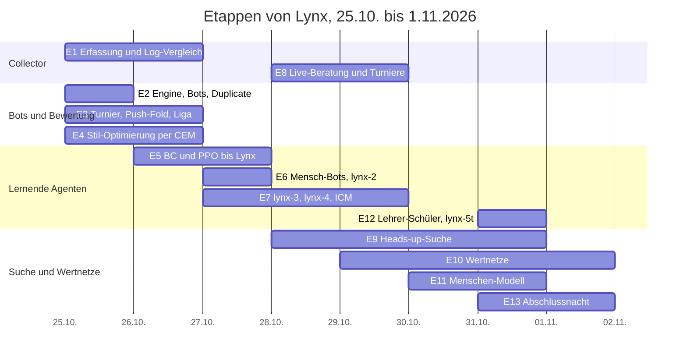

# Case Study: Lynx – vom Bildschirm-Collector zum Poker-Bot in acht Tagen

Stand 3.11.2026 · Jakob Figur, entwickelt mit Claude Code

In acht Tagen (25.10.–1.11.2026) entstand auf einem Laptop ohne Grafikkarte ein Poker-System, das PokerTH-Partien rein aus dem Bildschirmbild mitliest und mit einem selbst trainierten Bot berät. Der beste Bot spielt gegen das externe Maßband Slumbot heads-up auf Augenhöhe; gegen einen Menschen-Nachbau, gelernt aus 7,35 Millionen Showdown-Entscheidungen, gewinnt sein Lehrer-Schüler-Ableger +73 bis +78 bb/100. Die Cloud-Rechnung lag bei rund 6 Euro.

## Auf einen Blick

| Frage | Antwort |
| --- | --- |
| Ziel | PokerTH (Open Source, Spielgeld) ausschließlich visuell erfassen; daraus ein Bot, der vor allem gegen Menschen gut spielt |
| Rahmen | ein Entwickler mit Claude Code, Laptop mit Intel i5 und 16 GB ohne GPU, USB-Stick als Projektträger, Cloud nur stundenweise |
| Zeit und Kosten | 25.10.–1.11.2026; rund 6 € Hetzner-Rechenzeit, Netztraining auf Kaggle gratis |
| Collector | Aktionen 88 % Precision und 89 % Recall gegen das PokerTH-Log, Boardkarten 55 von 55, Beträge 98,7 % (nach einem Abend Korrekturen; vorher 18 % und 5 %) |
| Bot-Generationen | fünf Netz-Generationen mit bestandenem Gate bzw. vorab festgelegter Bestätigung (pros-2, pros-h1 „Lynx“, lynx-2, lynx-3, lynx-4); Menschen-Prüfstand `mensch480` von +43,8 % ROI (Regel-Bot rock) auf +128,2 % (lynx-4 greedy) |
| Externes Maßband | Slumbot, heads-up 200 BB: lynx-4 +0,2 [−29; +30] bb/100 über 10.000 Hände; die Vorgänger lagen bei −14 bis −35 |
| Gegen den Menschen-Nachbau | lynx-5t greedy +77,8 bzw. +73,0 bb/100 bei 40 bzw. 100 BB (4.800 Hände je Zelle); das Ausgangsnetz lynx-4 +13,0 bzw. −14,9 |
| Echte Turniere | 10 Sit&Gos gegen PokerTH-Bots mit Live-Beratung: 3 Siege, ROI +32 % (statistisch nicht belastbar) |
| Wichtigste Lehren | Gate nie bis zum Bestehen wiederholen; greedy statt gesampelt spielen (+98 bb/100); Datenverteilung schlägt Datenmenge; die Suche steht und fällt mit den Gegner-Ranges |

## Zeitstrahl

**Lesehilfe.** Jede Zahl trägt Datum und Quelle. „Chronik“ ist das interne Entwicklungsprotokoll; die meisten Befunde stehen zusätzlich im Projektprotokoll [`projektnotizen/DOKUMENTATION.md`](projektnotizen/DOKUMENTATION.md) („Doku x.y“). Dateien unter `data/` lagen im privaten Projektordner und sind bis auf ein kleines Startpaket nicht im Repository (siehe [`DATEN-UND-LIZENZEN.md`](DATEN-UND-LIZENZEN.md)). Was nicht belegt ist, ist als **unsicher** markiert. Die technischen Details stehen in [`TECHNISCHE-DOKUMENTATION.md`](TECHNISCHE-DOKUMENTATION.md).

---

## 1. Ausgangslage und Ziel

**Anfangsziel (25.10.2026, `PROJEKTUEBERGABE.md`):** Eine Windows-Anwendung soll Partien des PokerTH-Web-Clients **ausschließlich visuell** erfassen – Bildschirm aufnehmen, Karten, Beträge und Aktionen per OCR lesen, daraus Hände rekonstruieren und das Ergebnis **unabhängig gegen den PokerTH-Export** prüfen. Der Export ist nur Referenz, nie Eingabe. Keine Browser-Fernsteuerung, kein DOM-, Netzwerk- oder Speicherzugriff, keine automatischen Klicks. Das Übergabedokument wurde laut eigener Angabe auf einem Mac erstellt und verweist auf eine ältere Datei „Poker_Collector_Projektuebergabe.md“, die nicht mehr vorlag – ein früherer Vorlauf existierte also, sein Datum ist **unsicher**. Die Chronik der Memory-Datei nennt als Kernanliegen des Entwicklers: „Erfassung ausschließlich visuell – das ist das Experiment selbst.“

Der Plan sah die KI erst als späten Schritt vor (Phase G: „Baselines und Simulator zuerst“), mit Handlungsvorschlägen samt Begründung und Unsicherheit, aber ohne Autoplay.

**Verschiebung des Schwerpunkts (26.10.):** Nach einem Tag Collector-Bau und ersten Simulator-Stufen formulierte der Entwickler das KI-Ziel neu: „maximal guter Bot, in jeder Situation besser als Mensch“, Qualität vor Quantität bei Daten; abends „besser als Pluribus“ als Richtung (Chronik 26.10.).

**Zielklärung (29.10., 17:15, Chronik):** Lynx soll „insgesamt richtig gut werden, vor allem gegen MENSCHEN, nicht gegen die Bots einer Plattform“. PokerTH-Bots sind Übungsfeld und Messpunkt, kein Ziel. Folge: der Nachbau der PokerTH-Bots (Hebel H8) und bot-spezifische Ausbeutung wurden gestrichen; Priorität bekamen Suche als Lehrer, Gegnermodelle aus menschlichen Handhistorien, externe Maßbänder (Slumbot, GTO Wizard) und echte Spiele gegen Menschen.

**Ziele-Tafel (`ZIELE.md`, 28.10.):** fünf Benchmarks mit Stufen – (1) echte PokerTH-Turniere (50 mit ROI > 0, dann 200 mit ROI > +20 %), (2) `mensch480` ≥ +100 % → +120 %, (3) Slumbot > −15 → > 0 → untere 95-%-Grenze > 0 bei ≥ 20.000 Händen, (4) Ausbeuter ≤ +5 %, (5) Endspiel HU 20 BB (`nash240` ≥ 0, `kurz240` > +20 %). Bewusst kein Ziel: Übereinstimmung mit Menschen, Training auf Slumbot.

## 2. Rahmenbedingungen

| Punkt | Belegter Stand |
|---|---|
| Team | ein Entwickler (Jakob) plus Claude Code als Werkzeug; der Entwickler spielt selbst, gibt Freigaben (Slumbot-API, GTO Wizard, Hetzner-Tranchen), trägt Turnierplätze nach (`DOKUMENTATION.md` 1.1, Chronik) |
| Rechner | Laptop Intel i5-1335U (2 P- + 8 E-Kerne, 12 Threads), 16 GB RAM, **keine GPU**, Windows 11 Pro (`DOKUMENTATION.md` 2.1) |
| Projektträger | USB-Stick Intenso cMobile Line „POKER“, exFAT, Laufwerk D:, portables Python 3.12 + uv mit Offline-Cache, nichts installiert (`LIESMICH.md`, Doku 2.2) |
| Code-Umfang (2.11., gezählt) | ~16.800 Zeilen Python in `src` (Collector 6.247, KI 10.548), 44 Dateien im KI-Paket, 42 Testdateien mit 3.423 Zeilen; Testsuite 36 (25.10.) → 93 (25.10. abends) → 171 (28.10.) → 198 (29.10.) → 224 (30.10.) → 244 grün (31.10. abends) → 249 grün (3.11.; im veröffentlichten Baum 247 bestanden, 2 übersprungen) |
| Daten | 17 aufgezeichnete PokerTH-Sitzungen (26.10.–29.10., `data/sessions`, 41 MB bis 601 MB je Sitzung); HandHQ 25NL 2009 (5,0 GB, 5.989 Dateien, 5,72 Mio. Hände); Pluribus-PHH 10.000 Hände |
| Externe Dienste | Slumbot-API (freigegeben 27.10.), GTO-Wizard-Benchmark (freigegeben 29.10., Zugang beantragt, am 31.10. noch nicht erteilt), Hetzner Cloud (Token 29.10.), Kaggle (gratis T4-GPU) |
| Budget | „Maximum bei minimalem Budget“ (Entscheidung 29.10. 02:00): AX102-Dauerserver (~116 €/Monat) verworfen; stattdessen Laptop nachts, Hetzner cpx62 stundenweise (0,2479 €/h), Kaggle 0 €. Gesamtausgaben bis 1.11. **≈ 6 €** (Abschnitt 4f) |
| Zeitraum | 25.10.2026 (Projekt auf dem Stick, 18:01 Uhr Dateidaten) bis 1.11.2026 06:25 (letzter Chronik-Eintrag), also **acht Tage**, davon vier mit autonomen Nachtläufen |

Betriebliche Nebenbedingungen prägten die Arbeit: Der Stick fiel dreimal per USB-Controllerfehler aus (27.10. 07:10, 28.10. 04:15, 28.10. nachmittags), der Claude-Code-Speicherwächter beendete bei RAM-Knappheit Hintergrundhüllen, ein automatischer Sperrbildschirm nach 10 Minuten löste Modern Standby aus und fror Prozesse ein (29.10. 17:40). Alle drei Probleme kosteten Rechenstunden und wurden erst nach und nach per `powercfg`, Wachhalte-Skript und losgelösten Prozessen (`Start-Process`) umgangen (Doku 2.5, Chronik 28.–30.10.).

## 3. Etappen

### E1 – Collector: Capture, OCR, Rekonstruktion, Vergleich (25.–26.10., Nachbesserungen bis 29.10.)

**Ziel:** PokerTH rein visuell erfassen und gegen das Log messen.

**Gebaut (25.10., `LIESMICH.md`):** Layout-/Tischerkennung mit Profil `pokerth_web_v1.json` (10 Sitze, Board, Pot, Aktionsleiste, D/SB/BB), Windows-OCR mit Cache, Parser für Beträge und Aktionswörter inkl. OCR-Verleser, Kartenerkennung mit lernbaren Vorlagen, zeitliche Stabilisierung, unveränderliches Journal (JSONL + Belegbilder + SQLite + SHA-256-Manifest), Handrekonstruktion als State-Machine mit Lücken und Widersprüchen, Live-Quelle (mss, nur Vordergrund), PokerTH-Log-Import und feldweiser Vergleich (Precision/Recall). Erst an **einem** Preflop-Screenshot geprüft, 36 Tests.

**Ergebnis (erste echte Aufnahme 26.10., 6er-Tisch, 12 Hände im Log, Doku 3.4):**

| Feld | erste Auswertung | nach Korrekturen am selben Abend |
|---|---|---|
| Dealer | 11 % | 92 % |
| SB/BB-Sitz | 0 % / 11 % | 100 % / 100 % |
| Boardkarten | P 60 %, R 5,5 % | 100 % / 100 % (55/55) |
| Aktionen | P 18 %, R 5 % | **P 88 %, R 89 %** |
| Aktionsbeträge | – | 98,7 % |
| Startstacks | 0 % | 90 % |

Die Korrekturen waren Sitzgedächtnis, Formvergleich für Kartenränge und Rekonstruktions-Timing. Nebenbefund: PokerTH Web spielt 1000 Chips bei 10/20 (50 BB) mit Blinderhöhung alle 9 Hände – daraus entstand das Prüfstand-Format `pokerth`.

**Live-Härtung (28./29.10., Doku 8.6):** Im ersten Live-Abend zeigten sich Fehler der Kette, nicht der Erkennung: Vorschläge 10–20 s verspätet (Analyse-Queue immer voll, ~270 ms/Bild), Phantom-Vorschläge nach Handende, Handnummer-OCR hing 10–20 s (Verlauf der Vorhand landete in der Observation), „$1000“ als „51000“ gelesen. Nach den Fixes: Vorschlag 0,7–1,8 s nach Erkennung; Vergleich gegen das Log von Spiel 1: Aktionen 78/80 % → **88/88 %**, Dealer/SB/BB 74 % → **100 %**, Beträge 94 → 97 %. Spiel 7 (29.10.) lag mit Aktionen 79/85 % wieder darunter – offen, ob Sitzung oder Nachtänderungen (Doku 8.6).

**Schwerwiegendster Live-Bug (29.10. abends, Chronik):** Am Endbildschirm wurde der Siegerstack „$13408“ als Einsatz von Platz 5 gelesen und blieb im Zustand; im ganzen Folgeturnier stand Pot 13438 statt 30 in jeder Entscheidung (T9s preflop All-in 97 %). Fix `drop_stale_bets` + `fix_dollar_misreads`; Replay: 19 von 155 Vorschlägen anders.

**Lehre:** Die visuelle Erfassung ist nach einem Abend Korrekturen gut genug für Live-Beratung (Board 100 %, Beträge ~98 %), aber die Semantik des Bildes (Pot ohne laufende Einsätze, stehende Labels, Endbildschirme) ist die eigentliche Fehlerquelle. Ungeprüft bleiben Karo/Kreuz systematisch, Side Pots, Tischgrößen außer 4/6, überdeckungsfeste Aufnahme (Doku 3.5).

### E2 – Engine, Bot-Pool, Bewertung (25.10.)

**Gebaut:** NLHE-Regel-Engine 2–10 Spieler (`engine.py`), acht Stil-Bots (random, caller, equity, station, rock, tag, lag, maniac), Duplicate-Bewertung mit bb/100 und 95-%-CI, VPIP/PFR/AF/WTSD (`evaluate.py`), Brücke Collector→Observation (`replay.py`). 93 Tests grün am Abend des 25.10.

**Ergebnis (Doku 7):** Cash: tag +140 bb/100, station −185. Ein Engine-Bug (kurzer All-in-BB zwang SB zum Nachzahlen) wurde durch die Liga gefunden.

**Entscheidung:** Eine Schnittstelle Observation→Action für Simulator, Replay und Live; Training nur im Simulator, echte Daten nur für Gegnermodelle und Validierung, nie Einzelhand-Ergebnisse als Label (Kernprinzip, Chronik 25.10.).

### E3 – Turnier, Push/Fold, Liga (25.–26.10.)

**Gebaut:** Turniermodus 50/30/20 (`tournament.py`), Nash-Push/Fold (169×169-Equity-Matrix, HU exakt), Spielmodus Mensch gegen Bots (`pc.cmd play`), Liga mit Weng-Lin/Plackett-Luce-Rating auf Elo-Skala, Benchmark gegen feste Gegner, Push/Fold-EV-Verlust.

**Ergebnis (`data/league/report.md`, Stand 26.10., 90 Ligaspiele):** rock 2614 > opt-1 2479 ≈ tag 2484 > opt-2 2187 > lag 1611 > equity 1338 > maniac 930 > station 748 > random −150. Befund: im Turnier gewinnt rock vor tag, im Cash tag (Überleben zahlt sich bei drei bezahlten Plätzen aus); tag schaltet erst bei 12 BB auf Push/Fold. Die Liga wurde nach dem 26.10. nicht mehr aktualisiert (`players.json` listet 18 Einträge, alle Netz-Bots mit 0 Ligaspielen – sie wurden nur per Gate eingetragen). Doku 8.4 nennt den Liga-Report ausdrücklich veraltet.

### E4 – Stil-Parameter-Optimierung per CEM (25.–26.10.)

**Gebaut:** CEM über zehn Stil-Regler (`optimize.py`), Gate-Prüfung (`train gate`), Liga als Trainingsgegner (Gewicht exp((mu−max)/15), 20 % Self-Play).

**Ergebnis:**
- opt-1 (25.10.): Gate vs tag **+8,9 % ROI [1,1; 16,7]** auf 120 Schemata bestanden, Benchmark-SNG +46 % (bester), aber Liga-Rating unter tag → Nicht-Transitivität/Überanpassung (Chronik 25.10., `players.json`).
- Liga-Lauf 1 (26.10.): Gate +5,2 [−3,1; 13,4] auf 120 Schemata, Bestätigung auf 300 Schemata **−5,3 [−10,1; −0,5]** → durchgefallen.
- opt-2 (26.10.): Gate +8,5 [1,0; 16,0], Bestätigung 300 Schemata +1,9 [−2,2; 6,1] → aus der Liga genommen.

**Entscheidung und Lehre:** Alle Gates hatten Seed 777 geteilt – der Prüfsatz „nutzte sich ab“. Seitdem Gate-Seed = 100000 + Trainings-Seed. Eigene Methodenregel (26.10., in LIESMICH dokumentiert): **Gate nicht bis zum Bestehen wiederholen; höchstens eine vorab festgelegte größere Bestätigung.** 16 Schemata je Generation bedeuten ±15 % ROI Rauschen. Fazit: Stil-Tuning ausgereizt (rock/tag/opt-1 innerhalb weniger Prozent).

### E5 – Lernender Agent: BC aus Pluribus, PPO mit Leine (26.–27.10.)

**Gebaut:** 46 Merkmale/6 Aktionen (`features.py`), MLP-Agent (`nn_agent.py`), BC + PPO mit KL-Leine („piKL“, `rl.py`), PHH-Import (alle 10.000 Pluribus-Hände replayen identisch), Prüfstand `bench` (feste Sets, Δ rock gepaart), numba-Beschleunigung ~85×, MCCFR, Deep CFR, Ausbeuter-Test (`train exploit`), Zufalls-Stilbots und Ausbeuter im Training (PSRO-artig), Ranges (`ranges.py`), Merkmalsversionen feat-2/feat-3 mit `widen_net`, Aktionsversion act-2 (8 Aktionen), Self-Play-Plätze, Tischgewichte.

**Ergebnisreihe (Chronik 26./27.10., `data/bench/report.md`):**

| Lauf | Kernzahl | Befund |
|---|---|---|
| nn-1 (PPO ohne Leine) | Pool-ROI +84 %, Gate vs rock −8,5 %, Pluribus-Übereinstimmung 63 → 13 % | lernt Ausbeutung der Liga, kein Poker |
| pros-1 (BC Pluribus + Leine, 96 Turniere/It) | mix96 Δrock −20 → +8 bei It 200, Plateau ~+11 | Leine wirkt, Batches zu klein |
| **pros-2** (512 Turniere/It, 300 It, ~30 min) | **Gate vs rock +19,8 % [8,8; 30,7]**, mix96 Δrock +22,8, Ausbeuter +3,8 % | **große Batches waren der Schlüssel** |
| cfr-1 (Tabellen-MCCFR) | Ausbeuter +69 % | zu grob |
| dcfr-1 (Deep CFR) | It 30 −16 %, @60 −58 Δrock | aufgegeben 27.10. |
| pros-r1@300 (feat-2, Ranges) | mix96 +23,0, fest48 +25,0, Pluribus 82 % | auf `praezise` bester Bot des 27.10. |
| pros-r2/r3 (Multi-Format, Nachtlauf 26./27.) | Gate pros-r3@200 +13,3 [3,0; 23,6]; Format-Prüfstand alle im Rauschen (CI ±15–20) | „Gate-Sieger ≠ bester Bot“ |
| pros-o1 (Gegnermodell feat-3) | gepaart −3,9/−4,4 vs pros-r1@300 | zu früh, abgebrochen |
| **pros-h1@600** (feat-3 + act-2, 40 % Self-Play-Plätze, viele HU/3er-Tische, Leine erst ab 4 Spielern) | präzise vs pros-r1@300: hu480 +8,3*, 10max +8,3, mix960 +2,9; Gate 120 Schemata +3,0 nicht bestanden, **Einmal-Bestätigung 600 Schemata +6,0 [1,4; 10,6]** | neuer Bester 27.10. 15:20; Name **Lynx** (27.10. 18 Uhr) |

Slumbot-Leck-Analyse (27.10., 10.955 Hände pros-r1): Button foldet 40 % sofort (stark: 10–20 %), BB foldet 51 % gegen Open → ~−31 bb/100. Nach act-2 und HU-lastigem Training (pros-h1): Button-Fold 40 → 13 %, BB-Fold 47 → 35 %.

**Lehre:** Erfolg kam aus der Kombination Self-Play-Plätze + Ausbeuter + viele HU/3er-Tische + Leine ab 4 Spielern + act-2, nicht aus einer Zutat. Der große Prüfstand `praezise` (mix960 + pokerth480 + hu480 + 10max240, ±3 statt ±12) war nötig, um überhaupt Unterschiede zu sehen.

### E6 – Mensch-Bots aus HandHQ (27.10.)

**Gebaut:** HandHQ-Auswertung (`humans.py`): PS+PTY 25NL Juli 2009, 5,72 Mio. Hände, 121.391 Spieler, sechs Typen (Nit 27 %, Durchschnitt 25/17/9 %, passiv 14 %, TAG 9 %). Befund: die bisherigen Stil-Bots waren Calling-Stations (Fold auf Einsatz 6–17 % vs Mensch 50–70 %) → neuer Parameter `respect`. Mensch-Bots per CEM an die Typen angepasst (`humanbots.py`, v1/v2, Style `sticky`), Prüfstand-Set **mensch480** (PokerTH-Format, Gegner nach Typanteil). Datenfallen dokumentiert: PS-Winnings fehlen bei kampflosen Pots, PTY-Winnings enthalten Rückfluss, „????“ bei All-in.

**Ergebnis (Chronik 27.10. 20:45):** **lynx-2@500** = Lynx weiter mit 40 % Mensch-Bots: gepaart vs Lynx mensch480 **+17,7***, mix960 +8,1*, hu480 +8,5*, pokerth +3,2, 10max +8,5; Ausbeuter +1 %. Beide vorab festgelegten Bestätigungen bestanden: 600 frische Mensch-Tische **+12,1 [7,0; 17,3]**, Liga-Gate 600 frische Turniere **+7,4 [2,6; 12,3]** (`data/rl/lynx-2-bestaetigung.txt`).

**Lehre:** „Mensch-Bots als Trainingsgegner = größter Sprung bisher.“ Gegnerverteilung schlägt Trainingsdauer.

### E7 – lynx-3 und lynx-4: Nachtläufe, ICM, Plateaus, Gate-Disziplin (27.–29.10.)

**lynx-3 (Nacht 27./28.10., `NACHTPROTOKOLL.md`):** Abschnitte bis 1500 Iterationen, Gate je 600 Schemata. Nur @300 bestand (+4,5 [0,3; 8,6] vs lynx-2); @600 −3,7, @900 +0,1, @1200 −2,5, @1500 +2,8 gegen lynx-3-300 – alle nicht bestanden: **Plateau nach dem ersten Abschnitt.** Spätere Stände lagen auf mensch480 höher (@1100 +108,5 % vs @300 +96,8 %), wurden aber nach der Methodenregel nicht übernommen. Bestätigungen für lynx-3@300: Mensch-Tische **+9,2 [4,8; 13,6]**, Liga-Gate Seed 2810 **+6,7 [2,3; 11,0]** → Live-Standard 28.10. 10:07. Der Stick fiel um 04:15 aus; das Training war um 03:58 fertig.

**lynx-4 (Nacht 28./29.10., autonom):** ICM-Belohnung gebaut (`icm.py`, Malmuth-Harville, Mischung (1−icm)·Chips + icm·ΔICM), Lauf mit `--icm 1.0`, Ausbeuter alle 50 It, Tischgewichte 2:3/3:3/4:2/5:2/6:4. **Gate @300 bestanden: +10,0 [5,4; 14,6]** vs lynx-3-300 (600 Schemata). Gepaart vs lynx-3@300 (Doku 8.6): mensch480 **+18,3 [13,1; 23,5]**, mix960 +8,7, pokerth480 +12,3, 10max240 +13,5, hu480 −3,1 [−8,2; +2,0]. Gates @600/900/1200 gegen lynx-4-300: +3,1, +3,4, +4,3 [−0,0; +8,6] – nicht bestanden, dasselbe Plateau-Muster. Live-Standard ab 29.10. 10:50.

**Gate-Disziplin bewährt (29.10. 12:53):** lynx-4@100 sah auf den festen Prüfstand-Schemata besser aus als @300 (mix960 +18,3 statt +8,7 vs lynx-3). Frisches Gate @100 vs @300 (600 Schemata, Seed 2910): **+1,6 [−3,0; +6,1]** – kein Unterschied. Lehre: „Prüfstand-Vorsprung einzelner Checkpoints auf festen Schemata ist oft Rauschen; immer frisch gepaart nachprüfen.“

Absolute Prüfstandwerte lynx-4@300 (29.10., gleiche Schemata wie lynx-3@300): mensch480 115,1 / mix960 59,3 / pokerth480 47,5 / hu480 46,5 / 10max240 87,0 / Pluribus-top1 0,814.

### E8 – Live-Betrieb: Leiste, echte Turniere, Live-Bugs (28.–29.10.)

**Gebaut (28.10.):** Lynx-Leiste (`overlay.py`): Tk-Fenster über der Taskleiste, topmost, NOACTIVATE, `WDA_EXCLUDEFROMCAPTURE` (per mss-Gegenprobe verifiziert: 0 % statt 94 % sichtbar), Ton je Aktion; automatische Turniererkennung `TournamentWatch` mit Eintrag in `data/ziele/pokerth.jsonl`.

**Geändert für die Veröffentlichung (3.11.):** Die Leiste verbirgt sich nicht mehr vor Bildschirmaufnahmen, damit sie in Aufzeichnungen und Bildschirmfreigaben sichtbar bleibt. Stattdessen schneidet der Collector ihre Fläche aus seinen eigenen Bildern aus und füllt sie mit der Umgebungsfarbe. Praxistest: In einer normalen Bildschirmaufnahme zeigen 93 % der Leistenfläche die Aktionsfarbe, im Bild des Collectors nach der Maske 0 %.

**Ergebnis (`data/ziele/pokerth.jsonl`, 28.–29.10., alle 6er-Tische gegen PokerTH-Bots, Schwierigkeit „normal“, Jakob klickt, Lynx berät greedy):**

| Spiel | Datum | Bot | Platz | Hände | Erkennung |
|---|---|---|---|---|---|
| 1 | 28.10. 23:36 | lynx-3-300 | **1** | 35 | manuell (Auto verpasste Endhand All-in) |
| 2 | 29.10. 00:09 | lynx-3-300 | 3 | 20 | nachsimuliert, kein Log |
| 3 | 29.10. 00:21 | lynx-3-300 | 6 | 10 | auto 5, korrigiert auf 6 |
| 4 | 29.10. 01:02 | lynx-3-300 | 6 | ~7 | KK auf A-Q-4-4; Platz von Jakob |
| 5 | 29.10. 00:56 | lynx-3-300 | **1** | 25 | auto 2 (Endbildschirm vor Pot-Gutschrift), korrigiert |
| 6 | 29.10. 01:38 | lynx-3-300 | **1** | 31 | HU vs „Falcon Fay“ |
| 7 | 29.10. 10:34 | lynx-4-300 | 2 | 29 | auto korrekt |
| 8 | 29.10. 10:47 | lynx-4-300 | 4 | 24 | auto korrekt |
| 9 | 29.10. 16:47 | lynx-4-300 | 5 | 18 | auto korrekt |
| 10 | 29.10. 17:02 | lynx-4-300 | 3 | 27 | auto korrekt |

Zieltafel 29.10. 17:15: **10 Turniere, ROI +32 %** (Auszahlung 50/30/20: 3 Siege, 1 zweiter, 2 dritte). Getrennt: lynx-3-300 Spiele 1–6 → 3 Siege, ROI +70 %; lynx-4-300 Spiele 7–10 → Plätze 2, 4, 5, 3, ROI −25 % (eigene Rechnung aus den Plätzen). Zwei weitere Turniere am Abend des 29.10. (Sitzung 20261029-202109) gingen beide verloren – mit dem Pot-13438-Bug in Turnier 2 – und wurden mangels Platz nicht eingetragen. Statistisch sind 10 Turniere wertlos (Doku: 95-%-Intervall bei 6 Turnieren etwa −60 bis +200 %). Vier von sechs Spielen des ersten Abends liefen mit Live-Fehlern (Doku 8.6, Plan 1.2).

**Lehre (Plan 1.2):** „Die Live-Kette war der eigentliche Gegner, nicht die Bots.“ Nach den Fixes erkannte die Nachsimulation alle sechs Plätze richtig, ab Spiel 7 trug der Automat selbst ein.

### E9 – Heads-up-Suche (28.–30.10.)

**Gebaut (28.10.):** `husearch.py` – Blueprint-Netz bis Flop, ab Turn heads-up CFR+ (numba, nogil) über alle 1326 Kombos beider Spieler, Turn-Baum mit allen 44 Rivers, Ausnutzbarkeit via Best Response (Turn 120 It ~1,5 % Pot, River 300 It <1 %). Dazu HU-Preflop-Löser `hupreflop.py` (CFR+ über 169 Klassen, 800 It). 29.10.: Flop im Suchbaum (hus-2-Baum, gezogene Turn/River-Karten), Kernel ebenenweise parallel (2,5–3,3× schneller).

**Ergebnisreihe (alle Zahlen: `DOKUMENTATION.md` 6.8, `data/bench/diag-nacht.txt`, `hus1bp.txt`, `hus1v.txt`, `hus2v.txt`):**

| Datum | Variante | Maß | Ergebnis |
|---|---|---|---|
| 28.10. | hus-2 (Neulösen ab aktuellem Knoten, heuristische Range) | Slumbot | **−440 bb/100**, nach 458 Händen abgebrochen (massenhaft verlorene All-ins) |
| 28.10. | hus-3 (Lösen ab Straßenbeginn + Preflop-Löser) | Slumbot bereinigt, 8.167 Hände | −23,7 [−52; +5]; scheinbares Plus war Kartenglück +29 |
| 29.10. 22:15 | hus-1 (Turn+River, Ausspielen) | hu480 gepaart vs Netz +46,5 | Suche +17,1 → **−29,4 [−36,8; −21,9]** |
| 29.10. Nacht A | nur Preflop-Löser, postflop Netz | hu480 | +21,2 → **−25,2** → **Leck sitzt preflop** (200-BB-Cash-Gleichgewicht im 50-BB-Turnier) |
| 29.10. Nacht B | Turn+River ohne Preflop-Löser (hus1np) | hu480 | +37,9 → −8,5 [−14,7; −2,3] |
| 30.10. Nacht C | hus-1 vs Netz, HU 200 BB Cash, 2000 Hände | bb/100 | −0,6 [−62; +61] – unentschieden, Messung zu grob (SD je 50-Hände-Aufgabe ~200) |
| 30.10. D | + Blueprint-Ranges preflop (`bpranges.py`, ranges=pre) | hu480 | +41,2 → −5,2 [−11,6; +1,1] |
| 30.10. E | + Blueprint-Ranges preflop+flop | hu480 | +44,0 → **−2,5 [−8,7; +3,7]** (gleichauf); vs Heuristik-Suche +6,0 [1,8; 10,3] signifikant |
| 30.10. | hus-4 = E-Konfiguration | Slumbot bereinigt, 3.000 Hände | **−39,0 [−95; +17]**; River-Beitrag −99 bb/100 (Netz −65) – „Gegner spielt wie unser Netz“ gilt für Slumbot nicht |
| 30.10. | Gleichgewichts-Ranges `eq` aus hupreflop + Preflop-Löser + Netz-Blätter (hus-5) | Slumbot bereinigt, 3.000 Hände | **+0,0 [−50; +50]** |
| 31.10. 05:55 | hus-5 Fortsetzung | Slumbot bereinigt, 10.000 Hände | **−8,0 [−35; +19]** (Netz +0,2) |
| 30.10. F | Flop-Suche k 6/6, 40 It, Netz-Blätter | hu480 | +37,3; vs Turn-Suche V **−5,8 [−11,4; −0,3]** → Flop bleibt Blueprint |

Reihe Suche vs Netz auf hu480: **−29,4 → −8,5 → −5,2 → −2,5**. Reihe Suche vs Slumbot: hus-1 −12,6 (roh) / hus-3 −23,7 / hus-4 −39,0 / hus-5 +0,0 @3k, −8,0 @10k.

**Entscheidungen:** hus-Standard `streets=turn,river` + `ranges=pre,flop` (30.10.); Spec `auto=1` wählt je Hand Turnier- oder Cash-Konfiguration (31.10. 00:30). Die Suche wurde **nie Live-Standard**, weil sie nirgends gepaart signifikant vor dem Netz lag.

**Lehre:** Die Suche steht und fällt mit der Gegner-Range. Gegen Pool-Bots gewinnt das ausbeutend trainierte Netz, ein Gleichgewichtsspieler kann dort höchstens gleichziehen; gegen Slumbot bringen erst Gleichgewichts-Ranges die Suche auf Netz-Niveau. Zwischenstände unter ~5.000 Slumbot-Händen sind wertlos (Intervalle ±60 bis ±130).

### E10 – Wertnetze: River, River-Leaf, Turn (29.10.–1.11.)

**Plan (`PLAN-MEILENSTEIN-WERTNETZ.md`, 29.10.):** DeepStack-Reihenfolge – River-Netz zuerst, dann als Blatt im Turn-Baum, dann Turn-Daten mit River-Netz, dann Flop. Daten auf Hetzner (stundenweise), Training auf Kaggle T4 (gratis), Abnahme: Hold-out-MAE < 0,015 Pot, Orakel-Abweichung < 0,05 Pot, Turn live < 0,5 s.

**Gebaut:** `valuedata.py` (Situationen, synthetische Ranges, exakte CFR+-Lösung, .npz-Scherben, Modi `river`, `river-leaf`, `turn-leaf`), `valuenet.py` (eigenständig numpy+torch, 2712 → 1024×3 bzw. 2048×3 → 2652, Huber + Nullsummenstrafe), LEAF-Knoten in `husearch` mit Neubewertung alle 10 Iterationen, `cloud/hetzner.py` (API ohne hcloud, create/push/pull/delete), Kaggle-Kernels.

**Ergebnisreihe (Chronik 30.10.–1.11.; Fehler in Pot-Einheiten):**

| Schritt | Daten | Netz | Hold-out MAE | Orakel-500 EV-Fehler | **River-Leaf-Orakel EV-Fehler** |
|---|---|---|---|---|---|
| t1 (30.10. 13:16) | 500k breit (Tranche 1) | 1024×3, 30 Ep., 390 s | 0,0264 | 0,0053 | **0,121** (unbrauchbar an Blättern) |
| t1-curve | 200k | 1024×3 | 0,0380 | – | – (Fehler ~ n^−0,4) |
| t1-big | 500k | 2048×3, 60 Ep. | 0,0189 | 0,0038 | 0,132 (Kapazität hilft nicht) |
| t2-big (30.10. 18:05) | 500k breit + 252k Leaf (Tranche 2) | 2048×3 | 0,0199 | 0,0035 | **0,035** |
| **t3-big = vnet-river-1** (31.10. 00:12) | 500k breit + 504k Leaf (Tranche 3) | 2048×3, 47 min | 0,0192 | 0,0035 | **0,0081** (95 % 0,022, max 0,042) → **Ziel < 0,02 erreicht** |
| vnet-2 (31.10. 18:45) | + 3 Turn-Leaf-Scherben (66k, doppelt) | 2048×3, 62 min | 0,0209 | River-Leaf 0,0338 | **Turn-Leaf 0,0544** (vnet-river-1 auf Turn: 0,090) |
| vnet-2b (1.11. 06:25) | 300k River + 19 River-Leaf + 9 Turn-Leaf (977k Zeilen; 1,37 Mio. gab OOM) | 2048×3, 2812 s | 0,0260 (anderer Mix) | River-Leaf 0,0336 | **Turn-Leaf 0,0510** → Plateau ~0,05 |

**Entscheidende Einsicht (30.10. 13:40):** Die Trainings-Ranges der Tranche 1 waren alle breit (≥ 9 Bit Entropie); an echten Suchblättern sind Ranges dünn, boardkorreliert, SPR-Median 0,44 statt 1,4 → out-of-distribution. Daraufhin wurde der Modus `river-leaf` gebaut (Turn-Baum lösen, Ranges an den River-Wurzeln unter der Durchschnittsstrategie auslesen). Zwei Leaf-Tranchen drückten den Blattfehler um Faktor 15 (0,121 → 0,0081); mehr Kapazität auf breiten Daten brachte nichts.

**Spieltest V (30.10. 18:52):** Suche mit Netz-Blättern vs Suche mit exakten River-Teilbäumen: **−0,8 [−3,9; +2,3]** (hu480, gepaart), Turn-Entscheidung 1,1 statt 4,8 s (4,4× schneller). Das River-Netz kostet also keine messbare Stärke.

**Turn-Stufe (31.10.–1.11.):** `turn-leaf`-Tranche auf lehrer-1: 2,6 s je Flop-Seed, 84–87 min je Scherbe, 10 Scherben = 220.688 Zeilen (~14,5 h statt geschätzter 4–5 h). Flop-Suche `leaf=4` mit Turn-Netz halbiert die Abweichung zur Referenz (Strategie-Abstand 0,471 → 0,233 bei allen Turns, 0,369 bei k_turn=8 in 2,3 s; Chronik 31.10. 18:55). Dreimal so viele Turn-Daten (vnet-2b) brachten aber nur −6 % Turn-Fehler.

**Lehre:** Datenverteilung schlägt Datenmenge und Kapazität. Für den Turn ist das Plateau bei ~0,05 Pot vermutlich nicht mehr mit Daten derselben Art zu brechen (Chronik 1.11.: „Kapazität/Merkmale statt Daten, oder Turn-Daten aus echtem Suchspiel“).

### E11 – Menschen-Modell aus HandHQ-Showdowns (30.–31.10.)

**Gebaut:** `humandata.py` (Hände mit Engine nachspielen, nur gezeigte Spieler liefern Zeilen), `humanfold.py` (Fold-Modell), Kaggle-Kernel `lynx-train-human`.

**Zahlen:**
- Extraktion mit Karten (30.10., 2 h 21 min, 2 Prozesse): 5,97 Mio. Hände, 1,47 Mio. mit gezeigten Karten, 1,21 Mio. nachgespielt, **7,35 Mio. Entscheidungen**, 120 Scherben, 245 MB. Übersprungen: 239k Straddle-Hände, 15,7k Reihenfolge, 1k Stacks/Blinds. **0 Folds in den Daten** (wer foldet, zeigt nicht).
- **human-1** (31.10. 00:10, Kaggle T4, 49 s, 512 hidden, 8 Epochen): Hold-out NLL **0,720** (Häufigkeits-Vergleichslinie 0,95–1,06), Treffer preflop 77,9 %, flop 73,7 %, turn 74,7 %, river 73,0 %. Zum Vergleich lynx-4@300 auf denselben menschlichen Entscheidungen: NLL 2,255, 35,6 % Treffer, preflop 9,3 % → „Lynx spielt völlig anders als Menschen“.
- Kartenfreie Extraktion aller Entscheidungen (31.10. 06:30, 1596 s, 4 Prozesse): 5,64 Mio. Hände, **55,5 Mio. Entscheidungen mit Folds**. Fold vor Einsatz preflop 72,6 %, flop 57 %, turn 46 %, river 53 %.
- **human-fold-1** (31.10. 06:53, 37 s CPU, 18,9 Mio. Zeilen): Fold-Modell BCE 0,417 (Fold-Rate 51,6 %), Klassenmodell NLL 4,62 (gleichverteilt 5,13). Plausibilität: BB gegen UTG-Raise 3 BB P(fold)=0,754; Weiterspiel AA 0,98, 72o 0,02.
- Menschen-Bot mit Folds `nn?run=human-1@1&fold=human-fold-1` = „bester Prüfstand für ‚gegen Menschen‘“ (Chronik 31.10. 06:30).

**Messungen gegen den Menschen-Bot (HU Cash duplicate, je 10.000 Hände, `temp-hu.txt`/Chronik 31.10.):** lynx-4@300 gesampelt: 40 BB **+13,5 [−5; +32]**, 100 BB **−21,1 [−43; +0,4]** – das Blueprint-Netz schlägt den 25NL-Normalspieler-Nachbau heads-up nicht. Suche mit `opp=human-1` ohne Fold-Modell auf mensch480: **−20,0 [−25,5; −14,5]** gegen das Netz (Messung H) – Gegner-Ranges zu breit, und mensch480 besteht aus den eigenen Stilbots. Messung 1 gegen human-1 ohne Folds: unbrauchbar (Blöcke ±200 bb/100). Messung 2 mit Folds (je 720 Hände): nichts signifikant (`humanopp2.txt`). Server-Benchmark (7.680 Hände je Zelle, `humanopp_srv.txt`): 40 BB C-human+fold +30,4 [13,3; 47,5] vs Netz +2,9; 100 BB B +33,6 [5,8; 61,4] vs Netz **−40,3 [−68; −12]**.

**Lehre:** Showdown-Daten liefern P(Aktion | Hand, weitergespielt); Folds müssen aus kartenfreien Daten kommen. Das Fold-Modell ist gegen einen nie foldenden Zerrbild-Gegner falsch (40 BB −127 [−191; −63]), gegen den Menschen-Bot mit Folds bei 40 BB die beste Suchvariante.

### E12 – Lehrer-Schüler (Expert Iteration): lynx-5t, Greedy, Temperatur, Ausbeuter (31.10.)

**Gebaut:** `teacher.py` (TeacherRecorder sammelt Suchentscheidungen als weiche Ziele, `teacher-fit` = CE + KL-Anker), `cloud/run-teacher.sh`, Temperatur `temp=T` (`nn_agent.sharpen`), Suche-Optionen `greedy=1`, `bpgreedy=1`.

**Zahlen (Chronik 31.10., `lynx5t-sets.txt`, `temp-hu.txt`, `temp-pruefstand.txt`, `exploit-greedy.txt`, `slumbot-lynx-5t-g.txt`):**
- Lehrer-Sammlung auf lehrer-1 (cpx62, 16 Prozesse, 1 h 22 min, ~0,35 €): 61.440 Hände → **41.730 Lehrer-Zeilen** (nur Turn/River).
- lynx-5t = teacher-fit lynx-4@300, kl 0,5: Übereinstimmung mit der Suche **29 % → 64 %**, CE 2,61 → 0,98, KL 0,49.
- **Entdeckung:** greedy lynx-4 vs gesampeltes lynx-4, 100 BB, 10.000 Hände: **+97,7 bb/100 [+58; +137]**. Das Netz mischt mit Entropie 0,79 nats, die gestreuten Nebenaktionen verlieren gegen jeden Gegner.
- Gegen Menschen-Bot mit Folds (10.000 Hände je Zelle): **greedy lynx-5t +64,0 [50; 78] (40 BB) / +65,5 [46; 85] (100 BB)**; greedy lynx-4 +3,3 / −21,9 → Gewinn des Lehrer-Fits 60–85 bb/100.
- Prüfstand Turnierformat (hu480 / mensch480 / mix960): lynx-4@300 gesampelt 46,5 / 115,1 / 59,3; **lynx-4@300 greedy 55,8 / 128,2 / 79,8** (Bestwert); lynx-5t greedy 35,6 / 103,2 / 61,3; lynx-5t gesampelt 28,5 / 81,7 / 35,5. Temperatur monoton: T=0,5 53,5/127,2/75,5, T=0,3 53,3/127,3/78,5.
- Ausbeuter-Test (40 It gegen 5 Kopien, 48 frische Schemata): **lynx-4 greedy −15,0 % [−26,7; −3,3]**, gesampelt −3,8 %, T=0,3 +8,7 %, **lynx-5t greedy +24,6 % [+8,6; +40,5]**.
- Slumbot lynx-5t greedy, 3.000 Hände: bereinigt **+35,3 [−6; +77]** – beste Slumbot-Zahl, nicht signifikant.

**Entscheidungen:** Neue Referenz `lynx-4@300&greedy=1` (lynx-4-300-g); Live-Berater war ohnehin greedy. lynx-5t nur gegen Menschen-Gegner einsetzen (ausbeutbar).

**Lehre:** Sampling aus der PPO-Politik kostet gegen nicht anpassungsfähige Gegner durchweg; Greedy ist mit dem besten verfügbaren Ausbeuter nicht ausnutzbarer. Der Schüler schlug seinen Lehrer gegen den Menschen-Bot (lynx-5t +64/+65 vs Suche +20…+34), vermutlich weil die Suche preflop gesampelt spielt und mischt.

### E13 – Nacht 31.10./1.11.: humanopp3, Turn-Tranche, vnet-2b

- `bench_humanopp3` (8 Prozesse, 40 Blöcke × 120 Hände = **4.800 Hände je Zelle**, 40/100 BB, gegen Menschen-Bot mit Folds; ein erster Lauf stürzte 19:29 an einem Spec-Parser-Fehler ab, Fix `rpartition`, Neustart 21:20, fertig 1.11. 05:00, `humanopp3.txt`):

| Variante | 40 BB | 100 BB |
|---|---|---|
| **lynx-5t greedy** | **+77,8 [64,6; 90,9]** | **+73,0 [55,9; 90,1]** |
| C-5t-bpg (Suche, Blueprint lynx-5t) | +55,0 [33,3; 76,8] | +57,1 [24,3; 89,9] |
| C-bpg-g (Suche greedy, Blueprint greedy) | +48,4 | +60,8 |
| C-leaf4 (Flop-Suche mit Turn-Netz vnet-2) | +40,7 | +60,7 |
| C-bpg | +46,2 | +55,7 |
| C (Basis) | +31,5 | +37,4 |
| Netz lynx-4 greedy | +13,0 [−8,6; +34,7] | −14,9 [−40,6; +10,7] |

Fazit der Chronik: jede Suchvariante schlägt das Netz, keine erreicht lynx-5t (Lücke 15–20 bb/100 bei 40 BB); Greedy in der Suche bringt ~+15; Flop-Suche mit Turn-Netz bei 100 BB gleich viel wie Turn-Suche, bei 40 BB weniger.

- Turn-Tranche komplett (1.11. 02:55): 10 Scherben, **220.688 Zeilen**, 0 defekt; Server lehrer-1 gelöscht 02:54 (lief 31.10. 09:00 bis 1.11. 02:54, ~4,5 €; „keine Server mehr“).
- vnet-2b (1.11. 06:25): erster Kaggle-Versuch mit ~1,37 Mio. Zeilen OOM („Killed“ nach 306 s); Regel: T4-Kernel verträgt ~1,1 Mio. Zeilen bei float16 × 2712 Spalten. Ergebnis siehe E10.

## 4. Ergebnis-Tabellen

### 4a. Bot-Generationen auf dem Prüfstand (ROI %, Turnierformat) und Gates

| Bot | Datum | hu480 | mensch480 | mix960 | pokerth480 | 10max240 | Gate/Bestätigung | Quelle |
|---|---|---|---|---|---|---|---|---|
| rock (Regel-Bot) | 25.10. | −16,9 | +43,8 | +24,6 | +21,1 | +43,9 | Referenz | Doku 6.3 |
| pros-r1@300 | 27.10. | +35,6 | +73,0 | +41,3 | +32,6 | +56,2 | – | Doku 6.3 |
| pros-h1@600 (= Lynx) | 27.10. | +44,0 | +75,9 | +44,3 | +33,9 | +64,5 | Bestätigung 600 Sch. +6,0 [1,4; 10,6] | Doku 6.2/6.3 |
| lynx-2@500 | 27.10. | +52,5 | +93,6 | +52,4 | +37,1 | +72,9 | Mensch +12,1 [7,0; 17,3], Liga +7,4 [2,6; 12,3] | `lynx-2-bestaetigung.txt` |
| lynx-3@300 | 28.10. | +49,6 | +96,8 | +50,6 | +35,2 | +73,6 | Gate +4,5 [0,3; 8,6]; Mensch +9,2 [4,8; 13,6], Liga +6,7 [2,3; 11,0] | Doku 6.2 |
| lynx-4@300 (gesampelt) | 29.10. | +46,5 | +115,1 | +59,3 | +47,5 | +87,0 | Gate +10,0 [5,4; 14,6] | Doku 8.6 |
| **lynx-4@300 greedy** (Referenz seit 31.10.) | 31.10. | **+55,8** | **+128,2** | **+79,8** | – | – | kein eigenes Gate (gleiches Netz) | `lynx5t-sets.txt` |
| lynx-5t greedy | 31.10. | +35,6 | +103,2 | +61,3 | – | – | Menschen-Spezialist, kein Gate | `lynx5t-sets.txt` |

Hinweis: Die Werte von rock bis lynx-4 stammen aus gesampelter Politik; die Greedy-Werte sind nicht direkt mit den früheren Generationen vergleichbar (Chronik 31.10. 13:25).

### 4b. Slumbot-Reihe (HU 200 BB Cash, bb/100, bereinigt = All-in-EV − β·Baseline)

| Bot/Suche | Datum | Hände | roh | bereinigt [95 %] | Quelle |
|---|---|---|---|---|---|
| pros-r1@300 | 27.10. | 15.767 | −21,5 | −13,7 [−29; +2] | Doku 6.7 |
| pros-h1@600 | 27.10. | 7.666 | −33,2 | −35,4 [−57; −14] | Doku 6.7 |
| lynx-2@500 | 28.10. | 20.000 | −27,2 | **−18,6 [−33; −4]** | `slumbot-lynx2.txt` |
| lynx-3@300 | 28.10. | 10.000 | −21,3 | **−17,2 [−38; +4]** | `slumbot-lynx3.txt` |
| hus-3 (Suche + Preflop-Löser) | 28.10. | 8.167 | −8,7 | −23,7 [−52; +5] (Kartenglück +29) | `slumbot-hus3-teil2.txt` |
| **lynx-4@300** | 29.10. | 10.000 | −10,3 | **+0,2 [−29; +30]** | `slumbot-lynx4.txt` |
| hus-4 (turn,river + bp-Ranges) | 30.10. | 3.000 | −41,0 | −39,0 [−95; +17] | `slumbot-hus4.txt` |
| hus-5 (preflop,turn,river + eq-Ranges + Netz-Blätter) | 31.10. | 10.000 | −15,3 | **−8,0 [−35; +19]** | `slumbot-hus5b.txt` |
| lynx-5t greedy | 31.10. | 3.000 | +35,3 | **+35,3 [−6; +77]** n.s. | `slumbot-lynx-5t-g.txt` |

Ziel 3 Stufe 1 (> −15) wurde mit lynx-4-300 erreicht, Stufe 2 (> 0 gesichert) nicht. Die Konkurrenzanalyse (29.10.) stuft Slumbot als Vorstufe ein; GTO Wizard AIVAT (Spitze −3 bb/100, Mensch Rabichow −3,9) sollte Hauptmaß werden – der Zugang lag am 31.10. noch nicht vor.

### 4c. Messungen gegen den Menschen-Bot (human-1 + Fold-Modell, HU Cash duplicate, bb/100)

| Spieler | 40 BB | 100 BB | Hände je Zelle | Quelle |
|---|---|---|---|---|
| lynx-4@300 gesampelt | +13,5 [−5; +32] | −21,1 [−43; +0,4] | 10.000 | Chronik 31.10. 08:01 |
| lynx-4@300 greedy | +6,8 [−3; +17] / +13,0 | −18,3 [−30; −7] / −14,9 | 10.000 / 4.800 | `temp-hu.txt`, `humanopp3.txt` |
| Suche C (opp+fold) | +30,4 [13; 48] | +29,3 [4; 55] | 7.680 (Server) | `humanopp_srv.txt` |
| Suche beste Variante (C-bpg-g / C-5t-bpg) | +48,4 / +55,0 | +60,8 / +57,1 | 4.800 | `humanopp3.txt` |
| **lynx-5t greedy** | **+64,0 [50; 78] / +77,8 [65; 91]** | **+65,5 [46; 85] / +73,0 [56; 90]** | 10.000 / 4.800 | `temp-hu.txt`, `humanopp3.txt` |

Vorbehalt (Chronik 31.10. 05:22): Der Menschen-Bot ist ein Nachbau von 25NL-Onlinespielern aus 2009 und kennt kein Heads-up aus den Daten (HandHQ enthält kein HU); Tests gegen echte Menschen stehen aus.

### 4d. Wertnetz-Reihe (Fehler in Pot-Einheiten)

| Netz | Datum | Daten | River-Leaf EV-Fehler | Turn-Leaf MAE | Quelle |
|---|---|---|---|---|---|
| kaggle-t1 | 30.10. 13:16 | 500k breit | **0,121** | – | Chronik |
| kaggle-t2-big | 30.10. 18:05 | +252k Leaf | **0,035** | – | Chronik |
| vnet-river-1 (t3-big) | 31.10. 00:12 | +504k Leaf | **0,0081** | 0,090 (ungeeignet) | Chronik |
| vnet-2 | 31.10. 18:45 | +66k Turn-Leaf | 0,0338 (MAE) | **0,0544** | Chronik |
| vnet-2b | 1.11. 06:25 | +~200k Turn-Leaf | 0,0336 (MAE) | **0,0510** | Chronik |

### 4e. Echte PokerTH-Turniere (siehe E8)

10 eingetragene Turniere (28.–29.10., 6er, PokerTH-Bots „normal“): Plätze 1, 3, 6, 1, 6, 1, 2, 4, 5, 3 → 3 Siege, **ROI +32 %** (`data/ziele/pokerth.jsonl`, Chronik 29.10. 17:15). Ziel 1 Stufe 1 verlangt 50 Turniere. Zwei weitere, nicht eingetragene Turniere am 29.10. abends wurden verloren (ein Live-Bug). „hard“ wurde nie gespielt, Menschen auf pokerth.net auch nicht.

### 4f. Kosten

| Posten | Datum | Dauer | Kosten | Quelle |
|---|---|---|---|---|
| Hetzner 1000er-Test (cpx62, 3 Anläufe) | 30.10. 09:26 | Minuten | ~0,05 € | Chronik |
| Tranche 1: 500k River (cpx62 fsn1) | 30.10. 09:44–12:30 | 2 h 46 min | ~0,69 € | Chronik |
| Tranche 2: 252k River-Leaf | 30.10. 15:02–17:01 | 2 h | ~0,50 € | Chronik |
| Tranche 3: 252k River-Leaf | 30.10. 20:12–22:08 | 2 h | ~0,50 € | Chronik |
| lehrer-1: Lehrer-Sammlung (0,35 €) + Server-Benchmark + Turn-Tranche | 31.10. 09:00–1.11. 02:54 | ~18 h | ~4,5 € | Chronik 1.11. 02:55 |
| Kaggle (ca. 10 Kernel-Läufe T4, 10 s bis 62 min) | 29.10.–1.11. | – | 0 € | Chronik |
| Slumbot-API, GTO-Wizard-Antrag | – | – | 0 € | Chronik |
| **Summe** | | | **≈ 6,2 €** (unsicher: ±0,5 €, Stundenpreise gerundet) | eigene Addition |

Zum Vergleich: der verworfene Dauerserver-Plan hätte ≈ 450–500 € für drei Monate gekostet (`PLAN-NAECHSTES-LEVEL.md` 4).

## 5. Methodische Lehren

1. **Gate nicht wiederholen, Bestätigung vorab festlegen.** Eingeführt am 26.10. nach opt-1/opt-2; seitdem jede Übernahme (pros-h1, lynx-2, lynx-3, lynx-4) durch genau eine einmalige Bestätigung entschieden. Die Regel verhinderte am 28.10. die Übernahme von lynx-3@1100 trotz +108,5 % auf mensch480.
2. **Frische Seeds.** Seed 777 für alle Gates war „abgenutzt“ (26.10.); Gate-Seed = 100000 + Trainings-Seed. Die Nachprüfung lynx-4@100 vs @300 (+1,6 [−3,0; +6,1]) zeigte, dass Prüfstand-Vorsprünge auf festen Schemata Rauschen sind (29.10.).
3. **Prüfstand-Rauschen quantifizieren.** 48er-Sets ±15–20, `praezise` ±3; Slumbot-Zwischenstände unter 5.000 Händen wertlos (±60–130); HU-Cash-Blöcke zu 120 Händen ±200 bb/100. Das „bereinigte“ Slumbot-Maß (Kontrollvariable Baseline, 28.10.) entlarvte das vermeintliche Plus von hus-3 als Kartenglück +29.
4. **Greedy vs Sampling.** +97,7 bb/100 für Greedy gegen das eigene gesampelte Netz (31.10.); Greedy war auf allen Sets und gegen alle Gegner monoton besser und im Ausbeuter-Test nicht ausnutzbarer (−15,0 % vs −3,8 %). Die Prüfstand-Referenz war fünf Tage lang gesampelt gemessen – ein systematischer Messfehler, der erst beim Lehrer-Gate auffiel.
5. **Datenverteilung schlägt Datenmenge.** Wertnetz: 500k breite Situationen → EV-Fehler 0,121 an Blättern; 504k Blatt-Situationen → 0,0081; doppelte Kapazität auf breiten Daten verschlechterte (0,132). Mensch-Bots: 40 % Mensch-Gegner im Pool brachten den größten Sprung (lynx-2). Lehrer-Daten: nur 41.730 Zeilen genügten für +60–85 bb/100 gegen den Menschen-Bot.
6. **Suche braucht die richtigen Gegner-Ranges.** hus-2 −440 (heuristische Range ab aktuellem Knoten); auf hu480 die Reihe −29,4 → −2,5 durch Preflop-Löser raus + Blueprint-Ranges; gegen Slumbot −39 → 0 durch Gleichgewichts-Ranges. Es gibt keine formatunabhängige Range-Annahme; `auto=1` wählt je Hand.
7. **Nicht-Transitivität.** opt-1 schlug tag im Gate, lag aber in der Liga unter tag (25.10.); pros-r3-200 bestand das Gate, war auf `praezise` nicht besser; lynx-5t schlägt den Menschen-Bot um +65, verliert aber gegen Pool-Bots gegen lynx-4 (103,2 vs 128,2 auf mensch480) und ist ausbeutbar (+24,6 %). Ein Gate-Sieger ist nicht der beste Bot, ein Spezialist kein Fortschritt.
8. **Prüfstände messen, worauf trainiert wurde.** hu480/mensch480 bestehen aus den eigenen Stil-/Mensch-Bots; dort kann ein Gleichgewichtsspieler höchstens gleichziehen (Doku 6.8). Externe Maßbänder (Slumbot, GTO Wizard, echte Menschen) sind deshalb unverzichtbar.
9. **Laptop-Betrieb ist Teil des Experiments.** Drei Stick-Ausfälle, Speicherwächter, Sperrbildschirm-Standby (hus-Messung lief zwei Stunden „quasi nicht“), verwaiste Worker nach verschwundenem Elternprozess (85 min verloren, 30.10.), `__main__`-Schutz unter Windows-spawn, doppelte Ketten nach TaskStop. Gegenmittel: Wiederaufnahme je Block (`partial-*.json`), losgelöste Prozesse, Keep-awake, Kontroll-Crons, Prozessliste prüfen.
10. **Überschätzte Laufzeiten.** Turn-Tranche 14,5 h statt 4–5 h; humanopp3 7–8 h statt 2,5 h; Flop-Suche anfangs 17–62 s je Entscheidung. Jede Pipeline wurde erst mit einem 1000er-Test (0,05 €) geeicht, bevor Geld floss.

## 6. Offene Punkte und nächste Hebel

**Offen (Stand 1.11.):**
- Ziel 1: nur 10 von 50 Turnieren, keine gegen Menschen (pokerth.net Ranking), keine auf „hard“; lynx-4-300 in vier Turnieren ROI −25 % (statistisch bedeutungslos).
- GTO-Wizard-Zugang nicht erteilt; Hauptmaßband fehlt damit.
- Slumbot Stufe 2 (> 0 gesichert, 20.000 Hände) nicht erreicht; lynx-5t greedy +35,3 nur über 3.000 Hände.
- Turn-Wertnetz Plateau ~0,05 Pot; `leaf=4` noch nicht im Benchmark gegen Netz/Mensch gemessen.
- Collector: `compare` ordnet nur über Handnummer zu (Spiel 5: 14 von 25 Hände), Checks beim falschen Sitz, „$“-Verleser in der OCR selbst, Karo/Kreuz nicht systematisch, kein Windows.Graphics.Capture.
- Liga-Report seit 26.10. nicht aktualisiert; Netz-Bots ohne Ligaspiele.
- Doku-Lücke: `DOKUMENTATION.md` Abschnitt 7/8 endet am 31.10. morgens, die Chronik läuft bis 1.11.
- Menschen-Bot kennt kein Heads-up aus Daten; Mensch-Bots v2 treffen WTSD/C-Bet schlecht (Bots 9–15 % statt 25–33 %, 27.10.).

**Nächste Hebel (aus Chronik 1.11. und Plänen):**
1. Lehrer-Schüler Runde 2: `teacher-collect` mit lynx-5t-Suche bzw. Suche mit lynx-5t als Blueprint und greedy kombiniert (Lücke 15–20 bb/100 bei 40 BB).
2. Turn-Netz: Kapazität/Merkmale statt mehr Daten, oder Turn-Daten aus echtem Suchspiel (ReBeL-Lehre: ≥ 50 % Daten aus Selbstspiel).
3. Preflop-Löser mit echten Postflop-Werten (statt realisierter Equity), mehr Iterationen (jetzt bezahlbar), breiterer Suchraum (`wide`, dritte Raise-Größe), Blueprint-Warmstart der CFR.
4. GTO Wizard, sobald freigegeben: erst 500 Hände (bleibt im Rauschen), stabile Versionen auf 20–50k; kein Einsatz auf Echtgeld-Plattformen.
5. Echte Turniere sammeln (3–5 je Abend), dann Menschen; Mischung statt Vollgreedy live prüfen, sobald ein lernender Gegner existiert.

## 7. Arbeitsweise mit Claude Code

Das Projekt entstand im Zwiegespräch eines Entwicklers mit Claude Code (Anthropic): Der Entwickler setzte Ziele, gab Geld und externe Dienste frei und spielte die echten Partien, Claude Code schrieb Code, Tests und Doku, startete und überwachte die Läufe. So sah das Vorgehen aus Chronik und Protokollen aus:

- **Autonome Nachtläufe mit Vorab-Plan.** Vier Nächte (26./27., 27./28., 28./29., 31.10./1.11.) liefen ohne den Entwickler: Trainingsabschnitte mit Gate, anschließend Messketten; die Entscheidungsregeln (Kandidat = letzter bestandener Stand, Bestätigungen mit festem Seed) wurden vor der Nacht ins Protokoll geschrieben (`NACHTPROTOKOLL.md` 00:45 am 28.10.). Auftrag des Entwicklers: „Maximum rausholen + Code-Review“ (29.10. 01:55).
- **Stündliche Kontrollen per Cron** (z. B. :17, :23, :47), die Fortschritt, Tracebacks und freien RAM prüften und das Protokoll fortschrieben; Crons überleben Sitzungswechsel nicht und wurden je Sitzung neu angelegt (31.10. 21:30).
- **Gedächtnis als lückenlose Chronik.** Ein internes Entwicklungsprotokoll (Claude-Code-Memory, ca. 33 kB) hielt jeden Lauf mit Zeit, Spezifikation, Zahl und Intervall fest; es war die Grundlage für `DOKUMENTATION.md` und für diese Case Study. Dazu kamen Methodenregeln und Arbeitsvereinbarungen, etwa dass Turnierergebnisse automatisch eingetragen werden.
- **Review-Agenten.** In der Nacht 28./29.10. schrieben zwei Agenten `review-live.md` und `review-ki.md`; die Befunde wurden am Morgen mit Tests eingebaut (12 Live-Tests), Patches für laufende Trainings bis zum Trainingsende zurückgehalten (lazy Imports).
- **Doku-Pflicht.** Jede Etappe endet mit Eintrag in Chronik, `DOKUMENTATION.md` (Befunde, „Was nicht funktioniert hat“), Backup per robocopy (ohne `data/cloud`) und voller Testsuite (`data/tests-*.txt`).
- **Freigaben beim Entwickler.** Externe Dienste, Geld (jede Hetzner-Tranche: „Go gegeben“), Namenswahl, Zielklärungen und Publicity-Fragen wurden explizit erfragt; der Entwickler gab kurze Freigaben („okay dann mach weiter“, „mach alles“) und griff bei Plätzen und Schwierigkeitsgrad korrigierend ein.
- **Entwicklung neben laufenden Prozessen** in einer Kopie `dev/` (PYTHONPATH), Spezifikations-Strings für Bots (`nn?run=…`, `hus?bp=…`) als einheitliche Schnittstelle in CLI, Liga, Prüfstand und Live.

---

*Alle Zahlen stammen aus den genannten Dateien; eigene Rechnungen sind als solche gekennzeichnet (ROI-Teilsummen, Kostensumme, Zeilenzählung).*
