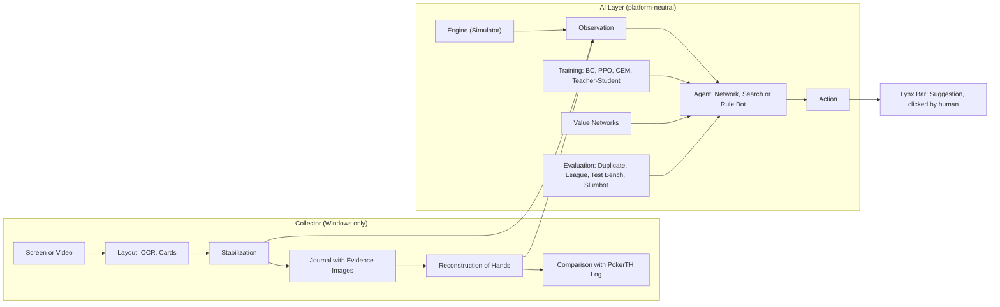

# Lynx – Technical Documentation

As of 3.11.2026 (Code from 1.11.2026) · Jakob Figur

Lynx is a self-built No-Limit Hold'em system consisting of two parts: a **Collector**, which captures pokerTH web client sessions exclusively from the screen image, and an **AI layer** with a rule engine, bots, evaluation, training, search, and value networks. This documentation fully describes the code: architecture, every module, data formats, operation, and reproduction. The machine-generated reference of all classes and functions is available at [`API_REFERENCE.md`](API_REFERENCE.md); the help for all commands at [`CLI_REFERENCE.md`](CLI_REFERENCE.md). What has been achieved and why is explained in [`CASE-STUDY.md`](CASE-STUDY.md).

## Contents

- [Overview](#overview): System at a glance, scope, directories, conventions
- [Part 1: The Collector](#part-1-the-collector-visual-capture): Capture, OCR, cards, reconstruction, comparison, bar, CLI, formats, tests, operation
- [Part 2: The AI Layer](#part-2-the-ai-layer): Interface, engine, bots, evaluation, learning, search, value networks, live, data, reproduction, platforms
- [Further documentation](#further-documents)

## Overview

### System at a glance



Both parts meet exactly at one interface: an observation `Observation` (what a player sees) goes into an agent, a state `Action` comes out. The same observation is generated in the simulator, during playback of recorded hands, and live from the image. This allows every bot to run without change in training, benchmarking, and live advising.

### Scope

| Area | Scope |
| --- | --- |
| Python code `collector/src/pokercollector` | 64 modules, 16,859 lines; of which AI package `ai/` has 40 modules, 10,588 lines |
| Tests `collector/tests` | 42 files, 229 test functions; run on 3.11.2026 in the exported tree: 247 passed, 2 skipped (these two require raw data or a value network not included in the repository) |
| Package tables | `ai/preflop_equity.json`, `ai/hand_vs_hand.json` (169×169 equity), `ai/pushfold_nash.json`, layout profile `profiles/pokerth_web_v1.json` |
| Dependencies | Python 3.12, numpy, opencv-python, mss, torch (CPU), numba, pillow, winrt-OCR (Windows only), pytest |

### Directories

```text
lynx-poker/
├── collector/                 Python package pokercollector
│   ├── src/pokercollector/    Collector modules, CLI (cli.py), profiles/
│   │   └── ai/                AI: Engine, Bots, Evaluation, Training, Search, Value networks, Live
│   ├── tests/                 pytest suite
│   ├── testdata/              Test image of a PokerTH table
│   ├── pyproject.toml         Dependencies, entry point pokercollector
│   └── uv.lock                pinned versions
├── cloud/                     Hetzner scripts (data generation, teacher collection), Kaggle kernel
├── scripts/                   gen_reference.py, experiments/ (original run scripts)
├── data/                      small starter package; everything else generated locally
├── docs/                      this documentation, case study, references, project notes
├── pc.cmd, tests.cmd, sync.cmd   startup scripts for Windows
└── pc.sh                      startup script for Linux/macOS
```

### Conventions

- **Bots as specification:** Each player is described by text like `tag`, `nn?run=lynx-4@300&greedy=1` or `hus?bp=lynx-4-300&vnet=vnet-river-1` (Part 2, Section 1). League names such as `lynx-4-300` are listed in `data/league/players.json`.
- **Measures:** Cash games measured in bb/100 (Big Blinds per 100 hands), tournaments as ROI in percent of buy-in, each with 95% confidence interval in square brackets; `*` means the interval excludes 0. “Paired” means two bots play the exact same cards and tables.
- **References:** `file.py:line` refers to the code from 1.11.2026. “Doc x.y” points to sections of the current project protocol [`research-notes/DEVELOPMENT_LOG.md`](research-notes/DEVELOPMENT_LOG.md).
- **Language:** Documentation, source comments and CLI text are in English. Existing command names and data identifiers remain compatible.

## Part 1: The Collector (Visual Capture)

Code status: 31.10.2026 (`cli.py` last updated 31.10. 09:07). All file references refer to `collector/src/pokercollector/` unless stated otherwise. Line references like `file.py:line`. Code that has never been checked against real data is marked as **unchecked**.

### 1. Purpose and basic idea

The Collector captures matches of the PokerTH web client (Chrome window “PokerTH Web”) **exclusively from the screen image**. It photographs the client area of the browser window, recognizes table, seats, cards, and amounts, reads text with Windows' built-in OCR, stabilizes values over time, writes every confirmed event with image proof into an immutable journal, and reconstructs hands from it. The PokerTH log (client export) is read only in `compare.py`/`reference.py` and serves solely as an independent reference to measure recognition quality.

Why no DOM, no network, no memory: This is the deliberate experimental setup of the project (`PROJECT_HANDOVER.md`, Sections 1 and 3; `DEVELOPMENT_LOG.md` 1.1/1.2). The question is “Is it possible using only the image?”, and the answer should be measurable. Accordingly, there is no function in the code that clicks, types, or controls windows; `capture.py:5-10` and `overlay.py:303` explicitly name this. The card templates (`data/templates`) come from own screenshots and not from the export (`glyphs.py:9`).

Three fundamental rules that run through all modules:

1. **Provenance for each value.** Each field stores raw text, confidence, image rectangle, and method (`analyzer.py:29-36`); each event in the journal refers to frame, video segment, and evidence image (`journal.py:122-139`).
2. **Report gaps rather than fill them.** Unseen actions are entered as `unknown` with source `inferred_gap` (`reconstruct.py:179-206`); contradictions go into `hand.contradictions`.
3. **Raw data immutable.** `observations.jsonl` is append-only; `hands.json` can be recalculated at any time (`reconstruct.py:3-4`), checksums in `manifest.json`.

### 2. Architecture and data flow

```
Source                      capture.py
  VideoFileSource (mp4)  |  ImageDirSource (png/jpg)  |  WindowSource (mss, live)  |  SessionVideoSource (Replay session)
        |
        v  Frame(index, t_mono, t_wall, image, source_ok, note)
+----------------------------------------------------------------------------------+
| FrameAnalyzer.analyze()                                        analyzer.py        |
|   detect_layout()  Felt, seat panels, marker D/SB/BB, action bar  layout.py   |
|     SeatMemory     stable seat numbers over frames                             |
|   RegionOcr.read() Windows.Media.Ocr (winrt) + Change-cache        ocr.py     |
|   parse.*          Bets, blinds, street, game/hand, action words parse.py|
|   CardReader       Slot empty/backface/open, rank (templates > font-
|                    similarity > tiled OCR), color (templates > heuristic) |
|                                                        cards.py, glyphs.py       |
+----------------------------------------------------------------------------------+
        |
        v  TableSnapshot: field -> FieldObs(value, raw, confidence, rect, method)
  Stabilizer.update()        change / transient / unknown            stabilize.py
        |
        v  FieldEvent
  Session.write_event()      observations.jsonl + evidence/*.png     journal.py
  SegmentRecorder.write()    video/segment_NNNN.mp4 + .frames.jsonl  capture.py  (live only)
        |
        v  (reproducible anytime: pc.cmd reconstruct)
  reconstruct(events)        Hand[] with actions, sources, gaps   reconstruct.py
        |                    -> hands.json, hands.md (report.py)
        v  (only on demand: pc.cmd compare)
  compare(hands, load_reference(pdb|txt))  -> compare.json/.md       compare.py, reference.py
```

**Live path** (`pipeline.LiveRunner`, `pipeline.py:133-293`): Capture has priority. Every frame immediately goes into the `SegmentRecorder`; analysis runs in its own thread with a queue length of 1 (`pipeline.py:161`). If analysis cannot keep up, the older unprocessed image is discarded and counted (`frames_skipped_analysis`); video frames are never lost. The session starts automatically once `detect_layout` finds a table with at least 2 seats in `detect_frames=5` consecutive images (`pipeline.py:240-258`) and ends `stop_after_s=20` seconds after the table disappears or source is lost (`pipeline.py:227-239`, `281-289`). Errors in reconstruction, bot, or bar are counted as `event_errors` and do not terminate the analysis thread (`pipeline.py:185-195`).

The AI builds on the live path: `cli.cmd_live` attaches a `on_event` (`LiveBot`) per event via `ai/live.py` that translates the stabilized state (`Stabilizer.state()`) into a `Observation` and generates a proposal; display is handled by the **Lynx bar** (`overlay.py`). Details about the LiveBot belong to Part 2 (AI); the bar is described in section 3.17.

Seat numbers are consistent: 0 = own seat (bottom center), then clockwise by action order, maximum 10 (`layout.py:3-9`, `reconstruct.py:26`).

### 3. Module by module

#### 3.1 `geometry.py` (78 lines)

`Rect(x, y, w, h)` as a frozen dataclass (`geometry.py:11`) with `clip`, `crop(img)`, `sub(rx, ry, rw, rh, scale)` (partial rectangle in reference pixels times scale, line 54), `iou`, `as_list`/`from_list`. All rectangles in the project are frame coordinates in pixels.

#### 3.2 `profile.py` (41 lines) and `profiles/pokerth_web_v1.json`

`Profile.load(path=None)` loads either the built-in profile `pokerth_web_v1.json` (package resource, `profile.py:35-41`) or a JSON file; `Profile.id` = `name@version` (`pokerth_web@1.0.0`) is written into every session. `profile.hsv(*keys)` provides HSV boundaries as `np.uint8` arrays.

Profile content (source: screenshot 25.10.2026, 1905×980, 10 seats):
- `reference`: Panel width 133 px, panel height 97, deployment row 21, own panel 158×102. The scale is calculated from this.
- `felt_hsv`, `panel_hsv`: Color boundaries for felt (green) and dark player panels.
- `seats[].anchor`: Relative target positions (0..1 relative to felt). **No longer used by `layout.py` for searching** (see 3.3); only `anchor_tolerance` 0.06 is incorporated into `SeatMemory`.
- `panel_regions.seat|hero`: Partial areas `cards`, `text`, `bet` in reference pixels.
- `board_slots` (5), `pot`, `info_row` (height 50 px, three areas left/center/right above the felt), `action_bar.min_width/height` 380×110.
- `card`: Color boundaries for card area and red backs, minimum size 22×32.
- `markers`: HSV per D/SB/BB, diameter 32, `max_distance` 140.
- `active_border_hsv` (yellow frame of the active player), `fold_tint_threshold` 7.0.

New layout: copy profile, adjust values, check with `pc.cmd --profile mein.json calibrate bild.png`.

#### 3.3 `layout.py` (279 lines): Table, seats, markers

`detect_layout(frame, profile, memory=None) -> TableLayout` (`layout.py:206-279`):
1. `_felt_rect` (line 99): Felt as rectangle from rows/columns where felt color proportion > 45%; at least 25% of image height or width must match, otherwise `found=False`.
2. `_dark_components` (line 116): Dark connected components in felt (closing 9×9, minimum area 4000·est_scale²). Thin boundary rows with < 30% coverage are trimmed (shadow of flying cards).
3. Action bar = largest component from 380×88 px·scale (lines 218-224). Panels = components with aspect ratio 0.9–1.9; very wide stripes are discarded.
4. **Own panel** = lower panel with smallest horizontal distance to felt center (lines 235-236), explicitly not the largest.
5. **Scale** = median of foreign panel widths / 133 (lines 237-244); fallback to own panel / 158 or felt width / 1905.
6. `SeatMemory.assign` (lines 57-96): For the first image, numbering is clockwise around the panel centroid, own seat = 0. Thereafter, greedy assignment by distance (tolerance 0.06 relative to felt), moving average 0.9/0.1, missing panels keep their number, new ones get the next free (max. 10).
7. Board slots and pot from relative profile values; info line above felt (`info_left/center/right`), warning if not in image.
8. `_find_markers` (lines 143-203): Color masks per D/SB/BB outside panels, board, bar; candidate 0.6–1.4 × diameter, aspect ratio 0.8–1.25, **circularity of convex hull ≥ 0.8** (separates buttons from cards, lines 183-185); assigned to nearest panel, `seat=None` from `max_distance`.

Data types: `SeatPanel(seat, rect, full_rect, has_bet_row, hero)`, `Marker(kind, rect, seat, distance)`, `TableLayout(found, felt, scale, seats, board_slots, pot, info_*, action_bar, markers, unmatched_panels, warnings)`.

Tested: 10-player table (test image), 6- and 4-player table (recordings 26.10.). Limit: unreliable below approx. 80% reference size (window < ~1500 px) (`tests/test_screenshot.py:68-84` tests 0.85 and 1.25).

#### 3.4 `ocr.py` (234 lines): Text recognition

- `WindowsOcr` (`ocr.py:43-96`): `winrt.windows.media.ocr.OcrEngine.try_create_from_user_profile_languages()` (or fixed language). Image → BGRA → `SoftwareBitmap`, `recognize_async` in its own asyncio loop. Images via `OcrEngine.max_image_dimension` are downscaled. Returns: lines `(text, (x, y, w, h))`. If an OCR language is missing, the constructor throws `RuntimeError` (lines 58-59).
- `FakeOcr` (line 99): fixed responses for tests.
- `RegionOcr(backend, upscale=3.0, cache_tolerance=1.5)` (lines 115-230):
  - `read(frame, rect, key, upscale, accept)`: crops out, enlarges cubically, pads 16 px border (Windows OCR loses text at image edges, lines 142-143). **Cache**: 48×16 grayscale thumbnail per `key`; mean deviation ≤ 1.5 → old result (lines 156-165). Using `accept` function, up to four variants are tried on failure (scaling 2.0, 4.0, inverted; line 188), but per key only every `retry_s=1.0` s, so continuously unreadable areas do not consume analysis time (lines 182-199).
  - `read_glyph_tiled(glyph_ink, repeats=3, heights=(120,80,160))` (lines 204-230): repeats a single character three times side by side, because Windows OCR often does not recognize isolated characters.
  - Counters `calls`, `cache_hits` go into `session.json["ocr"]`.
- `OCR_VERSION = "winocr-1"` (line 18), part of `analyzer_version`.

#### 3.5 `parse.py` (195 lines): Parser for OCR text

All parsers produce `Parsed(value, ok, corrected, note)` (`parse.py:17`). Corrections are only made within expected patterns and reported as `corrected=True`; confidence in the analyzer then drops from 0.9 to 0.6.

| Function | Input → Output | Special features |
|---|---|---|
| `parse_money(text)` line 30 | `'$3 000'`, `'S3 000'`, `'$O'`, `'2.5k'` → int | `_DIGIT_FIXES` (O→0, l/I→1, S→5, B→8, Z→2); currency signs `$`/`S`/`§`; **`5` is deliberately not interpreted as `$`** (lines 36-37); thousand groups must be triple digits |
| `extract_money(text)` line 69 | first amount with currency sign in a line | pure digit line marked as "without currency sign" (confidence later 0.3) |
| `parse_street` line 96 | preflop/flop/turn/river/showdown | partial matches allowed |
| `parse_game_hand` line 108 | `'Spiel: 1 Hand: 12'` → `(1, 12)` | |
| `parse_blinds` line 120 | `'10/20 ↑8'` → `{sb, bb, extra}` | `extra` = text behind the arrow (presumably hands up to raise, uncertain) |
| `parse_labeled_money` line 133 | `'Gesamt: $30'` with label | |
| `parse_action_label` line 167 | fold/check/call/bet/raise/allin/post_sb/post_bb | prefix match; otherwise Levenshtein ≤ 1 for words with ≥ 4 characters (`Cali` → call) |
| `parse_button` line 183 | `'Call $20'` → `('call', 20)` | |

#### 3.6 `glyphs.py` (80 lines): Rank by font-shape comparison

Background: Windows OCR recognized only 3 of 7 ranks on a 6-player recording (`glyphs.py:3-5`). `font_templates()` (lines 40-64, `lru_cache`) renders the 13 ranks ("10" for T) in up to 34 Windows fonts from `C:/Windows/Fonts` (list lines 25-31) with Pillow, crops to ink and normalizes to `GLYPH_SIZE = (20, 28)`. `match_rank(glyph, aspect)` (lines 67-80) calculates the correlation of the normalized glyph image with each template minus `ASPECT_WEIGHT=0.6 · |log(aspect/aspect_vorlage)|` and returns `(Rang, Score, Abstand zum zweitbesten)`. Without Pillow or fonts: empty list, then OCR fallback is used.

#### 3.7 `cards.py` (306 lines): Card recognition

- `TemplateStore(root)` (`cards.py:56-105`): loads `data/templates/rank/<R>/*.png` and `suit/<s>/*.png` (255 = ink), scaled to 20×28. `match(kind, glyph)` = best normalized correlation per label, `add()` saves new templates (for `harvest-cards`).
- `CardReader(profile, ocr, templates)`:
  - `_face_rects` (lines 156-182): white areas within a range, aspect ratio 0.45–0.95, ≥ 70% fill, red portion < 25%, white portion > 60% → open card. Small closing 3×3, so that closely positioned cards do not merge.
  - `_count_backs` (lines 184-199): red backs; merged backs are counted via `w/(h·0.72)`.
  - `read_face(frame, rect) -> CardRead` (lines 201-291): inner area (7% margin cropped), ink = gray < 150. Rank top / color bottom separated at largest line gap (lines 211-227). Color red/black from ink pixels (`r − max(g,b) > 60` if > 50% of pixels). **Rank cascade**: (1) learned template if score > 0.75 and distance > 0.1 → `rank:template`; (2) font shape comparison if score > 0.55 and distance > 0.08 → `rank:font` (confidence ≤ 0.8); (3) tiled OCR with majority vote → `rank:ocr-tiled` (confidence 0.5–0.9), cached after 10×14 thumbnail. **Color cascade**: template (> 0.75 / 0.1) → `suit:template`, otherwise `_suit_heuristic` (lines 108-137: heart = wide top > 0.45; diamond = narrow top and bottom < 0.3; spade = tip on top and solidity > 0.8; club = solidity < 0.8), confidence 0.4–0.6. If shape contradicts ink color, the color is discarded (`suit:color-conflict`).
  - `read_region(frame, hsv, region, scale) -> SlotRead(state, backs, faces)` with `state` ∈ faces/backs/empty.
- `CARDS_VERSION = "cards-1"`.

Template status: `data/templates/rank/{2..9,T,J,Q,K,A}` with 24–40 PNGs each (Q: 40), `suit/{c,d,h,s}` each 25, all from 6-player table shots (`pokerth6-*`). The contour heuristic for diamond/club is **not systematically tested** (`cards.py:5-6`); however, in comparisons from 26.10., all 55 board cards matched (`DEVELOPMENT_LOG.md` 3.4/3.5).

#### 3.8 `analyzer.py` (351 lines): Frame → TableSnapshot

`FrameAnalyzer(profile, ocr, cards)` with its own `SeatMemory`; `reset()` forgets seat positions on a new session. `analyze(frame, frame_index, t_mono, t_wall) -> TableSnapshot` (`analyzer.py:121-152`) sets fields in this order: `table.found`, `table.scale`, info line, pot, board, action bar, **marker before seats** (so a new dealer button is reported before the new blinds, lines 139-140), then each seat 0–9.

Field keys and methods:

| Field | Source | Confidence |
|---|---|---|
| `info.total`, `info.bets` | OCR left ("Total", "Bets"), `_info_row` lines 156 | 0.9 / 0.6 corrected |
| `info.blinds` `[sb, bb]`, `info.blinds_extra` | OCR center | 0.85 / 0.5 |
| `info.street`, `info.game_hand` `[spiel, hand]` | OCR right | 0.9 |
| `pot.total` | OCR pot, `accept=_has_money` (lines 192-201) | 0.9; `None` with 0.0 if unreadable |
| `board.count`, `board.cards` (5 entries, `"??"` = unreadable, `None` = empty) | Card areas in a search window center table (22–78% felt width, between pot and own panel, lines 203-221) | 0.9 at 0/3/4/5 cards, otherwise 0.3 |
| `hero.to_act` | Action bar found | 0.8 |
| `hero.buttons` | OCR of bar, list `{action, amount, primary, raw}`, only large buttons (lower 55%) | 0.8; **empty list with 0.5**, so old call buttons don't glow (lines 255-258) |
| `marker.D/SB/BB` | Seat number or None | 0.9 / 0.0 |
| `seat.n.present` | Panel present | 1.0 |
| `seat.n.name`, `seat.n.stack` | OCR text area, stack = line with amount (`_STACK_LIKE`), name = rest | 0.7 (0.5 at "..."); stack 0.9 / 0.6 / 0.3 without currency symbol |
| `seat.n.bet` | OCR bet line, if `has_bet_row`; otherwise 0 with method `no-bet-row` | 0.9 / 0.8 |
| `seat.n.folded` | Label "Fold" or panel tinting `_panel_tint > 7.0` (hidden panel lets green through, lines 97-107) | 0.95 / 0.7 |
| `seat.n.action_label` | OCR in card area | 0.85 |
| `seat.n.cards_state` | folded / faces / backs / empty | 0.8 |
| `seat.n.cards` | List like board | minimum card confidence |
| `seat.n.active` | yellow frame portion `_yellow_border_share > 0.12` (lines 84-94, 349-351) | 0.8 |

OCR magnification is chosen via `_up(base, scale)` (lines 60-62) such that text size is independent of table scale. `ANALYZER_VERSION = "analyzer-1/winocr-1/cards-1"`.

Measurements: screenshot 1905×980 approx. 200 ms first analysis, 40 ms unchanged; live 6-player table median 271 ms, p95 564 ms (`sessions/20261028-222209/hands.md`).

#### 3.9 `stabilize.py` (120 lines): temporal stabilization

`Stabilizer(min_frames=2, min_ms=150, unknown_after_ms=1500, min_confidence=0.3)` (`stabilize.py:58-63`). `update(snap) -> list[FieldEvent]`, `state()` = current stable state (field → value). Rules:
- A new value is only reported as `min_frames` after `min_ms` consecutive readings **and** `change`; the observation with the highest confidence is taken as evidence (lines 99-110).
- A candidate that disappears before confirmation is logged as `transient`, not filtered out (lines 115-120).
- Unreadable (`None` with confidence 0) or confidence < 0.3 replaces a stable value only after 1.5 s by `unknown` (lines 74-85).
- `FAST_FIELDS = ("hero.to_act",)` requires only 1 frame (line 19).

`FieldEvent(kind, field, old, new, t_first, t_confirmed, frame_first, frame_confirmed, confidence, raw, rect, method, note)` is the journal format (section 5.2).

#### 3.10 `journal.py` (225 lines): session folder

`Session.create(base, source, profile_id, analyzer_version, extra)` (`journal.py:73-96`) creates `sessions/<UTC yyyymmdd-HHMMSS>_<uuid8>/` with `evidence/`, `video/` and writes `session.json`. `write_event(event, frame, segment)` (lines 122-139) numbers `seq`, crops from existing `rect` the region extended by 6 px as `evidence/<seq:07d>_<feld>.png` and appends the line to `observations.jsonl` (flush per line). A `RLock` protects journal and metadata because analysis and main thread both write (line 68). `gap()`, `error()` write into `session.json`. `close()` sets `ended_utc`, builds `index.sqlite` (tables `events`, `hands`; lines 166-193) and `manifest.json` with SHA-256 of all files except `evidence/` (lines 204-210). `verify_manifest()` reports missing/changed files. `read_events()` survives a truncated last line after crash (`corrupt_line`, lines 158-162). `SCHEMA_VERSION = 1`.

#### 3.11 `capture.py` (341 lines): image sources and capture

- `Frame(index, t_mono, t_wall, image, source_ok, note)` (`capture.py:31-38`).
- `VideoFileSource(path, step_s)` (lines 92-122): OpenCV, `t_mono` from video position, `t_wall` estimated from file time minus duration; `step_s` skips frames.
- `SessionVideoSource(session_dir)` (lines 125-156): replays the segments of a live session with the real timestamps from `*.frames.jsonl` (post-analysis with new code: `pc.cmd analyze <sitzung>`).
- `ImageDirSource(path, interval_s)` (lines 159-176): screenshots in file order.
- Window functions (lines 179-274): `list_windows(filter)`, `window_info(hwnd)` via `user32` (ctypes), client rectangle in screen pixels, `foreground` flag. `_ensure_dpi_aware()` sets `PER_MONITOR_AWARE_V2`, otherwise coordinates are incorrect at 125% scaling (lines 208-221).
- `WindowSource(hwnd, fps=10.0, max_seconds, require_foreground=True)` (lines 293-365): `mss.grab` of the client area at a fixed rhythm. Window closed → abort; minimized, not in foreground or grab error (screen lock) → `Frame(source_ok=False, note=...)`. Backlog > 5 periods is not caught up but remains visible as a gap (lines 330-331). `describe()` documents the method `mss-screen-region` and the threshold (overlap) in `session.json`.
- `SegmentRecorder(video_dir, fps, segment_s=120.0, codec="mp4v")` (lines 370-431): new segment on size change or after 120 s; one sidecar line per frame `{i, frame, t_mono, t_wall}`. H.264 is not available (requires additional library).

- **Masks for own displays** (since 3.11.2026, lines 42-89): The Lynx bar is a normal window that every screen capture sees. To prevent the collector from reading it, it registers its window with `register_mask_window(hwnd)` (line 49). `WindowSource` retrieves the current window area each frame via `window_rect` (`GetWindowRect`, line 277) and crops it out with `apply_masks(img, origin, rects)` (line 66): The area is filled with the median of a 3 px wide ring around it, usually felt green, and reported as `Frame.masked` in image coordinates (line 355). `SegmentRecorder` notes this per frame in the sidecar as `masked` (line 417), `describe()` names the method in `session.json`. What lies beneath the bar is hidden from the collector; `cmd_live` reports once on the console if the bar is in the PokerTH window (`on_mask`, `cli.py:169`). Until 2.11.2026, the bar instead hid itself by `WDA_EXCLUDEFROMCAPTURE` from all captures; this was replaced at release so it remains visible for recordings and screen sharing.

Not built: overlap-resistant window capture via Windows.Graphics.Capture (named as planned C# adapter in the docstring).

#### 3.12 `pipeline.py` (293 lines): Connection

- `make_analyzer(profile, templates_dir, ocr_backend=None)` (lines 38-40).
- `write_hands(session_root)` (lines 43-50): `reconstruct(read_events(...))` → `hands.json` (atomic via `.tmp`).
- `RunStats` (lines 54-71): `frames_seen/analyzed/skipped_analysis/source_lost`, `analysis_errors`, `event_errors`, `events`, median and p95 of analysis time → `session.json["stats"]`.
- `run_offline(source, sessions_dir, profile, analyzer, on_event, progress) -> Path` (lines 83-130): Video is referenced by path + SHA-256, not copied; time jumps > max(1 s, 4·smallest dt) are logged as `gap`.
- `LiveRunner` see section 2. Status values: `wartet`, `Tisch erkannt`, `Aufnahme`, `Analyse verzoegert` (image age ≥ 1.5 s), `Quelle verloren`.

#### 3.13 `reconstruct.py` (754 lines): Hand reconstruction, version `reconstruct-2`

`reconstruct(events) -> list[Hand]` (`reconstruct.py:747-754`) sorts all journal lines with `seq` by `(t_first, _priority(field), seq)`; `_priority` (lines 730-744) simultaneously orders visible fields: table → game_hand → marker → blinds → street → board → present/name → seat → hero. Then `Reconstructor.feed(ev)` per event and `finish()`.

Data types (lines 40-92): `Action(t, street, seat, name, type, amount_to, added, allin, source, confidence, frames, evidence, note)` with `type` ∈ post_sb, post_bb, fold, check, call, bet, raise, collect, unknown; `SeatInfo(seat, name, start_stack, end_stack, cards, cards_source, folded, allin)`; `Hand(game_no, hand_no, t_start, t_end, boundary, dealer, sb_seat, bb_seat, blinds, seats, board[5], actions, pot_observations, contradictions, gaps, status, status_reasons)`.

Time constants (lines 27-36): `TURN_GRACE_S 0.9` (wait time after highlight change), `SWEEP_WINDOW_S 2.0` (bet falls near street change to 0 = collection), `SETTLE_S 2.5` (settling time after hand change), `LATE_S 1.5` (late folds/bets belong to previous street), `ADOPT_S 30` (late hand numbers are adopted), `MIN_HAND_S 4.0` (dealer change shortly after hand start is not a new hand start).

Process:
- **Hand boundaries** (`feed`, lines 622-650): hand number (`info.game_hand`) → `boundary="observed"`. Without number: board empty after flop/turn/river or dealer button moved (after ≥ 4s and at least one voluntary action) → `boundary="inferred"`; if number comes within 30s afterward, it is adopted (`status_reasons` "hand number read late").
- **Synchronization** (`_start_hand` lines 210, `_settle` lines 238-300): after hand start, seat events with properties bet/folded/action_label/active/stack are buffered up to 2.5s until SB and BB markers and empty board are seen. Then: dealer/SB/BB derived from markers, SB seat possibly inferred from BB (old SB marker of forehand discarded, lines 251-261), starting stacks = stack + visible bet, already visible blinds as `post_sb/post_bb`, then the buffered events replayed in order; stack gains in this phase are credited to the **forehand** as `collect` (lines 286-297).
- **Bets** (`_bet_change_now` lines 438-480): if the bet rises above the street maximum → bet/raise, equal → call, below → call with halved confidence ("below highest bid") or all-in if stack is 0. If it drops to 0 within 2s after street change → collection; otherwise drop → contradiction. Preflop SB/BB amounts are recognized at the correct seat as blinds.
- **Folds** (`_fold` line 496): via label or panel hiding, possibly assigned to previous street (`_late_for_prev` lines 486-494).
- **Checks**: label "Check" → `observed_label`; highlight changes without bet change → after 0.9s `derived_turn` (confidence 0.4, lines 546-569).
- **Order** (`_check_order` lines 179-206): skipped seats receive a `unknown` action sourced from `inferred_gap` and an entry in `hand.gaps`.
- **Street end** (`_close_street` lines 352-387): players still in hand who have bet less than maximum have called; those who have not bet and show no voluntary action have checked → `inferred_street_end`, confidence 0.6. Reason: the final call is practically never seen because bets are collected immediately.
- **Winnings** (`_stack_change` lines 571-600): stack increase → `collect` (`derived_stack`); decreases and returns without bet change are discarded as reading errors (`stack_dips`).
- **Cards**: majority vote per board slot or per seat over all confirmed readings (`board_votes`, `card_votes`, lines 651-660, 708-718); majority changes noted as contradictions. `cards_source` = `visible_hole_cards` (seat 0) or `visible_showdown`.
- **Completion** (`_finish_hand` lines 302-350): stack balance at start = end − winnings + bets, deviation → contradiction. `status = "complete"` only without reasons; otherwise `partial` with `status_reasons` (hand boundary inferred, dealer/blinds not seen, BB not observed, n gaps, n contradictions, winner not observed).

Limits: side pots, split pots, seat changes, connection drops not specifically tested; checks sometimes assigned to wrong seat (`DEVELOPMENT_LOG.md` 3.4). In the live session of 28.10., only 3 of 31 hands were `complete`, although comparison with the log yielded 88% precision/recall of actions; "partial" mostly means "winner or gap not observed", not "incorrect".

#### 3.14 `reference.py` (270 lines) and `compare.py` (281 lines)

`reference.py` reads the PokerTH export in two formats:
- **SQLite `.pdb`** (`load_pokerth_log` lines 118-174): tables `Hand`, `Action`, optionally `Player`; card encoding 0..51 = rank 2..A per suit in order d, h, s, c (`CARD_SUIT_ORDER`, line 25). `REFERENCE_PARSER_VERSION = "pokerth-sqlite-1 (ungeprueft)"`: schema and encoding come from PokerTH desktop source; `pc.cmd inspect-reference` shows the real schema. **Not checked on an actual `.pdb` of the web client** (lines 12-14).
- **Text log of web client** (`load_pokerth_text_log` lines 206-259, `TEXT_PARSER_VERSION = "pokerth-web-text-1"`): patterns `--- Game: 1 | Hand: 5 ---`, `Seat 3: Name ($1000)`, `BLIND LEVEL`, `BLINDS`, street lines with board cards, actions `folds.`, `calls $X.`, `bets $X.`, `raises $X.`, `is all in with $X.`, `shows [Ah,Kd]`, `wins $X`, `starts as dealer.`. **Tested on real exports** (26.10., 28./29.10.; files `sessions/*/pokerth-log.txt`). Bet semantics by comment lines 180-181: `bets $X` = street sum "onto X", `calls $X` = additionally paid.
- `load_reference(path)` (lines 262-270) detects format from file header (`SQLite format` or `Log-File for PokerTH`).
- Result: `RefHand(game_id, hand_id, dealer_seat, sb_seat, bb_seat, blinds, seats{n: name, cash, cards}, board, actions[RefAction(street, seat, name, type, amount, raw)])`.

`compare.compare(visual_hands, ref_hands, hero_seat_visual=0) -> CompareResult` (`compare.py:135-281`):
- `map_seats` (lines 27-48): visual seat → reference seat via most frequently recognized name (prefix match, because names are truncated).
- Hand assignment **only by hand number** (plus game number if ambiguous, lines 143-158); known weakness: dangling hand numbers lead to unassigned hands (game 5 on 28.10.: 14 of 25).
- Fields: `dealer`, `sb_seat`, `bb_seat`, `blinds`, `start_stack`, `hero_cards`, `shown_cards` (hole cards count as `not_visible`, not as error), `board`, `action` (LCS alignment per street by (seat, coarse type), `_align` lines 99-132), `action_amount` (hit if reference amount matches either `amount_to` or `added`; `amount_semantics` counts both), `winner` (`collect`).
- `FieldTally` with match/mismatch/missing/extra/not_visible, precision = match/(match+mismatch+extra), recall = match/(match+mismatch+missing).

Best measured values (6-player table, 12 hands, `sessions/20261026-224738_d01408e9/compare.md`): board 55/55, blinds/SB/BB 100%, dealer 92%, actions precision 0.88 / recall 0.89, amounts 98.7%, starting stacks 90%.

#### 3.15 `report.py` (120 lines)

`overlay(frame, snap)` (lines 15-56) draws felt, info line, pot, board slots, action bar, markers (`D->0`), seats (red = folded, yellow = active) with name/stack/bet/cards and a footer game/hand/street/blinds → `calibrate`. `hands_markdown(session_root)` (lines 65-100) generates `hands.md` (header with source, versions, statistics; per hand table street/seat/action/on/+/source/confidence/note, contradictions, gaps). `compare_markdown(result)` (lines 103-120) generates `compare.md`.

#### 3.16 `poker.py` (183), `fastpoker.py` (202), `advisor.py` (125)

- `poker.py`: Card notation rank `23456789TJQKA` + suit `shdc`; `evaluate(cards)` (lines 48-95) evaluates 5–7 cards as tuples (category 0–8, then kicker); `equity_vs_random(hero, board, opponents, iterations=3000, seed, dead)` (lines 113-176) Monte Carlo against random hands, uses `fastpoker.mc_stats` if numba is available and no `dead` cards; `pot_odds(to_call, pot)`.
- `fastpoker.py`: numba-compiled variant, cards as 0..51 (`Rang·4 + Farbe`), evaluation as integer `Kategorie << 20 | Ränge je 4 Bit` (`eval_cards` lines 63-124), `_mc` with partial Fisher-Yates (lines 128-187). Same ranking order as `poker.evaluate`, test over 40,000 comparisons; approx. 85× faster. Without numba falls back to pure Python (lines 21-32).
- `advisor.py` (`ADVISOR_VERSION = "baseline-equity-1"`): `state_from_snapshot_state(st)` builds `GameState(hero_cards, board, opponents, pot, to_call, hero_stack, big_blind, issues)` from the stabilizer state (opponent = present, not folded, cards backs/faces; `to_call` from call/check button). `advise(gs, iterations=2500, seed=0, margin=0.05)` (lines 82-125): equity against random hands vs. pot odds and fair share 1/(n+1) → fold/call/raise or check/bet, with reasons and explicit assumptions. Deliberately simplest baseline (no ranges, no future bets); replaced in live operation by Lynx networks, but still usable as `pc.cmd advise` and `--agent equity`.

#### 3.17 `overlay.py` (282 lines): Lynx bar (`OVERLAY_VERSION = "leiste-1"`)

- `Advice(kind, text, detail, alternatives)` (lines 45-51); `advice_from(sug, obs, agent)` (lines 54-84) translates suggestion + observation into display: “CHECK” instead of “FOLD” if checking is possible; “BET”/“RAISE to”/“ALL-IN” with amount in chips and BB; warnings with uncertain pot or estimated call amount (`WARNINGS` lines 89-90); alternatives with probabilities from `agent.last_probs` or `agent.last["probs"]` (`alternatives` lines 93-109).
- `Leiste(sound=True, title="Lynx")` (lines 132-294): Tk window 430×64 in own thread, communication via `queue.Queue` (`show`, `idle`, `status`, `close`). Window style: `overrideredirect`, topmost, alpha 0.94, ex-styles `WS_EX_TOOLWINDOW | WS_EX_NOACTIVATE | WS_EX_TOPMOST` (no focus, no taskbar button). The bar is visible for every screen capture; `_style_window` registers its window with `capture.register_mask_window` (lines 206-216) so the collector can cut out its area from its images (section 3.11), `masked_in_capture` shows this, on exit `quit` unregisters the bar. According to `mainloop` Tk objects are released in the Tk thread (lines 198-204); otherwise Tcl aborts at program end with “Tcl_AsyncDelete” and exit code 3. Colors by action (`COLORS` lines 31-38), sounds via `winsound.Beep` (`TONES` lines 41-42: Fold 392 Hz, Check/Call 587, Raise 880, All-in 880+1175). Status dot green/yellow/red/grey. Dragging moves, position in `data/live/leiste.json` (`settings_path` lines 112-114); right-click: sound on/off, reset position (default: bottom right above taskbar, `SPI_GETWORKAREA`).

#### 3.18 `system.py` (27 lines)

`keep_awake(enabled=True)` (lines 13-27): context manager around `SetThreadExecutionState(ES_CONTINUOUS | ES_SYSTEM_REQUIRED | ES_DISPLAY_REQUIRED)`; at end `ES_CONTINUOUS`. Keeps screen awake because in Modern Standby turning off the screen leads to standby (and disconnecting the USB stick). `cli.main` wraps **every** command, can be disabled with `--allow-sleep` (`cli.py:1457-1460`).

### 4. CLI Reference (`cli.py`, 1459 lines)

Invocation: `pc.cmd [--profile datei.json] [--allow-sleep] <befehl> ...` (entry point `pokercollector = pokercollector.cli:main`, `pyproject.toml`). Data root: `POKERCOLLECTOR_DATA` or `<Projekt>/data` (`data_dir`, `cli.py:17-22`). Session arguments accept path, name part or `last` (`_session_path`, lines 35-45).

**Collector commands** (lines 1071-1144):

| Command | Arguments | What happens | Example |
|---|---|---|---|
| `calibrate IMAGE [--out PFAD]` | Image file | Analyze an image, output all fields with confidence (`<-- unsicher` under 0.6), write overlay image `*.overlay.png` (`cmd_calibrate` line 53) | `pc.cmd calibrate collector\testdata\pokerth_preflop_hand1.png` |
| `analyze INPUT [--step 0.2] [--interval 1.0]` | Video, image folder, single image or session folder | New offline session: video every `--step` s, screenshots every `--interval` s; a session folder is reanalyzed with real timestamps via `SessionVideoSource` (lines 73-101). Writes `hands.md` | `pc.cmd analyze C:\aufnahme.mp4`, `pc.cmd analyze 20261028-222209` |
| `windows [FILTER]` | Title part | Visible windows with hwnd, client size, title (line 104) | `pc.cmd windows PokerTH` |
| `live [--window PokerTH] [--hwnd N] [--fps 8] [--segment 120] [--stop-after 20] [--max-seconds N] [--no-video] [--allow-background] [--advice] [--leiste] [--still] [--kein-eintrag] [--mischen] [--agent lynx-4-300]` | | Live capture with automatic sessions (lines 125-212). `--advice`: suggestion in console; `--leiste`: Lynx bar (implies `--advice`); `--still` no sound; `--mischen`: pull from mixed strategy instead of greedy; `--allow-background`: also record if window is not foreground (risk: foreign content). Turn endings are entered automatically in `data/ziele/pokerth.jsonl`, except `--kein-eintrag`. Reconstruction and opponent model always run. End with Ctrl+C | `pc.cmd live --leiste` |
| `live-replay SESSION [--agent]` | Session | Replay recording like live: every decision with history, suggestion, opponent model (line 280). AI-close, but collector data | `pc.cmd live-replay last` |
| `leiste-demo [--still] [--sekunden 3]` | | Demonstrate bar without table (line 259) | |
| `reconstruct SESSION` | Session | Regenerate `hands.json`, `index.sqlite`, `hands.md` (line 297) | `pc.cmd reconstruct last` |
| `report SESSION` | Session | `hands.md` to console (line 309) | |
| `inspect-reference FILE` | `.pdb` | Tables and columns of SQLite file (line 314) | |
| `compare SESSION REFERENCE` | Session, `.pdb` or `.txt` | Compare → `compare.json`, `compare.md` in session folder, output to console (line 320) | `pc.cmd compare last C:\export.txt` |
| `advise IMAGE` | Image | Baseline recommendation from a screenshot (line 335) | |
| `harvest-cards IMAGE...` | Images | Interactive: every detected exposed card is enlarged and stored as `data/templates/_last_card.png`, user confirms or corrects (`Td`), rank and suit glyphs become templates (lines 354-387) | `pc.cmd harvest-cards a.png b.png` |
| `verify SESSION` | Session | Checksums against `manifest.json`; exit 1 if deviation (line 1057) | `pc.cmd verify last` |

**AI commands** (listing only; details in part 2): `sim agents|match|hand|tournament|pushfold|review` (lines 1146-1184), `play`, `play-stats` (lines 1186-1204), `league show|add|retire|run|bench` (lines 1206-1228), `train cem|gate|bc|rl|cfr|deepcfr|exploit|humans-fit|valuedata|valuenet|teacher-collect|teacher-fit|humanfold` (lines 1230-1261, 1303-1324, 1358-1450), `bench run|show|slumbot|gtow|ziele|turnier|compare` (lines 1262-1307), `data pluribus|humans|humandata|humanpublic|agree` (lines 1330-1362).

Notes: `cmd` breaks down `&` into bot specifications, such calls belong in quotes or Python scripts. `live` already loads `make_agent` from the AI package at startup (lines 138-140); without training runs under `data/rl` the standard agent `lynx-4-300` fails, then use `--agent equity` (**not verified**, inferred from `_agent_spec` lines 215-218).

### 5. Data formats

#### 5.1 Session folder `data/sessions/<UTC>_<id>/`

| File | Content | Created by |
|---|---|---|
| `session.json` | `schema_version` 1, `session_id`, `created_utc`, `ended_utc`, `software_version`, `analyzer_version`, `profile`, `source` (type, path/hwnd/title, fps, method, boundary), `segments[]` (file, t_start, t_end, frames, width, height, fps_nominal, codec), `gaps[]`, `errors[]`, `stats`, `ocr`, `mode` (offline/live), `end_reason` | `journal.Session`, `pipeline` |
| `observations.jsonl` | one line per event (5.2), append-only | `Session.write_event` |
| `evidence/<seq>_<feld>.png` | image snippet per event with rectangle (+6 px margin); 2407 files in the example session | ibid. |
| `video/segment_NNNN.mp4`, `.frames.jsonl` | mp4v segments of 120 s each; sidecar `{i, frame, t_mono, t_wall}` per frame | `SegmentRecorder` (live only) |
| `hands.json` | `{reconstruct_version, created, hands[]}` (5.3) | `pipeline.write_hands` |
| `hands.md` | readable hand report | `report.hands_markdown` |
| `index.sqlite` | tables `events(seq, kind, field, old, new, t_first, t_confirmed, frame_first, frame_confirmed, confidence, raw, method, note, evidence, segment)` and `hands(idx, game, hand, status, t_start, t_end, json)`; reproducible from JSONL | `journal.build_index` |
| `manifest.json` | `{created_utc, files{pfad: sha256}}` without `evidence/` | `journal.write_manifest` |
| `compare.json`, `compare.md` | comparison result (5.5) | `cmd_compare` |
| `pokerth-log.txt` | user-stored export (not generated by the collector) | manual |

Example (`20261028-222209_668678b4`): 1920×1140 client, 8 fps, 7+ segments, 6740 frames seen, 2457 analyzed, 4284 skipped, 2655 events, 31 hands.

#### 5.2 Journal Line (`observations.jsonl`)

```json
{"kind": "change", "field": "seat.1.bet", "old": 0, "new": 10, "t_first": 46.57, "t_confirmed": 47.57,
 "frame_first": 372, "frame_confirmed": 373, "confidence": 0.9, "raw": "$10", "rect": [x, y, w, h],
 "method": "ocr", "note": "", "seq": 26, "segment": "video/segment_0001.mp4",
 "logged_utc": "2026-10-28T22:22:11.202+00:00", "evidence": "evidence/0000026_seat_1_bet.png"}
```

`kind` ∈ change / transient / unknown; `t_*` are monotonic seconds of the source (video: position; live: since start); `segment` is in offline videos `external:<pfad>`. After a crash the last line can be incomplete (`corrupt_line`).

#### 5.3 Hand JSON (`hands.json`)

Per hand: `game_no`, `hand_no`, `t_start`, `t_end`, `boundary` (observed/inferred), `dealer`, `sb_seat`, `bb_seat`, `blinds [sb, bb]`, `seats{"n": {seat, name, start_stack, end_stack, cards, cards_source, folded, allin}}`, `board[5]` (`null` = not seen), `actions[]` with `{t, street, seat, name, type, amount_to, added, allin, source, confidence, frames[], evidence[], note}`, `pot_observations[]`, `contradictions[]`, `gaps[]`, `status` (complete/partial), `status_reasons[]`. Amounts: `amount_to` = total bet on this street after the action, `added` = additional chips bet. See sources in 3.13.

#### 5.4 Card Templates (`data/templates/`)

`rank/<2..9|T|J|Q|K|A>/<name>.png`, `suit/<c|d|h|s>/<name>.png`: grayscale PNG, 255 = ink, normalized to 20×28 when loading. `_last_card.png` is a temporary preview of `harvest-cards`. Templates are obtained independently of the export.

#### 5.5 Comparison (`compare.json`)

`{compare_version: "compare-1", seat_map{vis: ref}, hands_visual, hands_reference, hands_matched, fields{feld: {match, mismatch, missing, extra, not_visible, precision, recall, judged}}, amount_semantics{"referenz=gesamt_auf": n, "referenz=zusaetzlich": n}, details[{visual_hand, game, status, issues[]}]}`.

#### 5.6 Bar Configuration (`data/live/leiste.json`)

`{"x": int, "y": int}`; written on mouse release after dragging. If the file is missing (currently the case, `data/live/` is empty), the default position bottom right in the workspace applies.

#### 5.7 Target Table (`data/ziele/pokerth.jsonl`)

One line per real PokerTH tournament (`ai/ziele.py`, path `bench_dir().parent/ziele/pokerth.jsonl`): `{"t": "2026-10-29 00:21:08", "platz": 6, "spieler": 6, "bot": "lynx-3-300", "notiz": "...", "quelle": "auto", "haende": 10, "spiel": 1, "letzte_hand": 10}`. `quelle=auto` comes from automatic tournament recognition in the live path; entries without `quelle` were set manually with `pc.cmd bench turnier`. Status 29.10.: 8 tournaments.

#### 5.8 Other `data/` Folders (Purpose)

| Folder | Purpose | Part |
|---|---|---|
| `sessions/` | Recordings (5.1) plus logs `live-*.log`, `reanalyze-*.log`, `compare3-*.md` | Collector |
| `templates/` | Card templates (5.4) | Collector |
| `live/` | Bar position (5.6) | Collector |
| `ziele/` | Target table (5.7) | Collector/AI |
| `bench/` | Test bench: `results.jsonl`, `report.md`, `slumbot/`, `gtow/`, run logs `*.txt` | AI |
| `rl/` | Training runs (checkpoints, logs, gates), `OVERNIGHT_LOG.md` | AI |
| `league/` | League: `players.json`, `games.jsonl`, `benchmarks.jsonl`, `report.md/html` | AI |
| `sim/`, `train/`, `teacher/`, `valuenet/`, `datasets/`, `humans/`, `external/`, `cloud/` | Simulation results, CEM training, teacher data, value network data, Pluribus datasets, HandHQ analysis, PHH raw data, cloud accesses (not in backup) | AI |
| `play/` | created by `pc.cmd play` (currently not present) | AI |
| `live-abend*.txt`, `review-*.md`, `tests-*.txt`, `backup-*.txt` | Console captures of live evenings, review reports, test runs, backup logs | both |

### 6. Tests

Location: `collector/tests/`, 41 test files plus `helpers.py`. Status 3.11.2026: in the full project **249 passed**, in the exported tree **247 passed, 2 skipped (these two require raw data or a value network, not included in the repository)** (full suite in the exported repository tree, i.e. as seen by a fresh clone). Configuration: `testpaths = ["tests"]` in `pyproject.toml`, `pytest` in group `dev`.

Run: `tests.cmd` (all, `pytest -q -p no:cacheprovider collector\tests`, additional arguments are passed through) or individually `cd collector && PYTHONIOENCODING=utf-8 ..\tools\uv\uv.exe run --quiet --no-sync pytest -q -p no:cacheprovider tests\test_x.py`. Tests requiring Windows OCR skip themselves if `make_analyzer` fails (`test_screenshot.py:17-20`).

Collector tests:

| File | Tests | Checks |
|---|---|---|
| `test_screenshot.py` | 5 (including 1×10, 1×2 parameterized) | End-to-end on real screenshot `testdata/pokerth_preflop_hand1.png`: 10 seats, scale 1.0 ± 0.03, markers D/SB/BB = 0/1/2, game/hand [1,1], blinds 10/20, pot 30, all names/stacks/bets, fold at seat 3, active seat 4, own cards `6s 9h`, buttons fold/call 20/raise 40; same at 85% and 125% image size |
| `test_pipeline.py` | 2 | `SegmentRecorder` correctly slices segments (12 frames, 1 s → 3 segments); offline session from synthetic video: journal, receipt, index, hand with post_sb/post_bb/fold, starting stacks from stack+blind, manifest valid |
| `test_capture_mask.py` | 5 | Masks for own displays (since 3.11.): filling with background color, partial overlap at image edge, mask over whole image, grayscale image, login and logout, note `masked` in sidecar |
| `test_reconstruct.py` | 8 | Synthetic events (`helpers.EventStream`, `standard_hand`): complete hand, unseen action reported instead of invented, decreasing bet = contradiction, check label, ignoring remaining bet of forehand, later fold of previous street + inferred calls, board majority vote, `SeatMemory` retains numbers on elimination |
| `test_stabilize.py` | 3 | Confirmation after 2 frames/150 ms, transient message, `unknown` only after timeout, `hero.to_act` immediate |
| `test_parse.py` | 5 | Bet variants, `5` not as `$`, chip symbol before amount, info line, action words including misreader |
| `test_compare.py` | 3 | `decode_card`, perfect hit against self-built SQLite reference, error detection |
| `test_poker.py` | 4 | Hand categories, kicker, equity plausibility, pot odds and baseline recommendation |
| `test_fastpoker.py` | 2 | same ranking as `poker.evaluate` (random hands), Monte Carlo matches known values |
| `test_overlay.py` | 3 | bar texts/colors, check instead of fold, alternatives list |
| `test_live.py` / `test_live_review.py` | 18 / 12 | Live path (`ai/live.py`): decision recognition, pot sources, `$` misreader, outdated bets, `TournamentWatch` (elimination, win, end screen, restart), phantom suggestions. Code is in AI package but checks collector semantics |
| `test_ziele.py` | 3 | target table and steps |

All other files (`test_engine`, `test_ai`, `test_rl`, `test_husearch`, etc.) belong to the AI (Part 2).

### 7. Operation

#### 7.1 Portable Setup on USB Stick

In the portable variant, everything is inside the project folder on the stick (drive letter doesn't matter, `%~dp0`):
- `tools\python\cpython-3.12.12-windows-x86_64-none\` (148 MB, portable CPython), `tools\uv\uv.exe` (+ `uvw.exe`, `uvx.exe`), `tools\uv-cache\` (1.4 GB offline package cache with wheels/sdists/builds).
- `collector\.venv` (project venv, created by uv), `collector\uv.lock` (pinned versions, including numpy 2.5.4, opencv-python 5.0.0.93, mss 10.2.0, numba 0.68.0, pillow 13.0.0, torch 2.14.1+cpu, winrt-runtime 4.0.3, winrt-Windows.Media.Ocr 10.0.28000.2705, pytest 9.1.1).
- `pc.cmd` sets (if `tools\uv\uv.exe` is present) `UV_PYTHON_INSTALL_DIR`, `UV_CACHE_DIR`, `UV_LINK_MODE=copy` (exFAT does not support hardlinks), `UV_PYTHON_PREFERENCE=only-managed`, `PYTHONIOENCODING=utf-8` and calls `uv run --quiet --no-sync --project collector pokercollector %*`. **`--no-sync`** prevents package checks on every start (which would disturb running training). `tests.cmd` similarly for pytest. `sync.cmd` (`uv sync`) only after changes to `pyproject.toml` and only if nothing is running.
- `pc.sh`: Linux/server counterpart, uses a system-wide installed `uv` (`~/.local/bin/uv`), sets `POKERCOLLECTOR_DATA=$ROOT/data`; Windows tools under `tools\` are not used there. `tools\uv-env.sh`/`dev-env.sh`: environment variables for Git Bash or a development copy `dev/src` via `PYTHONPATH`.
- Nothing is installed on the computer.
- **Without `tools\` (fresh clone):** `pc.cmd`, `tests.cmd` and `sync.cmd` then call an installed `uv` (since 3.11.2026); once beforehand `sync.cmd` or `uv sync --project collector`.

#### 7.2 Windows Dependencies

| Component | Dependency | Error symptom |
|---|---|---|
| OCR | `winrt-Windows.Media.Ocr` etc. (only `sys_platform == 'win32'`), one installed Windows OCR language | `RuntimeError("Windows OCR not available")` in `ocr.py:58`; OCR tests skip themselves |
| Live capture | `mss` (screen region), `user32` via ctypes, DPI awareness | wrong coordinates without DPI awareness; gap with covered window |
| Video | OpenCV `mp4v` | `RuntimeError("Video encoder ... not available")` (`capture.py:400-401`) |
| Bar | tkinter (included in portable CPython), `winsound`, `GetWindowRect` for mask | if bar overlays the table, this area is obscured for the collector; move bar next to table |
| Card ranks | Pillow + fonts under `C:/Windows/Fonts` | without fonts only templates and OCR fallback |
| Performance | numba (JIT, `cache=True`) | without numba Python fallback, ~85× slower |

Operating system according to documentation: Windows 11 Pro 10.0.26200, PowerShell 5.1 and Git Bash; laptop i5-1335U, 16 GB, no GPU.

#### 7.3 Power and Standby

Every `pc.cmd` invocation keeps system and display awake (`system.keep_awake`, section 3.18); `--allow-sleep` disables this. Background: With Modern Standby, Windows disconnects the USB stick as soon as the screen turns off. On 28.10., selective USB power saving for plugged and battery was additionally disabled via `powercfg` (`DEVELOPMENT_LOG.md` 2.5).

#### 7.4 Known Operational Issues

| Problem | Cause / Evidence | Countermeasure |
|---|---|---|
| Stick fails (“No Media”, event “disk 11 Controller error”; 27.10., twice on 28.10.) | USB power saving, standby | `keep_awake`, `powercfg`; after failure, reconnect (`pnputil` requires admin rights), if necessary, work from backup |
| Live records only in foreground | mss photographs the screen; an overlapping window would also be captured (`capture.py:7-10`) | Keep PokerTH window in front and uncovered; otherwise gap “Source lost”; `--allow-background` only deliberately |
| Window too small | unreliable under ~80% reference size (< ~1500 px) | Maximize window |
| Suggestions delayed | Analysis ~270 ms/frame at 8 fps; previously queue had 3 frames | Queue length 1 (`pipeline.py:161`), status shows “image age” |
| Hand number OCR hangs 10–20 s | OCR cache/display | Hand changes also via empty board and dealer change (`reconstruct.py`, ADOPT_S/MIN_HAND_S) |
| `$` read as `5` (“51000”) | OCR | corrected only in live path (`ai/live.fix_dollar_misreads`); open in OCR itself |
| Winner stack on end screen read as bet (Pot 13438 instead of 30 in subsequent tournament, 29.10.) | outdated field value | `drop_stale_bets` in live path; tournament chips sum nevertheless distorted (open) |
| RAM shortage (16 GB) | Training + test stand + live simultaneously | run sequentially |
| `compare` assigns only via hand number | `compare.py:143-147` | open; affected hands appear as “no matching reference hand” |
| Checks at wrong seat, check label remains until next street | Label visibility at 4–8 frames/s | open |

#### 7.5 Course of a Live Evening (Summary)

1. Open PokerTH Web in Chrome, do not start game yet. 2. Start `pc.cmd live --leiste` (waits for table). 3. Start game, keep window in front. 4. Read suggestion, click yourself. 5. After tournament end press Ctrl+C to register an open win (`bot.session_ended()`, `cli.py:199-201`). 6. Evaluation: `pc.cmd live-replay last`, export as `pokerth-log.txt` into session folder, `pc.cmd compare last <export>`.

### 8. What is Not Checked by the Collector (Summary)

- Diamond/Club heuristic without templates; 2-, 3-, 7–10-player tables live; side/split pots, seat changes, connection loss.
- SQLite import (`.pdb`) of the web client: parser is marked “unchecked”, all real comparisons relied on the text log.
- Overlay-proof capture (Windows.Graphics.Capture) not built; H.264 unavailable.
- Live standard agent assumes existing training runs (section 4, note).

## Part 2: The AI Layer

Scope: the package `collector/src/pokercollector/ai/`, `fastpoker.py`, the training and measurement scripts and the cloud scripts under `cloud/`.

All paths in this part are relative to the project folder; module paths without prefix are under `collector/src/pokercollector/ai/`. Line references pertain to the state as of November 2, 2026. Figures from measurements are, unless otherwise noted, taken from `DEVELOPMENT_LOG.md` (sections 6 to 8) and not recalculated.

### 1. Overview: a single interface for simulator, replay, and live

The entire AI layer hinges on a single interface defined in `observation.py`:

- `Action` (`observation.py:18-39`): `kind` is `fold | check | call | raise`; for `raise` `amount` is the total bet of this street after the action ("raise to"), never the increment.
- `PublicAction` (`observation.py:43-49`): an entry in the public history with `street`, `seat`, `kind` (`post_sb, post_bb, fold, check, call, bet, raise`), `amount_to`, `added`, `allin`.
- `Observation` (`observation.py:53-137`): everything a player sees and only that: own cards, board, street, button/SB/BB seats, blinds, stacks, bets this street, total chips bet (`committed`), fold/all-in/in-hand flags, history, plus rights calculated by the game master (`to_call`, `can_check`, `can_raise`, `min_raise_to`, `max_raise_to`). `source` is `sim | replay | live`, `uncertain` lists in replay and live what is uncertain; `tournament` optionally carries level, blinds, players left, average stack, payouts. Helper functions: `pot` (sum `committed`, lines 90-93), `position()` (0 = button, lines 118-123), `street_actions()`, `raises_this_street()`, `legal()`.
- `Agent` is a protocol with `name` and `act(obs) -> Action` (`observation.py:140-144`).
- `clamp_action` (`observation.py:147-160`) makes every intention rule-compliant: fold when check possible becomes check; raise outside `[min_raise_to, max_raise_to]` boundaries is clamped; raise without raise right becomes check or call. The simulator calls it by default in `play_hand` (`engine.py:341-342`, `on_illegal="clamp"`).

The same `Observation` is created in three places: in the engine (`engine.Hand.observation`, `engine.py:182-192`), in replay from reconstructed hands (`replay.decision_points`, `replay.py:19-95`), and live from the stabilized collector state (`replay.observation_from_table_state`, `replay.py:115-179`, supplemented by live history in `live.LiveBot.observation`, `live.py:464-488`).

**Agent registry and spec strings.** `agents.make_agent(spec, seed)` (`agents.py:282-327`) is the only entry point through which league, test stand, training, Slumbot, and live create a bot. Structure of a specification:

| Format | Meaning | Code |
|---|---|---|
| `tag`, `rock`, `station`, `lag`, `maniac`, `random`, `caller`, `equity` | Entries of the `REGISTRY` (`agents.py:274-279`) | |
| `tag?vpip=0.25&bluff=0.2` | Style bot with overridden `Style` fields; only allowed for `StyleBot`, unknown fields raise `ValueError` (`agents.py:314-324`) | |
| `nn?run=<Lauf>@<Checkpoint>` | Network consisting of `data/rl/<Lauf>/ckpt_<N>.pt`; without `@` the newest checkpoint. Optional `&greedy=1`, `&temp=<T>`, `&fold=<Fold-Modell>`, alternatively `&ckpt=` (`nn_agent.py:231-244`) | |
| `hus?bp=<Liga-Name>` or `hus?bp=run:<Lauf>@<N>&...` | Heads-up search over a blueprint, all parameters in section 6 (`husearch.py:1019-1053`) | |
| `search?bp=<Lauf>@<N>,worlds=16,gain=0.25` | Rollout search level 1; `,` or `&` separate (`search.py:160-165`) | |
| `cfr?run=<Lauf>` | Table MCCFR average strategy from `data/rl/<Lauf>/cfr_avg.npz` (`cfr.py:291-295`) | |
| `<spec>:Name` | Name suffix after the **last** colon, only if the name contains none of the characters `=&?@/` (`agents.py:285-289`). This was an error on 31.10.: `partition(":")` split `run:lynx-5t@1`; now `rpartition`. | |

Randomness in all bots is derived from the situation: `BaseAgent.rng(obs)` seeds `random.Random` with `name|seed|hand_id|len(history)|street` (`agents.py:90-91`). The same situation therefore results in the same decision; this makes duplicate evaluations fair and measurements reproducible.

### 2. Rule Engine (`engine.py`) and Evaluation Core (`fastpoker.py`)

`engine.Hand` (`engine.py:68-325`) is the game manager for No-Limit Hold'em with 2 to 10 seats (`ENGINE_VERSION = "nlhe-engine-1"`). The rules are documented in the module docstring (`engine.py:1-14`) and are implemented as follows:

- **Blinds and Order** (`_post_blinds`, `engine.py:146-165`): with two players, the button is the SB and acts first preflop, last postflop; otherwise SB is to the left of the button, BB left of that. Too short stacks post what they have (`_put`, lines 137-144, sets `allin`). The minimum bet remains a full BB, even if the BB posted less (lines 160-163).
- **Cards**: seat i receives `deck[2i], deck[2i+1]`, the board is `deck[20:25]` (lines 95-96). This ensures that with the same seed each seat gets the same cards regardless of button position; this underlies the duplicate procedure.
- **Rights** (`legal`, lines 169-180): `min_raise_inc` is the last full raise, at least 1 BB; a raise is only allowed if the player has not acted yet or since their last action a full raise has been made (`acted_at_full_level < full_raise_level`), if they have more chips than the current bet and someone else can still act. If the stack is insufficient for the minimum raise, only all-in is possible (lines 177-178).
- **Action** (`apply`, lines 196-234): checks right to act and legality, otherwise throws `IllegalAction`. A short all-in under a full raise does not update `full_raise_level` (lines 224-226) and does not reopen the round for others.
- **Round End** (`_needs_action`, lines 236-246): players who acted and have at least the current bet need not act further. Lines 238-245 fix the documented bug "short all-in in BB forced SB to pay": if all others are all-in or folded, only those below the highest bet of living players must call.
- **Showdown and Side Pots** (`_finish`, lines 282-325): pots by bet levels (`levels`), each level’s eligible players; levels on which only folded players bet are returned (`returned`, lines 297-302). Odd chips go to the first winner to the left of the button (lines 311-313). `assert sum(stacks) == sum(start)` ensures chip conservation (line 320). Hand values via `_hand_value`, which uses `fastpoker.evaluate_fast` if numba is present, otherwise `poker.evaluate` (lines 27-31).
- `Hand.clone()` (lines 116-122) only copies mutable lists; the search and table CFR test every own action with this.
- `play_hand(agents, stacks, button, sb, bb, seed, ...)` (lines 328-348) plays a hand to completion, queues actions and then calls `hand_over(record, seat)` on every agent that provides it (opponent model, training accounting).

Validation according to `DEVELOPMENT_LOG.md` 4.2: 18 rule tests, 600 random hands with chip conservation, all 10,000 Pluribus hands of the PHH dataset run through with identical end stacks (`phh.replay`, `phh.py:63-122`, allows ±1 chip on splits, lines 113-116). Known gap: engine does not know antes or straddles; `phh.replay` and `humandata` skip such hands (`phh.py:70-72`, `humandata.py:71-73`).

**`fastpoker.py`** (in package `pokercollector`, not in `ai/`) is the numba core. Trigger was a profile from 26.10.: 95 % of simulation time spent in Python hand evaluation (docstring lines 3-4). Cards are integers `Rang*4 + Farbe` in the order of `poker.FULL_DECK` (`CARD_INDEX`, line 19). `eval_cards(cards, n)` (lines 62-124) evaluates 5 to 7 cards to a number `Kategorie << 20 | Ränge je 4 Bit`, with the same ranking as `poker.evaluate` (test `tests/test_fastpoker.py`). `_mc` (lines 127-187) is the Monte-Carlo equity against k random hands with partial Fisher-Yates shuffling and returns sum, sum of squares, wins, splits; `mc_stats` (lines 198-202) is the Python wrapper. Without numba `njit`/`prange` fall back to identity (lines 21-31), everything then runs slowly. `husearch.py` and `ranges.py` import `njit`/`prange` from here and build own kernels upon it. According to `GETTING_STARTED.md` this achieved about 85-fold acceleration (37 to 3100 hands/s per core).

### 3. Bots

#### 3.1 Style Bots and Baselines (`agents.py`)

`Style` (`agents.py:130-145`) has twelve fields: `vpip`, `pfr` (percentile thresholds over `tables.preflop_percentile`), `value_margin`, `raise_margin` (equity over fair share for value bet or raise), `call_slack` (also calls below pot odds), `bluff`, `bet_size`, `open_size`, `push_bb` (push/fold only from this stack size), `nash_stack_factor` (table "as if you had x times as many BB"), `respect`, and `sticky` (call-down: less respect the later the street; both were added with the human bots because style bots v1 were calling stations). The five styles are listed in `STYLES` (`agents.py:148-159`).

`StyleBot.act` (lines 239-243) splits into `_preflop` (lines 192-218: under `push_bb` to `_push_fold`, else open/call by percentile, tighter ranges vs raises `pfr*0.3`, `vpip*0.6`, premiums only after two raises) and `_postflop` (lines 220-237: equity per `mc_equity` with `iterations=120`, `fair = 1/(Gegner+1)`, respect deduction `respect * (1 - sticky*later) * min(to_call/(pot-to_call), 1.5)` in lines 230-232). `_push_fold` (lines 168-190) uses `push_fold_spot` (lines 54-79: `first_in`, `facing_push`, `other`) and the Nash table.

`RandomAgent` (lines 108-118) is the lower bound, `CallAgent` (lines 121-126) the deterministic station for tests, `EquityAgent` (lines 246-271) the baseline from `advisor.py`.

Random style bots for training are generated by `optimize.random_style_spec` (`optimize.py:88-93`) from `RANDOM_SPACE` (lines 81-85), which is deliberately wider than the CEM search space `SPACE`.

#### 3.2 Push/Fold Nash (`pushfold.py`)

Two artifacts in the package: `hand_vs_hand.json` (equity matrix 169×169, `build_matrix`, lines 93-112, with `combo_weights` for exact blocker weights, lines 57-68) and `pushfold_nash.json` (`build_table`, lines 204-230). The game `PushFoldGame` (lines 128-190): pusher plus k caller with effective stack S, blinds according to `_blinds` (lines 121-126), dead money 1.5 BB; `solve` is a fictional game with step size `1/(t+1)` over 600 iterations; `exploitability` measures the gain of a perfect counter-strategy per role. Tabulated are `STACKS` 1 to 25 BB and `MAX_BEHIND = 8` (lines 37-38). Model boundaries are in the docstring (lines 1-17): heads-up exact, multiway simplified (at most one caller, caller independent), chip EV without ICM. Queries: `push_probability`, `call_probability` (lines 247-265), `decision_ev` (line 310) for push/fold evaluation in `recording.RecordingAgent` (`recording.py:46-80`, `PF_MAX_BB = 15`).

#### 3.3 Human Bots (`humans.py`, `humanbots.py`)

`humans.HumanStats` evaluates the HandHQ files (`.phhs`, TOML) and counts HUD statistics `STAT_KEYS` per anonymized player ID (`humans.py:29`: vpip, pfr, threebet, f3b, agg, ftb, cbet, wtsd, wsd) plus bb/100. Data traps from `DEVELOPMENT_LOG.md` 4.4: missing `winnings` at uncontested pots (PokerStars), rebate in `winnings` (Party), `????` over time, antes/straddles are skipped; the gain estimate for these is `_winnings` (`humans.py:59` ff.). `collect` (lines 243-266) distributes files in blocks of 20 to processes. `player_types` (lines 272-307) is a hand-weighted k-means over `TYPE_FEATURES` (line 269), eight starts, best error wins; `type_name` (lines 310-325) names the clusters. Result: `data/humans/handhq-25nl.json`.

`humanbots.fit_all` (`humanbots.py:156-181`) fits a style bot per type via CEM over `FIT_SPACE` (line 24, `RANDOM_SPACE` plus `respect`, `sticky`, narrower `bet_size`). The bot is measured with `measure` (lines 78-91): 6-max cash with 100 BB against `MEASURE_TABLE`, its hands are converted with `record_to_phh` (lines 32-75) into PHH format and passed through **the same** `HumanStats` to make bot and human values comparable. Distance = weighted sum of squares over `FIT_KEYS` (line 27). Round 2 uses the human bots from the preliminary round as opponents (lines 158-159, 178-180). `push_bb` is fixed at 0 (cash, lines 124, 133). Result `data/humans/mensch-25nl.json` with `name` (`mensch-1` to `mensch-6`), `type`, `share`, `spec`; `load_bots` (lines 184-187) reads it. The achieved values per type are in `DEVELOPMENT_LOG.md` 4.4 (preflop well matched, WTSD worse for human-3/-4). The file `mensch-25nl.json` combines per type the better version from v1 and v2 according to documentation (`mensch-25nl-v1.json`, `-v2.json` are adjacent).

#### 3.4 Human Policy Network `human-1` and Fold Model (`humandata.py`, `humanfold.py`, Kaggle `train_human.py`)

`humandata.replay_handhq` (`humandata.py:66-138`) plays a HandHQ hand with the engine according to (dollar × 100 = `SCALE`, heads-up button = SB, lines 39, 97) and delivers per player with shown cards per decision `features(feat-2)`, `action_mask(8)`, `from_action` and metadata (`META_FIELDS`, lines 42-43). `extract` (line 189) writes shards `human-<nr>.npz` to `data/humans/actions/` (120 shards available; according to documentation 7.35 million decisions from 1.21 million replayed hands, 245 MB). `public_rows`/`extract_public` (lines 248-376) are the second, **card-free** extraction of all decisions including folds (`PUBLIC_FIELDS`, lines 243-245; `hole_class = -1` if unknown) in `public-<nr>.npz` (also 120 shards, according to documentation 55.5 million decisions). Additionally come reports `report.json` and `report-public.json`; the folder totals 543 MB.

The policy network `human-1` was trained on Kaggle (`cloud/kaggle/lynx-train-human/train_human.py`): 49 features → 512 → 512 → 8 actions, exactly the architecture of `nn_agent.build_net`, hold-out every 50th hand, result `data/rl/human-1/ckpt_000001.pt` with `features = "feat-2"`. `train_human.json` lists 7,352,984 lines (hold-out 146,438) and as comparison line (action frequency per street) an NLL of 0.95 to 1.06; the final NLL 0.720 and accuracies (78% preflop, 73 to 75% postflop) are in `DEVELOPMENT_LOG.md` 6.8. Because no fold occurs in the showdown data, `nn?run=human-1@1` never folds.

`humanfold.py` thus provides the fold model: `f(s) = P(fold | öffentlicher Zustand)` and `g(c|s) = P(Handklasse | s, weitergespielt)` over a 20-dimensional card-free vector (`public_vector_arrays`, lines 39-67; `public_vector(obs)` constructs it from an observation, lines 70-87). `HumanFold.continue_factor(obs, range_weights)` (lines 121-135) calculates the Bayesian remainder `clip(g·(1−f)/P(c|s), 0, 1)` for each of the 1326 combinations, where `P(c|s)` is the current range estimate (aggregated by classes). Training: `train` (lines 138-206), two MLPs (64 and 256 wide, 3 epochs, BCE and cross entropy), saved as `.npz` with prefixes `f_`/`g_`, file `data/humans/human-fold-1.npz`. Usage: in search as `oppfold=human-fold-1` (before each non-fold opponent action, `bpranges.py:180-181`) and at the net bot as `&fold=human-fold-1` (`NNAgent.p_fold_hand`, `nn_agent.py:181-191`; folds with `1 − Faktor` of own hand on open bet and otherwise subtracts the net fold, lines 211-218).

### 4. Evaluation

#### 4.1 Cash matches (`evaluate.py`)

`run_match(agents, hands, seed, sb, bb, stack_bb, duplicate=True)` (`evaluate.py:102-143`): each hand `k` has deck seed `seed*1_000_003 + k`, button `k % n`, and is played with all n seat rotations; sample unit is the hand (`per_unit`). `AgentStats.result` (lines 54-69) provides bb/100 with 95%-interval via `t95(n)` (t-quantiles up to 30 degrees of freedom, otherwise 1.96, lines 27-37), additionally VPIP, PFR, aggression (bets+raises over calls postflop), WTSD, W$SD from `_tally` (lines 72-99). `report_markdown` marks intervals excluding 0 with `*`.

#### 4.2 Tournaments and ICM (`tournament.py`, `icm.py`)

`BlindSchedule` (`tournament.py:29-50`) doubles after `hands_per_level` hands or follows a list; `TournamentConfig` (lines 53-64) has a starting stack of 3000, payout 50/30/20%, emergency brake `max_hands = 3000`. `POKERTH_DEFAULT` (line 68) is 1000 chips, 10/20, increase every 9 hands (from the PokerTH log of 26.10.). `random_config` (lines 80-92) draws initial stacks of 20 to 200 BB for training (log-uniform distribution, 25% exactly 50 BB), blind tempo from `HANDS_PER_LEVEL` and payouts adjusted to the number of players; `random_players` uses `PLAYER_WEIGHTS` (line 71) or the `--table-weights`. `play_tournament` (lines 129-183) plays until one player has all chips, "moving button" (line 167), multiple eliminated players placed by starting stack, ties shared (`_assign_places`, lines 108-126). `run_tournaments` (lines 211-273) is the duplicate scheme over all rotations with ROI in buy-ins and intervals.

`icm.icm_equity(stacks, prizes, seat)` (`icm.py:12-40`) is Malmuth-Harville recursively until the last paid place; `prizes_from(payouts, players)` (lines 47-49) converts shares into prizes in buy-ins. ICM only flows into the training reward (`rl._Collector._reward`, `rl.py:110-128`), not into the features.

#### 4.3 League (`league.py`)

Rating according to Weng-Lin with Plackett-Luce model (`rate_plackett_luce`, `league.py:65-86`), `MU0 = 25`, `SIGMA0 = 25/3`, `BETA = SIGMA0/2`, display `1500 + 48·(μ−25)` (`display`, lines 36-37), "safe" = display − 3σ (`Player.conservative`, lines 60-62). A league game (`play_round`, lines 142-160) is a duplicate Sit&Go scheme over all rotations, rank by sum of payouts; decisions run through `RecordingAgent`, whose push/fold loss is recorded. `run` (lines 162-179) prefers bots with few games. `benchmark` (lines 183-206) plays cash and SNG against the fixed `GAUNTLET` with seed 4242. Files `data/league/players.json` (18 entries, see section 9), `games.jsonl` (90 games), `benchmarks.jsonl`, `report.md/html`. Today the league mainly serves as an opponent pool (`cli._league_pool`, `cli.py:597-601`, builds `optimize.LeaguePool` from all active bots with specification; `cli._league`, `cli.py:505-509`, creates missing standard bots via `League.ensure_defaults` itself) and as a register of title defenders.

**Gate procedure** (`optimize.gate`, `optimize.py:263-284`): Candidate and title defender play fresh card schemes `schemes` on `seed*7_000_003 + i` against the same, with `_matchups(sch, pool, seed)` drawn tables (without self-play and without the title defender itself at `LeaguePool`, `cli.py:925` for `train rl`, `cli.py:1011` for `train cem` and `train gate`). Passing means: lower 95% confidence bound of the paired difference > 0 (`passed`). Two seed rules: `train cem` uses `100_000 + --seed` (`cli.py:1043`), `train rl` uses `200_000 + seed*1000 + Ziel-Iteration` (`cli.py:928`); background according to `GETTING_STARTED.md`: previously all gates shared seed 777 and exhausted themselves. The method rule "Do not repeat Gate" is documented in `confirm.py` docstring (line 5) and `GOALS.md`: each confirmation runs exactly once with a predefined seed. Night scripts automatically set the title defender to the last passed stage (e.g. `train_lynx3.sh`: `CH=lynx-3-$T`, if present in `players.json`).

#### 4.4 Test bench (`bench.py`)

`BENCH_VERSION = "bench-1"`; test sets never change within the version. `bench_set(name)` (`bench.py:90-136`) produces deterministic lists `(Seed, Gegnertisch)`:

| Set | Seeds | Tables | Format (`set_config`, lines 81-87) |
|---|---|---|---|
| `fest48` | 777000+i | always `DEFAULT_POOL` rock/tag/lag/station/maniac | `DEFAULT_CONFIG` 3000 chips, 10/20 ×2 every 10 hands |
| `mix96` | 888000+i | 5 from `MIX_PLAYERS` with `MIX_WEIGHTS`, `random.Random(888)`, without replacement | as above |
| `hu48`, `3max48`, `10max48`, `turbo48`, `deep48`, `pokerth48` | 990000 + 1000·Index | from the mix mixture, with replacement if needed | `FORMAT_SETS` (lines 45-53) |
| `mensch<N>` | 995000+i | 5 human bots according to `share` from `mensch-25nl.json` | `POKERTH_DEFAULT` |
| `nash<N>` | 996000+i | `NASH_BOT = tag?push_bb=40&nash_stack_factor=1` | `ENDGAME_CONFIG` 400 chips, winner takes all |
| `kurz<N>` | 997000+i | one human bot | `ENDGAME_CONFIG` |
| `cash` | Seed 4242 | 300 duplicate boards against `DEFAULT_POOL` | `run_cash` (lines 184-189) |
| `pluribus` | – | network agreement with Pluribus (`phh.agreement`) | only `nn?` specs |

The number in the name is arbitrary (`parse_set`, lines 64-74, 1 to 1000); larger sets start with the schemes of the smaller ones. `PRECISE_SETS = ("mix960", "pokerth480", "hu480", "10max240")` (line 56), known in the CLI as `--sets praezise`, `--sets formate` for the six 48 formats (`cli.py:772-773`).

`run_set` (lines 152-181) distributes the schemes over 24 blocks (`mus[i::24]`), calculates per block `optimize.matchup_payouts` (all seat rotations, average net payout in buy-ins, `optimize.py:145-158`) and restores the order so that `per_scheme` is suitable for paired comparisons. Since 30.10., it saves finished blocks in `data/bench/partial-<name>-<set>.json` and resumes there (`resume=True` in `run_bench`, lines 197-200; reason: lost 85 minutes of calculation with parent process). `run_bench` appends the result to `data/bench/results.jsonl` (166 lines present) and rewrites `report.md` (`write_report`, lines 255-300). `paired_diff` (lines 248-252) and `compare(name_a, name_b)` (lines 303-320) form the paired difference per scheme with `t95` interval; this is the metric "Δ rock" or "Δ Ref" in all tables.

`confirm.confirm_vs_humans` (`confirm.py:25-39`) is the one-time confirmation on fresh human tables: `human_tables(schemes, seed)` draws seeds and tables from `random.Random("confirm|"+seed)`, both bots play the same schemes, `passed` if the lower bound > 0.

#### 4.5 External measuring tapes: Slumbot and GTO Wizard

`slumbot.py`: Format HU, 50/100, 20,000 chips per hand (line 37). `parse_action` (lines 63-82) dismantles the action text `b<N>/k/c/f`, `replay` (lines 85-111) reconstructs the game state in the engine (unknown cards randomized), `to_incr` (lines 114-122) translates back. `play_hand` (lines 159-183) plays a hand via the API, verifies the result against the engine (`engine_net`) at the end, and calculates `allin_ev` (lines 144-156: for all-in before the river equity instead of cards, exact for up to two missing cards, otherwise 4000 samples). `summarize` (lines 209-215) provides `roh`, `allin_ev`, `vs_baseline`, and `bereinigt`; `adjusted` (lines 218-232) is the main metric: All-in EV minus β·Baseline with β as regression coefficient (control variable, unbiased, smallest error bar), plus `glueck_bb100`. `run` (lines 235-271) runs `workers` parallel sessions and writes each hand immediately to `data/bench/slumbot/<name>.jsonl` (resumable; seed per hand from line number, worker, and index). Agent seed `1000 + i` per session (line 247). According to documentation review, the seed was changed to crc32 (platform fixed); in the current `run` there is an arithmetic seed, the crc32 seed is in `allin_ev` (lines 154-155) – whether this is the intended spot is uncertain.

`gtow.py` follows the same pattern for GTO Wizard AI (`API`, `GAME = "HUNL 200BB"`, lines 38-39): action with `_` as street change is translated into the Slumbot notation (`history_to_text`, line 92) and rebuilt with `slumbot.replay`; key from `--key`, `GTOW_API_KEY` or `data/bench/gtow/api_key.txt` (lines 41, 53-60); evaluation with AIVAT from the server (`server_results`, line 226). Results `data/bench/gtow/<name>.jsonl`. Status per documentation: access requested, no measurement yet (under `data/bench/gtow/` only `api_key.txt` exists).

#### 4.6 Target Table (`ziele.py`) and Exploiter Test

`GOALS` (`ziele.py:27-33`) encodes the five goals from `GOALS.md` with levels; `_stage` (lines 98-140) tests them against the latest benchmark entries (`latest`, lines 89-95), the Slumbot summary (cleaned from n ≥ 2, otherwise All-in EV), and the PokerTH tournament log `data/ziele/pokerth.jsonl` (`add_tournament`, `remove_last_tournament`, `pokerth_summary`, lines 40-86; 10 entries present, ROI according to simulator payouts 50/30/20). CLI: `pc.cmd bench ziele <bot> [--messen] [--exploit]` and `pc.cmd bench turnier <platz> --spieler 6 [--ersetzt]`.

The **Exploiter Test** `rl.exploit_test(target, init_ckpt, iterations=40, schemes=48, seed=9)` (`rl.py:600-633`): a network starts at checkpoint `--init` (standard `pros-1@0`, `cli.py:1326`), trains `iterations` PPO iterations without leash against five copies of the subject (`[target]*5`, `self_play=0`), then plays `schemes` fresh protocols (`seed*7_000_001 + i`) against the same five copies. Since the subject has exactly 0% ROI against itself, the exploiter ROI is the measure of exploitability; additionally, the ROI of the untrained start point is provided (`start_roi`). Within `train_ppo` the same runs every `exploit_every` iterations with `schemes=24`, `seed = cfg.seed*1000 + it` (lines 512-524), and the exploiter is included as opponent `expl-<it>` in the pool (PSRO-like).

### 5. Learning Agents

#### 5.1 Features and Actions (`features.py`)

`FEATURE_SIZES = {"feat-1": 46, "feat-2": 49, "feat-3": 57}` (`features.py:37`), `FEATURES_VERSION = "feat-2"` as standard for new nets. `_features_v1` (lines 93-159) provides in this order: street (4 one-hot), hand (equity, equity minus fair share, preflop percentile, pair, suited, two ranks), board (hand category/8, paired, max suit count/5, highest card/12, otherwise zeros), bets (pot odds, to_call/pot, log-scaled amounts, `my_stack/pot`, can_check, can_raise, all-in call), effective stack (`EFF_STACK_INDEX = 24`, line 163, log1p/2), position and number of players (`PLAYERS_INDEX = 29`), history (raises this street one-hot, preflop raiser, caller, last aggressor, foreign all-in), tournament (5 values). `features()` (lines 66-78) appends for feat-2 `_range_features` (lines 81-90: equity vs. estimated ranges with 120 iterations, difference to random equity, tightness of ranges = mass in top 15%) and for feat-3 the 8 values from `opponents.OpponentTracker.features` or `DEFAULT_FEATURES`. Each version only extends the previous at the end (docstring line 20), so `widen_net` can fill new inputs with 0. Preflop equity from table, postflop Monte Carlo with 100 iterations and situation seed (`equity_of`, lines 58-63).

Actions: `ACTIONS` (6, act-1) and `ACTIONS_8` (act-2: additionally `raise_third` and `raise_min`, index 6 and 7), `RAISE_FRACTIONS` 0.5/1.0/2.0 pot (lines 39-44). A raise “x pot” means first call, then raise x times the pot including call (`_raise_amount`, lines 194-196). `action_mask` (lines 178-191): fold masked if checking is possible; sizes only if genuinely below all-in, for act-2 also genuinely above min-raise, min-raise only if below all-in. `to_action` (lines 199-208) and `from_action` (lines 211-232, closest masked size) are the bridge to `Action`.

#### 5.2 Network and Checkpoints (`nn_agent.py`)

`build_net(hidden=128, version, n_actions)` (`nn_agent.py:34-53`): `n_in → hidden → hidden (ReLU) → pi (n_actions) + v (1)`, logits masked with −1e9; `NN_VERSION = "nn-mlp-1"`. Play is with `numpy_weights` (lines 56-60, key `w1,b1,w2,b2,wp,bp,wv,bv,features,n_actions`) and `forward_np` (lines 63-72). Checkpoint format (`save_checkpoint`, lines 120-128): `torch.save({"nn_version", "features", "n_features", "hidden", "n_actions", "state_dict", "meta", ...})`, atomic over `.tmp`; `load_checkpoint` (lines 131-137) validates feature version and width. `checkpoint_path(run, ckpt)` (lines 146-153) resolves `data/rl/<run>/ckpt_<N:06d>.pt` and `latest`; `load_weights` caches by path and mtime. `widen_net` (lines 92-117): larger feature version gets zero weights for new inputs, new actions start as copy of `raise_half` (`NEW_ACTION_TEMPLATE`) with logit −2.

`NNAgent.act` (lines 203-228): features and mask from `inputs` (lines 197-201, uses `OpponentTracker` only at feat-3), optional fold model (section 3.4), then `greedy` (argmax), otherwise temperature sharpening `sharpen(p, temp)` (lines 75-85, `p^(1/T)`, `T→0` greedy) and sampling with the situation RNG. `last_probs` is saved for display (`cli._print_suggestion`, from `cli.py:221`). The live advisor forces `greedy = True` if `--mischen` is not set (`cli.py:141-142`). Findings 31.10. (doc 6.8): greedy is better than sampling against all existing opponents, and not exploitable in the exploiter test; benchmark since `nn?run=lynx-4@300&greedy=1`.

#### 5.3 Training (`rl.py`, `RL_VERSION = "ppo-1"`)

`RLConfig` (`rl.py:47-82`) contains all hyperparameters; the actual state of a run is recorded in `data/rl/<lauf>/config.json` and takes precedence over the call values when resuming (lines 376-387, note on deviations). Example lynx-4 (`data/rl/lynx-4/config.json`): hidden 128, 512 tournaments/iteration, lr 2e-4, 4 epochs, minibatch 2048, clip 0.2, vf 0.5, ent 0.01, λ 0.95, reward_scale 10, self_play 0.3, anchor_coef 0.3 against `pros-r1:0`, anchor_min_bb 25, anchor_min_players 4, table_weights `2:3,3:3,4:2,5:2,6:4,7:1,8:1,9:1,10:1`, self_play_seats 0.3, bench every 100 iters on `mensch480,praezise,pluribus` against `lynx-3@300`, random_share 0.1, human_share 0.4, random_formats, exploit every 50 iters for 30 iters, icm 1.0, seed 4300.

Procedure:

1. **Behavior Cloning** (`behavior_clone`, lines 240-254, or `fit_bc` directly from a dataset): `_Teacher` (lines 168-186) records the decisions of a teacher bot, the value head learns the hand outcome; `fit_bc` (lines 257-306) trains for 10 epochs with label smoothing 0.05 and writes `ckpt_000000.pt` plus `bc.json`. From Pluribus: `train bc --dataset pluribus [--players Pluribus]` (`cli.py:870-880`), dataset from `phh.build_dataset` (`phh.py:125-156`), reward `BB_TO_REWARD = 1/15` (line 159). The runs `pros-1`/`plu-1` originated this way, as did the starting points of `pros-2` and `pros-r1` (according to their `bc.json`: Pluribus dataset, all players, 91,356 decisions, 15 epochs, accuracy 84.1% / 83.9%; only pros-r1 carries the version field feat-2, pros-1/pros-2 originate from the feat-1 period).
2. **PPO** (`train_ppo`, lines 367-529): per iteration `cfg.tournaments` Sit&Gos, distributed across up to 24 processes in rotation (lines 459-462, to distribute load in large tables). Tables come from `LeaguePool.sample` (`optimize.py:124-142`: weighted `exp((μ−μmax)/15)` with floor 0.1, then `random_share` random-style bots, `human_share` human bots, `self_play` an earlier own snapshot). `self_play_seats` replaces each opponent seat with this probability with an earlier version (lines 455-457). With `random_formats` each tournament gets its own player count (`random_players` with `table_weights`) and `random_config` (lines 447-449). The learner `_Learner` (lines 141-165) draws actions from network distribution and saves `[x, mask, a, logp, v, r, done]`; reward per hand at the last decision (`_Collector.hand_over`, lines 130-138), `_reward` (lines 110-128) shuffles `(1−icm)·Chips/Startstack + icm·ΔICM`, payout of position at folding. `gae` (lines 319-328) with γ = 1 within the hand.
3. **Update** (`_ppo_update`, lines 532-597): standard PPO clip, value loss, entropy bonus, plus the **Leash** (piKL): KL(π‖Anchor) over all masked actions, weighted only where the effective stack ≥ `anchor_min_bb` (calculated back from `EFF_STACK_INDEX`, line 580) and player count ≥ `anchor_min_players` (lines 581-582). If the anchor has only 6 actions, the mass of new actions is folded onto Raise ½ Pot (index 2) if that size is allowed, otherwise onto All-in (lines 568-578, review fix B3 from 29.10.; `DEVELOPMENT_LOG.md` 8.6 still lists it as "not implemented", but it is present in code). The anchor network may have a smaller feature version (front features, lines 418-421).
4. **Bookkeeping** per iteration: `ckpt_<it>.pt` all `snapshot_every` (10), `state.pt` (network + optimizer + iteration, resume from lines 397-405, learning rate reset), `log.jsonl`, all `eval_every` `eval.jsonl` with ROI against fixed pool on 12 schemes `555_000+i` (`eval_fixed`, lines 345-351) and Pluribus agreement. All `bench_every` iterations run benchmarks (lines 495-511); with `bench_ref` the mean paired difference over the sets is calculated and the best state after `best.json` is saved (lynx-4: iteration 100, mean +17.26 versus lynx-3@300). All `exploit_every` iterations an exploiter (section 4.6), list in `exploiters.json`, subfolder `expl-<it>`.
5. **Gate at end** (`cli.cmd_train_nn`, `cli.py:920-939`): candidate `nn?run=<lauf>@<letzter Snapshot>` versus title defender `--champion` on `--gate-schemes` fresh schemes, result `gate_<it>.json`; passing means name `--name` is entered into the league.

Keep-awake: `cli.main` executes every command in `system.keep_awake(not a.allow_sleep)` (`cli.py:1458-1459`). On Windows this sets `SetThreadExecutionState(ES_CONTINUOUS | ES_SYSTEM_REQUIRED | ES_DISPLAY_REQUIRED)` (`system.py:14-27`; also the screen stays awake because devices with "Modern Standby" would otherwise sleep), on other platforms this is ineffective (`system.py:18`). `pc.cmd --allow-sleep ...` (`cli.py:1067`) turns it off. An iteration with 512 tournaments takes about 7 seconds according to documentation plus benchmarks and exploiter; 1500 iterations is an overnight run.

#### 5.4 CEM (`optimize.py`), MCCFR (`cfr.py`), Deep CFR (`deepcfr.py`)

`run_cem` (`optimize.py:185-260`): Normal distribution over the ten `SPACE` parameters normalized to 0..1, per generation `population` candidates (the first is the center), all evaluated on the same `schemes_per_gen` schemes and tables, elite 25%, mean and spread smoothed with 0.7/0.3, spread minimum 0.03. Random number per generation from `(seed, g)`, protocol `log.jsonl` with checkpoint for resuming (`--resume`). Candidate for the gate is the center of the last generation (`cli.py:1037`). Result was opt-1/opt-2; the method is considered exhausted.

`cfr.py` (`CFR_VERSION = "mccfr-1"`): External-Sampling MCCFR with Linear CFR (weight = round number, `train_cfr`, lines 202-246). Infoset key from `_RADIX = (4, 20, 6, 5, 5, 5, 4, 2)` (street, hand class with 20 or 12 buckets, position, player, pot odds, stack, raises, aggressor; `infokey`, line 65). `abstract_mask` (lines 51-56) only allows fold/call/all-in after two raises. Hands with 2 to 6 players and 3 to 150 BB (`random_hand`, lines 152-157). State `cfr_state.npz`, strategy `cfr_avg.npz`; `CFRAgent` (lines 260-288) plays average strategy and falls back to an equity rule in unknown situations. Result according to documentation: cfr-1@200 clearly weaker (mix96 Δ rock −22.7) and highly exploitable (+68.8%).

`deepcfr.py` (`DEEPCFR_VERSION = "deepcfr-1"`): Advantage network and strategy network in `nn_agent` format with reservoir buffers (`Reservoir`, line 129; capacity in `DeepCFRConfig` 1.5 million, over cli `--buffer` with default 1 million), `train_deepcfr` (lines 213-279) with `adv.pt`, `buffers.npz`, `ckpt_<it>.pt`. Abandoned on 27.10. after collapse between iteration 30 and 60 (doc 4.7); a restart would be a server experiment.

#### 5.5 Search as teacher (`teacher.py`)

`TeacherRecorder` (`teacher.py:32-72`) encapsulates a `HUSearchAgent`: after each decision where actual searching occurred (`last["nodes"] > 0`, the preflop solver delivers `nodes = 0`), the student inputs `student.inputs(obs)` and the search distribution, mapped onto the 8x8 grid via `from_action`, are stored as a soft target. `collect` (lines 86-119) plays a duplicate match per stack depth and opponent with `run_match` (50/100 blinds), `resolve_opponent` (lines 75-83) solves `mensch-N` via `mensch-25nl.json`; resulting in a `.npz` with `x, mask, target, street, stack_bb, pot_bb, nodes` and meta. `fit` (lines 129-203): cross-entropy against the soft target plus `kl_coef · KL(Anker‖Schüler)` using the frozen base network as anchor, hold-out 10%, result `data/rl/<out_run>/ckpt_000001.pt` and `teacher.json`. Thus, `lynx-5t` was created from `lynx-4@300` (16 teacher files `data/teacher/t1/teacher/t1-000.npz` to `t1-015.npz` totaling 41,730 lines, 10 epochs, `--kl 0.5`, according to `data/rl/lynx-5t/teacher.json`; match with search 29→64%, KL 0.49 per documentation; log `data/teacher/fit-lynx-5t.txt`; variant `lynx-5t-k2` with `--kl 2.0`). Finding (Doc 6.8): lynx-5t greedy beats the human bot with folds by +64/+65 bb/100, but performs worse against the bot pool than lynx-4 and is clearly exploitable in the exploiter test with +24.6%.

### 6. Search

#### 6.1 Stage 1: Rollout Search (`search.py`), why harmful

`world_from_obs` (`search.py:39-77`) constructs a full engine game state from an observation and assumed opponent cards (starting stacks from `stacks + committed`, deck according to engine convention, hand history replayed; `ValueError` if the history does not match). `SearchAgent.act` (lines 107-157) draws `worlds` opponent hands from `ranges.sample_hands`, plays the hand to completion for each world and candidate action using the blueprint network **for all players** (`play_out`), overriding the blueprint only if the paired difference exceeds `min_gain` and two standard errors. The error lies in the model: all opponents play like our network (fold a lot), so in the rollout, any large raise pays off; result mix96 −18.9 instead of +49% (Doc 4.7). Discarded; `world_from_obs` continues to be used.

#### 6.2 Heads-up re-solving (`husearch.py`, `HUSEARCH_VERSION = "hus-2"`)

**Principle** (Docstring lines 1-32): as soon as only two players with chips remain in the hand, a subgame starting at the chosen streets from **street start** to showdown is solved via CFR+ over all 1326×1326 combinations; the actual bets of that street are inserted as branches (`SAME_SIZE = 0.04`, `_matches`, lines 204-208), the current decision is the node at the end of this path (`Tree.current`). The opponent is the worst-case (equilibrium in the subgame), no exploitation.

**States and tree.** `State` (lines 88-99) is the two-player state (board as indices, committed chips, bets, stacks, to_act, last_inc, raises, acted, oop, bb). `root_state(obs)` (lines 824-852) constructs it from the observation: player 0 = us, 1 = opponent; `oop` is the first of the two to the left of the button; dead money of folded players is split equally between both (constant shift); `path` are the actions of that street. `_children` (lines 130-167) generates abstracted actions from `SIZE_PRESETS` (lines 55-72): preset `narrow` river bets 0.33/0.75/1.5 pot and raise 1.0; turn bet 0.66; river in turn-tree 0.75; flop-tree 0.5/0.66/0.75; preset `wide` correspondingly broader. Always including all-in, `MAX_RAISES = 4` per street, stack fractions over `ALLIN_SNAP = 0.85` are all-in. `build_tree` (lines 220-327) builds the tree breadth-first (BFS) as flat arrays: `kind` (`DECISION, FOLD, SHOWDOWN, CHANCE, LEAF`), `player`, `first_child`, `n_children`, `util0` (fold utility), `stake` (showdown stake), `board_id`, `card`, `cdiv` (divider per chance node), `levels` (level bounds for parallelization), `leaf_*` (leaf nodes), `river_roots`/`turn_roots` (for `valuedata`). At chance nodes, either all cards are enumerated (full turn tree, `div = 44`) or `k_turn`/`k_river` are drawn (standard 6/6, `K_TURN_DEFAULT`, `K_RIVER_DEFAULT`, lines 80-81), whereby `cdiv = (avail−4)·k/avail` keeps the expectation unbiased (line 261). The draw is fixed per situation (seed via `zlib.crc32` from board, cards and path, line 956).

**Kernel.** `_solve` (line 436) and `_solve_small` (line 541) are numba kernels for alternating CFR+ with average weight `t^GAMMA`, `GAMMA = 2.0` (line 727); `_solve_any` (line 649) selects starting at `PARALLEL_MIN_NODES = 256` the layer-parallel variant (`prange` over the nodes of a BFS layer; according to comment line 645: 357 nodes × 100 iterations parallel 0.9 s instead of 1.75 s). `_showdown` (line 397) and `_fold_sums` (line 384) calculate with exact blockers via `COMBO_HAS`; `board_tables` (line 368) sorts hand values per board. `_best_response` (line 655) gives exploitability using `solve(..., exploit=True)`. `solve(root, r0, r1, iters, ...)` (lines 755-809) returns tree, average strategy at current node (actions × 1326) and root values; with `valuenet` and `leaf_street`, subtrees starting from this street are replaced by `LEAF` nodes whose values `leaf_values` (lines 730-752) fetch all `leaf_every = LEAF_EVERY = 10` iterations freshly from the network using the current reaches (first iteration with leaf value 0 only produces reaches, regrets and averages are then reset, lines 789-794). `warmup` (lines 987-996) compiles the kernels during agent construction, otherwise the first decision can wait up to 20 s. `set_threads` (lines 1010-1016) limits numba threads per process.

**Ranges at street start.** `public_ranges` (lines 812-821) is the heuristic fallback (`ranges.opponent_ranges` with `heads_up` quantiles for both players, only history up to street start). The standard is `bpranges.blueprint_ranges` (section 6.4).

**Agent.** `HUSearchAgent` (lines 859-984). `applies` (lines 891-894): street in `streets` and `iters`, exactly two live players, own cards, no one all-in, own stack > 0 (the `street in iters` protection fixed a KeyError "preflop" in the 6-player tournament). `preflop` (lines 896-915) calls `hupreflop.decide` only at the real heads-up table (`sum(in_hand) == 2`) and only when `preflop` is in `streets`. `choose_format` (lines 917-927, active with `auto=1`): deep cash (no tournament, effective stack ≥ `AUTO_DEEP_BB = 80`) → `streets=("preflop","turn","river")`, ranges `("eq","flop")`; otherwise `("turn","river")`, ranges `("preflop","flop")`. `act` (lines 929-984): where not searched, plays the blueprint; otherwise fetch ranges (`last["ranges"]` = `bp` or `heur`), never fully exclude own hand (1e-4), clean opponent range of own cards, solve tree (on flop with drawn cards, on turn all rivers or `k_river_turn`), fetch strategy for own hand or take top action with `greedy`. `last` contains `actions`, `probs`, `nodes`, `ranges` and is read by `TeacherRecorder`.

**Spec parameters complete** (`make_husearch_agent`, lines 1019-1053; unknown keys throw `ValueError` with help):

| Parameter | Default | Meaning |
|---|---|---|
| `bp` | Required | League name (via `League.agent`) or `run:<Lauf>@<N>` |
| `iters` | 120 | CFR+ iterations on turn |
| `iters_river` | 300 | Iterations on river |
| `iters_flop` | 40 | Iterations on flop |
| `streets` | `turn,river` | searched streets; `preflop` enables preflop solver, `flop` the flop tree |
| `k_turn`, `k_river` | 6, 6 | drawn turn/river cards in flop tree; `k_turn` also sets `k_turn_leaf` (also draws in `leaf=4`) |
| `k_river_turn` | all (48) | river cards in turn tree |
| `sizes` | `narrow` | bet preset `narrow` or `wide` |
| `threads` | all | numba threads per process |
| `vnet` | none | value net (`data/valuenet/<name>.pt` or path); replaces river or turn subtrees |
| `leaf` | 5 | card street in board cards: 5 = river starts, 4 = turn starts (needs turn-capable net) |
| `ranges` | `pre,flop` | origin of start ranges: `pre`, `pre,flop`, `eq`, `eq,flop`, `heur` |
| `opp` | none | opponent model `<Lauf>@<Ckpt>` for opponent's actions (e.g. `human-1@1`) |
| `oppfold` | none | fold model `data/humans/<name>.npz` |
| `auto` | 0 | `1` = choose format per hand (`choose_format`) |
| `bpgreedy` | 0 | `1` = blueprint plays greedy where not searched; ranges remain learned mixture |
| `greedy` | 0 | `1` = search takes top action of its mixed strategy |

Measurement series (Doc 6.8), search against its own blueprint on hu480: hus-1 −29.4 → without preflop solver −8.5 → blueprint ranges preflop −5.2 → preflop+flop −2.5 (even); with river net as card −0.8 versus exact variant at 4.4× speedup; flop search (`streets=flop,...`, k 6/6) significantly worse (−5.8 against the turn search). Against Slumbot, the cash configuration hus-5 (adjusted −8.0 over 10,000 hands) is at net level, not above.

#### 6.3 Heads-up Preflop Solver (`hupreflop.py`, `HUPREFLOP_VERSION = "hupre-1"`)

CFR+ over 169 starting hand classes with `ITERATIONS = 800` (line 35). Tree (`build`, line 63): SB fold/limp/open 2.5 BB (`OPEN_TO`)/all-in; BB versus limp check/raise 4 BB (`ISO_TO`)/all-in; versus raise fold/call/re-raise with `RERAISE = {1: 3.0, 2: 2.3, 3: 2.2}` as long as under `MAX_FRACTION = 0.45` of stack, otherwise all-in; actual sizes played are inserted as branches. Terminal values: fold utility, all-in with exact equity from `pushfold.matrix()`, otherwise postflop model `_realized_share` (lines 54-60) with `OOP_REALIZE = 0.80` and `ALPHA = 1.3`, against 1 at small SPR. `strategy(S2, path)` (lines 203-210) and `path_ranges` (lines 213-229) are `lru_cache`-based; `stack_key` (lines 232-238) grids the stack to half BB, from 30 BB full, from 60 BB steps of two. `equilibrium_ranges(obs)` (lines 241-254) provides equilibrium ranges of both players after actual preflop action (basis of `ranges=eq`); `decide(obs, rng)` (lines 278-297) the action. Finding: fixes preflop leak against Slumbot (+0.7 instead of −18.7 bb/100), costs about 25 points in 50-BB-tournament format, therefore not standard.

#### 6.4 Blueprint Ranges (`bpranges.py`) and Heuristic (`ranges.py`)

`blueprint_ranges(obs, hero, opp, blueprint, bp_streets, opp_weights, opp_fold)` (`bpranges.py:117-143`, cache 512 entries with key from hand, history, board, stacks) calls `_compute` (lines 146-198): the hand is replayed with the engine from the start (`_deck_for` sets the known board at position 20 ff.); at each action of one of the two players on a street in `bp_streets` is multiplied with `_blueprint_probs` (lines 73-80, `forward_batch` over all 169 classes preflop or all live combos postflop) the probability of this action per hand; other streets get heuristic factors (`_apply_heuristic`, lines 95-108). `eq` in `bp_streets` replaces the preflop part by `hupreflop.equilibrium_ranges` (lines 161-171). `opp_weights` is a separate net for the opponent, `opp_fold` multiplies the continuation factor before each non-fold opponent action (lines 180-181). Returns `None` if history not replayable (live uncertainty); search falls back to `public_ranges` then.

`ranges.py` is the heuristic model: weights over `COMBOS` (1326×2, line 32), preflop sigmoid thresholds on `COMBO_PCT` with `OPEN_Q = (0.30, 0.10, 0.045, 0.03)` and `CALL_Q = (0.60, 0.35, 0.14, 0.06)` per raise level, short all-ins up to 20 BB broader (lines 128-129), heads-up `OPEN_Q_HU = (0.85, 0.15, 0.06, 0.035)`, `CALL_Q_HU = (0.90, 0.70, 0.45, 0.12)` (lines 49-52); postflop `board_factors` (line 96) from strength percentile `s` on the then-board: bet ×(0.15+0.85·s^1.5), call ×(0.3+0.7·s^0.6), check ×(1−0.35·s^4). `opponent_ranges(obs, heads_up)` (lines 102-150) applies this for each live opponent over history, `equity_vs_ranges` (line 222) calculates per numba Monte Carlo against ranges, `sample_hands` (line 234) draws worlds for the search.

#### 6.5 Opponent Model (`opponents.py`)

`OpponentTracker` (`opponents.py:37-142`) counts like a HUD from `HandRecord.actions` (`update`) or from reconstructed collector hands (`update_collector`): `vpip`, `pfr`, `agg` (Bets+Raises on all Bets/Raises/Calls postflop), `ftb` (Fold to bet postflop). `stats` (lines 119-130) smooths with `PRIOR` (28/16/45/45 %, pseudo-counts 8/8/6/6) and delivers `conf = Hände/(Hände+20)`. `features(obs)` (lines 132-142) gives the 8 feat-3 values: the current opponent (last aggressor of this street, otherwise average) with vpip, pfr, agg, ftb, conf, plus average vpip, agg, ftb of all opponents in the hand. Live with `fuzzy=True`: noisy OCR names are assigned by `SequenceMatcher` ≥ 0.6, otherwise fallback to the last name at the seat (lines 46-62).

### 7. Value Nets

#### 7.1 Data (`valuedata.py`, `VALUEDATA_VERSION = "vdata-1"`)

A situation is a public state at the start of the street plus both ranges; the goal is the counterfactual values per combination at the root from `husearch.solve`, in pot units. `sample_state` (lines 80-93): Pot 2 to 80 BB and SPR 0.25 to 8 log-uniformly distributed, same stacks, `oop` random, `BB = 100`. `sample_ranges` (lines 54-77): 20% uniform, otherwise soft strength threshold (τ 0 to 0.85, softness 0.04 to 0.35), 30% capped without nuts, 50% gamma noise, small floor. Modes (`_worker`, lines 191-203; `ITERS_DEFAULT`, lines 35):

- `river` (300 iterations), `turn` (150), `flop` (60): one situation per seed exactly or with `--vnet` as leaf.
- `river-leaf` (`solve_leaf_samples`, lines 137-149): fully solve turn situation (60 it), at river beginnings (`tree.river_roots`) read ranges under average strategy (`average_reaches`), draw up to `LEAF_PER_TURN = 24` by reach mass and solve exactly. Reason: Nets from wide artificial ranges had 0.12 to 0.23 pot error on actual leaves.
- `turn-leaf` (`solve_turn_leaf_samples`, lines 175-188): flop situation with `TL_K_TURN = 8`, `TL_K_RIVER = 4`, solve 40 it, at `turn_roots` up to 12 turn situations with the **river value net as leaf** solved (DeepStack order, standard `vnet-river-1`).

`generate` (lines 211-256) writes a `.npz` shard with `board int8[n,5]`, `pot_bb`, `stack_bb`, `oop`, `r0/r1 float16`, `v0/v1 float16`, `seed`, `meta`; seeds run `seed..seed+n−1`. CLI `pc.cmd train valuedata <street> --n --seed --iters --workers --threads --out --vnet` (`cli.py:1370-1380`).

#### 7.2 Net (`valuenet.py`, `VALUENET_VERSION = "vnet-1"`)

Deliberately standalone (only numpy and torch, docstring lines 3-6), so the same file runs on Kaggle. Input `N_IN = 52 + 3 + 4 + 2·1326 = 2712` (`features`, lines 53-72: board bits, street one-hot, log pot/4, log stack/4, log SPR/3, oop, ranges ×100). `ValueMLP` (lines 75-87): `depth` blocks `Linear → LayerNorm → GELU`, output 2652. Loss (`train`, lines 139-216): Huber (β 0.1) on valid combinations plus `zs_weight · (r0·v0 + r1·v1)²` as zero-sum penalty; AdamW, OneCycle, gradient clip 1.0, hold-out 2%, checkpoint per epoch with `width`, `depth`, `hist`, `shards`. Memory: inputs and targets as float16, ranges not held separated (about 6 vs. 27 GB at 500k, comment lines 146-148). `ValueNet.predict` (lines 120-126) masks blocked combinations and exactly enforces zero-sum with `zero_sum_fix` (lines 90-100, half correction like ReBeL). `main` (lines 219-236): `python valuenet.py train --data "*.npz" --out vnet.pt [--epochs --batch --lr --width --depth --resume]`.

Existing nets under `data/valuenet/`: `vnet-river-1.pt` (= `kaggle-t3-big`, 2048×3, 1 million situations, leaf test EV error 0.0081 pot), `vnet-2.pt` (river + turn, turn-leaf test 0.054 pot), `vnet-2b.pt` (Kaggle run in `data/valuenet/kaggle-vnet2b/`: 977,288 lines from 12 river-, 19 river-leaf-, and 9 turn-leaf shards, hold-out MAE 0.026 pot, clean test on one withheld river-leaf shard 0.034 and turn-leaf 0.051 pot according to `train.json`/`test.json`, 51 min; the kernel writes `vnet-2.pt`, `data/valuenet/vnet-2b.pt` is probably the renamed copy, not verified by checksum; no playing strength measurement with it is documented), plus sample and oracle sets (`river-leaf-oracle.npz`, `river-oracle-500.npz` with seed 999001000, because seed 1000 overlapped with the tranches).

#### 7.3 Cloud Pipeline (`cloud/`)

`hetzner.py` talks to the Hetzner API without `hcloud` (token `data/cloud/hetzner.token`, SSH key `data/cloud/lynx_hetzner`, server label `project=lynx`, target folder `/opt/lynx`; lines 35-42). Subcommands (lines 263-273): `types [--location]` (prices per core-hour, column "orderable"), `list` (runtime and costs so far), `create NAME [--type cx53] [--location nbg1] [--image ubuntu-24.04] [--no-setup]` (checks availability, lists alternatives, waits for running and SSH, removes old host keys with `ssh-keygen -R`, uploads code and runs `server-setup.sh`), `push` (tar without `.venv`, `data`, `tools`, `.pt/.npz/.jsonl`, lines 195-216), `ssh NAME [BEFEHL]`, `pull NAME REMOTE LOKAL` (aborts if nothing arrives, lines 237-247; `remote_path` reverses MSYS path conversion), `delete NAME|--all`. `server-setup.sh`: apt, uv, Python 3.12, `uv sync --no-dev`, smoke test with 20 river situations.

`run-vdata.sh <street> <von> <bis> <n>`: shards `von..bis−1` with seeds `s·n`, `nproc` processes with 1 thread each, skips finished shards, writes `/opt/lynx/data/valuenet/<street>-<seed:08d>.npz` via `.tmp.npz`. `run-teacher.sh <procs> <hands>`: N processes `train teacher-collect` with search `hus?bp=lynx-4-300&auto=1&iters=60&iters_river=150&threads=1&vnet=vnet-river-1`, opponent `nn?run=lynx-4@300`, `nn?run=human-1@1&fold=human-fold-1`, `mensch-2`, `mensch-4`, stacks 25/50/100/200, seeds `1000 + 37·i`, `OMP_NUM_THREADS=1` (last 27 on 16 cores without). `upload-teacher-data.sh <IP>` copies the necessary data files. `run-after-teacher.sh` waits for the collection, starts `bench_humanopp_srv.py 16` and then `run-vdata.sh turn-leaf 0 10 2000`. `cloud/bench_leaf4_srv.py` (1.11.) is another server benchmark script (search with turn net `leaf=4` and greedy preflop against the human bot with folds and against lynx-4@300 greedy, 16 processes); one result is not locally available (no `leaf4_srv.txt` under `data/bench/`). `kaggle-upload-turn.sh create|version` and `night-pull-turn.sh [IP]` fetch turn shards, check them (lines > 10,000, no errors, board 4 cards, finite values) and upload as dataset version.

Kaggle (`cloud/kaggle/`): private datasets `lynx-vdata` (River chips plus `valuenet.py`), `lynx-vdata-leaf`, `lynx-vdata-turn`, `lynx-human-actions`; script kernels `lynx-train-river` (`train_river.py`: EPOCHS/WIDTH/DEPTH/BATCH/LR/SHARDS via environment variables, default 1024×3, batch 1024, 30 epochs), `-curve`, `-big` (2048×3, 60 epochs), `lynx-train-vnet2` (`train_vnet2.py`: River + River-Leaf + Turn-Leaf, `RIVER_SHARDS = 12` due to Kaggle RAM, each last leaf and turn chip as test, optional `RESUME`), `lynx-train-human` (`train_human.py`, section 3.4). Workflow according to `cloud/VALUE_NETWORK_CLOUD.md`: `kaggle datasets version -p ... --dir-mode skip`, `kaggle kernels push -p cloud/kaggle/<kernel>`, `kaggle kernels status`, `kaggle kernels output ... -p data/valuenet/kaggle-out`. Costs (documentation 6.8/8.6): cpx62 €0.248/h; tranche 1 (500k River) ≈ €0.69, tranche 2 (252k leaf) ≈ €0.50, tranche 3 ≈ €0.50, teacher collection ≈ €0.35, turn tranche (10 chips) estimated on 31.10. ≈ €3.6; Kaggle free (T4, 30 GPU-hours/week).

### 8. Live Connection (`live.py`, `replay.py`)

`LiveBot` (`live.py:324-503`) sits between collector events and agent: `feed` (lines 420-437) feeds the `Reconstructor`, completed hands go to the display `OpponentTracker(fuzzy=True)`, to the agent's tracker (feat-3), and to `TournamentWatch`. "It's your turn" = own seat highlighted and call/check buttons visible (`is_decision`, lines 105-108). `on_event` (lines 349-367) sets `pending_since` when it is your turn and a relevant field (`_relevant`, lines 343-347) changes; `poll` (lines 369-396) delivers only after `SETTLE_S = 0.7`'s rest, only if `playable` (table present, own stack readable > 0, lines 398-404), with own cards, plausible board and at least one opponent; the proposal runs through `sane` (lines 82-97: raise never over the stack, raise ≤ highest bid will be call/check, no raise against only all-ins) and is deduplicated against `last_key` and `same_as_shown` (lines 406-418, same hand/cards/street/type and amount within `SAME_AMOUNT = 0.25`). `observation` (lines 464-488): `fix_dollar_misreads` (lines 29-53, "$1000" as 51000, bet above all tournament chips) on the state, street from board length, history from `public_history` (lines 111-136), `drop_stale_bets` (lines 56-79, bets without action in the current hand), pot from history if the image shows too little. `TournamentWatch` (lines 144-321) detects elimination and victory only from image content (`on_hand`, `on_state` with `BUST_S = 20`'s, `activity`, `flush`), at most one result per game; `cli.cmd_live` automatically enters it into `data/ziele/pokerth.jsonl` (`quelle=auto`), unless `--kein-eintrag`. The bar (`overlay.py`) is described in part 1; `cli.cmd_live` starts it with `--leiste` (from `cli.py:163`). `replay_session` (lines 506-524) replays a journal with the same rules (`pc.cmd live-replay <session> --agent ...`).

`replay.decision_points` (`replay.py:19-95`) generates the player perspective from a reconstructed hand before each own decision including the actual action; `review_hands` (lines 181-198) compares proposal and action (`pc.cmd sim review`). `observation_from_table_state` (lines 115-179) builds live the observation: `in_hand` from card backs, pot via `live_pot` (lines 97-113: table center versus "total + bets"), amount to pay from buttons, otherwise estimated (marked as `uncertain`), `min_raise_to ≥ max(bets) + BB`, tournament info from blind display.

### 9. Data Layout under `data/`

**Root.** `nn_agent.rl_root()` (`nn_agent.py:28-31`) delivers `$POKERCOLLECTOR_DATA/rl` or `<Projekt>/data/rl`; from which `bench.bench_dir`, `valuedata.data_dir`, `slumbot.results_dir`, `gtow.results_dir`, `humans.handhq_dir` and `ziele.pokerth_log` derive, the CLI additionally uses its own `data_dir()` (part 1). `pc.sh` sets `POKERCOLLECTOR_DATA` to `<Projekt>/data` if the variable is missing; on the server it is `/opt/lynx/data`.

**Starter package in repository.** In the published repository under `data/` there are already `league/players.json`, the eight league checkpoints (`pros-1@0`, `pros-2@300`, `pros-r1@300`, `pros-r3@200`, `pros-h1@600`, `lynx-2@500`, `lynx-3@300`, `lynx-4@300`), `lynx-5t@1`, `human-1@1`, `humans/mensch-25nl.json` and `humans/human-fold-1.npz` (in total around 2.5 MB, list in `DATA_AND_LICENSES.md`). This omits the first, third and fourth of the following pitfalls.

**Fresh clone** here means: the code without `data/`, as transmitted by `hetzner.py push` (without `data/`, `tools/`, `.venv`, `*.pt`, `*.npz`, `*.jsonl`; `hetzner.py:195-216`). Without a single file under `data/`, engine, stylebots and `sim ...` (the tables `preflop_equity.json`, `hand_vs_hand.json` and `pushfold_nash.json` are in the package under `ai/`), the league (`cli._league` creates `players.json` with the seven standard bots), `train cem`, `train bc --teacher rock`, `train cfr`, `train deepcfr`, `train valuedata` for `river`, `turn`, `flop` and `river-leaf` as well as `bench run` with `fest48` and `cash` already run. Pitfalls with fresh clone (derived from code, not tested):

- All `mix*` and format sets contain the opponent `nn?run=pros-1@0` (`bench.py:38-42`). Without `data/rl/pros-1/ckpt_000000.pt` `bench run` aborts with standard sets, likewise `train rl` at the first test stand (standard `--bench-every 50`, `--bench-sets fest48,mix96,pluribus`), unless `--bench-every 0` or sets without this opponent are chosen.
- `--bench-ref <Name>` requires an entry of this name in `bench/results.jsonl`. If missing, `bench.compare` throws a `KeyError` (`bench.py:310-312`), which `train_ppo` does not catch (`rl.py:500-501`). So measure the reference beforehand with `bench run ... --name <Name>` on the same sets.
- When taking over an existing `players.json`, `train rl` uses all active league bots as opponents; each `nn?run=...` entry then needs its checkpoint (currently `pros-1@0`, `pros-2@300`, `pros-r3@200`, `pros-r1@300`, `pros-h1@600`, `lynx-2@500`, `lynx-3@300`, `lynx-4@300`), otherwise the run aborts when loading. Remedy: copy the checkpoints or deactivate entries with `league retire`. Anyone continuing a run also needs its `expl-*` subfolder, because `exploiters.json` re-inserts exploiters into the pool (`rl.py:428-440`).
- `mensch*`, `kurz*`, `confirm` and `--human-share` require `humans/mensch-25nl.json` (`bench.py:110-111`, `rl.py:436-437`).

| Folder/File | Content | Needed for fresh clone? | Regenerate |
|---|---|---|---|
| `rl/pros-1/ckpt_000000.pt` | BC on all 91,356 Pluribus decisions (feat-1, 6 actions); League `pros-bc`, opponents in `MIX_PLAYERS`, standard start of exploiter test (`cli.py:1326`) | **yes**, as soon as `mix*` or format sets are running (also in the standard test environment of `bench run` and `train rl`), and for `train exploit` without `--init` | `pc.cmd train bc --dataset pluribus --features feat-1 --run pros-1 --epochs 15` (values from `bc.json`); needs `datasets/pluribus.npz`, which the current CLI no longer generates, so practically copy |
| `rl/pros-r1/` (`ckpt_000000.pt`, `ckpt_000300.pt`) | `@0`: BC Pluribus feat-2, anchor `pros-r1:0` of all recipes from `train_h1.sh`; `@300`: league `pros-r1`, starting point of pros-h1 | yes for `train rl --anchor pros-r1:0`; `@300` only as league opponents and for `--widen-from` | `@0`: `pc.cmd data pluribus`, then `pc.cmd train bc --dataset pluribus --run pros-r1 --epochs 15`; `@300`: PPO after `config.json` (512 tournaments per iteration, leash 0.3 against own checkpoint 0, 30% random-style bots, exploiter every 50 iterations, league opponents dated 26.10. according to `run.txt`); the commands themselves are not saved |
| `rl/lynx-4/ckpt_000300.pt` | League `lynx-4-300`: live standard, reference, blueprint of the search, student of the teacher collection | yes for `live`, `live-replay`, `bench ziele`, `bench turnier` (standard `--agent lynx-4-300`), all specs `hus?bp=lynx-4-300` and `teacher-collect` (standard students) | Chain `pros-r1@300` → `pros-h1` (`train_h1.sh`) → `lynx-2` (`train_lynx2.sh`) → `lynx-3` (`train_lynx3.sh`) → `lynx-4` (`night_lynx4.sh`), one nightly run each with league, human, and exploiter opponents; not bit-exactly repeatable, so copy |
| `rl/human-1/ckpt_000001.pt` | Human policy network (feat-2, 8 actions, width 512) | only for `opp=human-1@1` and human bot `nn?run=human-1@1&fold=human-fold-1` | `pc.cmd data humandata`, shards uploaded as private Kaggle dataset `lynx-human-actions`, run kernel `cloud/kaggle/lynx-train-human`, output to `data/rl/human-1/` |
| `rl/lynx-5t/ckpt_000001.pt` (and `lynx-5t-k2`) | Teacher-student | only for lynx-5t measurements | `pc.cmd train teacher-fit --data "data\teacher\t1\teacher\t1-*.npz" --student lynx-4@300 --out-run lynx-5t --kl 0.5` (for k2 `--kl 2.0`) |
| other `rl/*`: `nn-1`, `plu-1`, `pros-2`, `pros-3`, `pros-o1`, `pros-r2`, `pros-r3`, `pros-h1`, `lynx-2`, `lynx-3`, `cfr-1`, `dcfr-1`, `exploit-*`, `*/expl-*` | History, league entries, exploiter | no, except as league opponents (see above), as source for `--widen-from` or when continuing a run | from `config.json`/`bc.json` of the run and scripts in project root; exploiters are newly created during training |
| `league/players.json` | League names with specification, μ/σ, active | yes, as soon as league names are used (`lynx-4-300`, `bp=lynx-4-300`, `--champion`); without the file there are only the seven standard bots | `pc.cmd league add <Name> "<Spec>"` per entry (specs see pitfalls); μ/σ and thus pool weights only through `league run`, with other values |
| `league/games.jsonl`, `benchmarks.jsonl`, `report.md`, `report.html` | History (90 games), report outdated | no | `league run`, `league bench`, `league show` |
| `bench/results.jsonl`, `bench/report.md` | Test stand history (166 entries) | no; needed for `bench compare`, `--bench-ref` and `bench ziele` | rerun `bench run` (deterministic with same code, same checkpoints and same `BENCH_VERSION`) |
| `bench/partial-*.json` | Intermediate results of ongoing measurements | no | generated automatically (`resume=True`) |
| `bench/slumbot/*.jsonl` | Hand logs versus Slumbot (13 files) | no; needed for goal 3 in `bench ziele` | not reproducible (external opponent); new hands with `bench slumbot` |
| `bench/gtow/api_key.txt` | API key for GTO Wizard, secret | only for `bench gtow` | apply for own access (`gtow.request_access`), choose the key itself (at least 32 characters according to `gtow.py` docstring) and place it there or set `GTOW_API_KEY` |
| `bench/*.txt` | Logs of measurement scripts | no | rerun scripts |
| `datasets/pluribus.npz`, `datasets/pluribus-feat-2.npz` (with `.json`, `.log`) | Pluribus decisions in feat-1 and feat-2 | only for `train bc --dataset pluribus`, `data agree` and set `pluribus`; if missing, test stand and PPO silently skip the set (`bench.py:216-220`, `rl.py:423-427`) | `pc.cmd data pluribus` generates `pluribus-feat-2.npz`; `pluribus.npz` (feat-1) only with code changes, because `build_dataset` uses standard feat-2 version |
| `external/phh-dataset/` | PHH raw data: `data/pluribus/` (10,000 `.phh` files), `data/handhq/PS-2009-07-01_2009-07-23_25NLH_OBFU` (3.7 GB) and `PTY-…` (1.3 GB), `LICENSE`, `README.md` | only for `data pluribus`, `data humans`, `data humandata`, `data humanpublic` | `git clone --depth 1 --filter=blob:none --sparse https://github.com/uoftcprg/phh-dataset.git` and `git -c safe.directory=* sparse-checkout set data/pluribus` (info text `cli.py:670-671`); handHQ folders according to README also in repo, the command is not saved (presumably `sparse-checkout add data/handhq/<Ordner>`). Repo license: MIT (`LICENSE`); handHQ raw data are anonymized online logs from July 2009 according to README, own usage terms not reviewed here |
| `humans/handhq-25nl.json` | HUD statistics per player and six player types | only for `train humans-fit` | `pc.cmd data humans --sets PS-2009-07-01_2009-07-23_25NLH_OBFU,PTY-2009-07-01_2009-07-23_25NLH_OBFU --name handhq-25nl --min-hands 300 --workers 8` (`pause_and_humans.sh`) |
| `humans/mensch-25nl.json` (and `-v1`, `-v2`) | the six human bots | yes for `mensch*`, `kurz*`, `confirm`, `--human-share` and teacher opponents `mensch-N` | `pc.cmd train humans-fit --source handhq-25nl --name mensch-25nl`; existing file combines better version per type from v1 and v2 (doc 4.4), a re-run yields different bots and different human480 numbers, so copy for comparability |
| `humans/human-fold-1.npz` | Fold model | only for `oppfold=` and `&fold=` | `pc.cmd data humanpublic`, then `pc.cmd train humanfold --out human-fold-1` |
| `humans/actions/` | 120 `human-*.npz`, 120 `public-*.npz`, `report.json`, `report-public.json`, Kaggle metadata; 543 MB | no | `pc.cmd data humandata` (according to doc 2 h 21 min with two processes) and `pc.cmd data humanpublic` |
| `valuenet/vnet-river-1.pt` | River value net 2048×3 (copy of `kaggle-t3-big`) | only for `vnet=vnet-river-1` (teacher collection, server benchmarks) and `valuedata turn-leaf` (standard net) | shards on Hetzner with `run-vdata.sh river 0 20 25000` and River-Leaf tranches (filenames like `river-leaf-01050000.npz` correspond to `run-vdata.sh river-leaf 1000 1010 1050`, the command is not saved); training on Kaggle with `lynx-train-river-big`; local only theoretical (doc says 0.43 s per river situation and core) |
| `valuenet/vnet-2.pt`, `valuenet/vnet-2b.pt` | Nets for River and Turn | only for `vnet=vnet-2` and `leaf=4` respectively | Kaggle kernel `lynx-train-vnet2` with datasets `lynx-vdata`, `lynx-vdata-leaf`, `lynx-vdata-turn` |
| `valuenet/hetzner-*`, `kaggle-*`, samples, oracles | Shards, kernel outputs, test sets | no | as above; oracle with `train valuedata` and a seed outside the tranches |
| `teacher/` | Teacher lines `t1/teacher/t1-000.npz` to `t1-015.npz` with logs, `probe.npz`, fit protocols | only for `train teacher-fit` | `cloud/run-teacher.sh 16 120` on server (doc 6.8) or `pc.cmd train teacher-collect` |
| `sim/` | Results of `sim match` and `sim tournament` | no | rerun |
| `ziele/pokerth.jsonl` | real PokerTH tournaments (10 entries) | no, only for goal 1 of goal table | not reproducible; entries come from `live` (automatic) or `bench turnier` |
| `cloud/` | Access data (`hetzner.token`, `kaggle.token`, `lynx_hetzner`, `lynx_hetzner.pub`) and `README.txt` | only for Hetzner and Kaggle; never back up or share | create own access: Hetzner API token according to `data/cloud/hetzner.token`, SSH keypair without passphrase to `data/cloud/lynx_hetzner` (public part registered by `hetzner.py create` itself, `hetzner.py:159-161`), Kaggle token to `data/cloud/kaggle.token` (environment variable `KAGGLE_API_TOKEN`) |
| `train/<Zeit>/` | CEM runs (`log.jsonl`, `result.json`, `gate.json`) | no; only for `train cem --resume` and `train gate --from` | `train cem` |
| `sessions/`, `templates/` | Recordings and card templates of the collector | see part 1 | see part 1 |
| loose files (`review-*.md`, `tests-*.txt`, `live-abend*.txt`, `live-replay-test*.txt`, `backup-*.txt`, `humans-*.txt`) | Reports and logs | no | – |

### 10. Reproducibility and Startup Commands

**Seeds.** All sources of randomness are derived from seeds: agents (`BaseAgent.rng`), card schemas (`evaluate.run_match`: `seed·1_000_003 + k`; `tournament.run_tournaments`: `seed·7919 + k`; `play_tournament`: hand seed `seed·1_000_003 + hand_no`, button `seed % n`), test bench (fixed seed blocks per set, section 4.4), gate (`seed·7_000_003 + i`), PPO (`rng = Random(seed·1_000_003 + it)` per iteration, minibatch permutation from `Generator().manual_seed(n)`), CEM (`default_rng([seed, g])`), value network data (seed per situation), Slumbot (seed per hand from position in file), search (tree seed from board, cards, and path; no time budget). The night diagnosis on October 30th showed that two individually recomputed tasks exactly reproduced the original values (Documentation 6.8). String seeds as in `BaseAgent.rng` are stable across processes and platforms because `random.Random(<str>)` seeds in Python 3 using SHA-512 rather than the per-process random `hash()`; where a hash is required, the code uses `zlib.crc32` (`features.py:86`, `husearch.py:956`, `slumbot.allin_ev`). Limits: the completion order at `as_completed` does not matter because `run_set` restores the order; torch training on multiple threads is not guaranteed to be bit-exact (estimate, not measured); furthermore, a PPO run depends on the league state (`players.json`, weights after μ) at runtime and is only reproducible with the same league file.

**Gate Seeds.** `train cem`: `100_000 + seed`; `train rl`: `200_000 + seed·1000 + Iterationen`; manual gate `train gate --seed <N>` (default 777, please choose differently for each run); night scripts set `--seed $TARGET` or `$((4000 + TARGET))` accordingly.

**Starting Measurement.** Each line is from the mentioned source; values in angle brackets can be freely chosen. The `.cmd` and `.sh` wrappers invoke `pc.cmd` directly from `tools\uv\uv.exe run --quiet --no-sync pokercollector ...` instead of `collector\` (see section 11 on `&` in Specs).

| Purpose | Command | Source |
|---|---|---|
| Test bench on selected sets | `pokercollector bench run "nn?run=lynx-4@300&greedy=1" --name lynx-4-300-g --sets hu480,mensch480,mix960` | `bench_lynx5t_sets.cmd` |
| precise sets | `pc.cmd bench run rock --name rock --sets praezise` | `measure.sh` |
| paired comparison of two entries | `pc.cmd bench compare search-r1@300 pros-r1@300` | `measure.sh` |
| Slumbot (resumable) | `pc.cmd bench slumbot "nn?run=lynx-3@300" --name lynx-3@300 --hands <N> --workers 6` | `morgen_lynx3.sh` |
| GTO Wizard | `pc.cmd bench gtow <spec> --hands <N> --workers 2 --server` | `DEVELOPMENT_LOG.md` 8.6 |
| Target board and tournament entry | `pc.cmd bench ziele <bot> --messen --exploit`, `pc.cmd bench turnier <Platz> --spieler 6 --notiz "gegen PokerTH-Bots"` | `GOALS.md` |
| Exploiter test | `pokercollector train exploit "nn?run=lynx-4@300&greedy=1" --init lynx-4@300` | `exploit_greedy.cmd` |
| Gate with own seed | `pc.cmd train gate "nn?run=lynx-4@100" --champion lynx-4-300 --schemes 600 --seed 2910` | `DEVELOPMENT_LOG.md` 8.6 |
| one-time confirmation on fresh human tables | from `collector/`: `python confirm_lynx3.py lynx-3@<N>` (calls `confirm.confirm_vs_humans`) | `morgen_lynx3.sh` |

Measurement scripts in the project root with their own process pool (`bench_hus_nacht.py`, `bench_diag_nacht.py`, `bench_hus1bp.py`, `bench_hus1v.py`, `bench_hus2v.py`, `bench_hus_opp.py`, `bench_humanopp*.py`, `bench_lynx5t_sets.cmd`, `bench_temp.cmd`, `exploit_greedy.cmd`) run from `collector/` with `../tools/uv/uv.exe run --quiet --no-sync python ../<skript>.py` and require the `if __name__ == "__main__"` protection (Windows spawn, otherwise `BrokenProcessPool`, `bench_hus_nacht.py` Docstring). `bench_humanopp3.py` defines the variants of search against the human bot with folds (40 blocks × 120 hands, 40 and 100 BB).

**Starting Training.** Complete recipe of the last night run (from `night_lynx4.sh`, section up to 300; the same values are in `data/rl/lynx-4/config.json`):

```
./pc.cmd train rl --run lynx-4 --widen-from lynx-3@300 --iterations 300 --tournaments 512 \
    --icm 1.0 --lr 2e-4 --anchor-coef 0.3 --anchor pros-r1:0 --anchor-min-players 4 \
    --human-share 0.4 --random-share 0.1 --self-play-seats 0.3 --random-formats \
    --table-weights "2:3,3:3,4:2,5:2,6:4,7:1,8:1,9:1,10:1" --exploit-every 50 --exploit-iters 30 \
    --bench-every 100 --bench-sets mensch480,praezise,pluribus --bench-ref lynx-3@300 \
    --gate-schemes 600 --seed 4300 --champion lynx-3-300 --name lynx-4-300
```

Continue: same `--run`, higher `--iterations`. Once `config.json` exists, the stored values apply for all `RLConfig`; differing call values will be ignored with a note (`rl.py:376-387`), also `--lr` (the note in `OVERNIGHT_LOG.md` from October 27, that `--lr` applies when continuing, is thus outdated; derived from code). Per call only `--champion`, `--name`, `--gate-schemes`, `--widen-from` (only without `ckpt_000000.pt`) and the gate seed from `--seed` (`cli.py:920-939`) take effect. These underpin the section scripts: they pass `--seed $TARGET` or `$((4000 + TARGET))` and thus get a fresh gate per section, while the training seeds come from `config.json`.

| Purpose | Command | Source |
|---|---|---|
| BC from Pluribus | `pc.cmd train bc --dataset pluribus --run pros-1` (according to `bc.json` with `--epochs 15`) | `GETTING_STARTED.md` |
| PPO with leash | `pc.cmd train rl --run pros-1 --iterations 200 --anchor-coef 0.3` | `GETTING_STARTED.md` |
| Extend run | `... --widen-from pros-r1@300 --features feat-3 --actions 8` | `train_h1.sh` |
| CEM | `pc.cmd train cem --start tag` (default: 8 generations × 12 candidates × 12 schemas, gate with 48 schemas against `tag`) | `cli.py` from line 1226 |
| HandHQ and human bots | `pc.cmd data humans --sets PS-2009-07-01_2009-07-23_25NLH_OBFU,PTY-2009-07-01_2009-07-23_25NLH_OBFU --name handhq-25nl --min-hands 300 --workers 8`, then `pc.cmd train humans-fit --source handhq-25nl --name mensch-25nl` | `pause_and_humans.sh` |
| Human data and fold model | `pc.cmd data humandata`, `pc.cmd data humanpublic`, `pc.cmd train humanfold --out human-fold-1` | CLI default values, `cli.py` from line 1338 and 1407 |
| Read Pluribus, match | `pc.cmd data pluribus`, `pc.cmd data agree nn-1 --ckpt 0,100,200` | `GETTING_STARTED.md` |
| Value network data | `./pc.sh train valuedata <street> --n <N> --seed <Seed> --workers <P> --threads 1 --out <Datei>` | `cloud/run-vdata.sh` |
| Value network local (small) | `pc.cmd train valuenet --data "data\valuenet\river-*.npz" --out vnet-river-1` | Help text `cli.py` from line 1377; the employed networks came from Kaggle |
| Collect teachers | `./pc.sh train teacher-collect --search "<hus-Spec>" --student "nn?run=lynx-4@300" --opponents "<Liste>" --stacks 25,50,100,200 --hands <N> --seed <S> --out <Datei>` | `cloud/run-teacher.sh` |
| Teacher fitting | `pc.cmd train teacher-fit --data "data\teacher\t1\teacher\t1-*.npz" --student lynx-4@300 --out-run lynx-5t --kl 0.5` | reconstructed from `data/rl/lynx-5t/teacher.json` |
| Table CFR | `pc.cmd train cfr --run cfr-1 --rounds 400` | `GETTING_STARTED.md` |
| Deep CFR | `pc.cmd train deepcfr --run dcfr-1 --iterations 100 --traversals 600 --buffer 1000000` | `morning.sh` |

The night scripts (`train_lynx3.sh`, `night_lynx4.sh`, `train_h1b.sh`) run in sections (300/600/900/...), read the last iteration from `log.jsonl`, skip completed sections, and select as title defender the last passed own state from `players.json`. `morgen_lynx3.sh` shows the predefined confirmation scheme (human tables with own seed, league gate with seed 2810, then Slumbot). Do not start two trainings simultaneously (each uses all cores; RAM limit 16 GB according to `GETTING_STARTED.md`).

**Start Cloud** (`cloud/VALUE_NETWORK_CLOUD.md`):

```
set PY=tools\python\cpython-3.12.12-windows-x86_64-none\python.exe
%PY% cloud\hetzner.py create lynx-vdata-1 --type cpx62 --location fsn1
%PY% cloud\hetzner.py ssh lynx-vdata-1 "nohup /opt/lynx/cloud/run-vdata.sh river 0 20 25000 > /opt/lynx/data/vdata.log 2>&1 &"
%PY% cloud\hetzner.py pull lynx-vdata-1 /opt/lynx/data/valuenet/ data\valuenet\hetzner-1
%PY% cloud\hetzner.py delete lynx-vdata-1
```

Always pull first, check locally, then delete; in Git-Bash set `MSYS_NO_PATHCONV=1`.

### 11. Platform Dependency

Foundation: `collector/pyproject.toml` (Python `>=3.12,<3.13`; numpy, opencv-python, mss, torch from PyTorch CPU index, numba, pillow; the `winrt-*` packages only on `sys_platform == 'win32'`) and the `sys.platform` checks in the code.

| Area | Outside Windows (Linux) | Evidence |
|---|---|---|
| Engine, bots, `sim`, league, test bench, PPO, CEM, CFR, search, value network data, teacher collection | runs; deployed on Hetzner (Ubuntu 24.04) for `train valuedata`, `train teacher-collect` and the server benchmarks | `cloud/server-setup.sh` (smoke test), `cloud/run-*.sh`, chronicle 30./31.10. in `DEVELOPMENT_LOG.md` |
| `valuenet.py`, Kaggle kernels | runs (Kaggle, Linux with GPU), without package imports | `cloud/kaggle/*/` |
| Live capture (`pc.cmd live`), window capture, OCR, bar | Windows only: Windows OCR via `winrt` packages (`ocr.py`), window functions via `ctypes.windll.user32` (`capture.py:194`), Win32 window styles of the bar behind a `sys.platform` check (`overlay.py:207`) | Part 1 |
| `ai/live.py`, `ai/replay.py`, `pc.cmd live-replay` | the code itself does not call anything Windows-specific; `live-replay` only reads recorded journals and should therefore also run under Linux (not tested) | imports in `live.py`, `replay.py` |
| Keep-awake | Windows only, otherwise ineffective | `system.py:18` |
| `pc.cmd`, all `*.cmd`, `tools/` | Windows only (project Python and `uv.exe` located under `tools/`) | |
| `pc.sh` | Linux/macOS counterpart, requires an installed `uv` | `pc.sh` |
| Scripts in project root (`train_*.sh`, `night*.sh`, `morning.sh`, `measure.sh`, `morgen_lynx3.sh`, `pause_and_humans.sh`, `slumbot_long.sh`, `bench_lynx5t_sets.sh`) | not unchanged: written for Git Bash on Windows (`cd <Projektordner>`, `./pc.cmd`, partly `tools/uv/uv.exe` and `powershell`) | the scripts |
| `bench_*.py` in project root | pure Python, platform-neutral; wrappers start it via `uv.exe` | |
| `cloud/run-vdata.sh`, `run-teacher.sh`, `run-after-teacher.sh`, `server-setup.sh` | server only (fixed paths under `/opt/lynx`, Ubuntu) | |
| `cloud/hetzner.py`, `upload-teacher-data.sh` | standard library or shell plus `ssh`, `scp`, `ssh-keygen`; written and used under Windows with Git for Windows, presumably runnable under Linux (not tested) | |
| `cloud/kaggle-upload-turn.sh`, `night-pull-turn.sh` | tied to Windows laptop (`tools/uv/uv.exe`, fixed uv-cache path in user profile) | |

Further differences:

- **Process pools:** On Windows, workers start with `spawn`; every script with `ProcessPoolExecutor` therefore requires protection `if __name__ == "__main__"` (night glitch 29.10., docstring of `bench_hus_nacht.py`). Under Linux, Python 3.12 uses `fork` by default; the protection does not harm there.
- **`&` in specifications:** The code comments cite cmd as the reason for `@` instead of `&ckpt=` (`nn_agent.py:238`) and for `,` as delimiter in `search?` (`search.py:161`). The `.cmd` scripts call `uv.exe ... pokercollector` directly with the spec in quotes; league names (e.g. `lynx-4-300`) avoid the problem entirely. How reliably `pc.cmd` passes specs with `&` is not verified.
- **Git Bash paths:** MSYS converts arguments like `/opt/lynx/...` into Windows paths; `MSYS_NO_PATHCONV=1` sets, `hetzner.remote_path` corrects this for `pull` (`hetzner.py:229-234`).
- **Threads:** torch and numba take all cores per process. On the server, scripts therefore set `OMP_NUM_THREADS=1` and related (`run-teacher.sh`), locally limited by `threads=` in search and `--threads` for `train valuedata`; `train_ppo` sets `torch.set_num_threads(max(1, min(8, workers or 8)))` (`rl.py:373`).
- **numba:** optional in code; without numba, `fastpoker`, `ranges` and `husearch` fall back to pure Python (`fastpoker.py:21-31`). According to `GETTING_STARTED.md` this is about 85 times slower for manual evaluation, for search it would be practically unusable by own estimate. `pyproject.toml` always installs numba.
- **Paths:** The code finds `data/` relative to the package or via `POKERCOLLECTOR_DATA`. Absolute Windows paths only appear in metadata, e.g. in `sources` from `data/rl/lynx-5t/teacher.json`. `tools/dev-env.sh` points to a development copy under `dev/src`, not present in the project folder.

### 12. Open and insecure points

- **vnet-2b:** Training result available (section 7.2). Whether `data/valuenet/vnet-2b.pt` is the kernel output `kaggle-vnet2b/vnet-2.pt` is not verified by checksum; a playing strength measurement with it is missing from documentation, as well as a local result from `cloud/bench_leaf4_srv.py`.
- **GTO Wizard:** Access to documentation state not unlocked; `gtow.py` only reviewed via `test_gtow.py`.
- **Slumbot seed:** Review note "Slumbot-Seed crc32 (platform-stable)" matches current code to equity seed in `allin_ev`; the hand seed in `run` is arithmetic and thus also platform-stable.
- **Reconstructed commands:** Not stored in project and reconstructed here from metadata are BC and PPO from `pros-r1` (from `bc.json`, `config.json`, `run.txt`), the River-Leaf tranches (from filenames), the HandHQ part of the sparse checkouts and the teacher fit from lynx-5t (from `teacher.json`).
- **Helper scripts outside the project:** `bench_temp.cmd` starts `temp_lynx.py` from a temporary scratchpad folder (temperature measurement HU-Cash, `data/bench/temp-hu.txt`); according to documentation, also `slumbot_leaks.py` and `leaf4_vs_ref.py` are only in scratchpad. These results are only traceable via logs in `data/bench/`.
- **Derived from code, not tested:** pitfalls on fresh clone (section 9) and behavior of `--lr` on continuation (section 10).
- **Human bots:** `mensch-25nl.json` is a combined state from v1 and v2 (doc 4.4); a rerun of `humans-fit` does not reproduce it.
- **League report:** `league/report.md` not updated since 26.10.
- **Tests:** `collector/tests/` contains 229 test functions (count via `def test`), run on 3.11.2026 in exported tree: 247 passed, 2 skipped (these two require raw data or a value network not present in repository). AI-relevant are `test_engine`, `test_fastpoker`, `test_ai`, `test_actions8`, `test_rl`, `test_optimize`, `test_bench`, `test_tournament`, `test_icm`, `test_league_play`, `test_pushfold`, `test_ranges`, `test_opponents`, `test_search`, `test_husearch`, `test_husearch_leaf`, `test_hupreflop`, `test_bpranges`, `test_valuedata`, `test_valuenet`, `test_teacher`, `test_humans`, `test_humandata`, `test_humanfold`, `test_cfr`, `test_deepcfr`, `test_slumbot`, `test_gtow`, `test_ziele`, `test_live`, `test_live_review` and `test_nn_temp`.


## Further Documents

| Document | Content |
| --- | --- |
| [`CASE-STUDY.md`](CASE-STUDY.md) | What was done, how and why, stages and results |
| [`API_REFERENCE.md`](API_REFERENCE.md) | all modules, classes, functions with signature (generated from code) |
| [`CLI_REFERENCE.md`](CLI_REFERENCE.md) | help for each command (generated from parser) |
| [`DATA_AND_LICENSES.md`](DATA_AND_LICENSES.md) | starter package, excluded data, third-party sources and licenses |
| [`research-notes/`](research-notes/) | original notes: project log, plans, goals, night log, test bench report |
| [`../scripts/experimente/`](../scripts/experimente/) | scripts actually used for training and measurements |

References are newly generated by `scripts/gen_reference.py`: `uv run --project collector python scripts/gen_reference.py`.
