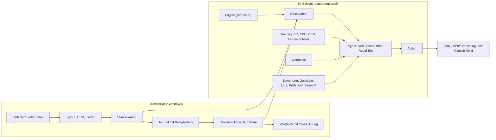

# Lynx – Technische Dokumentation

Stand 3.11.2026 (Code vom 1.11.2026) · Jakob Figur, entwickelt mit Claude Code

Lynx ist ein selbst gebautes No-Limit-Hold'em-System aus zwei Teilen: einem **Collector**, der Partien des PokerTH-Web-Clients ausschließlich aus dem Bildschirmbild erfasst, und einer **KI-Schicht** mit Regel-Engine, Bots, Bewertung, Training, Suche und Wertnetzen. Diese Dokumentation beschreibt den Code vollständig: Architektur, jedes Modul, Datenformate, Betrieb und Reproduktion. Die maschinell erzeugte Referenz aller Klassen und Funktionen steht in [`API-REFERENZ.md`](API-REFERENZ.md), die Hilfe aller Befehle in [`CLI-REFERENZ.md`](CLI-REFERENZ.md). Was erreicht wurde und warum, erzählt die [`CASE-STUDY.md`](CASE-STUDY.md).

## Inhalt

- [Überblick](#überblick): System auf einen Blick, Umfang, Verzeichnisse, Konventionen
- [Teil 1: Der Collector](#teil-1-der-collector-visuelle-erfassung): Erfassung, OCR, Karten, Rekonstruktion, Vergleich, Leiste, CLI, Formate, Tests, Betrieb
- [Teil 2: Die KI-Schicht](#teil-2-die-ki-schicht): Schnittstelle, Engine, Bots, Bewertung, Lernen, Suche, Wertnetze, Live, Daten, Reproduktion, Plattformen
- [Weiterführende Dokumente](#weiterführende-dokumente)

## Überblick

### System auf einen Blick



Beide Teile treffen sich an genau einer Schnittstelle: Eine `Observation` (was ein Spieler sieht) geht in einen Agenten, eine `Action` kommt heraus. Dieselbe Observation entsteht im Simulator, beim Abspielen aufgezeichneter Hände und live aus dem Bild. Dadurch läuft jeder Bot ohne Änderung in Training, Messung und Live-Beratung.

### Umfang

| Bereich | Umfang |
| --- | --- |
| Python-Code `collector/src/pokercollector` | 64 Module, 16.859 Zeilen; davon KI-Paket `ai/` 40 Module, 10.588 Zeilen |
| Tests `collector/tests` | 42 Dateien, 229 Testfunktionen; Lauf 3.11.2026 im exportierten Baum: 247 bestanden, 2 übersprungen (diese beiden brauchen Rohdaten bzw. ein Wertnetz, die nicht im Repository liegen) |
| Paket-Tabellen | `ai/preflop_equity.json`, `ai/hand_vs_hand.json` (169×169 Equity), `ai/pushfold_nash.json`, Layout-Profil `profiles/pokerth_web_v1.json` |
| Abhängigkeiten | Python 3.12, numpy, opencv-python, mss, torch (CPU), numba, pillow, winrt-OCR (nur Windows), pytest |

### Verzeichnisse

```text
lynx-poker/
├── collector/                 Python-Paket pokercollector
│   ├── src/pokercollector/    Collector-Module, CLI (cli.py), profiles/
│   │   └── ai/                KI: Engine, Bots, Bewertung, Training, Suche, Wertnetze, Live
│   ├── tests/                 pytest-Suite
│   ├── testdata/              Testbild eines PokerTH-Tisches
│   ├── pyproject.toml         Abhängigkeiten, Einstiegspunkt pokercollector
│   └── uv.lock                gepinnte Versionen
├── cloud/                     Hetzner-Skripte (Datenerzeugung, Lehrer-Sammlung), Kaggle-Kernel
├── scripts/                   gen_reference.py, experimente/ (Originalskripte der Läufe)
├── data/                      kleines Startpaket; alles Weitere entsteht lokal
├── docs/                      diese Dokumentation, Case Study, Referenzen, Projektnotizen
├── pc.cmd, tests.cmd, sync.cmd   Start unter Windows
└── pc.sh                      Start unter Linux/macOS
```

### Konventionen

- **Bots als Spezifikation:** Jeder Spieler ist ein Text wie `tag`, `nn?run=lynx-4@300&greedy=1` oder `hus?bp=lynx-4-300&vnet=vnet-river-1` (Teil 2, Abschnitt 1). Liga-Namen wie `lynx-4-300` stehen in `data/league/players.json`.
- **Maße:** Cash in bb/100 (Big Blinds je 100 Hände), Turniere als ROI in Prozent des Buy-ins, jeweils mit 95-%-Intervall in eckigen Klammern; `*` heißt, das Intervall schließt 0 aus. „Gepaart“ heißt, zwei Bots spielen exakt dieselben Karten und Tische.
- **Verweise:** `datei.py:Zeile` bezieht sich auf den Code vom 1.11.2026. „Doku x.y“ verweist auf Abschnitte des laufenden Projektprotokolls [`projektnotizen/DOKUMENTATION.md`](projektnotizen/DOKUMENTATION.md).
- **Sprache:** Code-Kommentare, Ausgaben und Dokumentation sind deutsch (Umlaute im Code als ae/oe/ue).

## Teil 1: Der Collector (visuelle Erfassung)

Stand des Codes: 31.10.2026 (`cli.py` zuletzt 31.10. 09:07). Alle Datei-Verweise beziehen sich auf `collector/src/pokercollector/`, sofern nicht anders angegeben. Zeilenangaben in der Form `datei.py:Zeile`. Was im Code steht, aber nie an echten Daten geprüft wurde, ist als **ungeprüft** markiert.

### 1. Zweck und Grundidee

Der Collector erfasst Partien des PokerTH-Web-Clients (Chrome-Fenster „PokerTH Web“) **ausschließlich aus dem Bildschirmbild**. Er fotografiert den Client-Bereich des Browserfensters, erkennt Tisch, Sitze, Karten und Beträge, liest Text mit der Windows-eigenen OCR, stabilisiert die Werte über die Zeit, schreibt jedes bestätigte Ereignis mit Bildbeleg in ein unveränderliches Journal und rekonstruiert daraus die Hände. Das PokerTH-Log (Export des Clients) wird nur in `compare.py`/`reference.py` gelesen und dient allein als unabhängige Referenz zur Messung der Erkennungsgüte.

Warum kein DOM, kein Netzwerk, kein Speicher: Das ist die bewusste Versuchsanordnung des Projekts (`PROJEKTUEBERGABE.md`, Abschnitte 1 und 3; `DOKUMENTATION.md` 1.1/1.2). Die Frage lautet „Geht es nur über das Bild?“, und die Antwort soll messbar sein. Entsprechend gibt es im Code keine Funktion, die klickt, tippt oder Fenster steuert; `capture.py:5-10` und `overlay.py:303` benennen das ausdrücklich. Die Kartenvorlagen (`data/templates`) stammen aus eigenen Screenshots und nicht aus dem Export (`glyphs.py:9`).

Drei Grundregeln, die sich durch alle Module ziehen:

1. **Provenienz je Wert.** Jedes Feld trägt Rohtext, Konfidenz, Bildrechteck und Methode (`analyzer.py:29-36`); jedes Ereignis im Journal verweist auf Frame, Videosegment und Belegbild (`journal.py:122-139`).
2. **Lücken melden statt füllen.** Nicht gesehene Aktionen werden als `unknown` mit Quelle `inferred_gap` eingetragen (`reconstruct.py:179-206`); Widersprüche landen in `hand.contradictions`.
3. **Rohdaten unveränderlich.** `observations.jsonl` ist append-only; `hands.json` ist jederzeit neu berechenbar (`reconstruct.py:3-4`), Prüfsummen in `manifest.json`.

### 2. Architektur und Datenfluss

```
Quelle                      capture.py
  VideoFileSource (mp4)  |  ImageDirSource (png/jpg)  |  WindowSource (mss, live)  |  SessionVideoSource (Sitzung erneut)
        |
        v  Frame(index, t_mono, t_wall, image, source_ok, note)
+----------------------------------------------------------------------------------+
| FrameAnalyzer.analyze()                                        analyzer.py        |
|   detect_layout()  Filz, Sitz-Panels, Marker D/SB/BB, Aktionsleiste  layout.py   |
|     SeatMemory     stabile Sitznummern ueber Frames                              |
|   RegionOcr.read() Windows.Media.Ocr (winrt) + Aenderungs-Cache       ocr.py     |
|   parse.*          Betraege, Blinds, Strasse, Spiel/Hand, Aktionswoerter parse.py|
|   CardReader       Slot leer/Rueckseite/offen, Rang (Vorlagen > Schrift-         |
|                    Formvergleich > gekachelte OCR), Farbe (Vorlagen > Heuristik) |
|                                                        cards.py, glyphs.py       |
+----------------------------------------------------------------------------------+
        |
        v  TableSnapshot: Feld -> FieldObs(value, raw, confidence, rect, method)
  Stabilizer.update()        change / transient / unknown            stabilize.py
        |
        v  FieldEvent
  Session.write_event()      observations.jsonl + evidence/*.png     journal.py
  SegmentRecorder.write()    video/segment_NNNN.mp4 + .frames.jsonl  capture.py  (nur live)
        |
        v  (jederzeit erneut: pc.cmd reconstruct)
  reconstruct(events)        Hand[] mit Aktionen, Quellen, Luecken   reconstruct.py
        |                    -> hands.json, hands.md (report.py)
        v  (nur auf Wunsch: pc.cmd compare)
  compare(hands, load_reference(pdb|txt))  -> compare.json/.md       compare.py, reference.py
```

**Live-Pfad** (`pipeline.LiveRunner`, `pipeline.py:133-293`): Die Aufnahme hat Vorrang. Jeder Frame geht sofort in den `SegmentRecorder`; die Analyse läuft in einem eigenen Thread mit einer Warteschlange der Länge 1 (`pipeline.py:161`). Kommt die Analyse nicht hinterher, wird das ältere, noch nicht analysierte Bild verworfen und gezählt (`frames_skipped_analysis`); Videoframes gehen nie verloren. Die Sitzung beginnt automatisch, wenn `detect_layout` in `detect_frames=5` aufeinanderfolgenden Bildern einen Tisch mit mindestens 2 Sitzen findet (`pipeline.py:240-258`), und endet `stop_after_s=20` s nach Verschwinden des Tisches oder Verlust der Quelle (`pipeline.py:227-239`, `281-289`). Fehler in Rekonstruktion, Bot oder Leiste werden als `event_errors` gezählt und beenden den Analysefaden nicht (`pipeline.py:185-195`).

Auf den Live-Pfad setzt die KI auf: `cli.cmd_live` hängt per `on_event` einen `LiveBot` (`ai/live.py`) an, der pro Ereignis den stabilisierten Zustand (`Stabilizer.state()`) in eine `Observation` übersetzt und einen Vorschlag erzeugt; die Anzeige übernimmt die **Lynx-Leiste** (`overlay.py`). Details zum LiveBot gehören zu Teil 2 (KI); die Leiste ist in Abschnitt 3.17 beschrieben.

Sitznummern sind durchgehend: 0 = eigener Platz (unten Mitte), danach im Uhrzeigersinn = Aktionsreihenfolge, maximal 10 (`layout.py:3-9`, `reconstruct.py:26`).

### 3. Modul für Modul

#### 3.1 `geometry.py` (78 Zeilen)

`Rect(x, y, w, h)` als frozen dataclass (`geometry.py:11`) mit `clip`, `crop(img)`, `sub(rx, ry, rw, rh, scale)` (Teilrechteck in Referenzpixeln mal Maßstab, Z. 54), `iou`, `as_list`/`from_list`. Alle Rechtecke im Projekt sind Frame-Koordinaten in Pixeln.

#### 3.2 `profile.py` (41 Zeilen) und `profiles/pokerth_web_v1.json`

`Profile.load(path=None)` lädt entweder das eingebaute Profil `pokerth_web_v1.json` (Paketressource, `profile.py:35-41`) oder eine JSON-Datei; `Profile.id` = `name@version` (`pokerth_web@1.0.0`) wird in jede Sitzung geschrieben. `profile.hsv(*keys)` liefert HSV-Grenzen als `np.uint8`-Arrays.

Inhalt des Profils (Quelle: Screenshot 25.10.2026, 1905×980, 10 Sitze):
- `reference`: Panelbreite 133 px, Panelhöhe 97, Einsatzzeile 21, eigenes Panel 158×102. Daraus wird der Maßstab berechnet.
- `felt_hsv`, `panel_hsv`: Farbgrenzen für Filz (grün) und dunkle Spieler-Panels.
- `seats[].anchor`: relative Soll-Positionen (0..1 zum Filz). **Werden von `layout.py` nicht mehr zum Suchen benutzt** (siehe 3.3); nur `anchor_tolerance` 0.06 fließt in `SeatMemory` ein.
- `panel_regions.seat|hero`: Teilbereiche `cards`, `text`, `bet` in Referenzpixeln.
- `board_slots` (5), `pot`, `info_row` (Höhe 50 px, drei Bereiche links/mitte/rechts über dem Filz), `action_bar.min_width/height` 380×110.
- `card`: Farbgrenzen für Kartenfläche und rote Rückseiten, Mindestgröße 22×32.
- `markers`: HSV je D/SB/BB, Durchmesser 32, `max_distance` 140.
- `active_border_hsv` (gelber Rahmen des Spielers am Zug), `fold_tint_threshold` 7.0.

Neues Layout: Profil kopieren, Werte anpassen, mit `pc.cmd --profile mein.json calibrate bild.png` prüfen.

#### 3.3 `layout.py` (279 Zeilen): Tisch, Sitze, Marker

`detect_layout(frame, profile, memory=None) -> TableLayout` (`layout.py:206-279`):
1. `_felt_rect` (Z. 99): Filz als Rechteck aus Zeilen/Spalten, deren Filzfarbanteil > 45 % ist; mindestens 25 % der Bildhöhe bzw. -breite müssen passen, sonst `found=False`.
2. `_dark_components` (Z. 116): dunkle Zusammenhangskomponenten im Filz (Closing 9×9, Mindestfläche 4000·est_scale²). Dünne Randzeilen mit < 30 % Deckung werden abgeschnitten (Schatten fliegender Karten).
3. Aktionsleiste = größte Komponente ab 380×88 px·Maßstab (Z. 218-224). Panels = Komponenten mit Seitenverhältnis 0.9–1.9; sehr breite Streifen werden verworfen.
4. **Eigenes Panel** = unteres Panel mit kleinstem horizontalem Abstand zur Filzmitte (Z. 235-236), ausdrücklich nicht das größte.
5. **Maßstab** = Median der Fremdpanelbreiten / 133 (Z. 237-244); Rückfall auf eigenes Panel / 158 oder Filzbreite / 1905.
6. `SeatMemory.assign` (Z. 57-96): Beim ersten Bild wird nach Winkel um den Panel-Schwerpunkt im Uhrzeigersinn nummeriert, eigener Platz = 0. Danach greedy Zuordnung über die Distanz (Toleranz 0.06 relativ zum Filz), gleitender Mittelwert 0.9/0.1, verschwundene Panels behalten ihre Nummer, neue bekommen die nächste freie (max. 10).
7. Board-Slots und Pot aus relativen Profilwerten; Infozeile oberhalb des Filzes (`info_left/center/right`), Warnung, wenn sie nicht im Bild ist.
8. `_find_markers` (Z. 143-203): Farbmasken je D/SB/BB außerhalb von Panels, Board, Leiste; Kandidat 0.6–1.4 × Durchmesser, Seitenverhältnis 0.8–1.25, **Kreisförmigkeit der konvexen Hülle ≥ 0.8** (trennt Buttons von Karten, Z. 183-185); Zuordnung zum nächsten Panel, `seat=None` ab `max_distance`.

Datentypen: `SeatPanel(seat, rect, full_rect, has_bet_row, hero)`, `Marker(kind, rect, seat, distance)`, `TableLayout(found, felt, scale, seats, board_slots, pot, info_*, action_bar, markers, unmatched_panels, warnings)`.

Geprüft: 10er-Tisch (Testbild), 6er- und 4er-Tisch (Aufnahmen 26.10.). Grenze: unter ca. 80 % Referenzgröße (Fenster < ~1500 px) unzuverlässig (`tests/test_screenshot.py:68-84` testet 0.85 und 1.25).

#### 3.4 `ocr.py` (234 Zeilen): Texterkennung

- `WindowsOcr` (`ocr.py:43-96`): `winrt.windows.media.ocr.OcrEngine.try_create_from_user_profile_languages()` (oder feste Sprache). Bild → BGRA → `SoftwareBitmap`, `recognize_async` in einer eigenen asyncio-Schleife. Bilder über `OcrEngine.max_image_dimension` werden verkleinert. Rückgabe: Zeilen `(text, (x, y, w, h))`. Fehlt eine OCR-Sprache, wirft der Konstruktor `RuntimeError` (Z. 58-59).
- `FakeOcr` (Z. 99): feste Antworten für Tests.
- `RegionOcr(backend, upscale=3.0, cache_tolerance=1.5)` (Z. 115-230):
  - `read(frame, rect, key, upscale, accept)`: schneidet aus, vergrößert kubisch, füllt 16 px Rand auf (Windows-OCR verliert Text am Bildrand, Z. 142-143). **Cache**: 48×16-Graustufen-Thumbnail je `key`; mittlere Abweichung ≤ 1.5 → altes Ergebnis (Z. 156-165). Mit `accept`-Funktion werden bei Misserfolg bis zu vier Varianten probiert (Skalierung 2.0, 4.0, invertiert; Z. 188), aber je Schlüssel nur alle `retry_s=1.0` s, damit dauerhaft unlesbare Bereiche nicht die Analysezeit fressen (Z. 182-199).
  - `read_glyph_tiled(glyph_ink, repeats=3, heights=(120,80,160))` (Z. 204-230): setzt ein Einzelzeichen dreimal nebeneinander, weil Windows-OCR isolierte Zeichen oft nicht erkennt.
  - Zähler `calls`, `cache_hits` landen in `session.json["ocr"]`.
- `OCR_VERSION = "winocr-1"` (Z. 18), Teil der `analyzer_version`.

#### 3.5 `parse.py` (195 Zeilen): Parser für OCR-Text

Alle Parser liefern `Parsed(value, ok, corrected, note)` (`parse.py:17`). Korrekturen werden nur innerhalb erwarteter Muster vorgenommen und als `corrected=True` gemeldet; die Konfidenz im Analyzer sinkt dann von 0.9 auf 0.6.

| Funktion | Eingabe → Ausgabe | Besonderheiten |
|---|---|---|
| `parse_money(text)` Z. 30 | `'$3 000'`, `'S3 000'`, `'$O'`, `'2.5k'` → int | `_DIGIT_FIXES` (O→0, l/I→1, S→5, B→8, Z→2); Währungszeichen `$`/`S`/`§`; **`5` wird bewusst nicht als `$` gedeutet** (Z. 36-37); Tausendergruppen müssen 3-stellig sein |
| `extract_money(text)` Z. 69 | erster Betrag mit Währungszeichen in einer Zeile | reine Ziffernzeile wird als „ohne Waehrungszeichen gelesen“ markiert (Konfidenz später 0.3) |
| `parse_street` Z. 96 | preflop/flop/turn/river/showdown | Teiltreffer erlaubt |
| `parse_game_hand` Z. 108 | `'Spiel: 1 Hand: 12'` → `(1, 12)` | |
| `parse_blinds` Z. 120 | `'10/20 ↑8'` → `{sb, bb, extra}` | `extra` = Text hinter dem Pfeil (vermutlich Hände bis zur Erhöhung, unsicher) |
| `parse_labeled_money` Z. 133 | `'Gesamt: $30'` mit Label | |
| `parse_action_label` Z. 167 | fold/check/call/bet/raise/allin/post_sb/post_bb | Präfixtreffer; sonst Levenshtein ≤ 1 bei Wörtern ab 4 Zeichen (`Cali` → call) |
| `parse_button` Z. 183 | `'Call $20'` → `('call', 20)` | |

#### 3.6 `glyphs.py` (80 Zeilen): Rang per Schrift-Formvergleich

Hintergrund: Windows-OCR erkannte an einer 6er-Aufnahme nur 3 von 7 Rängen (`glyphs.py:3-5`). `font_templates()` (Z. 40-64, `lru_cache`) zeichnet die 13 Ränge („10“ für T) in bis zu 34 Windows-Schriften aus `C:/Windows/Fonts` (Liste Z. 25-31) mit Pillow, beschneidet auf die Tinte und normiert auf `GLYPH_SIZE = (20, 28)`. `match_rank(glyph, aspect)` (Z. 67-80) berechnet die Korrelation des normierten Bildglyphs mit jeder Vorlage minus `ASPECT_WEIGHT=0.6 · |log(aspect/aspect_vorlage)|` und liefert `(Rang, Score, Abstand zum zweitbesten)`. Ohne Pillow oder ohne Schriften: leere Liste, dann greift die OCR-Rückfallstufe.

#### 3.7 `cards.py` (306 Zeilen): Kartenerkennung

- `TemplateStore(root)` (`cards.py:56-105`): lädt `data/templates/rank/<R>/*.png` und `suit/<s>/*.png` (255 = Tinte), skaliert auf 20×28. `match(kind, glyph)` = beste normierte Korrelation je Label, `add()` speichert neue Vorlagen (für `harvest-cards`).
- `CardReader(profile, ocr, templates)`:
  - `_face_rects` (Z. 156-182): weiße Flächen in einem Bereich, Seitenverhältnis 0.45–0.95, ≥ 70 % Füllung, Rotanteil < 25 %, Weißanteil > 60 % → offene Karte. Kleines Closing 3×3, damit eng liegende Karten nicht verschmelzen.
  - `_count_backs` (Z. 184-199): rote Rückseiten; verschmolzene Rückseiten werden über `w/(h·0.72)` gezählt.
  - `read_face(frame, rect) -> CardRead` (Z. 201-291): Innenbereich (7 % Rand abgeschnitten), Tinte = Grau < 150. Rang oben / Farbe unten getrennt an der größten Zeilenlücke (Z. 211-227). Farbe rot/schwarz aus den Tintenpixeln (`r − max(g,b) > 60` bei > 50 % der Pixel). **Rang-Kaskade**: (1) gelernte Vorlage, wenn Score > 0.75 und Abstand > 0.1 → `rank:template`; (2) Schrift-Formvergleich, wenn Score > 0.55 und Abstand > 0.08 → `rank:font` (Konfidenz ≤ 0.8); (3) gekachelte OCR mit Mehrheitsvotum → `rank:ocr-tiled` (Konfidenz 0.5–0.9), gecacht nach 10×14-Thumbnail. **Farb-Kaskade**: Vorlage (> 0.75 / 0.1) → `suit:template`, sonst `_suit_heuristic` (Z. 108-137: Herz = breite Oberseite > 0.45; Karo = oben und unten schmal < 0.3; Pik = Spitze oben und Solidity > 0.8; Kreuz = Solidity < 0.8), Konfidenz 0.4–0.6. Widerspricht die Form der Tintenfarbe, wird die Farbe verworfen (`suit:color-conflict`).
  - `read_region(frame, hsv, region, scale) -> SlotRead(state, backs, faces)` mit `state` ∈ faces/backs/empty.
- `CARDS_VERSION = "cards-1"`.

Stand der Vorlagen: `data/templates/rank/{2..9,T,J,Q,K,A}` mit je 24–40 PNGs (Q: 40), `suit/{c,d,h,s}` je 25, alle aus 6er-Tisch-Aufnahmen (`pokerth6-*`). Die Konturheuristik für Karo/Kreuz ist **nicht systematisch geprüft** (`cards.py:5-6`); in den Vergleichen vom 26.10. stimmten aber alle 55 Boardkarten (`DOKUMENTATION.md` 3.4/3.5).

#### 3.8 `analyzer.py` (351 Zeilen): Frame → TableSnapshot

`FrameAnalyzer(profile, ocr, cards)` mit eigener `SeatMemory`; `reset()` vergisst die Sitzpositionen bei neuer Sitzung. `analyze(frame, frame_index, t_mono, t_wall) -> TableSnapshot` (`analyzer.py:121-152`) setzt Felder in dieser Reihenfolge: `table.found`, `table.scale`, Infozeile, Pot, Board, Aktionsleiste, **Marker vor Sitzen** (damit ein neuer Dealer-Button vor den neuen Blinds gemeldet wird, Z. 139-140), dann je Sitz 0–9.

Feldschlüssel und Methoden:

| Feld | Quelle | Konfidenz |
|---|---|---|
| `info.total`, `info.bets` | OCR links („Gesamt“, „Einsätze“), `_info_row` Z. 156 | 0.9 / 0.6 korrigiert |
| `info.blinds` `[sb, bb]`, `info.blinds_extra` | OCR Mitte | 0.85 / 0.5 |
| `info.street`, `info.game_hand` `[spiel, hand]` | OCR rechts | 0.9 |
| `pot.total` | OCR Pot, `accept=_has_money` (Z. 192-201) | 0.9; `None` mit 0.0 wenn unlesbar |
| `board.count`, `board.cards` (5 Einträge, `"??"` = unlesbar, `None` = leer) | Kartenflächen in einem Suchfenster Tischmitte (22–78 % Filzbreite, zwischen Pot und eigenem Panel, Z. 203-221) | 0.9 bei 0/3/4/5 Karten, sonst 0.3 |
| `hero.to_act` | Aktionsleiste gefunden | 0.8 |
| `hero.buttons` | OCR der Leiste, Liste `{action, amount, primary, raw}`, nur große Knöpfe (untere 55 %) | 0.8; **leere Liste mit 0.5**, damit alte Call-Knöpfe nicht nachleuchten (Z. 255-258) |
| `marker.D/SB/BB` | Sitznummer oder None | 0.9 / 0.0 |
| `seat.n.present` | Panel vorhanden | 1.0 |
| `seat.n.name`, `seat.n.stack` | OCR Textbereich, Stack = Zeile mit Betrag (`_STACK_LIKE`), Name = Rest | 0.7 (0.5 bei „...“); Stack 0.9 / 0.6 / 0.3 ohne Währungszeichen |
| `seat.n.bet` | OCR Einsatzzeile, wenn `has_bet_row`; sonst 0 mit Methode `no-bet-row` | 0.9 / 0.8 |
| `seat.n.folded` | Label „Fold“ oder Panel-Tönung `_panel_tint > 7.0` (ausgeblendetes Panel lässt Grün durch, Z. 97-107) | 0.95 / 0.7 |
| `seat.n.action_label` | OCR im Kartenbereich | 0.85 |
| `seat.n.cards_state` | folded / faces / backs / empty | 0.8 |
| `seat.n.cards` | Liste wie Board | min. Kartenkonfidenz |
| `seat.n.active` | gelber Rahmenanteil `_yellow_border_share > 0.12` (Z. 84-94, 349-351) | 0.8 |

OCR-Vergrößerung wird über `_up(base, scale)` (Z. 60-62) so gewählt, dass Text unabhängig vom Tischmaßstab gleich groß wird. `ANALYZER_VERSION = "analyzer-1/winocr-1/cards-1"`.

Messwerte: Screenshot 1905×980 ca. 200 ms erste Analyse, 40 ms unverändert; live 6er-Tisch Median 271 ms, p95 564 ms (`sessions/20261028-222209/hands.md`).

#### 3.9 `stabilize.py` (120 Zeilen): zeitliche Stabilisierung

`Stabilizer(min_frames=2, min_ms=150, unknown_after_ms=1500, min_confidence=0.3)` (`stabilize.py:58-63`). `update(snap) -> list[FieldEvent]`, `state()` = aktueller stabiler Zustand (Feld → Wert). Regeln:
- Ein neuer Wert wird erst nach `min_frames` aufeinanderfolgenden Lesungen **und** `min_ms` als `change` gemeldet; dabei wird die Beobachtung mit der höchsten Konfidenz als Beleg genommen (Z. 99-110).
- Ein Kandidat, der vor der Bestätigung wieder verschwindet, wird als `transient` protokolliert, nicht weggemittelt (Z. 115-120).
- Unlesbar (`None` mit Konfidenz 0) oder Konfidenz < 0.3 ersetzt einen stabilen Wert erst nach 1,5 s durch `unknown` (Z. 74-85).
- `FAST_FIELDS = ("hero.to_act",)` braucht nur 1 Frame (Z. 19).

`FieldEvent(kind, field, old, new, t_first, t_confirmed, frame_first, frame_confirmed, confidence, raw, rect, method, note)` ist das Journalformat (Abschnitt 5.2).

#### 3.10 `journal.py` (225 Zeilen): Sitzungsordner

`Session.create(base, source, profile_id, analyzer_version, extra)` (`journal.py:73-96`) legt `sessions/<UTC yyyymmdd-HHMMSS>_<uuid8>/` mit `evidence/`, `video/` an und schreibt `session.json`. `write_event(event, frame, segment)` (Z. 122-139) nummeriert `seq`, schneidet bei vorhandenem `rect` den um 6 px erweiterten Bereich als `evidence/<seq:07d>_<feld>.png` aus und hängt die Zeile an `observations.jsonl` (flush je Zeile). Ein `RLock` schützt Journal und Metadaten, weil Analyse- und Hauptthread schreiben (Z. 68). `gap()`, `error()` schreiben in `session.json`. `close()` setzt `ended_utc`, baut `index.sqlite` (Tabellen `events`, `hands`; Z. 166-193) und `manifest.json` mit SHA-256 aller Dateien außer `evidence/` (Z. 204-210). `verify_manifest()` meldet fehlende/geänderte Dateien. `read_events()` übersteht eine abgeschnittene letzte Zeile nach Absturz (`corrupt_line`, Z. 158-162). `SCHEMA_VERSION = 1`.

#### 3.11 `capture.py` (341 Zeilen): Bildquellen und Aufnahme

- `Frame(index, t_mono, t_wall, image, source_ok, note)` (`capture.py:31-38`).
- `VideoFileSource(path, step_s)` (Z. 92-122): OpenCV, `t_mono` aus Videoposition, `t_wall` geschätzt aus Dateizeit minus Dauer; `step_s` überspringt Frames.
- `SessionVideoSource(session_dir)` (Z. 125-156): spielt die Segmente einer Live-Sitzung mit den echten Zeitstempeln aus `*.frames.jsonl` erneut ab (Nachauswertung mit neuem Code: `pc.cmd analyze <sitzung>`).
- `ImageDirSource(path, interval_s)` (Z. 159-176): Screenshots in Dateireihenfolge.
- Fensterfunktionen (Z. 179-274): `list_windows(filter)`, `window_info(hwnd)` über `user32` (ctypes), Client-Rechteck in Bildschirmpixeln, `foreground`-Flag. `_ensure_dpi_aware()` setzt `PER_MONITOR_AWARE_V2`, sonst stimmen Koordinaten bei 125 % Skalierung nicht (Z. 208-221).
- `WindowSource(hwnd, fps=10.0, max_seconds, require_foreground=True)` (Z. 293-365): `mss.grab` des Client-Bereichs im festen Takt. Fenster geschlossen → Abbruch; minimiert, nicht im Vordergrund oder Grab-Fehler (Bildschirmsperre) → `Frame(source_ok=False, note=...)`. Rückstand > 5 Perioden wird nicht nachgeholt, sondern bleibt als Lücke sichtbar (Z. 330-331). `describe()` dokumentiert die Methode `mss-screen-region` und die Grenze (Überdeckung) in `session.json`.
- `SegmentRecorder(video_dir, fps, segment_s=120.0, codec="mp4v")` (Z. 370-431): neues Segment bei Größenwechsel oder nach 120 s; je Frame eine Sidecar-Zeile `{i, frame, t_mono, t_wall}`. H.264 ist nicht verfügbar (bräuchte zusätzliche Bibliothek).

- **Masken für eigene Anzeigen** (seit 3.11.2026, Z. 42-89): Die Lynx-Leiste ist ein normales Fenster, das jede Bildschirmaufnahme sieht. Damit der Collector sie nicht mitliest, meldet sie ihr Fenster mit `register_mask_window(hwnd)` an (Z. 49). `WindowSource` holt je Bild die aktuelle Fensterfläche über `window_rect` (`GetWindowRect`, Z. 277) und schneidet sie mit `apply_masks(img, origin, rects)` aus (Z. 66): Die Fläche wird mit dem Median eines 3 px breiten Rings um sie herum gefüllt, meist also Filzgrün, und als `Frame.masked` in Bildkoordinaten gemeldet (Z. 355). `SegmentRecorder` vermerkt das je Bild im Sidecar als `masked` (Z. 417), `describe()` nennt die Methode in `session.json`. Was unter der Leiste liegt, ist für den Collector verdeckt; `cmd_live` meldet einmal auf der Konsole, wenn die Leiste im PokerTH-Fenster liegt (`on_mask`, `cli.py:169`). Bis 2.11.2026 verbarg sich die Leiste stattdessen per `WDA_EXCLUDEFROMCAPTURE` vor allen Aufnahmen; das wurde für die Veröffentlichung ersetzt, damit sie für Aufzeichnungen und Bildschirmfreigaben sichtbar bleibt.

Nicht gebaut: überdeckungsfeste Fensteraufnahme per Windows.Graphics.Capture (im Docstring als geplanter C#-Adapter genannt).

#### 3.12 `pipeline.py` (293 Zeilen): Verbindung

- `make_analyzer(profile, templates_dir, ocr_backend=None)` (Z. 38-40).
- `write_hands(session_root)` (Z. 43-50): `reconstruct(read_events(...))` → `hands.json` (atomar über `.tmp`).
- `RunStats` (Z. 54-71): `frames_seen/analyzed/skipped_analysis/source_lost`, `analysis_errors`, `event_errors`, `events`, Median und p95 der Analysezeit → `session.json["stats"]`.
- `run_offline(source, sessions_dir, profile, analyzer, on_event, progress) -> Path` (Z. 83-130): Video wird per Pfad + SHA-256 referenziert, nicht kopiert; Zeitsprünge > max(1 s, 4·kleinstes dt) werden als `gap` protokolliert.
- `LiveRunner` siehe Abschnitt 2. Statuswerte: `wartet`, `Tisch erkannt`, `Aufnahme`, `Analyse verzoegert` (Bildalter ≥ 1,5 s), `Quelle verloren`.

#### 3.13 `reconstruct.py` (754 Zeilen): Handrekonstruktion, Version `reconstruct-2`

`reconstruct(events) -> list[Hand]` (`reconstruct.py:747-754`) sortiert alle Journalzeilen mit `seq` nach `(t_first, _priority(field), seq)`; `_priority` (Z. 730-744) ordnet gleichzeitig sichtbar gewordene Felder: table → game_hand → marker → blinds → street → board → present/name → seat → hero. Dann `Reconstructor.feed(ev)` je Ereignis und `finish()`.

Datentypen (Z. 40-92): `Action(t, street, seat, name, type, amount_to, added, allin, source, confidence, frames, evidence, note)` mit `type` ∈ post_sb, post_bb, fold, check, call, bet, raise, collect, unknown; `SeatInfo(seat, name, start_stack, end_stack, cards, cards_source, folded, allin)`; `Hand(game_no, hand_no, t_start, t_end, boundary, dealer, sb_seat, bb_seat, blinds, seats, board[5], actions, pot_observations, contradictions, gaps, status, status_reasons)`.

Zeitkonstanten (Z. 27-36): `TURN_GRACE_S 0.9` (Wartezeit nach Hervorhebungswechsel), `SWEEP_WINDOW_S 2.0` (Einsatz fällt nahe Straßenwechsel auf 0 = Einsammeln), `SETTLE_S 2.5` (Einschwingen nach Handwechsel), `LATE_S 1.5` (späte Fold/Einsätze gehören zur vorigen Straße), `ADOPT_S 30` (verspätete Handnummer wird übernommen), `MIN_HAND_S 4.0` (Dealerwechsel kurz nach Handbeginn ist kein neuer Handbeginn).

Ablauf:
- **Handgrenzen** (`feed`, Z. 622-650): Handnummer (`info.game_hand`) → `boundary="observed"`. Ohne Nummer: Board leer nach Flop/Turn/River oder Dealer-Button gewandert (nach ≥ 4 s und mindestens einer freiwilligen Aktion) → `boundary="inferred"`; kommt die Nummer innerhalb 30 s nach, wird sie übernommen (`status_reasons` „Handnummer verspaetet gelesen“).
- **Einschwingen** (`_start_hand` Z. 210, `_settle` Z. 238-300): Nach Handbeginn werden Sitz-Ereignisse der Eigenschaften bet/folded/action_label/active/stack bis zu 2,5 s gepuffert, bis SB- und BB-Marker und leeres Board gesehen wurden. Dann: Dealer/SB/BB aus Markern, SB-Platz ggf. aus BB abgeleitet (alter SB-Marker der Vorhand wird verworfen, Z. 251-261), Startstacks = Stack + sichtbarer Einsatz, bereits sichtbare Blinds als `post_sb/post_bb`, dann die gepufferten Ereignisse geordnet nachgespielt; Stackzuwächse in dieser Phase werden der **Vorhand** als `collect` gutgeschrieben (Z. 286-297).
- **Einsätze** (`_bet_change_now` Z. 438-480): Steigt der Einsatz über das Straßenmaximum → bet/raise, gleich → call, darunter → call mit halbierter Konfidenz („unter dem Hoechstgebot“) bzw. All-in, wenn der Stack 0 ist. Sinkt er auf 0 innerhalb 2 s nach Straßenwechsel → Einsammeln; sinkt er sonst → Widerspruch. Preflop werden SB/BB-Beträge am richtigen Sitz als Blinds erkannt.
- **Folds** (`_fold` Z. 496): über Label oder Panel-Ausblendung, ggf. der vorigen Straße zugeordnet (`_late_for_prev` Z. 486-494).
- **Checks**: Label „Check“ → `observed_label`; Hervorhebung wechselt ohne Einsatzänderung → nach 0,9 s `derived_turn` (Konfidenz 0.4, Z. 546-569).
- **Reihenfolge** (`_check_order` Z. 179-206): übersprungene Sitze bekommen eine `unknown`-Aktion mit Quelle `inferred_gap` und einen Eintrag in `hand.gaps`.
- **Straßenende** (`_close_street` Z. 352-387): Wer noch in der Hand ist und weniger als das Maximum gesetzt hat, hat gecallt; wer nichts gesetzt hat und keine freiwillige Aktion zeigt, hat gecheckt → `inferred_street_end`, Konfidenz 0.6. Grund: der abschließende Call ist praktisch nie zu sehen, weil die Einsätze sofort eingesammelt werden.
- **Gewinne** (`_stack_change` Z. 571-600): Stackzuwachs → `collect` (`derived_stack`); Absinken und Rückkehr ohne Einsatzänderung wird als Lesefehler verworfen (`stack_dips`).
- **Karten**: Mehrheitsvotum je Boardslot bzw. je Sitz über alle bestätigten Lesungen (`board_votes`, `card_votes`, Z. 651-660, 708-718); Wechsel der Mehrheit wird als Widerspruch notiert. `cards_source` = `visible_hole_cards` (Sitz 0) oder `visible_showdown`.
- **Abschluss** (`_finish_hand` Z. 302-350): Stackbilanz Start = Ende − Gewinne + Einsätze, Abweichung → Widerspruch. `status = "complete"` nur ohne Gründe; sonst `partial` mit `status_reasons` (Handgrenze abgeleitet, Dealer/Blinds nicht gesehen, BB nicht beobachtet, n Lücken, n Widersprüche, Gewinner nicht beobachtet).

Grenzen: Side Pots, Split Pots, Sitzwechsel, Verbindungsabbruch nicht gezielt getestet; Checks landen teils beim falschen Sitz (`DOKUMENTATION.md` 3.4). In der Live-Sitzung vom 28.10. waren nur 3 von 31 Händen `complete`, obwohl der Vergleich mit dem Log 88 % Precision/Recall der Aktionen ergab; „partial“ heißt meist „Gewinner oder Lücke nicht beobachtet“, nicht „falsch“.

#### 3.14 `reference.py` (270 Zeilen) und `compare.py` (281 Zeilen)

`reference.py` liest den PokerTH-Export in zwei Formaten:
- **SQLite `.pdb`** (`load_pokerth_log` Z. 118-174): Tabellen `Hand`, `Action`, optional `Player`; Kartencodierung 0..51 = Rang 2..A je Farbe in der Reihenfolge d, h, s, c (`CARD_SUIT_ORDER`, Z. 25). `REFERENCE_PARSER_VERSION = "pokerth-sqlite-1 (ungeprueft)"`: Schema und Codierung stammen aus der PokerTH-Desktop-Quelle; `pc.cmd inspect-reference` zeigt das echte Schema. **Nicht an einem echten `.pdb` des Web-Clients geprüft** (Z. 12-14).
- **Text-Log des Web-Clients** (`load_pokerth_text_log` Z. 206-259, `TEXT_PARSER_VERSION = "pokerth-web-text-1"`): Muster `--- Game: 1 | Hand: 5 ---`, `Seat 3: Name ($1000)`, `BLIND LEVEL`, `BLINDS`, Straßenzeilen mit Boardkarten, Aktionen `folds.`, `calls $X.`, `bets $X.`, `raises $X.`, `is all in with $X.`, `shows [Ah,Kd]`, `wins $X`, `starts as dealer.`. **Geprüft an echten Exporten** (26.10., 28./29.10.; Dateien `sessions/*/pokerth-log.txt`). Betragssemantik laut Kommentar Z. 180-181: `bets $X` = Straßensumme „auf X“, `calls $X` = zusätzlich gezahlt.
- `load_reference(path)` (Z. 262-270) erkennt das Format am Dateikopf (`SQLite format` bzw. `Log-File for PokerTH`).
- Ergebnis: `RefHand(game_id, hand_id, dealer_seat, sb_seat, bb_seat, blinds, seats{n: name, cash, cards}, board, actions[RefAction(street, seat, name, type, amount, raw)])`.

`compare.compare(visual_hands, ref_hands, hero_seat_visual=0) -> CompareResult` (`compare.py:135-281`):
- `map_seats` (Z. 27-48): visueller Sitz → Referenzsitz über den häufigsten erkannten Namen (Präfixvergleich, weil Namen abgeschnitten sind).
- Zuordnung der Hände **nur über die Handnummer** (plus Spielnummer bei Mehrdeutigkeit, Z. 143-158); bekannte Schwäche: hängende Handnummern führen zu nicht zugeordneten Händen (Spiel 5 am 28.10.: 14 von 25).
- Felder: `dealer`, `sb_seat`, `bb_seat`, `blinds`, `start_stack`, `hero_cards`, `shown_cards` (verdeckte Karten zählen als `not_visible`, nicht als Fehler), `board`, `action` (LCS-Ausrichtung je Straße über (Sitz, Grobtyp), `_align` Z. 99-132), `action_amount` (Treffer, wenn der Referenzbetrag entweder `amount_to` oder `added` entspricht; `amount_semantics` zählt beides), `winner` (`collect`).
- `FieldTally` mit match/mismatch/missing/extra/not_visible, Precision = match/(match+mismatch+extra), Recall = match/(match+mismatch+missing).

Beste gemessene Werte (6er-Tisch, 12 Hände, `sessions/20261026-224738_d01408e9/compare.md`): Board 55/55, Blinds/SB/BB 100 %, Dealer 92 %, Aktionen Precision 0.88 / Recall 0.89, Beträge 98,7 %, Startstacks 90 %.

#### 3.15 `report.py` (120 Zeilen)

`overlay(frame, snap)` (Z. 15-56) zeichnet Filz, Infozeile, Pot, Boardslots, Aktionsleiste, Marker (`D->0`), Sitze (rot = gefoldet, gelb = aktiv) mit Name/Stack/Einsatz/Karten und eine Fußzeile Spiel/Hand/Straße/Blinds → `calibrate`. `hands_markdown(session_root)` (Z. 65-100) erzeugt `hands.md` (Kopf mit Quelle, Versionen, Statistik; je Hand Tabelle Straße/Sitz/Aktion/auf/+/Quelle/Konf./Notiz, Widersprüche, Lücken). `compare_markdown(result)` (Z. 103-120) erzeugt `compare.md`.

#### 3.16 `poker.py` (183), `fastpoker.py` (202), `advisor.py` (125)

- `poker.py`: Kartennotation Rang `23456789TJQKA` + Farbe `shdc`; `evaluate(cards)` (Z. 48-95) bewertet 5–7 Karten als Tupel (Kategorie 0–8, dann Kicker); `equity_vs_random(hero, board, opponents, iterations=3000, seed, dead)` (Z. 113-176) Monte-Carlo gegen Zufallshände, nutzt `fastpoker.mc_stats`, wenn numba verfügbar und keine `dead`-Karten; `pot_odds(to_call, pot)`.
- `fastpoker.py`: numba-kompilierte Variante, Karten als 0..51 (`Rang·4 + Farbe`), Bewertung als Integer `Kategorie << 20 | Ränge je 4 Bit` (`eval_cards` Z. 63-124), `_mc` mit partiellem Fisher-Yates (Z. 128-187). Gleiche Rangfolge wie `poker.evaluate`, Test über 40 000 Vergleiche; ca. 85× schneller. Ohne numba Rückfall auf reines Python (Z. 21-32).
- `advisor.py` (`ADVISOR_VERSION = "baseline-equity-1"`): `state_from_snapshot_state(st)` baut `GameState(hero_cards, board, opponents, pot, to_call, hero_stack, big_blind, issues)` aus dem Stabilizer-Zustand (Gegner = anwesend, nicht gefoldet, Karten backs/faces; `to_call` aus Call-/Check-Knopf). `advise(gs, iterations=2500, seed=0, margin=0.05)` (Z. 82-125): Equity gegen Zufallshände vs. Pot Odds und fairer Anteil 1/(n+1) → fold/call/raise bzw. check/bet, mit Begründungen und ausdrücklichen Annahmen. Bewusst einfachste Baseline (keine Ranges, keine Zukunftseinsätze); im Live-Betrieb durch die Lynx-Netze abgelöst, aber als `pc.cmd advise` und `--agent equity` weiter nutzbar.

#### 3.17 `overlay.py` (282 Zeilen): Lynx-Leiste (`OVERLAY_VERSION = "leiste-1"`)

- `Advice(kind, text, detail, alternatives)` (Z. 45-51); `advice_from(sug, obs, agent)` (Z. 54-84) übersetzt Vorschlag + Observation in Anzeige: „CHECK“ statt „FOLD“, wenn checken möglich; „BET“/„RAISE auf“/„ALL-IN“ mit Betrag in Chips und BB; Warnungen bei unsicherem Pot oder geschätztem Call-Betrag (`WARNINGS` Z. 89-90); Alternativen mit Wahrscheinlichkeiten aus `agent.last_probs` bzw. `agent.last["probs"]` (`alternatives` Z. 93-109).
- `Leiste(sound=True, title="Lynx")` (Z. 132-294): Tk-Fenster 430×64 in eigenem Thread, Kommunikation über `queue.Queue` (`show`, `idle`, `status`, `close`). Fensterstil: `overrideredirect`, topmost, Alpha 0.94, Ex-Styles `WS_EX_TOOLWINDOW | WS_EX_NOACTIVATE | WS_EX_TOPMOST` (kein Fokus, kein Taskleisten-Knopf). Die Leiste ist für jede Bildschirmaufnahme sichtbar; `_style_window` meldet ihr Fenster mit `capture.register_mask_window` an (Z. 206-216), damit der Collector ihre Fläche aus seinen Bildern ausschneidet (Abschnitt 3.11), `masked_in_capture` zeigt das an, beim Beenden meldet `quit` sie wieder ab. Nach `mainloop` werden die Tk-Objekte im Tk-Thread freigegeben (Z. 198-204); sonst bricht Tcl beim Programmende mit „Tcl_AsyncDelete“ und Exitcode 3 ab. Farben je Aktion (`COLORS` Z. 31-38), Töne per `winsound.Beep` (`TONES` Z. 41-42: Fold 392 Hz, Check/Call 587, Raise 880, All-in 880+1175). Statuspunkt grün/gelb/rot/grau. Ziehen verschiebt, Position in `data/live/leiste.json` (`settings_path` Z. 112-114); Rechtsklick: Ton an/aus, Position zurücksetzen (Standard: rechts unten über der Taskleiste, `SPI_GETWORKAREA`).

#### 3.18 `system.py` (27 Zeilen)

`keep_awake(enabled=True)` (Z. 13-27): Kontextmanager um `SetThreadExecutionState(ES_CONTINUOUS | ES_SYSTEM_REQUIRED | ES_DISPLAY_REQUIRED)`; am Ende `ES_CONTINUOUS`. Bildschirm wird mit wachgehalten, weil bei Modern Standby das Abschalten des Bildschirms zum Standby (und zum Trennen des USB-Sticks) führt. `cli.main` umschließt **jeden** Befehl damit, abschaltbar mit `--allow-sleep` (`cli.py:1457-1460`).

### 4. CLI-Referenz (`cli.py`, 1459 Zeilen)

Aufruf: `pc.cmd [--profile datei.json] [--allow-sleep] <befehl> ...` (Einstiegspunkt `pokercollector = pokercollector.cli:main`, `pyproject.toml`). Datenwurzel: `POKERCOLLECTOR_DATA` oder `<Projekt>/data` (`data_dir`, `cli.py:17-22`). Sitzungsargumente akzeptieren Pfad, Namensteil oder `last` (`_session_path`, Z. 35-45).

**Collector-Befehle** (Z. 1071-1144):

| Befehl | Argumente | Was passiert | Beispiel |
|---|---|---|---|
| `calibrate IMAGE [--out PFAD]` | Bilddatei | Ein Bild analysieren, alle Felder mit Konfidenz ausgeben (`<-- unsicher` unter 0.6), Overlay-Bild `*.overlay.png` schreiben (`cmd_calibrate` Z. 53) | `pc.cmd calibrate collector\testdata\pokerth_preflop_hand1.png` |
| `analyze INPUT [--step 0.2] [--interval 1.0]` | Video, Bildordner, Einzelbild oder Sitzungsordner | Neue Offline-Sitzung: Video alle `--step` s, Screenshots mit `--interval` s Abstand; ein Sitzungsordner wird über `SessionVideoSource` mit echten Zeitstempeln neu ausgewertet (Z. 73-101). Schreibt `hands.md` | `pc.cmd analyze C:\aufnahme.mp4`, `pc.cmd analyze 20261028-222209` |
| `windows [FILTER]` | Titelteil | Sichtbare Fenster mit hwnd, Client-Größe, Titel (Z. 104) | `pc.cmd windows PokerTH` |
| `live [--window PokerTH] [--hwnd N] [--fps 8] [--segment 120] [--stop-after 20] [--max-seconds N] [--no-video] [--allow-background] [--advice] [--leiste] [--still] [--kein-eintrag] [--mischen] [--agent lynx-4-300]` | | Live-Erfassung mit automatischen Sitzungen (Z. 125-212). `--advice`: Vorschlag in der Konsole; `--leiste`: Lynx-Leiste (impliziert `--advice`); `--still` ohne Ton; `--mischen`: aus gemischter Strategie ziehen statt greedy; `--allow-background`: auch aufnehmen, wenn das Fenster nicht im Vordergrund ist (Risiko: fremder Inhalt). Turnierenden werden automatisch in `data/ziele/pokerth.jsonl` eingetragen, außer `--kein-eintrag`. Rekonstruktion und Gegnermodell laufen immer mit. Ende mit Strg+C | `pc.cmd live --leiste` |
| `live-replay SESSION [--agent]` | Sitzung | Aufnahme wie live abspielen: jede Entscheidung mit Verlauf, Vorschlag, Gegnermodell (Z. 280). KI-nah, aber Collector-Daten | `pc.cmd live-replay last` |
| `leiste-demo [--still] [--sekunden 3]` | | Leiste ohne Tisch vorführen (Z. 259) | |
| `reconstruct SESSION` | Sitzung | `hands.json`, `index.sqlite`, `hands.md` neu erzeugen (Z. 297) | `pc.cmd reconstruct last` |
| `report SESSION` | Sitzung | `hands.md` auf die Konsole (Z. 309) | |
| `inspect-reference FILE` | `.pdb` | Tabellen und Spalten der SQLite-Datei (Z. 314) | |
| `compare SESSION REFERENCE` | Sitzung, `.pdb` oder `.txt` | Vergleich → `compare.json`, `compare.md` im Sitzungsordner, Ausgabe auf Konsole (Z. 320) | `pc.cmd compare last C:\export.txt` |
| `advise IMAGE` | Bild | Baseline-Empfehlung aus einem Screenshot (Z. 335) | |
| `harvest-cards IMAGE...` | Bilder | Interaktiv: jede erkannte offene Karte wird vergrößert als `data/templates/_last_card.png` abgelegt, Nutzer bestätigt oder korrigiert (`Td`), Rang- und Farbglyphe landen als Vorlagen (Z. 354-387) | `pc.cmd harvest-cards a.png b.png` |
| `verify SESSION` | Sitzung | Prüfsummen gegen `manifest.json`; Exit 1 bei Abweichung (Z. 1057) | `pc.cmd verify last` |

**KI-Befehle** (nur Auflistung; Details in Teil 2): `sim agents|match|hand|tournament|pushfold|review` (Z. 1146-1184), `play`, `play-stats` (Z. 1186-1204), `league show|add|retire|run|bench` (Z. 1206-1228), `train cem|gate|bc|rl|cfr|deepcfr|exploit|humans-fit|valuedata|valuenet|teacher-collect|teacher-fit|humanfold` (Z. 1230-1261, 1303-1324, 1358-1450), `bench run|show|slumbot|gtow|ziele|turnier|compare` (Z. 1262-1307), `data pluribus|humans|humandata|humanpublic|agree` (Z. 1330-1362).

Hinweise: `cmd` zerlegt `&` in Bot-Spezifikationen, solche Aufrufe gehören in Anführungszeichen oder Python-Skripte. `live` lädt bereits beim Start `make_agent` aus dem KI-Paket (Z. 138-140); ohne Trainingsläufe unter `data/rl` schlägt der Standard-Agent `lynx-4-300` fehl, dann `--agent equity` verwenden (**nicht verifiziert**, aus `_agent_spec` Z. 215-218 geschlossen).

### 5. Datenformate

#### 5.1 Sitzungsordner `data/sessions/<UTC>_<id>/`

| Datei | Inhalt | Erzeugt von |
|---|---|---|
| `session.json` | `schema_version` 1, `session_id`, `created_utc`, `ended_utc`, `software_version`, `analyzer_version`, `profile`, `source` (Typ, Pfad/hwnd/Titel, fps, Methode, Grenze), `segments[]` (file, t_start, t_end, frames, width, height, fps_nominal, codec), `gaps[]`, `errors[]`, `stats`, `ocr`, `mode` (offline/live), `end_reason` | `journal.Session`, `pipeline` |
| `observations.jsonl` | eine Zeile je Ereignis (5.2), append-only | `Session.write_event` |
| `evidence/<seq>_<feld>.png` | Bildausschnitt je Ereignis mit Rechteck (+6 px Rand); 2407 Dateien in der Beispielsitzung | ebd. |
| `video/segment_NNNN.mp4`, `.frames.jsonl` | mp4v-Segmente à 120 s; Sidecar `{i, frame, t_mono, t_wall}` je Frame | `SegmentRecorder` (nur live) |
| `hands.json` | `{reconstruct_version, created, hands[]}` (5.3) | `pipeline.write_hands` |
| `hands.md` | lesbarer Handbericht | `report.hands_markdown` |
| `index.sqlite` | Tabellen `events(seq, kind, field, old, new, t_first, t_confirmed, frame_first, frame_confirmed, confidence, raw, method, note, evidence, segment)` und `hands(idx, game, hand, status, t_start, t_end, json)`; aus JSONL neu erzeugbar | `journal.build_index` |
| `manifest.json` | `{created_utc, files{pfad: sha256}}` ohne `evidence/` | `journal.write_manifest` |
| `compare.json`, `compare.md` | Vergleichsergebnis (5.5) | `cmd_compare` |
| `pokerth-log.txt` | vom Nutzer abgelegter Export (nicht vom Collector erzeugt) | manuell |

Beispiel (`20261028-222209_668678b4`): 1920×1140 Client, 8 fps, 7+ Segmente, 6740 Frames gesehen, 2457 analysiert, 4284 übersprungen, 2655 Ereignisse, 31 Hände.

#### 5.2 Journalzeile (`observations.jsonl`)

```json
{"kind": "change", "field": "seat.1.bet", "old": 0, "new": 10, "t_first": 46.57, "t_confirmed": 47.57,
 "frame_first": 372, "frame_confirmed": 373, "confidence": 0.9, "raw": "$10", "rect": [x, y, w, h],
 "method": "ocr", "note": "", "seq": 26, "segment": "video/segment_0001.mp4",
 "logged_utc": "2026-10-28T22:22:11.202+00:00", "evidence": "evidence/0000026_seat_1_bet.png"}
```

`kind` ∈ change / transient / unknown; `t_*` sind monotone Sekunden der Quelle (Video: Position; live: seit Start); `segment` ist bei Offline-Videos `external:<pfad>`. Nach Absturz kann die letzte Zeile unvollständig sein (`corrupt_line`).

#### 5.3 Hand-JSON (`hands.json`)

Je Hand: `game_no`, `hand_no`, `t_start`, `t_end`, `boundary` (observed/inferred), `dealer`, `sb_seat`, `bb_seat`, `blinds [sb, bb]`, `seats{"n": {seat, name, start_stack, end_stack, cards, cards_source, folded, allin}}`, `board[5]` (`null` = nicht gesehen), `actions[]` mit `{t, street, seat, name, type, amount_to, added, allin, source, confidence, frames[], evidence[], note}`, `pot_observations[]`, `contradictions[]`, `gaps[]`, `status` (complete/partial), `status_reasons[]`. Beträge: `amount_to` = Gesamteinsatz dieser Straße nach der Aktion, `added` = zusätzlich gesetzte Chips. Quellen siehe 3.13.

#### 5.4 Kartenvorlagen (`data/templates/`)

`rank/<2..9|T|J|Q|K|A>/<name>.png`, `suit/<c|d|h|s>/<name>.png`: Graustufen-PNG, 255 = Tinte, auf 20×28 normiert beim Laden. `_last_card.png` ist eine temporäre Vorschau von `harvest-cards`. Vorlagen sind unabhängig vom Export gewonnen.

#### 5.5 Vergleich (`compare.json`)

`{compare_version: "compare-1", seat_map{vis: ref}, hands_visual, hands_reference, hands_matched, fields{feld: {match, mismatch, missing, extra, not_visible, precision, recall, judged}}, amount_semantics{"referenz=gesamt_auf": n, "referenz=zusaetzlich": n}, details[{visual_hand, game, status, issues[]}]}`.

#### 5.6 Leisten-Konfiguration (`data/live/leiste.json`)

`{"x": int, "y": int}`; wird beim Loslassen nach dem Ziehen geschrieben. Fehlt die Datei (derzeit der Fall, `data/live/` ist leer), gilt die Standardposition rechts unten im Arbeitsbereich.

#### 5.7 Zieltafel (`data/ziele/pokerth.jsonl`)

Eine Zeile je echtes PokerTH-Turnier (`ai/ziele.py`, Pfad `bench_dir().parent/ziele/pokerth.jsonl`): `{"t": "2026-10-29 00:21:08", "platz": 6, "spieler": 6, "bot": "lynx-3-300", "notiz": "...", "quelle": "auto", "haende": 10, "spiel": 1, "letzte_hand": 10}`. `quelle=auto` stammt von der automatischen Turniererkennung im Live-Pfad; Einträge ohne `quelle` wurden mit `pc.cmd bench turnier` von Hand gesetzt. Stand 29.10.: 8 Turniere.

#### 5.8 Weitere `data/`-Ordner (Zweck)

| Ordner | Zweck | Teil |
|---|---|---|
| `sessions/` | Aufzeichnungen (5.1) plus Logs `live-*.log`, `reanalyze-*.log`, `compare3-*.md` | Collector |
| `templates/` | Kartenvorlagen (5.4) | Collector |
| `live/` | Leistenposition (5.6) | Collector |
| `ziele/` | Zieltafel (5.7) | Collector/KI |
| `bench/` | Prüfstand: `results.jsonl`, `report.md`, `slumbot/`, `gtow/`, Lauf-Protokolle `*.txt` | KI |
| `rl/` | Trainingsläufe (Checkpoints, Logs, Gates), `NACHTPROTOKOLL.md` | KI |
| `league/` | Liga: `players.json`, `games.jsonl`, `benchmarks.jsonl`, `report.md/html` | KI |
| `sim/`, `train/`, `teacher/`, `valuenet/`, `datasets/`, `humans/`, `external/`, `cloud/` | Simulationsergebnisse, CEM-Trainings, Lehrerdaten, Wertnetz-Daten, Pluribus-Datensätze, HandHQ-Auswertung, PHH-Rohdaten, Cloud-Zugänge (nicht im Backup) | KI |
| `play/` | von `pc.cmd play` angelegt (derzeit nicht vorhanden) | KI |
| `live-abend*.txt`, `review-*.md`, `tests-*.txt`, `backup-*.txt` | Konsolenmitschnitte der Live-Abende, Review-Berichte, Testläufe, Backup-Protokolle | beide |

### 6. Tests

Ort: `collector/tests/`, 41 Testdateien plus `helpers.py`. Stand 3.11.2026: im vollständigen Projekt **249 bestanden**, im exportierten Baum **247 bestanden, 2 übersprungen (diese beiden brauchen Rohdaten bzw. ein Wertnetz, die nicht im Repository liegen)** (volle Suite im exportierten Repository-Baum, also so, wie ein frischer Klon sie sieht). Konfiguration: `testpaths = ["tests"]` in `pyproject.toml`, `pytest` in der Gruppe `dev`.

Ausführen: `tests.cmd` (alle, `pytest -q -p no:cacheprovider collector\tests`, weitere Argumente werden durchgereicht) oder einzeln `cd collector && PYTHONIOENCODING=utf-8 ..\tools\uv\uv.exe run --quiet --no-sync pytest -q -p no:cacheprovider tests\test_x.py`. Tests, die Windows-OCR brauchen, überspringen sich selbst, wenn `make_analyzer` fehlschlägt (`test_screenshot.py:17-20`).

Collector-Tests:

| Datei | Tests | Prüft |
|---|---|---|
| `test_screenshot.py` | 5 (davon 1×10, 1×2 parametrisiert) | Ende-zu-Ende am echten Screenshot `testdata/pokerth_preflop_hand1.png`: 10 Sitze, Maßstab 1.0 ± 0.03, Marker D/SB/BB = 0/1/2, Spiel/Hand [1,1], Blinds 10/20, Pot 30, alle Namen/Stacks/Einsätze, Fold bei Sitz 3, aktiv Sitz 4, eigene Karten `6s 9h`, Knöpfe fold/call 20/raise 40; dasselbe bei 85 % und 125 % Bildgröße |
| `test_pipeline.py` | 2 | `SegmentRecorder` schneidet Segmente richtig (12 Frames, 1 s → 3 Segmente); Offline-Sitzung aus synthetischem Video: Journal, Beleg, Index, Hand mit post_sb/post_bb/fold, Startstacks aus Stack+Blind, Manifest gültig |
| `test_capture_mask.py` | 5 | Masken für eigene Anzeigen (seit 3.11.): Füllung mit der Umgebungsfarbe, Teilüberdeckung am Bildrand, Maske über dem ganzen Bild, Graustufenbild, An- und Abmelden, Vermerk `masked` im Sidecar |
| `test_reconstruct.py` | 8 | Synthetische Ereignisse (`helpers.EventStream`, `standard_hand`): vollständige Hand, nicht gesehene Aktion wird gemeldet statt erfunden, sinkender Einsatz = Widerspruch, Check-Label, Rest-Einsatz der Vorhand ignoriert, später Fold der vorigen Straße + erschlossene Calls, Board-Mehrheitsvotum, `SeatMemory` behält Nummern bei Ausscheiden |
| `test_stabilize.py` | 3 | Bestätigung nach 2 Frames/150 ms, Transient-Meldung, `unknown` erst nach Timeout, `hero.to_act` sofort |
| `test_parse.py` | 5 | Betragsvarianten, `5` nicht als `$`, Chip-Symbol vor Betrag, Infozeile, Aktionswörter inkl. Verleser |
| `test_compare.py` | 3 | `decode_card`, perfekter Treffer gegen selbst gebaute SQLite-Referenz, Erkennung von Fehlern |
| `test_poker.py` | 4 | Handkategorien, Kicker, Equity-Plausibilität, Pot Odds und Baseline-Empfehlung |
| `test_fastpoker.py` | 2 | gleiche Rangfolge wie `poker.evaluate` (Zufallshände), Monte-Carlo trifft bekannte Werte |
| `test_overlay.py` | 3 | Texte/Farben der Leiste, Check statt Fold, Alternativenliste |
| `test_live.py` / `test_live_review.py` | 18 / 12 | Live-Pfad (`ai/live.py`): Entscheidungserkennung, Pot-Quellen, `$`-Verleser, veraltete Einsätze, `TournamentWatch` (Ausscheiden, Sieg, Endbildschirm, Neustart), Phantom-Vorschläge. Code liegt im KI-Paket, prüft aber Collector-Semantik |
| `test_ziele.py` | 3 | Zieltafel und Stufen |

Alle übrigen Dateien (`test_engine`, `test_ai`, `test_rl`, `test_husearch` usw.) gehören zur KI (Teil 2).

### 7. Betrieb

#### 7.1 Portables Setup auf dem USB-Stick

In der portablen Variante liegt alles im Projektordner auf dem Stick (Laufwerksbuchstabe egal, `%~dp0`):
- `tools\python\cpython-3.12.12-windows-x86_64-none\` (148 MB, portabler CPython), `tools\uv\uv.exe` (+ `uvw.exe`, `uvx.exe`), `tools\uv-cache\` (1,4 GB Offline-Paketcache mit wheels/sdists/builds).
- `collector\.venv` (Projekt-venv, von uv angelegt), `collector\uv.lock` (gepinnte Versionen, u. a. numpy 2.5.4, opencv-python 5.0.0.93, mss 10.2.0, numba 0.68.0, pillow 13.0.0, torch 2.14.1+cpu, winrt-runtime 4.0.3, winrt-Windows.Media.Ocr 10.0.28000.2705, pytest 9.1.1).
- `pc.cmd` setzt (wenn `tools\uv\uv.exe` vorhanden ist) `UV_PYTHON_INSTALL_DIR`, `UV_CACHE_DIR`, `UV_LINK_MODE=copy` (exFAT kennt keine Hardlinks), `UV_PYTHON_PREFERENCE=only-managed`, `PYTHONIOENCODING=utf-8` und ruft `uv run --quiet --no-sync --project collector pokercollector %*`. **`--no-sync`** verhindert, dass bei jedem Start Pakete geprüft werden (würde laufende Trainings stören). `tests.cmd` ebenso für pytest. `sync.cmd` (`uv sync`) nur nach Änderungen an `pyproject.toml` und nur, wenn nichts läuft.
- `pc.sh`: Linux/Server-Gegenstück, nutzt ein systemweit installiertes `uv` (`~/.local/bin/uv`), setzt `POKERCOLLECTOR_DATA=$ROOT/data`; die Windows-Werkzeuge unter `tools\` werden dort nicht benutzt. `tools\uv-env.sh`/`dev-env.sh`: Umgebungsvariablen für Git Bash bzw. eine Entwicklungskopie `dev/src` über `PYTHONPATH`.
- Es wird nichts auf dem Rechner installiert.
- **Ohne `tools\` (frischer Klon):** `pc.cmd`, `tests.cmd` und `sync.cmd` rufen dann ein installiertes `uv` auf (seit 3.11.2026); einmalig vorher `sync.cmd` bzw. `uv sync --project collector`.

#### 7.2 Windows-Abhängigkeiten

| Baustein | Abhängigkeit | Fehlerbild |
|---|---|---|
| OCR | `winrt-Windows.Media.Ocr` u. a. (nur `sys_platform == 'win32'`), eine installierte Windows-OCR-Sprache | `RuntimeError("Windows-OCR nicht verfuegbar")` in `ocr.py:58`; OCR-Tests überspringen sich |
| Live-Aufnahme | `mss` (Bildschirmausschnitt), `user32` über ctypes, DPI-Awareness | falsche Koordinaten ohne DPI-Awareness; Lücke bei verdecktem Fenster |
| Video | OpenCV `mp4v` | `RuntimeError("Videoencoder ... nicht verfuegbar")` (`capture.py:400-401`) |
| Leiste | tkinter (im portablen CPython enthalten), `winsound`, `GetWindowRect` für die Maske | liegt die Leiste über dem Tisch, ist dieser Bereich für den Collector verdeckt; Leiste neben den Tisch schieben |
| Kartenränge | Pillow + Schriften unter `C:/Windows/Fonts` | ohne Schriften nur Vorlagen und OCR-Rückfall |
| Tempo | numba (JIT, `cache=True`) | ohne numba Python-Rückfall, ~85× langsamer |

Betriebssystem laut Dokumentation: Windows 11 Pro 10.0.26200, PowerShell 5.1 und Git Bash; Laptop i5-1335U, 16 GB, keine GPU.

#### 7.3 Energie und Standby

Jeder `pc.cmd`-Aufruf hält System und Bildschirm wach (`system.keep_awake`, Abschnitt 3.18); `--allow-sleep` schaltet das ab. Hintergrund: Bei Modern Standby trennt Windows den USB-Stick, sobald der Bildschirm abschaltet. Am 28.10. wurde zusätzlich das selektive USB-Energiesparen per `powercfg` für Netz und Akku deaktiviert (`DOKUMENTATION.md` 2.5).

#### 7.4 Bekannte Betriebsprobleme

| Problem | Ursache / Beleg | Gegenmittel |
|---|---|---|
| Stick fällt aus („No Media“, Ereignis „disk 11 Controllerfehler“; 27.10., 28.10. zweimal) | USB-Energiesparen, Standby | `keep_awake`, `powercfg`; nach Ausfall umstecken (`pnputil` braucht Adminrechte), notfalls vom Backup arbeiten |
| Live nimmt nur im Vordergrund auf | mss fotografiert den Bildschirm, ein überdeckendes Fenster würde mitgelesen (`capture.py:7-10`) | PokerTH-Fenster vorn und unverdeckt halten; sonst Lücke „Quelle verloren“; `--allow-background` nur bewusst |
| Fenster zu klein | unter ~80 % Referenzgröße (< ~1500 px) unzuverlässig | Fenster maximieren |
| Vorschläge verzögert | Analyse ~270 ms/Bild bei 8 fps; früher Warteschlange 3 Bilder | Queue der Länge 1 (`pipeline.py:161`), Status zeigt „Bildalter“ |
| Handnummer-OCR hängt 10–20 s | OCR-Cache/Anzeige | Handwechsel auch über Board leer und Dealerwechsel (`reconstruct.py`, ADOPT_S/MIN_HAND_S) |
| `$` als `5` gelesen („51000“) | OCR | nur im Live-Pfad korrigiert (`ai/live.fix_dollar_misreads`); in der OCR selbst offen |
| Siegerstack des Endbildschirms als Einsatz gelesen (Pot 13438 statt 30 im Folgeturnier, 29.10.) | veralteter Feldwert | `drop_stale_bets` im Live-Pfad; Turnierchips-Summe war trotzdem verfälscht (offen) |
| RAM-Knappheit (16 GB) | Training + Prüfstand + Live gleichzeitig | nacheinander laufen lassen |
| `compare` ordnet nur über Handnummer zu | `compare.py:143-147` | offen; betroffene Hände erscheinen als „keine passende Referenzhand“ |
| Checks beim falschen Sitz, Check-Label bleibt bis in die nächste Straße stehen | Label-Sichtbarkeit bei 4–8 Bildern/s | offen |

#### 7.5 Ablauf eines Live-Abends (Kurzform)

1. PokerTH Web im Chrome öffnen, noch kein Spiel starten. 2. `pc.cmd live --leiste` starten (wartet auf Tisch). 3. Spiel starten, Fenster vorn halten. 4. Vorschlag lesen, selbst klicken. 5. Nach Turnierende Strg+C, damit ein offener Sieg eingetragen wird (`bot.session_ended()`, `cli.py:199-201`). 6. Auswertung: `pc.cmd live-replay last`, Export als `pokerth-log.txt` in den Sitzungsordner legen, `pc.cmd compare last <export>`.

### 8. Was beim Collector nicht geprüft ist (Zusammenfassung)

- Karo/Kreuz-Heuristik ohne Vorlagen; 2-, 3-, 7–10-Spieler-Tische live; Side/Split Pots, Sitzwechsel, Verbindungsabbruch.
- SQLite-Import (`.pdb`) des Web-Clients: Parser ist als „ungeprueft“ markiert, alle echten Vergleiche liefen über das Text-Log.
- Überdeckungsfeste Aufnahme (Windows.Graphics.Capture) nicht gebaut; H.264 nicht verfügbar.
- Live-Standardagent setzt vorhandene Trainingsläufe voraus (Abschnitt 4, Hinweis).

## Teil 2: Die KI-Schicht

Umfang: das Paket `collector/src/pokercollector/ai/`, `fastpoker.py`, die Trainings- und Mess-Skripte und die Cloud-Skripte unter `cloud/`.

Alle Pfade in diesem Teil sind relativ zum Projektordner; Modulpfade ohne Präfix liegen unter `collector/src/pokercollector/ai/`. Zeilenangaben beziehen sich auf den Stand vom 2.11.2026. Zahlen aus Messungen sind, wo nicht anders vermerkt, aus `DOKUMENTATION.md` (Abschnitte 6 bis 8) übernommen und nicht neu nachgerechnet.

### 1. Überblick: eine Schnittstelle für Simulator, Replay und Live

Die gesamte KI-Schicht hängt an einer einzigen Schnittstelle, die in `observation.py` definiert ist:

- `Action` (`observation.py:18-39`): `kind` ist `fold | check | call | raise`; bei `raise` ist `amount` der Gesamteinsatz dieser Straße nach der Aktion ("raise auf"), nie der Zuschlag.
- `PublicAction` (`observation.py:43-49`): ein Eintrag im öffentlichen Verlauf mit `street`, `seat`, `kind` (`post_sb, post_bb, fold, check, call, bet, raise`), `amount_to`, `added`, `allin`.
- `Observation` (`observation.py:53-137`): alles, was ein Spieler sieht und nur das: eigene Karten, Board, Straße, Button/SB/BB-Plätze, Blinds, Stacks, Einsätze dieser Straße, insgesamt gesetzte Chips (`committed`), Fold-/All-in-/In-Hand-Flags, Verlauf, dazu die vom Spielleiter berechneten Rechte (`to_call`, `can_check`, `can_raise`, `min_raise_to`, `max_raise_to`). `source` ist `sim | replay | live`, `uncertain` listet im Replay und live, was nicht sicher ist, `tournament` trägt optional Stufe, Blinds, Spieler übrig, Durchschnittsstack, Auszahlungen. Hilfsfunktionen: `pot` (Summe `committed`, Zeile 90-93), `position()` (0 = Button, Zeile 118-123), `street_actions()`, `raises_this_street()`, `legal()`.
- `Agent` ist ein Protokoll mit `name` und `act(obs) -> Action` (`observation.py:140-144`).
- `clamp_action` (`observation.py:147-160`) macht jede Absicht regelkonform: Fold bei möglichem Check wird Check, Raise außerhalb `[min_raise_to, max_raise_to]` wird auf die Grenzen gezogen, Raise ohne Raise-Recht wird Check bzw. Call. Der Simulator ruft es in `play_hand` standardmäßig auf (`engine.py:341-342`, `on_illegal="clamp"`).

Dieselbe `Observation` entsteht an drei Stellen: in der Engine (`engine.Hand.observation`, `engine.py:182-192`), im Replay aus rekonstruierten Händen (`replay.decision_points`, `replay.py:19-95`) und live aus dem stabilisierten Collector-Zustand (`replay.observation_from_table_state`, `replay.py:115-179`, ergänzt um den Live-Verlauf in `live.LiveBot.observation`, `live.py:464-488`).

**Agenten-Registry und Spec-Strings.** `agents.make_agent(spec, seed)` (`agents.py:282-327`) ist der einzige Einstieg, über den Liga, Prüfstand, Training, Slumbot und Live einen Bot erzeugen. Aufbau einer Spezifikation:

| Form | Bedeutung | Code |
|---|---|---|
| `tag`, `rock`, `station`, `lag`, `maniac`, `random`, `caller`, `equity` | Einträge der `REGISTRY` (`agents.py:274-279`) | |
| `tag?vpip=0.25&bluff=0.2` | Stilbot mit überschriebenen `Style`-Feldern; nur für `StyleBot` erlaubt, unbekannte Felder werfen `ValueError` (`agents.py:314-324`) | |
| `nn?run=<Lauf>@<Checkpoint>` | Netz aus `data/rl/<Lauf>/ckpt_<N>.pt`; ohne `@` der neueste Checkpoint. Optional `&greedy=1`, `&temp=<T>`, `&fold=<Fold-Modell>`, alternativ `&ckpt=` (`nn_agent.py:231-244`) | |
| `hus?bp=<Liga-Name>` oder `hus?bp=run:<Lauf>@<N>&...` | Heads-up-Suche über einem Blueprint, alle Parameter in Abschnitt 6 (`husearch.py:1019-1053`) | |
| `search?bp=<Lauf>@<N>,worlds=16,gain=0.25` | Rollout-Suche Stufe 1; `,` oder `&` trennen (`search.py:160-165`) | |
| `cfr?run=<Lauf>` | Tabellen-MCCFR-Durchschnittsstrategie aus `data/rl/<Lauf>/cfr_avg.npz` (`cfr.py:291-295`) | |
| `<spec>:Name` | Namenssuffix hinter dem **letzten** Doppelpunkt, nur wenn der Name keines der Zeichen `=&?@/` enthält (`agents.py:285-289`). Das war am 31.10. ein Fehler: `partition(":")` zerlegte `run:lynx-5t@1`; jetzt `rpartition`. | |

Zufall ist in allen Bots aus der Situation abgeleitet: `BaseAgent.rng(obs)` seedet `random.Random` mit `name|seed|hand_id|len(history)|street` (`agents.py:90-91`). Gleiche Situation ergibt also dieselbe Entscheidung; das macht Duplicate-Bewertungen fair und Messungen wiederholbar.

### 2. Regel-Engine (`engine.py`) und Bewertungskern (`fastpoker.py`)

`engine.Hand` (`engine.py:68-325`) ist der Spielleiter für No-Limit Hold'em mit 2 bis 10 Plätzen (`ENGINE_VERSION = "nlhe-engine-1"`). Die Regeln stehen im Modul-Docstring (`engine.py:1-14`) und sind so umgesetzt:

- **Blinds und Reihenfolge** (`_post_blinds`, `engine.py:146-165`): bei zwei Spielern ist der Button der SB und handelt preflop zuerst, postflop zuletzt; sonst SB links vom Button, BB links davon. Zu kurze Stacks posten, was sie haben (`_put`, Zeile 137-144, setzt `allin`). Der Mindesteinsatz bleibt ein voller BB, auch wenn der BB kürzer gepostet hat (Zeile 160-163).
- **Karten**: Platz i bekommt `deck[2i], deck[2i+1]`, das Board ist `deck[20:25]` (Zeile 95-96). Dadurch erhält bei gleichem Seed jeder Platz dieselben Karten, egal wo der Button steht; darauf beruht das Duplicate-Verfahren.
- **Rechte** (`legal`, Zeile 169-180): `min_raise_inc` ist die letzte volle Erhöhung, mindestens 1 BB; ein Raise ist nur erlaubt, wenn der Spieler noch nicht gehandelt hat oder seit seinem letzten Handeln eine volle Erhöhung kam (`acted_at_full_level < full_raise_level`), wenn er mehr als den aktuellen Einsatz hat und noch jemand handeln kann. Reicht der Stack nicht für den Mindest-Raise, ist nur All-in möglich (Zeile 177-178).
- **Aktion** (`apply`, Zeile 196-234): prüft Zugrecht und Legalität, wirft sonst `IllegalAction`. Ein kurzes All-in unter einer vollen Erhöhung aktualisiert `full_raise_level` nicht (Zeile 224-226) und eröffnet die Runde für die anderen nicht neu.
- **Rundenende** (`_needs_action`, Zeile 236-246): wer gehandelt hat und mindestens den aktuellen Einsatz hat, muss nichts mehr tun. Zeile 238-245 ist der Fix des dokumentierten Bugs "kurzes All-in im BB zwang den SB zum Nachzahlen": sind alle anderen all-in oder raus, muss nur noch nachzahlen, wer unter dem höchsten Einsatz der lebenden Spieler liegt.
- **Showdown und Side Pots** (`_finish`, Zeile 282-325): Pots nach Einsatzstufen (`levels`), je Stufe die berechtigten Spieler; Stufen, auf die nur gefoldete Spieler gesetzt haben, gehen zurück (`returned`, Zeile 297-302). Ungerade Chips bekommt der erste Gewinner links vom Button (Zeile 311-313). `assert sum(stacks) == sum(start)` sichert die Chip-Erhaltung (Zeile 320). Handwert über `_hand_value`, das `fastpoker.evaluate_fast` nutzt, wenn numba da ist, sonst `poker.evaluate` (Zeile 27-31).
- `Hand.clone()` (Zeile 116-122) kopiert nur die veränderlichen Listen; die Suche und das Tabellen-CFR probieren damit jede eigene Aktion aus.
- `play_hand(agents, stacks, button, sb, bb, seed, ...)` (Zeile 328-348) spielt eine Hand zu Ende, klemmt Aktionen und ruft danach `hand_over(record, seat)` an jedem Agenten, der es anbietet (Gegnermodell, Trainingsbuchhaltung).

Validierung laut `DOKUMENTATION.md` 4.2: 18 Regeltests, 600 Zufallshände mit Chip-Erhaltung, alle 10.000 Pluribus-Hände des PHH-Datensatzes laufen mit identischen Endstacks durch (`phh.replay`, `phh.py:63-122`, erlaubt ±1 Chip bei Split, Zeile 113-116). Bekannte Lücke: Antes und Straddles kennt die Engine nicht; `phh.replay` und `humandata` überspringen solche Hände (`phh.py:70-72`, `humandata.py:71-73`).

**`fastpoker.py`** (im Paket `pokercollector`, nicht in `ai/`) ist der numba-Kern. Anlass war ein Profil vom 26.10.: 95 % der Simulationszeit in der Python-Handbewertung (Docstring Zeile 3-4). Karten sind Ganzzahlen `Rang*4 + Farbe` in der Reihenfolge von `poker.FULL_DECK` (`CARD_INDEX`, Zeile 19). `eval_cards(cards, n)` (Zeile 62-124) bewertet 5 bis 7 Karten als eine Zahl `Kategorie << 20 | Ränge je 4 Bit`, mit derselben Rangfolge wie `poker.evaluate` (Test `tests/test_fastpoker.py`). `_mc` (Zeile 127-187) ist die Monte-Carlo-Equity gegen k Zufallshände mit teilweisem Fisher-Yates-Mischen und liefert Summe, Quadratsumme, Siege, Splits; `mc_stats` (Zeile 198-202) ist die Python-Hülle. Ohne numba fallen `njit`/`prange` auf Identität zurück (Zeile 21-31), alles läuft dann langsam weiter. `husearch.py` und `ranges.py` importieren `njit`/`prange` von hier und bauen eigene Kernel darauf. Laut `LIESMICH.md` brachte das rund 85-fache Beschleunigung (37 auf 3100 Hände/s je Kern).

### 3. Bots

#### 3.1 Stilbots und Baselines (`agents.py`)

`Style` (`agents.py:130-145`) hat zwölf Felder: `vpip`, `pfr` (Perzentil-Schwellen über `tables.preflop_percentile`), `value_margin`, `raise_margin` (Equity über dem fairen Anteil für Value-Bet bzw. Raise), `call_slack` (callt auch unter den Pot Odds), `bluff`, `bet_size`, `open_size`, `push_bb` (ab diesem Stack nur Push/Fold), `nash_stack_factor` (Tabelle "als hätte man x-mal so viele BB"), `respect` und `sticky` (Call-Down: weniger Respekt je später die Straße; beide kamen mit den Mensch-Bots dazu, weil die Stilbots v1 Calling-Stations waren). Die fünf Stile stehen in `STYLES` (`agents.py:148-159`).

`StyleBot.act` (Zeile 239-243) teilt in `_preflop` (Zeile 192-218: unter `push_bb` an `_push_fold`, sonst Eröffnen/Callen nach Perzentil, gegen Raises engere Anteile `pfr*0.3`, `vpip*0.6`, ab zwei Raises nur Premium) und `_postflop` (Zeile 220-237: Equity per `mc_equity` mit `iterations=120`, `fair = 1/(Gegner+1)`, Respekt-Abzug `respect * (1 - sticky*later) * min(to_call/(pot-to_call), 1.5)` in Zeile 230-232). `_push_fold` (Zeile 168-190) nutzt `push_fold_spot` (Zeile 54-79: `first_in`, `facing_push`, `other`) und die Nash-Tabelle.

`RandomAgent` (Zeile 108-118) ist die Untergrenze, `CallAgent` (Zeile 121-126) die deterministische Station für Tests, `EquityAgent` (Zeile 246-271) die Baseline aus `advisor.py`.

Zufalls-Stilbots für das Training erzeugt `optimize.random_style_spec` (`optimize.py:88-93`) aus `RANDOM_SPACE` (Zeile 81-85), das bewusst weiter als der CEM-Suchraum `SPACE` ist.

#### 3.2 Push/Fold-Nash (`pushfold.py`)

Zwei Artefakte im Paket: `hand_vs_hand.json` (Equity-Matrix 169×169, `build_matrix`, Zeile 93-112, mit `combo_weights` für exakte Blocker-Gewichte, Zeile 57-68) und `pushfold_nash.json` (`build_table`, Zeile 204-230). Das Spiel `PushFoldGame` (Zeile 128-190): Pusher plus k Caller mit effektivem Stack S, Blinds nach `_blinds` (Zeile 121-126), totes Geld 1,5 BB; `solve` ist fiktives Spiel mit Schrittweite `1/(t+1)` über 600 Iterationen; `exploitability` misst den Gewinn einer perfekten Gegenstrategie je Rolle. Tabelliert sind `STACKS` 1 bis 25 BB und `MAX_BEHIND = 8` (Zeile 37-38). Modellgrenzen stehen im Docstring (Zeile 1-17): heads-up exakt, multiway vereinfacht (höchstens ein Caller, Caller unabhängig), Chip-EV ohne ICM. Abfragen: `push_probability`, `call_probability` (Zeile 247-265), `decision_ev` (Zeile 310) für die Push/Fold-Bewertung in `recording.RecordingAgent` (`recording.py:46-80`, `PF_MAX_BB = 15`).

#### 3.3 Mensch-Bots (`humans.py`, `humanbots.py`)

`humans.HumanStats` wertet die HandHQ-Dateien (`.phhs`, TOML) aus und zählt je anonymisierter Spieler-ID die HUD-Werte `STAT_KEYS` (`humans.py:29`: vpip, pfr, threebet, f3b, agg, ftb, cbet, wtsd, wsd) plus bb/100. Datenfallen aus `DOKUMENTATION.md` 4.4: fehlende `winnings` bei kampflosen Pots (PokerStars), Rückfluss in `winnings` (Party), `????` im Verlauf, Antes/Straddles werden übersprungen; die Gewinnschätzung dafür ist `_winnings` (`humans.py:59` ff.). `collect` (Zeile 243-266) verteilt Dateien in 20er-Blöcken auf Prozesse. `player_types` (Zeile 272-307) ist ein nach Händen gewichtetes k-Means über `TYPE_FEATURES` (Zeile 269), acht Starts, bester Fehler gewinnt; `type_name` (Zeile 310-325) benennt die Cluster. Ergebnis: `data/humans/handhq-25nl.json`.

`humanbots.fit_all` (`humanbots.py:156-181`) passt je Typ einen Stilbot per CEM über `FIT_SPACE` (Zeile 24, `RANDOM_SPACE` plus `respect`, `sticky`, engeres `bet_size`) an. Gemessen wird der Bot mit `measure` (Zeile 78-91): 6er-Cash mit 100 BB gegen `MEASURE_TABLE`, seine Hände werden mit `record_to_phh` (Zeile 32-75) in das PHH-Format übersetzt und durch **dieselbe** `HumanStats` geschickt, damit Bot- und Menschenwerte vergleichbar sind. Abstand = gewichtete Quadratsumme über `FIT_KEYS` (Zeile 27). Runde 2 setzt die Mensch-Bots der Vorrunde als Mitspieler ein (Zeile 158-159, 178-180). `push_bb` wird auf 0 festgeschrieben (Cash, Zeile 124, 133). Ergebnis `data/humans/mensch-25nl.json` mit `name` (`mensch-1` bis `mensch-6`), `type`, `share`, `spec`; `load_bots` (Zeile 184-187) liest es. Die erreichten Werte je Typ stehen in `DOKUMENTATION.md` 4.4 (Preflop gut getroffen, WTSD bei mensch-3/-4 schlechter). Die Datei `mensch-25nl.json` kombiniert laut Doku je Typ die bessere Version aus v1 und v2 (`mensch-25nl-v1.json`, `-v2.json` liegen daneben).

#### 3.4 Menschen-Politiknetz `human-1` und Fold-Modell (`humandata.py`, `humanfold.py`, Kaggle `train_human.py`)

`humandata.replay_handhq` (`humandata.py:66-138`) spielt eine HandHQ-Hand mit der Engine nach (Dollar × 100 = `SCALE`, heads-up Button = SB, Zeile 39, 97) und liefert für jeden Spieler mit gezeigten Karten je Entscheidung `features(feat-2)`, `action_mask(8)`, `from_action` und Metadaten (`META_FIELDS`, Zeile 42-43). `extract` (Zeile 189) schreibt Scherben `human-<nr>.npz` nach `data/humans/actions/` (120 Scherben vorhanden; laut Doku 7,35 Mio. Entscheidungen aus 1,21 Mio. nachgespielten Händen, 245 MB). `public_rows`/`extract_public` (Zeile 248-376) sind die zweite, **kartenfreie** Extraktion aller Entscheidungen inklusive Folds (`PUBLIC_FIELDS`, Zeile 243-245; `hole_class = -1` wenn unbekannt) in `public-<nr>.npz` (ebenfalls 120 Scherben, laut Doku 55,5 Mio. Entscheidungen). Dazu kommen die Berichte `report.json` und `report-public.json`; der Ordner ist zusammen 543 MB groß.

Das Politiknetz `human-1` wurde auf Kaggle trainiert (`cloud/kaggle/lynx-train-human/train_human.py`): 49 Merkmale → 512 → 512 → 8 Aktionen, exakt der Aufbau von `nn_agent.build_net`, Hold-out jede 50. Hand, Ergebnis `data/rl/human-1/ckpt_000001.pt` mit `features = "feat-2"`. `train_human.json` nennt 7.352.984 Zeilen (Hold-out 146.438) und als Vergleichslinie (Aktionshäufigkeit je Straße) eine NLL von 0,95 bis 1,06; die End-NLL 0,720 und die Trefferquoten (78 % preflop, 73 bis 75 % postflop) stehen in `DOKUMENTATION.md` 6.8. Weil in den Showdown-Daten kein Fold vorkommt, foldet `nn?run=human-1@1` nie.

`humanfold.py` liefert deshalb das Fold-Modell: `f(s) = P(fold | öffentlicher Zustand)` und `g(c|s) = P(Handklasse | s, weitergespielt)` über einen 20-dimensionalen kartenfreien Vektor (`public_vector_arrays`, Zeile 39-67; `public_vector(obs)` baut ihn aus einer Observation, Zeile 70-87). `HumanFold.continue_factor(obs, range_weights)` (Zeile 121-135) berechnet den Bayes-Rest `clip(g·(1−f)/P(c|s), 0, 1)` je der 1326 Kombinationen, wobei `P(c|s)` die aktuelle Range-Schätzung (nach Klassen aggregiert) ist. Training: `train` (Zeile 138-206), zwei MLPs (64 bzw. 256 breit, 3 Epochen, BCE bzw. Kreuzentropie), gespeichert als `.npz` mit Präfixen `f_`/`g_`, Datei `data/humans/human-fold-1.npz`. Einsatz: in der Suche als `oppfold=human-fold-1` (vor jeder Nicht-Fold-Aktion des Gegners, `bpranges.py:180-181`) und am Netz-Bot als `&fold=human-fold-1` (`NNAgent.p_fold_hand`, `nn_agent.py:181-191`; foldet mit `1 − Faktor` der eigenen Hand bei offenem Einsatz und rechnet sonst den Netz-Fold heraus, Zeile 211-218).

### 4. Bewertung

#### 4.1 Cash-Matches (`evaluate.py`)

`run_match(agents, hands, seed, sb, bb, stack_bb, duplicate=True)` (`evaluate.py:102-143`): jedes Blatt `k` hat den Deck-Seed `seed*1_000_003 + k`, Button `k % n`, und wird mit allen n Sitzrotationen gespielt; Stichprobeneinheit ist das Blatt (`per_unit`). `AgentStats.result` (Zeile 54-69) liefert bb/100 mit 95-%-Intervall über `t95(n)` (t-Quantile bis 30 Freiheitsgrade, sonst 1,96, Zeile 27-37), außerdem VPIP, PFR, Aggression (Bets+Raises/Calls postflop), WTSD, W$SD aus `_tally` (Zeile 72-99). `report_markdown` markiert Intervalle ohne 0 mit `*`.

#### 4.2 Turniere und ICM (`tournament.py`, `icm.py`)

`BlindSchedule` (`tournament.py:29-50`) verdoppelt nach `hands_per_level` Händen oder folgt einer Liste; `TournamentConfig` (Zeile 53-64) hat Startstack 3000, Auszahlung 50/30/20 %, Notbremse `max_hands = 3000`. `POKERTH_DEFAULT` (Zeile 68) ist 1000 Chips, 10/20, Erhöhung alle 9 Hände (aus dem PokerTH-Log vom 26.10.). `random_config` (Zeile 80-92) zieht für das Training Startstacks 20 bis 200 BB (log-gleichverteilt, 25 % genau 50 BB), Blind-Tempo aus `HANDS_PER_LEVEL` und zur Spielerzahl passende Auszahlungen; `random_players` nutzt `PLAYER_WEIGHTS` (Zeile 71) oder die `--table-weights`. `play_tournament` (Zeile 129-183) spielt bis einer alle Chips hat, "moving button" (Zeile 167), mehrere gleichzeitig Ausgeschiedene nach Startstack platziert, Gleichstand geteilt (`_assign_places`, Zeile 108-126). `run_tournaments` (Zeile 211-273) ist das Duplicate-Schema über alle Rotationen mit ROI in Buy-ins und Intervall.

`icm.icm_equity(stacks, prizes, seat)` (`icm.py:12-40`) ist Malmuth-Harville rekursiv bis zum letzten bezahlten Platz; `prizes_from(payouts, players)` (Zeile 47-49) macht aus Anteilen Preise in Buy-ins. ICM fließt nur in die Belohnung des Trainings ein (`rl._Collector._reward`, `rl.py:110-128`), nicht in die Merkmale.

#### 4.3 Liga (`league.py`)

Rating nach Weng-Lin mit Plackett-Luce-Modell (`rate_plackett_luce`, `league.py:65-86`), `MU0 = 25`, `SIGMA0 = 25/3`, `BETA = SIGMA0/2`, Anzeige `1500 + 48·(μ−25)` (`display`, Zeile 36-37), "sicher" = Anzeige − 3σ (`Player.conservative`, Zeile 60-62). Ein Ligaspiel (`play_round`, Zeile 142-160) ist ein Duplicate-Sit&Go-Schema über alle Rotationen, Rang nach Summe der Auszahlungen; Entscheidungen laufen durch `RecordingAgent`, dessen Push/Fold-Verlust mitgeschrieben wird. `run` (Zeile 162-179) bevorzugt Bots mit wenigen Spielen. `benchmark` (Zeile 183-206) spielt Cash und SNG gegen das feste `GAUNTLET` mit Seed 4242. Dateien `data/league/players.json` (18 Einträge, siehe Abschnitt 9), `games.jsonl` (90 Spiele), `benchmarks.jsonl`, `report.md/html`. Heute dient die Liga vor allem als Gegner-Pool (`cli._league_pool`, `cli.py:597-601`, baut `optimize.LeaguePool` aus allen aktiven Bots mit Spezifikation; `cli._league`, `cli.py:505-509`, legt fehlende Standard-Bots über `League.ensure_defaults` selbst an) und als Register der Titelverteidiger.

**Gate-Verfahren** (`optimize.gate`, `optimize.py:263-284`): Kandidat und Titelverteidiger spielen auf `schemes` frischen Kartenschemata `seed*7_000_003 + i` gegen dieselben, mit `_matchups(sch, pool, seed)` gezogenen Tische (bei `LeaguePool` ohne Self-Play und ohne den Titelverteidiger selbst, `cli.py:925` für `train rl`, `cli.py:1011` für `train cem` und `train gate`). Bestanden heißt: untere 95-%-Grenze der gepaarten Differenz > 0 (`passed`). Zwei Seed-Regeln: `train cem` nutzt `100_000 + --seed` (`cli.py:1043`), `train rl` nutzt `200_000 + seed*1000 + Ziel-Iteration` (`cli.py:928`); Hintergrund laut `LIESMICH.md`: früher teilten alle Gates Seed 777 und nutzten sich ab. Die Methodenregel "Gate nicht wiederholen" ist in `confirm.py` Docstring (Zeile 5) und `ZIELE.md` festgehalten: jede Bestätigung läuft genau einmal mit vorab festgelegtem Seed. Die Nachtskripte setzen den Titelverteidiger automatisch auf den letzten bestandenen Abschnitt (z. B. `train_lynx3.sh`: `CH=lynx-3-$T`, wenn in `players.json` vorhanden).

#### 4.4 Prüfstand (`bench.py`)

`BENCH_VERSION = "bench-1"`; Testsets ändern sich innerhalb der Version nie. `bench_set(name)` (`bench.py:90-136`) erzeugt deterministische Listen `(Seed, Gegnertisch)`:

| Set | Seeds | Tische | Format (`set_config`, Zeile 81-87) |
|---|---|---|---|
| `fest48` | 777000+i | immer `DEFAULT_POOL` rock/tag/lag/station/maniac | `DEFAULT_CONFIG` 3000 Chips, 10/20 ×2 alle 10 Hände |
| `mix96` | 888000+i | 5 aus `MIX_PLAYERS` mit `MIX_WEIGHTS`, `random.Random(888)`, ohne Zurücklegen | wie oben |
| `hu48`, `3max48`, `10max48`, `turbo48`, `deep48`, `pokerth48` | 990000 + 1000·Index | aus der Mix-Mischung, bei Bedarf mit Zurücklegen | `FORMAT_SETS` (Zeile 45-53) |
| `mensch<N>` | 995000+i | 5 Mensch-Bots nach `share` aus `mensch-25nl.json` | `POKERTH_DEFAULT` |
| `nash<N>` | 996000+i | `NASH_BOT = tag?push_bb=40&nash_stack_factor=1` | `ENDGAME_CONFIG` 400 Chips, Sieger nimmt alles |
| `kurz<N>` | 997000+i | ein Mensch-Bot | `ENDGAME_CONFIG` |
| `cash` | Seed 4242 | 300 Duplicate-Blätter gegen `DEFAULT_POOL` | `run_cash` (Zeile 184-189) |
| `pluribus` | – | Übereinstimmung des Netzes mit Pluribus (`phh.agreement`) | nur `nn?`-Specs |

Die Zahl im Namen ist frei (`parse_set`, Zeile 64-74, 1 bis 1000); größere Sets beginnen mit den Schemata der kleinen. `PRECISE_SETS = ("mix960", "pokerth480", "hu480", "10max240")` (Zeile 56), in der CLI als `--sets praezise`, `--sets formate` für die sechs 48er-Formate (`cli.py:772-773`).

`run_set` (Zeile 152-181) verteilt die Schemata auf 24 Blöcke (`mus[i::24]`), rechnet je Block `optimize.matchup_payouts` (alle Sitzrotationen, Mittel der Netto-Auszahlung in Buy-ins, `optimize.py:145-158`) und stellt die Reihenfolge wieder her, damit `per_scheme` für gepaarte Vergleiche taugt. Seit 30.10. sichert es fertige Blöcke in `data/bench/partial-<name>-<set>.json` und nimmt dort wieder auf (`resume=True` in `run_bench`, Zeile 197-200; Anlass: 85 Minuten Rechnung mit dem Elternprozess verloren). `run_bench` hängt das Ergebnis an `data/bench/results.jsonl` (166 Zeilen vorhanden) und schreibt `report.md` neu (`write_report`, Zeile 255-300). `paired_diff` (Zeile 248-252) und `compare(name_a, name_b)` (Zeile 303-320) bilden die gepaarte Differenz je Schema mit `t95`-Intervall; das ist die Kennzahl "Δ rock" bzw. "Δ Ref" in allen Tabellen.

`confirm.confirm_vs_humans` (`confirm.py:25-39`) ist die einmalige Bestätigung auf frischen Mensch-Tischen: `human_tables(schemes, seed)` zieht Seeds und Tische aus `random.Random("confirm|"+seed)`, beide Bots spielen dieselben Schemata, `passed` bei unterer Grenze > 0.

#### 4.5 Externe Maßbänder: Slumbot und GTO Wizard

`slumbot.py`: Format HU, 50/100, 20.000 Chips je Hand (Zeile 37). `parse_action` (Zeile 63-82) zerlegt den Verlaufstext `b<N>/k/c/f`, `replay` (Zeile 85-111) baut den Spielstand in der Engine nach (unbekannte Karten zufällig), `to_incr` (Zeile 114-122) übersetzt zurück. `play_hand` (Zeile 159-183) spielt eine Hand über die API, prüft am Ende das Ergebnis gegen die Engine (`engine_net`) und berechnet `allin_ev` (Zeile 144-156: bei All-in vor dem River Equity statt Karten, exakt bis zwei fehlende Karten, sonst 4000 Stichproben). `summarize` (Zeile 209-215) liefert `roh`, `allin_ev`, `vs_baseline` und `bereinigt`; `adjusted` (Zeile 218-232) ist das Hauptmaß: All-in-EV minus β·Baseline mit β als Regressionskoeffizient (Kontrollvariable, erwartungstreu, kleinster Fehlerbalken), dazu `glueck_bb100`. `run` (Zeile 235-271) führt `workers` parallele Sitzungen und schreibt jede Hand sofort nach `data/bench/slumbot/<name>.jsonl` (fortsetzbar; Seed je Hand aus Zeilenzahl, Worker und Index). Agent-Seed `1000 + i` je Sitzung (Zeile 247). Laut Doku-Review wurde der Seed auf crc32 umgestellt (plattformfest); im aktuellen `run` steht ein arithmetischer Seed, der crc32-Seed sitzt in `allin_ev` (Zeile 154-155) – ob das die gemeinte Stelle ist, ist unsicher.

`gtow.py` folgt demselben Muster für GTO Wizard AI (`API`, `GAME = "HUNL 200BB"`, Zeile 38-39): Verlauf mit `_` als Straßenwechsel wird in die Slumbot-Schreibweise übersetzt (`history_to_text`, Zeile 92) und mit `slumbot.replay` nachgebaut; Schlüssel aus `--key`, `GTOW_API_KEY` oder `data/bench/gtow/api_key.txt` (Zeile 41, 53-60); Bewertung mit AIVAT vom Server (`server_results`, Zeile 226). Ergebnisse `data/bench/gtow/<name>.jsonl`. Stand laut Doku: Zugang beantragt, noch keine Messung (unter `data/bench/gtow/` liegt nur `api_key.txt`).

#### 4.6 Zieltafel (`ziele.py`) und Ausbeuter-Test

`GOALS` (`ziele.py:27-33`) kodiert die fünf Ziele aus `ZIELE.md` mit Stufen; `_stage` (Zeile 98-140) prüft sie gegen die neuesten Prüfstand-Einträge (`latest`, Zeile 89-95), die Slumbot-Zusammenfassung (bereinigt ab n ≥ 2, sonst All-in-EV) und das PokerTH-Turnierlog `data/ziele/pokerth.jsonl` (`add_tournament`, `remove_last_tournament`, `pokerth_summary`, Zeile 40-86; 10 Einträge vorhanden, ROI nach den Simulator-Auszahlungen 50/30/20). CLI: `pc.cmd bench ziele <bot> [--messen] [--exploit]` und `pc.cmd bench turnier <platz> --spieler 6 [--ersetzt]`.

Der **Ausbeuter-Test** `rl.exploit_test(target, init_ckpt, iterations=40, schemes=48, seed=9)` (`rl.py:600-633`): ein Netz startet beim Checkpoint `--init` (Standard `pros-1@0`, `cli.py:1326`), trainiert `iterations` PPO-Iterationen ohne Leine gegen fünf Kopien des Prüflings (`[target]*5`, `self_play=0`), und spielt dann `schemes` frische Schemata (`seed*7_000_001 + i`) gegen dieselben fünf Kopien. Da der Prüfling gegen sich selbst genau 0 % ROI hat, ist der Ausbeuter-ROI das Maß der Ausnutzbarkeit; zusätzlich wird der ROI des ungeübten Startpunkts mitgeliefert (`start_roi`). Innerhalb von `train_ppo` läuft dasselbe alle `exploit_every` Iterationen mit `schemes=24`, `seed = cfg.seed*1000 + it` (Zeile 512-524), und der Ausbeuter wird als Gegner `expl-<it>` in den Pool aufgenommen (PSRO-artig).

### 5. Lernende Agenten

#### 5.1 Merkmale und Aktionen (`features.py`)

`FEATURE_SIZES = {"feat-1": 46, "feat-2": 49, "feat-3": 57}` (`features.py:37`), `FEATURES_VERSION = "feat-2"` als Standard für neue Netze. `_features_v1` (Zeile 93-159) liefert in dieser Reihenfolge: Straße (4 One-hot), Hand (Equity, Equity minus fairer Anteil, Preflop-Perzentil, Paar, suited, zwei Ränge), Board (Handkategorie/8, gepaart, max. Farbanzahl/5, höchste Karte/12, sonst Nullen), Einsätze (Pot Odds, to_call/pot, log-skalierte Beträge, `my_stack/pot`, can_check, can_raise, All-in-Call), effektiver Stack (`EFF_STACK_INDEX = 24`, Zeile 163, log1p/2), Position und Spielerzahl (`PLAYERS_INDEX = 29`), Verlauf (Raises dieser Straße One-hot, Preflop-Raiser, Caller, letzter Aggressor, fremdes All-in), Turnier (5 Werte). `features()` (Zeile 66-78) hängt für feat-2 `_range_features` an (Zeile 81-90: Equity gegen die geschätzten Ranges mit 120 Iterationen, Differenz zur Zufalls-Equity, Enge der Ranges = Masse in den oberen 15 %) und für feat-3 die 8 Werte aus `opponents.OpponentTracker.features` bzw. `DEFAULT_FEATURES`. Jede Version erweitert die vorige nur hinten (Docstring Zeile 20), weshalb `widen_net` neue Eingänge mit 0 belegen kann. Equity preflop aus der Tabelle, postflop Monte-Carlo mit 100 Iterationen und Situations-Seed (`equity_of`, Zeile 58-63).

Aktionen: `ACTIONS` (6, act-1) und `ACTIONS_8` (act-2: zusätzlich `raise_third` und `raise_min`, Index 6 und 7), `RAISE_FRACTIONS` 0.5/1.0/2.0 Pot (Zeile 39-44). Ein Raise "x Pot" heißt erst callen, dann x-mal den Pot inklusive Call drauf (`_raise_amount`, Zeile 194-196). `action_mask` (Zeile 178-191): Fold maskiert, wenn Check geht; Größen nur, wenn sie echt unter All-in liegen, bei act-2 auch echt über dem Min-Raise, Min-Raise nur wenn unter All-in. `to_action` (Zeile 199-208) und `from_action` (Zeile 211-232, nächstgelegene maskierte Größe) sind die Brücke zu `Action`.

#### 5.2 Netz und Checkpoints (`nn_agent.py`)

`build_net(hidden=128, version, n_actions)` (`nn_agent.py:34-53`): `n_in → hidden → hidden (ReLU) → pi (n_actions) + v (1)`, Logits maskiert mit −1e9; `NN_VERSION = "nn-mlp-1"`. Gespielt wird mit `numpy_weights` (Zeile 56-60, Schlüssel `w1,b1,w2,b2,wp,bp,wv,bv,features,n_actions`) und `forward_np` (Zeile 63-72). Checkpoint-Format (`save_checkpoint`, Zeile 120-128): `torch.save({"nn_version", "features", "n_features", "hidden", "n_actions", "state_dict", "meta", ...})`, atomar über `.tmp`; `load_checkpoint` (Zeile 131-137) prüft Merkmalsversion und -breite. `checkpoint_path(run, ckpt)` (Zeile 146-153) löst `data/rl/<run>/ckpt_<N:06d>.pt` bzw. `latest` auf; `load_weights` cacht nach Pfad und mtime. `widen_net` (Zeile 92-117): größere Merkmalsversion bekommt Nullgewichte für neue Eingänge, neue Aktionen starten als Kopie von `raise_half` (`NEW_ACTION_TEMPLATE`) mit Logit −2.

`NNAgent.act` (Zeile 203-228): Merkmale und Maske aus `inputs` (Zeile 197-201, nutzt den `OpponentTracker` nur bei feat-3), optional Fold-Modell (Abschnitt 3.4), dann `greedy` (argmax), sonst Temperatur-Schärfung `sharpen(p, temp)` (Zeile 75-85, `p^(1/T)`, `T→0` greedy) und Ziehen mit dem Situations-RNG. `last_probs` wird für die Anzeige gespeichert (`cli._print_suggestion`, ab `cli.py:221`). Der Live-Berater erzwingt `greedy = True`, wenn nicht `--mischen` gesetzt ist (`cli.py:141-142`). Befund 31.10. (Doku 6.8): Greedy ist gegen alle vorhandenen Gegner besser als Sampling, und im Ausbeuter-Test nicht ausnutzbarer; Referenz seither `nn?run=lynx-4@300&greedy=1`.

#### 5.3 Training (`rl.py`, `RL_VERSION = "ppo-1"`)

`RLConfig` (`rl.py:47-82`) enthält alle Hyperparameter; der tatsächliche Stand eines Laufs steht in `data/rl/<lauf>/config.json` und gilt beim Fortsetzen vor den Aufrufwerten (Zeile 376-387, Hinweis bei Abweichung). Beispiel lynx-4 (`data/rl/lynx-4/config.json`): hidden 128, 512 Turniere/Iteration, lr 2e-4, 4 Epochen, Minibatch 2048, clip 0,2, vf 0,5, ent 0,01, λ 0,95, reward_scale 10, self_play 0,3, anchor_coef 0,3 gegen `pros-r1:0`, anchor_min_bb 25, anchor_min_players 4, table_weights `2:3,3:3,4:2,5:2,6:4,7:1,8:1,9:1,10:1`, self_play_seats 0,3, bench alle 100 It auf `mensch480,praezise,pluribus` gegen `lynx-3@300`, random_share 0,1, human_share 0,4, random_formats, exploit alle 50 It à 30 It, icm 1,0, seed 4300.

Ablauf:

1. **Behavior Cloning** (`behavior_clone`, Zeile 240-254, oder `fit_bc` direkt aus einem Datensatz): `_Teacher` (Zeile 168-186) zeichnet die Entscheidungen eines Lehrer-Bots auf, der Wertkopf lernt das Handergebnis; `fit_bc` (Zeile 257-306) trainiert 10 Epochen mit Label-Smoothing 0,05 und schreibt `ckpt_000000.pt` plus `bc.json`. Aus Pluribus: `train bc --dataset pluribus [--players Pluribus]` (`cli.py:870-880`), Datensatz aus `phh.build_dataset` (`phh.py:125-156`), Belohnung `BB_TO_REWARD = 1/15` (Zeile 159). Die Läufe `pros-1`/`plu-1` entstanden so, ebenso die Startpunkte von `pros-2` und `pros-r1` (laut deren `bc.json`: Pluribus-Datensatz, alle Spieler, 91.356 Entscheidungen, 15 Epochen, Trefferquote 84,1 % bzw. 83,9 %; nur pros-r1 trägt das Versionsfeld feat-2, pros-1/pros-2 stammen aus der feat-1-Zeit).
2. **PPO** (`train_ppo`, Zeile 367-529): je Iteration `cfg.tournaments` Sit&Gos, verteilt auf bis zu 24 Prozesse reihum (Zeile 459-462, damit große Tische die Last verteilen). Tische kommen aus `LeaguePool.sample` (`optimize.py:124-142`: gewichtet `exp((μ−μmax)/15)` mit Boden 0,1, dann `random_share` Zufalls-Stilbots, `human_share` Mensch-Bots, `self_play` ein eigener früherer Snapshot). `self_play_seats` ersetzt je Gegnerplatz mit dieser Wahrscheinlichkeit durch eine frühere Version (Zeile 455-457). Mit `random_formats` bekommt jedes Turnier eine eigene Spielerzahl (`random_players` mit `table_weights`) und `random_config` (Zeile 447-449). Der Lernende `_Learner` (Zeile 141-165) zieht Aktionen aus der Netz-Verteilung und speichert `[x, mask, a, logp, v, r, done]`; Belohnung je Hand bei der letzten Entscheidung (`_Collector.hand_over`, Zeile 130-138), `_reward` (Zeile 110-128) mischt `(1−icm)·Chips/Startstack + icm·ΔICM`, bei Ausscheiden die Auszahlung des Platzes. `gae` (Zeile 319-328) mit γ = 1 innerhalb der Hand.
3. **Update** (`_ppo_update`, Zeile 532-597): Standard-PPO-Clip, Wertverlust, Entropiebonus, dazu die **Leine** (piKL): KL(π‖Anker) über alle maskierten Aktionen, gewichtet nur dort, wo der effektive Stack ≥ `anchor_min_bb` (aus `EFF_STACK_INDEX` zurückgerechnet, Zeile 580) und Spielerzahl ≥ `anchor_min_players` (Zeile 581-582). Hat der Anker nur 6 Aktionen, wird die Masse der neuen Aktionen auf Raise ½ Pot (Index 2) gefaltet, wenn diese Größe erlaubt ist, sonst auf All-in (Zeile 568-578, Review-Fix B3 vom 29.10.; `DOKUMENTATION.md` 8.6 führt ihn noch als "nicht eingebaut", im Code ist er vorhanden). Ankernetz darf eine kleinere Merkmalsversion haben (vordere Merkmale, Zeile 418-421).
4. **Buchführung** je Iteration: `ckpt_<it>.pt` alle `snapshot_every` (10), `state.pt` (Netz + Optimizer + Iteration, Fortsetzen ab Zeile 397-405, Lernrate wird neu gesetzt), `log.jsonl`, alle `eval_every` `eval.jsonl` mit ROI gegen den festen Pool auf 12 Schemata `555_000+i` (`eval_fixed`, Zeile 345-351) und Pluribus-Übereinstimmung. Alle `bench_every` Iterationen Prüfstand (Zeile 495-511); mit `bench_ref` wird die mittlere gepaarte Differenz über die Sets berechnet und der beste Stand nach `best.json` geschrieben (lynx-4: Iteration 100, Mittel +17,26 gegen lynx-3@300). Alle `exploit_every` Iterationen ein Ausbeuter (Abschnitt 4.6), Liste in `exploiters.json`, Unterordner `expl-<it>`.
5. **Gate am Ende** (`cli.cmd_train_nn`, `cli.py:920-939`): Kandidat `nn?run=<lauf>@<letzter Snapshot>` gegen den Titelverteidiger `--champion` auf `--gate-schemes` frischen Schemata, Ergebnis `gate_<it>.json`; bestanden wird der Name `--name` in die Liga eingetragen.

Keep-awake: `cli.main` führt jeden Befehl in `system.keep_awake(not a.allow_sleep)` aus (`cli.py:1458-1459`). Unter Windows setzt das `SetThreadExecutionState(ES_CONTINUOUS | ES_SYSTEM_REQUIRED | ES_DISPLAY_REQUIRED)` (`system.py:14-27`; auch der Bildschirm bleibt wach, weil Geräte mit "Modern Standby" sonst einschlafen), auf anderen Plattformen ist es wirkungslos (`system.py:18`). `pc.cmd --allow-sleep ...` (`cli.py:1067`) schaltet es ab. Eine Iteration mit 512 Turnieren dauert laut Doku rund 7 s plus Prüfstände und Ausbeuter; 1500 Iterationen sind ein Nachtlauf.

#### 5.4 CEM (`optimize.py`), MCCFR (`cfr.py`), Deep CFR (`deepcfr.py`)

`run_cem` (`optimize.py:185-260`): Normalverteilung über die auf 0..1 normierten zehn `SPACE`-Parameter, je Generation `population` Kandidaten (der erste ist das Zentrum), alle auf denselben `schemes_per_gen` Schemata und Tischen bewertet, Elite 25 %, Mittel und Streuung mit 0,7/0,3 geglättet, Streuung mindestens 0,03. Zufall je Generation aus `(seed, g)`, Protokoll `log.jsonl` mit Zustand zum Fortsetzen (`--resume`). Kandidat für das Gate ist das Zentrum der letzten Generation (`cli.py:1037`). Ergebnis waren opt-1/opt-2; das Verfahren gilt als ausgereizt.

`cfr.py` (`CFR_VERSION = "mccfr-1"`): External-Sampling-MCCFR mit Linear CFR (Gewicht = Rundennummer, `train_cfr`, Zeile 202-246). Infoset-Schlüssel aus `_RADIX = (4, 20, 6, 5, 5, 5, 4, 2)` (Straße, Handklasse mit 20 bzw. 12 Buckets, Position, Spieler, Pot Odds, Stack, Raises, Aggressor; `infokey`, Zeile 65). `abstract_mask` (Zeile 51-56) erlaubt ab zwei Raises nur Fold/Call/All-in. Hände mit 2 bis 6 Spielern und 3 bis 150 BB (`random_hand`, Zeile 152-157). Zustand `cfr_state.npz`, Strategie `cfr_avg.npz`; `CFRAgent` (Zeile 260-288) spielt die Durchschnittsstrategie und fällt bei unbekannten Situationen auf eine Equity-Regel zurück. Ergebnis laut Doku: cfr-1@200 klar schwächer (mix96 Δ rock −22,7) und stark ausnutzbar (+68,8 %).

`deepcfr.py` (`DEEPCFR_VERSION = "deepcfr-1"`): Vorteils-Netz und Strategie-Netz in `nn_agent`-Form mit Reservoir-Puffern (`Reservoir`, Zeile 129; Kapazität in `DeepCFRConfig` 1,5 Mio., über die CLI `--buffer` mit Standard 1 Mio.), `train_deepcfr` (Zeile 213-279) mit `adv.pt`, `buffers.npz`, `ckpt_<it>.pt`. Aufgegeben am 27.10. nach Einbruch bei Iteration 30 bis 60 (Doku 4.7); ein Wiederanlauf wäre ein Server-Experiment.

#### 5.5 Suche als Lehrer (`teacher.py`)

`TeacherRecorder` (`teacher.py:32-72`) umhüllt einen `HUSearchAgent`: nach jeder Entscheidung, bei der tatsächlich gesucht wurde (`last["nodes"] > 0`, der Preflop-Löser liefert `nodes = 0`), werden die Schüler-Eingaben `student.inputs(obs)` und die Such-Verteilung, über `from_action` auf das 8er-Raster abgebildet, als weiches Ziel gespeichert. `collect` (Zeile 86-119) spielt je Stacktiefe und Gegner ein Duplicate-Match mit `run_match` (50/100 Blinds), `resolve_opponent` (Zeile 75-83) löst `mensch-N` über `mensch-25nl.json` auf; Ergebnis eine `.npz` mit `x, mask, target, street, stack_bb, pot_bb, nodes` und Meta. `fit` (Zeile 129-203): Kreuzentropie gegen das weiche Ziel plus `kl_coef · KL(Anker‖Schüler)` mit dem eingefrorenen Ausgangsnetz als Anker, Hold-out 10 %, Ergebnis `data/rl/<out_run>/ckpt_000001.pt` und `teacher.json`. So entstand `lynx-5t` aus `lynx-4@300` (16 Lehrer-Dateien `data/teacher/t1/teacher/t1-000.npz` bis `t1-015.npz` mit zusammen 41.730 Zeilen, 10 Epochen, `--kl 0.5`, laut `data/rl/lynx-5t/teacher.json`; Übereinstimmung mit der Suche 29 → 64 %, KL 0,49 laut Doku; Protokoll `data/teacher/fit-lynx-5t.txt`; Variante `lynx-5t-k2` mit `--kl 2.0`). Befund (Doku 6.8): lynx-5t greedy schlägt den Menschen-Bot mit Folds um +64/+65 bb/100, ist aber gegen den Bot-Pool schlechter als lynx-4 und im Ausbeuter-Test mit +24,6 % deutlich ausnutzbar.

### 6. Suche

#### 6.1 Stufe 1: Rollout-Suche (`search.py`), warum schädlich

`world_from_obs` (`search.py:39-77`) baut aus einer Observation und angenommenen Gegnerkarten einen vollständigen Engine-Spielstand (Startstacks aus `stacks + committed`, Deck nach Engine-Konvention, Verlauf nachgespielt; `ValueError`, wenn der Verlauf nicht passt). `SearchAgent.act` (Zeile 107-157) zieht `worlds` Gegnerhände aus `ranges.sample_hands`, spielt je Welt und Kandidatenaktion die Hand mit dem Blueprint-Netz **für alle Spieler** zu Ende (`play_out`) und überstimmt das Blueprint nur, wenn die gepaarte Differenz mindestens `min_gain` und zwei Standardfehler beträgt. Der Fehler liegt im Modell: alle Gegner spielen wie unser Netz (folden viel), also lohnt im Rollout jeder große Raise; Ergebnis mix96 −18,9 statt +49 % (Doku 4.7). Verworfen; `world_from_obs` wird weiter genutzt.

#### 6.2 Heads-up-Neulösen (`husearch.py`, `HUSEARCH_VERSION = "hus-2"`)

**Prinzip** (Docstring Zeile 1-32): sobald nur noch zwei Spieler mit Chips in der Hand sind, wird auf den gewählten Straßen ein Teilspiel ab **Straßenbeginn** bis zum Showdown per CFR+ über alle 1326×1326 Kombinationen gelöst; die tatsächlich gespielten Einsätze dieser Straße werden als Äste eingefügt (`SAME_SIZE = 0.04`, `_matches`, Zeile 204-208), die aktuelle Entscheidung ist der Knoten am Ende dieses Pfads (`Tree.current`). Der Gegner ist der ungünstigste (Gleichgewicht im Teilspiel), kein Ausbeuten.

**Zustände und Baum.** `State` (Zeile 88-99) ist der Zwei-Spieler-Zustand (Board als Indizes, committed, bets, stacks, to_act, last_inc, raises, acted, oop, bb). `root_state(obs)` (Zeile 824-852) bildet ihn aus der Observation: Spieler 0 = wir, 1 = Gegner; `oop` ist der erste der beiden links vom Button; totes Geld gefoldeter Spieler wird hälftig beiden zugeschlagen (konstante Verschiebung); `path` sind die Aktionen dieser Straße. `_children` (Zeile 130-167) erzeugt die abstrahierten Aktionen aus `SIZE_PRESETS` (Zeile 55-72): Preset `narrow` River-Bets 0,33/0,75/1,5 Pot und Raise 1,0; Turn-Bet 0,66; River im Turn-Baum 0,75; Flop-Baum 0,5/0,66/0,75; Preset `wide` entsprechend breiter. Immer dazu All-in, `MAX_RAISES = 4` je Straße, Größen über `ALLIN_SNAP = 0.85` des Stacks werden All-in. `build_tree` (Zeile 220-327) baut den Baum breitenweise (BFS) als flache Arrays: `kind` (`DECISION, FOLD, SHOWDOWN, CHANCE, LEAF`), `player`, `first_child`, `n_children`, `util0` (Fold-Nutzen), `stake` (Showdown-Einsatz), `board_id`, `card`, `cdiv` (Teiler je Zufallsknoten), `levels` (Ebenengrenzen für die Parallelisierung), `leaf_*` (Blattknoten), `river_roots`/`turn_roots` (für `valuedata`). An Zufallsknoten werden entweder alle Karten aufgezählt (voller Turn-Baum, `div = 44`) oder `k_turn`/`k_river` gezogen (Standard 6/6, `K_TURN_DEFAULT`, `K_RIVER_DEFAULT`, Zeile 80-81), wobei `cdiv = (avail−4)·k/avail` den Erwartungswert unverzerrt hält (Zeile 261). Die Ziehung ist je Situation fest (Seed per `zlib.crc32` aus Board, Karten und Pfad, Zeile 956).

**Kernel.** `_solve` (Zeile 436) und `_solve_small` (Zeile 541) sind numba-Kernel für alternierendes CFR+ mit Durchschnittsgewicht `t^GAMMA`, `GAMMA = 2.0` (Zeile 727); `_solve_any` (Zeile 649) wählt ab `PARALLEL_MIN_NODES = 256` die ebenenweise parallele Variante (`prange` über die Knoten einer BFS-Ebene; laut Kommentar Zeile 645: 357 Knoten × 100 It parallel 0,9 s statt 1,75 s). `_showdown` (Zeile 397) und `_fold_sums` (Zeile 384) rechnen mit exakten Blockern über `COMBO_HAS`; `board_tables` (Zeile 368) sortiert je Board die Handwerte. `_best_response` (Zeile 655) liefert die Ausnutzbarkeit über `solve(..., exploit=True)`. `solve(root, r0, r1, iters, ...)` (Zeile 755-809) gibt Baum, Durchschnittsstrategie am aktuellen Knoten (Aktionen × 1326) und Wurzelwerte zurück; mit `valuenet` und `leaf_street` werden Teilbäume ab dieser Straße durch `LEAF`-Knoten ersetzt, deren Werte `leaf_values` (Zeile 730-752) alle `leaf_every = LEAF_EVERY = 10` Iterationen aus den aktuellen Reaches neu vom Netz holt (erste Iteration mit Blattwert 0 liefert nur die Reaches, Regrets und Durchschnitt werden danach zurückgesetzt, Zeile 789-794). `warmup` (Zeile 987-996) kompiliert die Kernel beim Agentenbau, sonst wartet die erste Entscheidung bis zu 20 s. `set_threads` (Zeile 1010-1016) begrenzt numba-Fäden je Prozess.

**Ranges zu Straßenbeginn.** `public_ranges` (Zeile 812-821) ist der heuristische Rückfall (`ranges.opponent_ranges` mit `heads_up`-Quantilen für beide Spieler, nur Verlauf bis Straßenbeginn). Standard ist `bpranges.blueprint_ranges` (Abschnitt 6.4).

**Agent.** `HUSearchAgent` (Zeile 859-984). `applies` (Zeile 891-894): Straße in `streets` und in `iters`, genau zwei lebende Spieler, eigene Karten, niemand all-in, eigener Stack > 0 (der `street in iters`-Schutz behob einen KeyError "preflop" im 6er-Turnier). `preflop` (Zeile 896-915) ruft `hupreflop.decide` nur am echten Heads-up-Tisch (`sum(in_hand) == 2`) und nur, wenn `preflop` in `streets` steht. `choose_format` (Zeile 917-927, aktiv mit `auto=1`): tiefes Cash (kein Turnier, effektiver Stack ≥ `AUTO_DEEP_BB = 80`) → `streets=("preflop","turn","river")`, Ranges `("eq","flop")`; sonst `("turn","river")`, Ranges `("preflop","flop")`. `act` (Zeile 929-984): wo nicht gesucht wird, spielt das Blueprint; sonst Ranges holen (`last["ranges"]` = `bp` oder `heur`), eigene Hand nie ganz ausschließen (1e-4), Gegner-Range um die eigenen Karten bereinigen, Baum lösen (am Flop mit gezogenen Karten, am Turn alle Rivers oder `k_river_turn`), Strategie für die eigene Hand ziehen oder mit `greedy` die Top-Aktion nehmen. `last` enthält `actions`, `probs`, `nodes`, `ranges` und wird vom `TeacherRecorder` gelesen.

**Spec-Parameter vollständig** (`make_husearch_agent`, Zeile 1019-1053; unbekannte Schlüssel werfen `ValueError` mit der Hilfe):

| Parameter | Standard | Bedeutung |
|---|---|---|
| `bp` | Pflicht | Liga-Name (über `League.agent`) oder `run:<Lauf>@<N>` |
| `iters` | 120 | CFR+-Iterationen am Turn |
| `iters_river` | 300 | Iterationen am River |
| `iters_flop` | 40 | Iterationen am Flop |
| `streets` | `turn,river` | gesuchte Straßen; `preflop` schaltet den Preflop-Löser zu, `flop` den Flop-Baum |
| `k_turn`, `k_river` | 6, 6 | gezogene Turn-/Rivercards im Flop-Baum; `k_turn` setzt zugleich `k_turn_leaf` (Ziehen auch bei `leaf=4`) |
| `k_river_turn` | alle (48) | Rivercards im Turn-Baum |
| `sizes` | `narrow` | Einsatz-Preset `narrow` oder `wide` |
| `threads` | alle | numba-Fäden je Prozess |
| `vnet` | keins | Wertnetz (`data/valuenet/<name>.pt` oder Pfad); ersetzt River- bzw. Turn-Teilbäume |
| `leaf` | 5 | Blattstraße in Boardkarten: 5 = River-Anfänge, 4 = Turn-Anfänge (braucht Turn-fähiges Netz) |
| `ranges` | `pre,flop` | Herkunft der Startranges: `pre`, `pre,flop`, `eq`, `eq,flop`, `heur` |
| `opp` | keins | Gegnermodell `<Lauf>@<Ckpt>` für die Aktionen des Gegners (z. B. `human-1@1`) |
| `oppfold` | keins | Fold-Modell `data/humans/<name>.npz` |
| `auto` | 0 | `1` = Format je Hand wählen (`choose_format`) |
| `bpgreedy` | 0 | `1` = Blueprint spielt greedy, wo nicht gesucht wird; Ranges bleiben die gelernte Mischung |
| `greedy` | 0 | `1` = Suche nimmt die Top-Aktion ihrer gemischten Strategie |

Messreihe (Doku 6.8), Suche gegen ihr eigenes Blueprint auf hu480: hus-1 −29,4 → ohne Preflop-Löser −8,5 → Blueprint-Ranges preflop −5,2 → preflop+flop −2,5 (gleichauf); mit River-Netz als Blatt −0,8 gegen die exakte Variante bei 4,4-facher Beschleunigung; Flop-Suche (`streets=flop,...`, k 6/6) signifikant schlechter (−5,8 gegen die Turn-Suche). Gegen Slumbot ist die Cash-Konfiguration hus-5 (bereinigt −8,0 über 10.000 Hände) auf Netz-Niveau, nicht darüber.

#### 6.3 Heads-up-Preflop-Löser (`hupreflop.py`, `HUPREFLOP_VERSION = "hupre-1"`)

CFR+ über die 169 Starthand-Klassen mit `ITERATIONS = 800` (Zeile 35). Baum (`build`, Zeile 63): SB Fold/Limp/Open 2,5 BB (`OPEN_TO`)/All-in; BB gegen Limp Check/Raise 4 BB (`ISO_TO`)/All-in; gegen Raise Fold/Call/Re-Raise mit `RERAISE = {1: 3.0, 2: 2.3, 3: 2.2}` solange unter `MAX_FRACTION = 0.45` des Stacks, sonst All-in; tatsächlich gespielte Größen werden als Äste eingefügt. Terminalwerte: Fold-Nutzen, All-in mit exakter Equity aus `pushfold.matrix()`, sonst Postflop-Modell `_realized_share` (Zeile 54-60) mit `OOP_REALIZE = 0.80` und `ALPHA = 1.3`, gegen 1 bei kleinem SPR. `strategy(S2, path)` (Zeile 203-210) und `path_ranges` (Zeile 213-229) sind `lru_cache`-gestützt; `stack_key` (Zeile 232-238) rastert den Stack auf halbe BB, ab 30 BB ganze, ab 60 BB Zweierschritte. `equilibrium_ranges(obs)` (Zeile 241-254) liefert die Gleichgewichts-Ranges beider Spieler nach dem tatsächlichen Preflop-Verlauf (Grundlage von `ranges=eq`); `decide(obs, rng)` (Zeile 278-297) die Aktion. Befund: gegen Slumbot repariert er das Preflop-Leck (+0,7 statt −18,7 bb/100), im 50-BB-Turnierformat kostet er rund 25 Punkte, deshalb nicht Standard.

#### 6.4 Blueprint-Ranges (`bpranges.py`) und Heuristik (`ranges.py`)

`blueprint_ranges(obs, hero, opp, blueprint, bp_streets, opp_weights, opp_fold)` (`bpranges.py:117-143`, Cache 512 Einträge mit Schlüssel aus Hand, Verlauf, Board, Stacks) ruft `_compute` (Zeile 146-198): die Hand wird mit der Engine von vorn nachgespielt (`_deck_for` legt das bekannte Board an Position 20 ff.); bei jeder Aktion eines der beiden Spieler auf einer Straße in `bp_streets` wird mit `_blueprint_probs` (Zeile 73-80, `forward_batch` über alle 169 Klassen preflop bzw. alle lebenden Kombinationen postflop) die Wahrscheinlichkeit dieser Aktion je Hand multipliziert; andere Straßen bekommen die Heuristikfaktoren (`_apply_heuristic`, Zeile 95-108). `eq` in `bp_streets` ersetzt den Preflop-Teil durch `hupreflop.equilibrium_ranges` (Zeile 161-171). `opp_weights` ist ein eigenes Netz für den Gegner, `opp_fold` multipliziert vor jeder Nicht-Fold-Aktion des Gegners den Weiterspiel-Faktor (Zeile 180-181). Liefert `None`, wenn der Verlauf nicht nachspielbar ist (Live-Unsicherheit); die Suche fällt dann auf `public_ranges` zurück.

`ranges.py` ist das Heuristik-Modell: Gewichte über `COMBOS` (1326×2, Zeile 32), preflop Sigmoid-Schwellen auf `COMBO_PCT` mit `OPEN_Q = (0.30, 0.10, 0.045, 0.03)` und `CALL_Q = (0.60, 0.35, 0.14, 0.06)` je Raise-Stufe, kurze All-ins bis 20 BB breiter (Zeile 128-129), heads-up `OPEN_Q_HU = (0.85, 0.15, 0.06, 0.035)`, `CALL_Q_HU = (0.90, 0.70, 0.45, 0.12)` (Zeile 49-52); postflop `board_factors` (Zeile 96) aus der Stärkeperzentile `s` auf dem damaligen Board: Bet ×(0,15+0,85·s^1,5), Call ×(0,3+0,7·s^0,6), Check ×(1−0,35·s^4). `opponent_ranges(obs, heads_up)` (Zeile 102-150) führt das für jeden lebenden Gegner über den Verlauf, `equity_vs_ranges` (Zeile 222) rechnet per numba-Monte-Carlo gegen die Ranges, `sample_hands` (Zeile 234) zieht Welten für die Suche.

#### 6.5 Gegnermodell (`opponents.py`)

`OpponentTracker` (`opponents.py:37-142`) zählt wie ein HUD aus `HandRecord.actions` (`update`) oder aus rekonstruierten Collector-Händen (`update_collector`): `vpip`, `pfr`, `agg` (Bets+Raises an allen Bets/Raises/Calls postflop), `ftb` (Fold auf Einsatz postflop). `stats` (Zeile 119-130) glättet mit `PRIOR` (28/16/45/45 %, Pseudo-Zählungen 8/8/6/6) und liefert `conf = Hände/(Hände+20)`. `features(obs)` (Zeile 132-142) gibt die 8 feat-3-Werte: der aktuelle Gegner (letzter Aggressor dieser Straße, sonst Durchschnitt) mit vpip, pfr, agg, ftb, conf, dazu Durchschnitt vpip, agg, ftb aller Gegner in der Hand. Live mit `fuzzy=True`: verrauschte OCR-Namen werden per `SequenceMatcher` ≥ 0,6 zugeordnet, sonst Rückfall auf den letzten Namen des Platzes (Zeile 46-62).

### 7. Wertnetze

#### 7.1 Daten (`valuedata.py`, `VALUEDATA_VERSION = "vdata-1"`)

Eine Situation ist ein öffentlicher Zustand zu Straßenbeginn plus beide Ranges; das Ziel sind die kontrafaktischen Werte je Kombination an der Wurzel aus `husearch.solve`, in Pot-Einheiten. `sample_state` (Zeile 80-93): Pot 2 bis 80 BB und SPR 0,25 bis 8 log-gleichverteilt, gleiche Stacks, `oop` zufällig, `BB = 100`. `sample_ranges` (Zeile 54-77): 20 % gleichverteilt, sonst weiche Stärkeschwelle (τ 0 bis 0,85, Weichheit 0,04 bis 0,35), 30 % gekappt ohne Nuts, 50 % Gamma-Rauschen, kleiner Boden. Modi (`_worker`, Zeile 191-203; `ITERS_DEFAULT`, Zeile 35):

- `river` (300 It), `turn` (150), `flop` (60): eine Situation je Seed exakt bzw. mit `--vnet` als Blatt.
- `river-leaf` (`solve_leaf_samples`, Zeile 137-149): Turn-Situation voll lösen (60 It), an den River-Anfängen (`tree.river_roots`) die Ranges unter der Durchschnittsstrategie auslesen (`average_reaches`), bis zu `LEAF_PER_TURN = 24` nach Erreichmasse ziehen und exakt lösen. Anlass: Netze aus breiten Kunstranges hatten an echten Blättern 0,12 bis 0,23 Pot Fehler.
- `turn-leaf` (`solve_turn_leaf_samples`, Zeile 175-188): Flop-Situation mit `TL_K_TURN = 8`, `TL_K_RIVER = 4`, 40 It lösen, an den `turn_roots` bis zu 12 Turn-Situationen mit dem **River-Wertnetz als Blatt** lösen (DeepStack-Reihenfolge, Standard `vnet-river-1`).

`generate` (Zeile 211-256) schreibt eine `.npz`-Scherbe mit `board int8[n,5]`, `pot_bb`, `stack_bb`, `oop`, `r0/r1 float16`, `v0/v1 float16`, `seed`, `meta`; Seeds laufen `seed..seed+n−1`. CLI `pc.cmd train valuedata <street> --n --seed --iters --workers --threads --out --vnet` (`cli.py:1370-1380`).

#### 7.2 Netz (`valuenet.py`, `VALUENET_VERSION = "vnet-1"`)

Bewusst eigenständig (nur numpy und torch, Docstring Zeile 3-6), damit dieselbe Datei auf Kaggle läuft. Eingabe `N_IN = 52 + 3 + 4 + 2·1326 = 2712` (`features`, Zeile 53-72: Board-Bits, Straße One-hot, log Pot/4, log Stack/4, log SPR/3, oop, Ranges ×100). `ValueMLP` (Zeile 75-87): `depth` Blöcke `Linear → LayerNorm → GELU`, Ausgabe 2652. Verlust (`train`, Zeile 139-216): Huber (β 0,1) auf gültigen Kombinationen plus `zs_weight · (r0·v0 + r1·v1)²` als Nullsummenstrafe; AdamW, OneCycle, Gradientenclip 1,0, Hold-out 2 %, Checkpoint je Epoche mit `width`, `depth`, `hist`, `shards`. Speicher: Eingaben und Ziele als float16, Ranges nicht getrennt gehalten (rund 6 statt 27 GB bei 500k, Kommentar Zeile 146-148). `ValueNet.predict` (Zeile 120-126) maskiert blockierte Kombinationen und stellt mit `zero_sum_fix` (Zeile 90-100, hälftige Korrektur wie ReBeL) die Nullsumme exakt her. `main` (Zeile 219-236): `python valuenet.py train --data "*.npz" --out vnet.pt [--epochs --batch --lr --width --depth --resume]`.

Vorhandene Netze unter `data/valuenet/`: `vnet-river-1.pt` (= `kaggle-t3-big`, 2048×3, 1 Mio. Situationen, Blatt-Prüfsatz EV-Fehler 0,0081 Pot), `vnet-2.pt` (River + Turn, Turn-Leaf-Test 0,054 Pot), `vnet-2b.pt` (Kaggle-Lauf in `data/valuenet/kaggle-vnet2b/`: 977.288 Zeilen aus 12 River-, 19 River-Leaf- und 9 Turn-Leaf-Scherben, Hold-out-MAE 0,026 Pot, sauberer Test auf je einer zurückgehaltenen Scherbe River-Leaf 0,034 und Turn-Leaf 0,051 Pot laut `train.json`/`test.json`, 51 min; der Kernel schreibt `vnet-2.pt`, `data/valuenet/vnet-2b.pt` ist vermutlich die umbenannte Kopie, nicht per Prüfsumme geprüft; eine Spielstärke-Messung damit steht nicht in der Doku), dazu Proben und Orakel-Sätze (`river-leaf-oracle.npz`, `river-oracle-500.npz` mit Seed 999001000, weil Seed 1000 mit den Tranchen überlappte).

#### 7.3 Cloud-Pipeline (`cloud/`)

`hetzner.py` spricht die Hetzner-API ohne `hcloud` (Token `data/cloud/hetzner.token`, SSH-Schlüssel `data/cloud/lynx_hetzner`, Server-Label `project=lynx`, Zielordner `/opt/lynx`; Zeile 35-42). Unterbefehle (Zeile 263-273): `types [--location]` (Preise je Kern-Stunde, Spalte "bestellbar"), `list` (Laufzeit und Kosten bisher), `create NAME [--type cx53] [--location nbg1] [--image ubuntu-24.04] [--no-setup]` (prüft Verfügbarkeit, nennt Alternativen, wartet auf running und SSH, entfernt alte Host-Schlüssel mit `ssh-keygen -R`, lädt den Code hoch und führt `server-setup.sh` aus), `push` (tar ohne `.venv`, `data`, `tools`, `.pt/.npz/.jsonl`, Zeile 195-216), `ssh NAME [BEFEHL]`, `pull NAME REMOTE LOKAL` (bricht ab, wenn nichts ankommt, Zeile 237-247; `remote_path` macht die MSYS-Pfadumwandlung rückgängig), `delete NAME|--all`. `server-setup.sh`: apt, uv, Python 3.12, `uv sync --no-dev`, Rauchtest mit 20 River-Situationen.

`run-vdata.sh <street> <von> <bis> <n>`: Scherben `von..bis−1` mit Seeds `s·n`, `nproc` Prozesse à 1 Faden, überspringt fertige Scherben, schreibt `/opt/lynx/data/valuenet/<street>-<seed:08d>.npz` über `.tmp.npz`. `run-teacher.sh <procs> <hands>`: N Prozesse `train teacher-collect` mit Suche `hus?bp=lynx-4-300&auto=1&iters=60&iters_river=150&threads=1&vnet=vnet-river-1`, Gegner `nn?run=lynx-4@300`, `nn?run=human-1@1&fold=human-fold-1`, `mensch-2`, `mensch-4`, Stacks 25/50/100/200, Seeds `1000 + 37·i`, `OMP_NUM_THREADS=1` (Last 27 auf 16 Kernen ohne). `upload-teacher-data.sh <IP>` kopiert die dafür nötigen Datendateien. `run-after-teacher.sh` wartet auf die Sammlung, startet `bench_humanopp_srv.py 16` und dann `run-vdata.sh turn-leaf 0 10 2000`. `cloud/bench_leaf4_srv.py` (1.11.) ist ein weiteres Server-Benchmark-Skript (Suche mit Turn-Netz `leaf=4` und greedy Preflop gegen den Menschen-Bot mit Folds und gegen lynx-4@300 greedy, 16 Prozesse); ein Ergebnis dazu liegt lokal nicht vor (keine `leaf4_srv.txt` unter `data/bench/`). `kaggle-upload-turn.sh create|version` und `night-pull-turn.sh [IP]` holen Turn-Scherben, prüfen sie (Zeilen > 10.000, keine Fehler, Board 4 Karten, endliche Werte) und laden sie als Dataset-Version hoch.

Kaggle (`cloud/kaggle/`): private Datasets `lynx-vdata` (River-Scherben plus `valuenet.py`), `lynx-vdata-leaf`, `lynx-vdata-turn`, `lynx-human-actions`; Skript-Kernel `lynx-train-river` (`train_river.py`: EPOCHS/WIDTH/DEPTH/BATCH/LR/SHARDS über Umgebungsvariablen, Standard 1024×3, Batch 1024, 30 Epochen), `-curve`, `-big` (2048×3, 60 Epochen), `lynx-train-vnet2` (`train_vnet2.py`: River + River-Leaf + Turn-Leaf, `RIVER_SHARDS = 12` wegen Kaggle-RAM, je letzte Leaf- und Turn-Scherbe als Test, optional `RESUME`), `lynx-train-human` (`train_human.py`, Abschnitt 3.4). Ablauf laut `cloud/README-WERTNETZ-CLOUD.md`: `kaggle datasets version -p ... --dir-mode skip`, `kaggle kernels push -p cloud/kaggle/<kernel>`, `kaggle kernels status`, `kaggle kernels output ... -p data/valuenet/kaggle-out`. Kosten (Doku 6.8/8.6): cpx62 0,248 €/h; Tranche 1 (500k River) ≈ 0,69 €, Tranche 2 (252k Blatt) ≈ 0,50 €, Tranche 3 ≈ 0,50 €, Lehrer-Sammlung ≈ 0,35 €, Turn-Tranche (10 Scherben) laut Schätzung vom 31.10. ≈ 3,6 €; Kaggle gratis (T4, 30 GPU-h/Woche).

### 8. Live-Anbindung (`live.py`, `replay.py`)

`LiveBot` (`live.py:324-503`) sitzt zwischen Collector-Ereignissen und Agent: `feed` (Zeile 420-437) füttert den `Reconstructor`, fertige Hände gehen an das Anzeige-`OpponentTracker(fuzzy=True)`, an den Tracker des Agenten (feat-3) und an `TournamentWatch`. "Du bist dran" = eigener Platz hervorgehoben und Call/Check-Buttons sichtbar (`is_decision`, Zeile 105-108). `on_event` (Zeile 349-367) setzt `pending_since`, wenn man dran ist und ein relevantes Feld (`_relevant`, Zeile 343-347) sich ändert; `poll` (Zeile 369-396) liefert erst nach `SETTLE_S = 0.7` s Ruhe, nur wenn `playable` (Tisch da, eigener Stack lesbar > 0, Zeile 398-404), mit eigenen Karten, plausiblem Board und mindestens einem Gegner; der Vorschlag läuft durch `sane` (Zeile 82-97: Raise nie über den Stack, Raise ≤ Höchstgebot wird Call/Check, kein Raise gegen lauter All-ins) und wird gegen `last_key` und `same_as_shown` (Zeile 406-418, gleiche Hand/Karten/Straße/Art und Betrag innerhalb `SAME_AMOUNT = 0.25`) entdoppelt. `observation` (Zeile 464-488): `fix_dollar_misreads` (Zeile 29-53, "$1000" als 51000, Einsatz über allen Turnierchips) auf den Zustand, Straße aus der Boardlänge, Verlauf aus `public_history` (Zeile 111-136), `drop_stale_bets` (Zeile 56-79, Einsätze ohne Aktion in der laufenden Hand), Pot aus dem Verlauf, wenn das Bild zu wenig zeigt. `TournamentWatch` (Zeile 144-321) erkennt Ausscheiden und Sieg nur aus Bildinhalt (`on_hand`, `on_state` mit `BUST_S = 20` s, `activity`, `flush`), je Spiel höchstens ein Ergebnis; `cli.cmd_live` trägt es automatisch in `data/ziele/pokerth.jsonl` ein (`quelle=auto`), sofern nicht `--kein-eintrag`. Die Leiste (`overlay.py`) wird in Teil 1 beschrieben; `cli.cmd_live` startet sie mit `--leiste` (ab `cli.py:163`). `replay_session` (Zeile 506-524) spielt ein Journal mit denselben Regeln ab (`pc.cmd live-replay <session> --agent ...`).

`replay.decision_points` (`replay.py:19-95`) erzeugt aus einer rekonstruierten Hand den Spielerblick vor jeder eigenen Entscheidung samt tatsächlicher Aktion; `review_hands` (Zeile 181-198) stellt Vorschlag und Aktion gegenüber (`pc.cmd sim review`). `observation_from_table_state` (Zeile 115-179) baut live die Observation: `in_hand` aus Kartenrücken, Pot über `live_pot` (Zeile 97-113: Tischmitte gegen "Gesamt + Einsätze"), zu zahlender Betrag aus den Buttons, sonst geschätzt (als `uncertain` markiert), `min_raise_to ≥ max(bets) + BB`, Turnierinfo aus der Blind-Anzeige.

### 9. Daten-Layout unter `data/`

**Wurzel.** `nn_agent.rl_root()` (`nn_agent.py:28-31`) liefert `$POKERCOLLECTOR_DATA/rl` bzw. `<Projekt>/data/rl`; davon leiten sich `bench.bench_dir`, `valuedata.data_dir`, `slumbot.results_dir`, `gtow.results_dir`, `humans.handhq_dir` und `ziele.pokerth_log` ab, die CLI nutzt zusätzlich ihr eigenes `data_dir()` (Teil 1). `pc.sh` setzt `POKERCOLLECTOR_DATA` auf `<Projekt>/data`, falls die Variable fehlt; auf dem Server ist das `/opt/lynx/data`.

**Startpaket im Repository.** Im veröffentlichten Repository liegen unter `data/` bereits `league/players.json`, die acht Liga-Checkpoints (`pros-1@0`, `pros-2@300`, `pros-r1@300`, `pros-r3@200`, `pros-h1@600`, `lynx-2@500`, `lynx-3@300`, `lynx-4@300`), `lynx-5t@1`, `human-1@1`, `humans/mensch-25nl.json` und `humans/human-fold-1.npz` (zusammen rund 2,5 MB, Liste in `DATEN-UND-LIZENZEN.md`). Damit entfallen die ersten, dritten und vierten der folgenden Stolperfallen.

**Frischer Klon** heißt hier: der Code ohne `data/`, so wie ihn `hetzner.py push` überträgt (ohne `data/`, `tools/`, `.venv`, `*.pt`, `*.npz`, `*.jsonl`; `hetzner.py:195-216`). Ohne eine einzige Datei unter `data/` laufen bereits: Engine, Stilbots und `sim ...` (die Tabellen `preflop_equity.json`, `hand_vs_hand.json` und `pushfold_nash.json` liegen im Paket unter `ai/`), die Liga (`cli._league` legt `players.json` mit den sieben Standard-Bots an), `train cem`, `train bc --teacher rock`, `train cfr`, `train deepcfr`, `train valuedata` für `river`, `turn`, `flop` und `river-leaf` sowie `bench run` mit `fest48` und `cash`. Stolperfallen beim frischen Klon (aus dem Code abgeleitet, nicht ausprobiert):

- Alle `mix*`- und Format-Sets enthalten den Gegner `nn?run=pros-1@0` (`bench.py:38-42`). Ohne `data/rl/pros-1/ckpt_000000.pt` bricht `bench run` mit den Standard-Sets ab, ebenso `train rl` beim ersten Prüfstand (Standard `--bench-every 50`, `--bench-sets fest48,mix96,pluribus`), solange nicht `--bench-every 0` oder Sets ohne diesen Gegner gewählt sind.
- `--bench-ref <Name>` verlangt einen Eintrag dieses Namens in `bench/results.jsonl`. Fehlt er, wirft `bench.compare` einen `KeyError` (`bench.py:310-312`), den `train_ppo` nicht abfängt (`rl.py:500-501`). Die Referenz also vorher mit `bench run ... --name <Name>` auf denselben Sets messen.
- Wird eine vorhandene `players.json` übernommen, zieht `train rl` alle aktiven Liga-Bots als Gegner; jeder `nn?run=...`-Eintrag braucht dann seinen Checkpoint (Stand heute `pros-1@0`, `pros-2@300`, `pros-r3@200`, `pros-r1@300`, `pros-h1@600`, `lynx-2@500`, `lynx-3@300`, `lynx-4@300`), sonst bricht der Lauf beim Laden ab. Abhilfe: die Checkpoints mitkopieren oder Einträge mit `league retire` stilllegen. Wer einen Lauf fortsetzt, braucht außerdem dessen `expl-*`-Unterordner, weil `exploiters.json` die Ausbeuter wieder in den Pool aufnimmt (`rl.py:428-440`).
- `mensch*`, `kurz*`, `confirm` und `--human-share` brauchen `humans/mensch-25nl.json` (`bench.py:110-111`, `rl.py:436-437`).

| Ordner/Datei | Inhalt | Für frischen Klon nötig? | Neu erzeugen |
|---|---|---|---|
| `rl/pros-1/ckpt_000000.pt` | BC auf allen 91.356 Pluribus-Entscheidungen (feat-1, 6 Aktionen); Liga `pros-bc`, Gegner in `MIX_PLAYERS`, Standard-Start des Ausbeuter-Tests (`cli.py:1326`) | **ja**, sobald `mix*`- oder Format-Sets laufen (auch im Standard-Prüfstand von `bench run` und `train rl`), und für `train exploit` ohne `--init` | `pc.cmd train bc --dataset pluribus --features feat-1 --run pros-1 --epochs 15` (Werte aus `bc.json`); braucht `datasets/pluribus.npz`, das die heutige CLI nicht mehr erzeugt, praktisch also kopieren |
| `rl/pros-r1/` (`ckpt_000000.pt`, `ckpt_000300.pt`) | `@0`: BC Pluribus feat-2, Anker `pros-r1:0` aller Rezepte ab `train_h1.sh`; `@300`: Liga `pros-r1`, Startpunkt von pros-h1 | ja für `train rl --anchor pros-r1:0`; `@300` nur als Liga-Gegner und für `--widen-from` | `@0`: `pc.cmd data pluribus`, dann `pc.cmd train bc --dataset pluribus --run pros-r1 --epochs 15`; `@300`: PPO nach `config.json` (512 Turniere je Iteration, Leine 0,3 gegen den eigenen Checkpoint 0, 30 % Zufalls-Stilbots, Ausbeuter alle 50 It, Liga-Gegner vom 26.10. laut `run.txt`); die Kommandos selbst sind nicht abgelegt |
| `rl/lynx-4/ckpt_000300.pt` | Liga `lynx-4-300`: Live-Standard, Referenz, Blueprint der Suche, Schüler der Lehrer-Sammlung | ja für `live`, `live-replay`, `bench ziele`, `bench turnier` (Standard `--agent lynx-4-300`), alle Specs `hus?bp=lynx-4-300` und `teacher-collect` (Standard-Schüler) | Kette `pros-r1@300` → `pros-h1` (`train_h1.sh`) → `lynx-2` (`train_lynx2.sh`) → `lynx-3` (`train_lynx3.sh`) → `lynx-4` (`night_lynx4.sh`), je ein Nachtlauf mit Liga-, Mensch- und Ausbeuter-Gegnern; nicht bitgenau wiederholbar, daher kopieren |
| `rl/human-1/ckpt_000001.pt` | Menschen-Politiknetz (feat-2, 8 Aktionen, 512 breit) | nur für `opp=human-1@1` und den Menschen-Bot `nn?run=human-1@1&fold=human-fold-1` | `pc.cmd data humandata`, Scherben als privates Kaggle-Dataset `lynx-human-actions` hochladen, Kernel `cloud/kaggle/lynx-train-human` laufen lassen, Ausgabe nach `data/rl/human-1/` |
| `rl/lynx-5t/ckpt_000001.pt` (und `lynx-5t-k2`) | Lehrer-Schüler | nur für lynx-5t-Messungen | `pc.cmd train teacher-fit --data "data\teacher\t1\teacher\t1-*.npz" --student lynx-4@300 --out-run lynx-5t --kl 0.5` (für k2 `--kl 2.0`) |
| übrige `rl/*`: `nn-1`, `plu-1`, `pros-2`, `pros-3`, `pros-o1`, `pros-r2`, `pros-r3`, `pros-h1`, `lynx-2`, `lynx-3`, `cfr-1`, `dcfr-1`, `exploit-*`, `*/expl-*` | Historie, Liga-Einträge, Ausbeuter | nein, außer als Liga-Gegner (siehe oben), als Quelle für `--widen-from` oder beim Fortsetzen eines Laufs | aus `config.json`/`bc.json` des Laufs und den Skripten im Projektroot; Ausbeuter entstehen beim Training neu |
| `league/players.json` | Liga-Namen mit Spezifikation, μ/σ, aktiv | ja, sobald Liga-Namen benutzt werden (`lynx-4-300`, `bp=lynx-4-300`, `--champion`); ohne Datei gibt es nur die sieben Standard-Bots | `pc.cmd league add <Name> "<Spec>"` je Eintrag (Specs siehe Stolperfallen); μ/σ und damit die Pool-Gewichte nur über `league run`, mit anderen Werten |
| `league/games.jsonl`, `benchmarks.jsonl`, `report.md`, `report.html` | Historie (90 Spiele), Report veraltet | nein | `league run`, `league bench`, `league show` |
| `bench/results.jsonl`, `bench/report.md` | Prüfstand-Historie (166 Einträge) | nein; nötig für `bench compare`, `--bench-ref` und `bench ziele` | erneutes `bench run` (deterministisch bei gleichem Code, gleichen Checkpoints und gleicher `BENCH_VERSION`) |
| `bench/partial-*.json` | Zwischenstände laufender Messungen | nein | entsteht von selbst (`resume=True`) |
| `bench/slumbot/*.jsonl` | Hand-Protokolle gegen Slumbot (13 Dateien) | nein; nötig für Ziel 3 in `bench ziele` | nicht reproduzierbar (externer Gegner); neue Hände mit `bench slumbot` |
| `bench/gtow/api_key.txt` | API-Schlüssel für GTO Wizard, geheim | nur für `bench gtow` | eigenen Zugang beantragen (`gtow.request_access`), den Schlüssel selbst wählen (laut `gtow.py`-Docstring mindestens 32 Zeichen) und dort ablegen oder `GTOW_API_KEY` setzen |
| `bench/*.txt` | Protokolle der Mess-Skripte | nein | Skripte erneut laufen lassen |
| `datasets/pluribus.npz`, `datasets/pluribus-feat-2.npz` (mit `.json`, `.log`) | Pluribus-Entscheidungen in feat-1 bzw. feat-2 | nur für `train bc --dataset pluribus`, `data agree` und das Set `pluribus`; fehlt die Datei, überspringen Prüfstand und PPO das Set still (`bench.py:216-220`, `rl.py:423-427`) | `pc.cmd data pluribus` erzeugt `pluribus-feat-2.npz`; `pluribus.npz` (feat-1) nur mit Code-Änderung, weil `build_dataset` die Standardversion feat-2 nutzt |
| `external/phh-dataset/` | PHH-Rohdaten: `data/pluribus/` (10.000 `.phh`-Dateien), `data/handhq/PS-2009-07-01_2009-07-23_25NLH_OBFU` (3,7 GB) und `PTY-…` (1,3 GB), `LICENSE`, `README.md` | nur für `data pluribus`, `data humans`, `data humandata`, `data humanpublic` | `git clone --depth 1 --filter=blob:none --sparse https://github.com/uoftcprg/phh-dataset.git` und `git -c safe.directory=* sparse-checkout set data/pluribus` (Hinweistext `cli.py:670-671`); die HandHQ-Ordner liegen laut README ebenfalls im Repo, das Kommando dafür ist nicht festgehalten (vermutlich `sparse-checkout add data/handhq/<Ordner>`). Lizenz des Repos: MIT (`LICENSE`); die HandHQ-Rohdaten sind laut README anonymisierte Online-Protokolle vom Juli 2009, eigene Nutzungsbedingungen dafür wurden hier nicht geprüft |
| `humans/handhq-25nl.json` | HUD-Statistiken je Spieler und sechs Spielertypen | nur für `train humans-fit` | `pc.cmd data humans --sets PS-2009-07-01_2009-07-23_25NLH_OBFU,PTY-2009-07-01_2009-07-23_25NLH_OBFU --name handhq-25nl --min-hands 300 --workers 8` (`pause_and_humans.sh`) |
| `humans/mensch-25nl.json` (und `-v1`, `-v2`) | die sechs Mensch-Bots | ja für `mensch*`, `kurz*`, `confirm`, `--human-share` und die Lehrer-Gegner `mensch-N` | `pc.cmd train humans-fit --source handhq-25nl --name mensch-25nl`; die vorhandene Datei kombiniert je Typ die bessere Version aus v1 und v2 (Doku 4.4), ein Neulauf ergibt andere Bots und andere mensch480-Zahlen, für Vergleichbarkeit also kopieren |
| `humans/human-fold-1.npz` | Fold-Modell | nur für `oppfold=` und `&fold=` | `pc.cmd data humanpublic`, dann `pc.cmd train humanfold --out human-fold-1` |
| `humans/actions/` | 120 `human-*.npz`, 120 `public-*.npz`, `report.json`, `report-public.json`, Kaggle-Metadaten; 543 MB | nein | `pc.cmd data humandata` (laut Doku 2 h 21 min mit zwei Prozessen) und `pc.cmd data humanpublic` |
| `valuenet/vnet-river-1.pt` | River-Wertnetz 2048×3 (Kopie von `kaggle-t3-big`) | nur für `vnet=vnet-river-1` (Lehrer-Sammlung, Server-Benchmarks) und `valuedata turn-leaf` (Standardnetz) | Scherben auf Hetzner mit `run-vdata.sh river 0 20 25000` und den River-Leaf-Tranchen (die Dateinamen wie `river-leaf-01050000.npz` passen zu `run-vdata.sh river-leaf 1000 1010 1050`, das Kommando ist nicht abgelegt); Training auf Kaggle mit `lynx-train-river-big`; lokal nur theoretisch (laut Doku 0,43 s je River-Situation und Kern) |
| `valuenet/vnet-2.pt`, `valuenet/vnet-2b.pt` | Netze für River und Turn | nur für `vnet=vnet-2` bzw. `leaf=4` | Kaggle-Kernel `lynx-train-vnet2` mit den Datasets `lynx-vdata`, `lynx-vdata-leaf`, `lynx-vdata-turn` |
| `valuenet/hetzner-*`, `kaggle-*`, Proben, Orakel | Scherben, Kernel-Ausgaben, Prüfsätze | nein | wie oben; Orakel mit `train valuedata` und einem Seed außerhalb der Tranchen |
| `teacher/` | Lehrer-Zeilen `t1/teacher/t1-000.npz` bis `t1-015.npz` mit Logs, `probe.npz`, Fit-Protokolle | nur für `train teacher-fit` | `cloud/run-teacher.sh 16 120` auf dem Server (Doku 6.8) bzw. `pc.cmd train teacher-collect` |
| `sim/` | Ergebnisse von `sim match` und `sim tournament` | nein | erneut laufen lassen |
| `ziele/pokerth.jsonl` | echte PokerTH-Turniere (10 Einträge) | nein, nur für Ziel 1 der Zieltafel | nicht erzeugbar; Einträge kommen aus `live` (automatisch) oder aus `bench turnier` |
| `cloud/` | Zugangsdaten (`hetzner.token`, `kaggle.token`, `lynx_hetzner`, `lynx_hetzner.pub`) und `README.txt` | nur für Hetzner und Kaggle; nie ins Backup oder weitergeben | eigene Zugänge anlegen: Hetzner-API-Token nach `data/cloud/hetzner.token`, SSH-Schlüsselpaar ohne Passphrase nach `data/cloud/lynx_hetzner` (den öffentlichen Teil hinterlegt `hetzner.py create` selbst, `hetzner.py:159-161`), Kaggle-Token nach `data/cloud/kaggle.token` (Umgebungsvariable `KAGGLE_API_TOKEN`) |
| `train/<Zeit>/` | CEM-Läufe (`log.jsonl`, `result.json`, `gate.json`) | nein; nur für `train cem --resume` und `train gate --from` | `train cem` |
| `sessions/`, `templates/` | Aufnahmen und Kartenvorlagen des Collectors | siehe Teil 1 | siehe Teil 1 |
| lose Dateien (`review-*.md`, `tests-*.txt`, `live-abend*.txt`, `live-replay-test*.txt`, `backup-*.txt`, `humans-*.txt`) | Berichte und Protokolle | nein | – |

### 10. Reproduzierbarkeit und Startbefehle

**Seeds.** Alle Zufallsquellen sind aus Seeds abgeleitet: Agenten (`BaseAgent.rng`), Kartenschemata (`evaluate.run_match`: `seed·1_000_003 + k`; `tournament.run_tournaments`: `seed·7919 + k`; `play_tournament`: Hand-Seed `seed·1_000_003 + hand_no`, Button `seed % n`), Prüfstand (feste Seed-Blöcke je Set, Abschnitt 4.4), Gate (`seed·7_000_003 + i`), PPO (`rng = Random(seed·1_000_003 + it)` je Iteration, Minibatch-Permutation aus `Generator().manual_seed(n)`), CEM (`default_rng([seed, g])`), Wertnetz-Daten (Seed je Situation), Slumbot (Seed je Hand aus Position in der Datei), Suche (Baum-Seed aus Board, Karten und Pfad; kein Zeitbudget). Die Nachtdiagnose vom 30.10. zeigte, dass zwei einzeln nachgerechnete Aufgaben exakt die ursprünglichen Werte reproduzierten (Doku 6.8). String-Seeds wie in `BaseAgent.rng` sind prozess- und plattformübergreifend stabil, weil `random.Random(<str>)` in Python 3 über SHA-512 seedet und nicht über das je Prozess zufällige `hash()`; wo ein Hash gebraucht wird, nutzt der Code `zlib.crc32` (`features.py:86`, `husearch.py:956`, `slumbot.allin_ev`). Grenzen: Die Fertigstellungsreihenfolge bei `as_completed` ändert nichts, weil `run_set` die Reihenfolge wiederherstellt; torch-Training auf mehreren Threads ist nicht garantiert bitgenau (Einschätzung, nicht gemessen); ein PPO-Lauf hängt außerdem vom Liga-Stand (`players.json`, Gewichte nach μ) zum Zeitpunkt des Laufs ab und ist nur mit derselben Liga-Datei wiederholbar.

**Gate-Seeds.** `train cem`: `100_000 + seed`; `train rl`: `200_000 + seed·1000 + Iterationen`; manuelles Gate `train gate --seed <N>` (Standard 777, bitte je Lauf anders wählen); Nachtskripte setzen `--seed $TARGET` bzw. `$((4000 + TARGET))`.

**Messung starten.** Jede Zeile stammt aus der genannten Quelle; Werte in spitzen Klammern sind frei zu wählen. Die `.cmd`- und `.sh`-Hüllen rufen statt `pc.cmd` direkt `tools\uv\uv.exe run --quiet --no-sync pokercollector ...` aus `collector\` auf (siehe Abschnitt 11 zu `&` in Specs).

| Zweck | Befehl | Quelle |
|---|---|---|
| Prüfstand auf gewählten Sets | `pokercollector bench run "nn?run=lynx-4@300&greedy=1" --name lynx-4-300-g --sets hu480,mensch480,mix960` | `bench_lynx5t_sets.cmd` |
| präzise Sets | `pc.cmd bench run rock --name rock --sets praezise` | `measure.sh` |
| gepaarter Vergleich zweier Einträge | `pc.cmd bench compare search-r1@300 pros-r1@300` | `measure.sh` |
| Slumbot (fortsetzbar) | `pc.cmd bench slumbot "nn?run=lynx-3@300" --name lynx-3@300 --hands <N> --workers 6` | `morgen_lynx3.sh` |
| GTO Wizard | `pc.cmd bench gtow <spec> --hands <N> --workers 2 --server` | `DOKUMENTATION.md` 8.6 |
| Zieltafel und Turniereintrag | `pc.cmd bench ziele <bot> --messen --exploit`, `pc.cmd bench turnier <Platz> --spieler 6 --notiz "gegen PokerTH-Bots"` | `ZIELE.md` |
| Ausbeuter-Test | `pokercollector train exploit "nn?run=lynx-4@300&greedy=1" --init lynx-4@300` | `exploit_greedy.cmd` |
| Gate mit eigenem Seed | `pc.cmd train gate "nn?run=lynx-4@100" --champion lynx-4-300 --schemes 600 --seed 2910` | `DOKUMENTATION.md` 8.6 |
| einmalige Bestätigung auf frischen Mensch-Tischen | aus `collector/`: `python confirm_lynx3.py lynx-3@<N>` (ruft `confirm.confirm_vs_humans`) | `morgen_lynx3.sh` |

Mess-Skripte im Projektroot mit eigenem Prozess-Pool (`bench_hus_nacht.py`, `bench_diag_nacht.py`, `bench_hus1bp.py`, `bench_hus1v.py`, `bench_hus2v.py`, `bench_hus_opp.py`, `bench_humanopp*.py`, `bench_lynx5t_sets.cmd`, `bench_temp.cmd`, `exploit_greedy.cmd`) laufen aus `collector/` mit `../tools/uv/uv.exe run --quiet --no-sync python ../<skript>.py` und brauchen den `if __name__ == "__main__"`-Schutz (Windows spawn, sonst `BrokenProcessPool`, `bench_hus_nacht.py` Docstring). `bench_humanopp3.py` definiert die Varianten der Suche gegen den Menschen-Bot mit Folds (40 Blöcke × 120 Hände, 40 und 100 BB).

**Training starten.** Vollständiges Rezept des letzten Nachtlaufs (aus `night_lynx4.sh`, Abschnitt bis 300; dieselben Werte stehen in `data/rl/lynx-4/config.json`):

```
./pc.cmd train rl --run lynx-4 --widen-from lynx-3@300 --iterations 300 --tournaments 512 \
    --icm 1.0 --lr 2e-4 --anchor-coef 0.3 --anchor pros-r1:0 --anchor-min-players 4 \
    --human-share 0.4 --random-share 0.1 --self-play-seats 0.3 --random-formats \
    --table-weights "2:3,3:3,4:2,5:2,6:4,7:1,8:1,9:1,10:1" --exploit-every 50 --exploit-iters 30 \
    --bench-every 100 --bench-sets mensch480,praezise,pluribus --bench-ref lynx-3@300 \
    --gate-schemes 600 --seed 4300 --champion lynx-3-300 --name lynx-4-300
```

Fortsetzen: gleicher `--run`, höheres `--iterations`. Sobald `config.json` existiert, gelten für alle `RLConfig`-Werte die gespeicherten; abweichende Aufrufwerte werden mit Hinweis ignoriert (`rl.py:376-387`), auch `--lr` (der Vermerk im `NACHTPROTOKOLL.md` vom 27.10., `--lr` gelte beim Fortsetzen, ist damit überholt; aus dem Code abgeleitet). Je Aufruf wirken nur `--champion`, `--name`, `--gate-schemes`, `--widen-from` (nur ohne `ckpt_000000.pt`) und der Gate-Seed aus `--seed` (`cli.py:920-939`). Darauf beruhen die Abschnittsskripte: Sie übergeben `--seed $TARGET` bzw. `$((4000 + TARGET))` und bekommen so je Abschnitt ein frisches Gate, während die Trainings-Seeds aus `config.json` kommen.

| Zweck | Befehl | Quelle |
|---|---|---|
| BC aus Pluribus | `pc.cmd train bc --dataset pluribus --run pros-1` (laut `bc.json` mit `--epochs 15`) | `LIESMICH.md` |
| PPO mit Leine | `pc.cmd train rl --run pros-1 --iterations 200 --anchor-coef 0.3` | `LIESMICH.md` |
| Lauf aufweiten | `... --widen-from pros-r1@300 --features feat-3 --actions 8` | `train_h1.sh` |
| CEM | `pc.cmd train cem --start tag` (Standard: 8 Generationen × 12 Kandidaten × 12 Schemata, Gate mit 48 Schemata gegen `tag`) | `cli.py` ab Zeile 1226 |
| HandHQ und Mensch-Bots | `pc.cmd data humans --sets PS-2009-07-01_2009-07-23_25NLH_OBFU,PTY-2009-07-01_2009-07-23_25NLH_OBFU --name handhq-25nl --min-hands 300 --workers 8`, danach `pc.cmd train humans-fit --source handhq-25nl --name mensch-25nl` | `pause_and_humans.sh` |
| Menschen-Daten und Fold-Modell | `pc.cmd data humandata`, `pc.cmd data humanpublic`, `pc.cmd train humanfold --out human-fold-1` | CLI-Standardwerte, `cli.py` ab Zeile 1338 bzw. 1407 |
| Pluribus einlesen, Übereinstimmung | `pc.cmd data pluribus`, `pc.cmd data agree nn-1 --ckpt 0,100,200` | `LIESMICH.md` |
| Wertnetz-Daten | `./pc.sh train valuedata <street> --n <N> --seed <Seed> --workers <P> --threads 1 --out <Datei>` | `cloud/run-vdata.sh` |
| Wertnetz lokal (klein) | `pc.cmd train valuenet --data "data\valuenet\river-*.npz" --out vnet-river-1` | Hilfetext `cli.py` ab Zeile 1377; die eingesetzten Netze kamen von Kaggle |
| Lehrer sammeln | `./pc.sh train teacher-collect --search "<hus-Spec>" --student "nn?run=lynx-4@300" --opponents "<Liste>" --stacks 25,50,100,200 --hands <N> --seed <S> --out <Datei>` | `cloud/run-teacher.sh` |
| Lehrer-Fit | `pc.cmd train teacher-fit --data "data\teacher\t1\teacher\t1-*.npz" --student lynx-4@300 --out-run lynx-5t --kl 0.5` | rekonstruiert aus `data/rl/lynx-5t/teacher.json` |
| Tabellen-CFR | `pc.cmd train cfr --run cfr-1 --rounds 400` | `LIESMICH.md` |
| Deep CFR | `pc.cmd train deepcfr --run dcfr-1 --iterations 100 --traversals 600 --buffer 1000000` | `morning.sh` |

Die Nachtskripte (`train_lynx3.sh`, `night_lynx4.sh`, `train_h1b.sh`) laufen in Abschnitten (300/600/900/...), lesen die letzte Iteration aus `log.jsonl`, überspringen fertige Abschnitte und wählen als Titelverteidiger den letzten bestandenen eigenen Stand aus `players.json`. `morgen_lynx3.sh` zeigt das vorab festgelegte Bestätigungsschema (Mensch-Tische mit eigenem Seed, Liga-Gate mit Seed 2810, danach Slumbot). Nicht zwei Trainings gleichzeitig starten (jedes nutzt alle Kerne; RAM-Grenze 16 GB laut `LIESMICH.md`).

**Cloud starten** (`cloud/README-WERTNETZ-CLOUD.md`):

```
set PY=tools\python\cpython-3.12.12-windows-x86_64-none\python.exe
%PY% cloud\hetzner.py create lynx-vdata-1 --type cpx62 --location fsn1
%PY% cloud\hetzner.py ssh lynx-vdata-1 "nohup /opt/lynx/cloud/run-vdata.sh river 0 20 25000 > /opt/lynx/data/vdata.log 2>&1 &"
%PY% cloud\hetzner.py pull lynx-vdata-1 /opt/lynx/data/valuenet/ data\valuenet\hetzner-1
%PY% cloud\hetzner.py delete lynx-vdata-1
```

Reihenfolge immer pull, lokal prüfen, dann delete; in Git-Bash `MSYS_NO_PATHCONV=1` setzen.

### 11. Plattformabhängigkeit

Grundlage: `collector/pyproject.toml` (Python `>=3.12,<3.13`; numpy, opencv-python, mss, torch aus dem CPU-Index von PyTorch, numba, pillow; die `winrt-*`-Pakete nur bei `sys_platform == 'win32'`) und die `sys.platform`-Prüfungen im Code.

| Bereich | Außerhalb von Windows (Linux) | Beleg |
|---|---|---|
| Engine, Bots, `sim`, Liga, Prüfstand, PPO, CEM, CFR, Suche, Wertnetz-Daten, Lehrer-Sammlung | läuft; auf Hetzner (Ubuntu 24.04) für `train valuedata`, `train teacher-collect` und die Server-Benchmarks im Einsatz | `cloud/server-setup.sh` (Rauchtest), `cloud/run-*.sh`, Chronik 30./31.10. in `DOKUMENTATION.md` |
| `valuenet.py`, Kaggle-Kernel | läuft (Kaggle, Linux mit GPU), ohne Paket-Importe | `cloud/kaggle/*/` |
| Live-Erfassung (`pc.cmd live`), Fensteraufnahme, OCR, Leiste | nur Windows: Windows-OCR über die `winrt`-Pakete (`ocr.py`), Fensterfunktionen über `ctypes.windll.user32` (`capture.py:194`), Win32-Fensterstile der Leiste hinter einer `sys.platform`-Prüfung (`overlay.py:207`) | Teil 1 |
| `ai/live.py`, `ai/replay.py`, `pc.cmd live-replay` | der Code selbst ruft nichts Windows-Spezifisches auf; `live-replay` liest nur aufgezeichnete Journale und sollte deshalb auch unter Linux laufen (nicht geprüft) | Importe in `live.py`, `replay.py` |
| Keep-awake | nur Windows, sonst wirkungslos | `system.py:18` |
| `pc.cmd`, alle `*.cmd`, `tools/` | nur Windows (Projekt-Python und `uv.exe` liegen unter `tools/`) | |
| `pc.sh` | Linux/macOS-Gegenstück, braucht ein installiertes `uv` | `pc.sh` |
| Skripte im Projektroot (`train_*.sh`, `night*.sh`, `morning.sh`, `measure.sh`, `morgen_lynx3.sh`, `pause_and_humans.sh`, `slumbot_long.sh`, `bench_lynx5t_sets.sh`) | nicht unverändert: für Git-Bash unter Windows geschrieben (`cd <Projektordner>`, `./pc.cmd`, teils `tools/uv/uv.exe` und `powershell`) | die Skripte |
| `bench_*.py` im Projektroot | reines Python, plattformneutral; die Hüllen starten sie über `uv.exe` | |
| `cloud/run-vdata.sh`, `run-teacher.sh`, `run-after-teacher.sh`, `server-setup.sh` | nur für den Server (feste Pfade unter `/opt/lynx`, Ubuntu) | |
| `cloud/hetzner.py`, `upload-teacher-data.sh` | Standardbibliothek bzw. Shell plus `ssh`, `scp`, `ssh-keygen`; geschrieben und benutzt unter Windows mit Git für Windows, unter Linux vermutlich lauffähig (nicht geprüft) | |
| `cloud/kaggle-upload-turn.sh`, `night-pull-turn.sh` | an den Windows-Laptop gebunden (`tools/uv/uv.exe`, fester uv-Cache-Pfad im Benutzerprofil) | |

Weitere Unterschiede:

- **Prozess-Pools:** Unter Windows starten Worker mit `spawn`; jedes Skript mit `ProcessPoolExecutor` braucht deshalb den Schutz `if __name__ == "__main__"` (Nachtpanne 29.10., Docstring von `bench_hus_nacht.py`). Unter Linux ist in Python 3.12 `fork` der Standard; der Schutz schadet dort nicht.
- **`&` in Spezifikationen:** Die Code-Kommentare nennen cmd als Grund für `@` statt `&ckpt=` (`nn_agent.py:238`) und für `,` als Trenner in `search?` (`search.py:161`). Die `.cmd`-Skripte rufen `uv.exe ... pokercollector` direkt mit der Spec in Anführungszeichen auf; Liga-Namen (z. B. `lynx-4-300`) umgehen das Problem ganz. Wie zuverlässig `pc.cmd` Specs mit `&` durchreicht, ist nicht geprüft.
- **Git-Bash-Pfade:** MSYS wandelt Argumente wie `/opt/lynx/...` in Windows-Pfade um; `MSYS_NO_PATHCONV=1` setzen, `hetzner.remote_path` korrigiert das für `pull` (`hetzner.py:229-234`).
- **Fäden:** torch und numba nehmen je Prozess alle Kerne. Auf dem Server setzen die Skripte deshalb `OMP_NUM_THREADS=1` und Verwandte (`run-teacher.sh`), lokal begrenzen `threads=` in der Suche und `--threads` bei `train valuedata`; `train_ppo` setzt `torch.set_num_threads(max(1, min(8, workers or 8)))` (`rl.py:373`).
- **numba:** im Code optional; ohne numba fallen `fastpoker`, `ranges` und `husearch` auf reines Python zurück (`fastpoker.py:21-31`). Laut `LIESMICH.md` ist das bei der Handbewertung rund 85-mal langsamer, für die Suche wäre es nach eigener Einschätzung praktisch unbrauchbar. `pyproject.toml` installiert numba immer mit.
- **Pfade:** Der Code findet `data/` relativ zum Paket oder über `POKERCOLLECTOR_DATA`. Absolute Windows-Pfade stehen nur in Metadaten, etwa in `sources` von `data/rl/lynx-5t/teacher.json`. `tools/dev-env.sh` verweist auf eine Entwicklungskopie unter `dev/src`, die im Projektordner nicht vorhanden ist.

### 12. Offene und unsichere Punkte

- **vnet-2b:** Das Trainingsergebnis liegt vor (Abschnitt 7.2). Ob `data/valuenet/vnet-2b.pt` die Kernel-Ausgabe `kaggle-vnet2b/vnet-2.pt` ist, ist nicht per Prüfsumme bestätigt; eine Spielstärke-Messung damit fehlt in der Doku, ebenso lokal ein Ergebnis von `cloud/bench_leaf4_srv.py`.
- **GTO Wizard:** Zugang zum Dokumentationsstand nicht freigeschaltet; `gtow.py` ist nur über `test_gtow.py` geprüft.
- **Slumbot-Seed:** Der Review-Vermerk "Slumbot-Seed crc32 (plattformfest)" passt im aktuellen Code zum Equity-Seed in `allin_ev`; der Hand-Seed in `run` ist arithmetisch und damit ebenfalls plattformfest.
- **Rekonstruierte Kommandos:** Nicht im Projekt abgelegt und hier aus Metadaten erschlossen sind BC und PPO von `pros-r1` (aus `bc.json`, `config.json`, `run.txt`), die River-Leaf-Tranchen (aus den Dateinamen), der HandHQ-Teil des Sparse-Checkouts und der Lehrer-Fit von lynx-5t (aus `teacher.json`).
- **Hilfsskripte außerhalb des Projekts:** `bench_temp.cmd` startet `temp_lynx.py` aus einem temporären Scratchpad-Ordner (Temperatur-Messung HU-Cash, `data/bench/temp-hu.txt`); laut Doku liegen auch `slumbot_leaks.py` und `leaf4_vs_ref.py` nur im Scratchpad. Diese Ergebnisse sind nur über die Protokolle in `data/bench/` nachvollziehbar.
- **Aus dem Code abgeleitet, nicht ausprobiert:** die Stolperfallen beim frischen Klon (Abschnitt 9) und das Verhalten von `--lr` beim Fortsetzen (Abschnitt 10).
- **Mensch-Bots:** `mensch-25nl.json` ist ein aus v1 und v2 zusammengesetzter Stand (Doku 4.4); ein Neulauf von `humans-fit` reproduziert ihn nicht.
- **Liga-Report:** `league/report.md` ist seit 26.10. nicht aktualisiert.
- **Tests:** `collector/tests/` enthält 229 Testfunktionen (Zählung über `def test`), Lauf am 3.11.2026 im exportierten Baum: 247 bestanden, 2 übersprungen (diese beiden brauchen Rohdaten bzw. ein Wertnetz, die nicht im Repository liegen). KI-relevant sind `test_engine`, `test_fastpoker`, `test_ai`, `test_actions8`, `test_rl`, `test_optimize`, `test_bench`, `test_tournament`, `test_icm`, `test_league_play`, `test_pushfold`, `test_ranges`, `test_opponents`, `test_search`, `test_husearch`, `test_husearch_leaf`, `test_hupreflop`, `test_bpranges`, `test_valuedata`, `test_valuenet`, `test_teacher`, `test_humans`, `test_humandata`, `test_humanfold`, `test_cfr`, `test_deepcfr`, `test_slumbot`, `test_gtow`, `test_ziele`, `test_live`, `test_live_review` und `test_nn_temp`.


## Weiterführende Dokumente

| Dokument | Inhalt |
| --- | --- |
| [`CASE-STUDY.md`](CASE-STUDY.md) | Was gemacht wurde, wie und warum, Etappen und Ergebnisse |
| [`API-REFERENZ.md`](API-REFERENZ.md) | alle Module, Klassen, Funktionen mit Signatur (aus dem Code erzeugt) |
| [`CLI-REFERENZ.md`](CLI-REFERENZ.md) | Hilfe jedes Befehls (aus dem Parser erzeugt) |
| [`DATEN-UND-LIZENZEN.md`](DATEN-UND-LIZENZEN.md) | Startpaket, nicht enthaltene Daten, Drittquellen und Lizenzen |
| [`projektnotizen/`](projektnotizen/) | Originalnotizen: Projektprotokoll, Pläne, Ziele, Nachtprotokoll, Prüfstand-Report |
| [`../scripts/experimente/`](../scripts/experimente/) | Skripte, mit denen die Trainings und Messungen tatsächlich liefen |

Die Referenzen erzeugt `scripts/gen_reference.py` neu: `uv run --project collector python scripts/gen_reference.py`.
